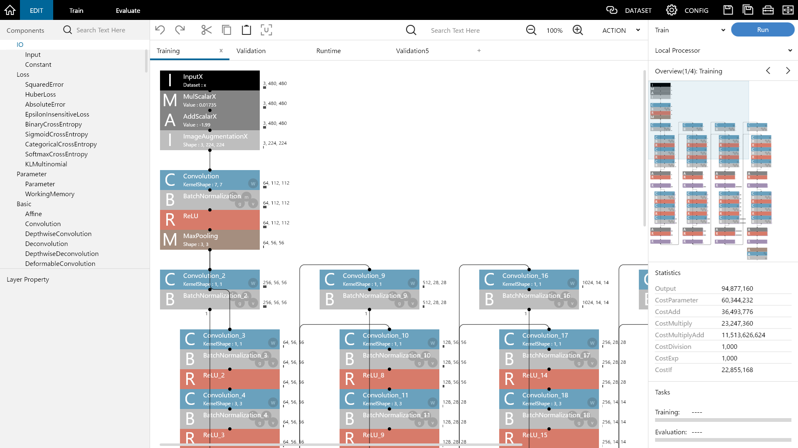

> This project has reached end of life on [April 3, 2025].
> No further development or security support is provided.

# Neural Network Console

**[日本語](document/ja/README.md)**

## Overview

Neural Network Console is a Windows-based GUI application for designing, training, and evaluating neural networks. It is an integrated development environment for Deep Learning that enables visual network design, efficient trial-and-error through neural architecture search, and comprehensive model management.

This tool is particularly suited for educational purposes for those who want to understand deep learning, and for developing small neural networks for embedded applications. It allows users to understand network designs visually while supporting high-speed training with GPU acceleration.

## Key Features

### Visual Network Design
- **Drag-and-drop interface**: Build neural networks visually by connecting layers
- **Real-time network visualization**: See your network structure and statistics instantly
- **Layer property editing**: Configure layer parameters through an intuitive interface
- **Network statistics**: Monitor computational complexity and memory usage

### Multiple Engine Support
- **NNabla**: Sony's deep learning framework optimized for efficiency
- **PyTorch**: Popular research framework with extensive model support
- **Transformers**: Pre-trained models for NLP and computer vision tasks

### Training and Evaluation
- **Local training**: Train on your machine with GPU acceleration support
- **Real-time monitoring**: Track training progress with learning curves and metrics
- **Hyperparameter management**: Configure optimizers, learning rate schedules, and more
- **Structure search**: Automated neural architecture search capabilities

### Data Management
- **Dataset integration**: Support for CSV, image, and audio datasets
- **Data preprocessing**: Built-in tools for data preparation and augmentation
- **Format support**: Import/export in multiple formats (NNP, ONNX, TensorFlow)

### Project Templates and Examples
- **Tutorial projects**: Step-by-step examples for learning
- **Sample datasets**: Pre-configured datasets including MNIST, CIFAR-10
- **Application templates**: Ready-to-use projects for common tasks:
  - Image classification and recognition
  - Object detection and semantic segmentation
  - Generative models (VAE, GAN)
  - Natural language processing
  - Audio classification
  - Time series analysis

## System Requirements

- **Operating System**: Windows 10 or later (64-bit)
- **Memory**: 8 GB RAM minimum, 16 GB recommended
- **Storage**: 10 GB available space
- **GPU**: NVIDIA GPU with CUDA support (optional, for GPU acceleration)

## Installation

1. Download the latest version from [GitHub Releases](https://github.com/sony/neural-network-console/releases)
2. Extract the 7z file and copy the extracted `neural_network_console` folder to C:\ drive
3. For GPU support, install the latest NVIDIA drivers

**Important Notes:**
- **Recommended location**: `C:\neural_network_console\` (ensures no permission issues and optimal performance)
- **Avoid**: Program Files, system directories, or paths with multibyte characters (Japanese, Chinese, Korean)
- Use separate folders for different versions to avoid conflicts

## Quick Start

For a comprehensive tutorial, please visit our [YouTube channel](https://www.youtube.com/c/NeuralNetworkConsole) for step-by-step video guides.

1. **Launch**: Double-click `neural_network_console.exe`
2. **Create Project**: Click "+New Project (nnabla)"
3. **Design Network**: Use the visual editor to build your neural network
4. **Prepare Data**: Load your dataset or use provided samples
5. **Configure Training**: Set up training parameters in the CONFIG tab
6. **Train**: Click the training button and monitor progress
7. **Evaluate**: Test your trained model on validation data

## Documentation

Access documentation directly within the application by pressing **F1** for the built-in help system.

Alternatively, you can find comprehensive PDF manuals in your installation folder:
- English manual: `manual.pdf`
- Japanese manual: `manual_ja.pdf`

Additional documentation is also available in the source repository:
- English documentation: `document/en/`
- Japanese documentation: `document/ja/`

## Sample Projects

The installation includes various sample projects to help you get started:

- **Basics**: Fundamental concepts and simple networks
- **Image Recognition**: CNN models for image classification
- **Image Generation**: GANs and VAEs for image synthesis
- **Natural Language Processing**: Text classification and sequence models
- **Object Detection**: YOLO and other detection architectures
- **Semantic Segmentation**: Pixel-level classification models
- **Audio Processing**: Audio classification and processing

## Building from Source

If you want to build Neural Network Console from source code, please refer to [BUILD.md](BUILD.md) for detailed build instructions.

## Support and Resources

- **Documentation**: Included in the installation package and accessible via F1 key
- **Sample Projects**: Pre-configured examples for various use cases
- **Community Forums**: Connect with other users and share knowledge
  - English: [Neural Network Console Users](https://groups.google.com/g/neural_network_console_users)
  - Japanese: [Neural Network Console Users JP](https://groups.google.com/g/neural_network_console_users_jp)

## License

This project is licensed under the Apache License 2.0. See the [LICENSE](LICENSE) file for details.

---

Neural Network Console provides an accessible platform for deep learning education, allowing you to design neural networks by hand and intuitively understand what happens inside them. This visual approach makes it ideal for learning the fundamental concepts of deep learning and gaining hands-on experience with neural network architecture design.
