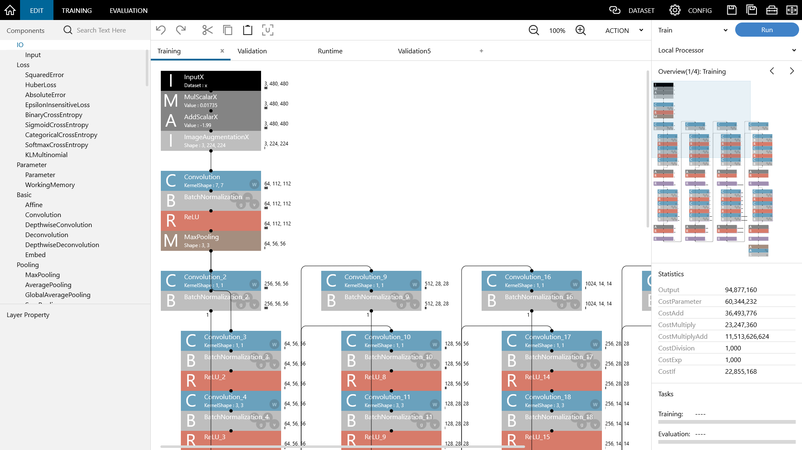

Introduction
============

What is |Console| ?
-------------------------------

|Console| is a Deep Learning integrated development environment. It allows designing of networks in research and development that use Deep Learning and significant optimization in trial-and-error based on network structure search. As the network design can be understood visually, it is also ideal for Deep Learning training applications.

|Console| is a Windows application. A training environment with a GPU also enables treatment of full-fledged Deep Learning research and development applications that handle big data.

The latest version of |Console| can be obtained from the following website.

https://dl.sony.com/
