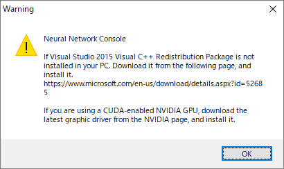
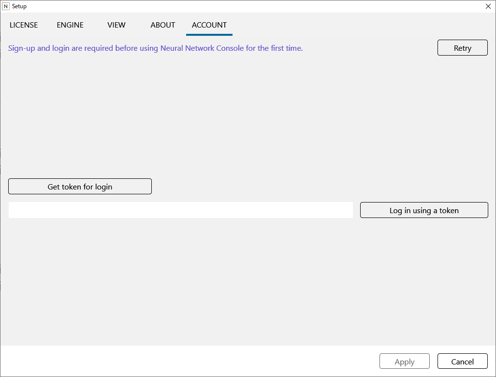
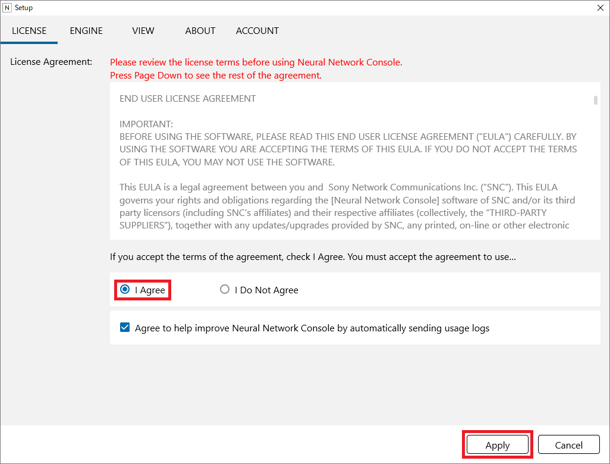
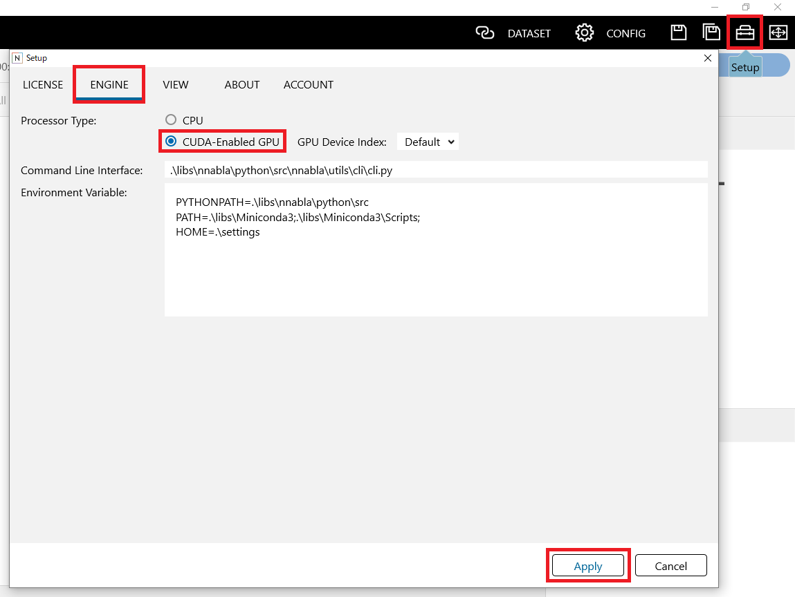

Setup and preparation
=====================

Setup
-----

1. Run neural_network_console_xxx.7z (xxx is the version name), specify the installation folder, and click Extract button.

**Notes**

|Console| must be placed in a folder whose path does not include Japanese or other 2-byte characters and that can be written to freely from applications. |Console| will not work properly in a folder that includes 2-byte characters in its path or that cannot be written to from applications (e.g., Program Files).

**Notes**

If you want to install a new version of |Console| (update it), the new version must be unzipped in a folder separate from the existing version. If the existing |Console| is overwritten, it may not run properly.

2. If Visual Studio 2015 Visual C++ Redistributable Package is not installed, download it from the following page, and install it.

https://www.microsoft.com/en-us/download/details.aspx?id=52685

3. If you are using a CUDA-enabled NVIDIA GPU with a Maxwell architecture or later and want to actually use the GPU, update the GPU driver to the latest version.

**Notes**

When using the GPU, you need to update the GPU driver. If the GPU driver is not updated to the latest version, an error will occur when training is executed on the GPU. After installing or updating |Console|, be sure to update the GPU driver to the latest version.

**Reference**

This concludes the setup if you are not using the GPU. If you are using a CUDA-enabled NVIDIA GPU, the training speed can be drastically improved by performing ":ref:`GPU environment setup <#gpu-environment-setup>`", explained later.

Running and activating |Console|
---------------------------------------------

Running |Console|
~~~~~~~~~~~~~~~~~~~~~~~~~~~~~~

1. Double-click neural_network_console.exe to run it. A pre-setup guidance is displayed. Check that the items have been taken care of, and click **OK**.

Activation
~~~~~~~~~~

To use |Console| for the first time, you need to create a |Console| account and log in. To perform these tasks, your computer must be connected to the Internet.

1. From the browser that appears after the application starts, create a |Console| account, and log in. To log in, you can use a Sony account or Google account. To redo the account creation and login, click Retry at the upper right of the ACCOUNT tab.

**Reference**

If you cannot log in correctly even after retrying, click the Get token for login button, follow the on-screen instructions to get the token, enter the obtained token in the text box to the right of the button, and click the Log in using a token button.

2. Check the license displayed on the LICENSE tab, and if you accept the terms, click I Agree to select it.

3. If you do not agree to having your usage logs collected and transmitted, click the “Agree to help improve |Console| by automatically sending usage logs” check box to unselect it.

4. Click Apply to close the setup window.

.. _#gpu-environment-setup:

GPU environment setup
---------------------

If you are using a CUDA-enabled NVIDIA GPU with Maxwell architecture or later, the learning speed can be drastically improved by performing GPU environment setup, which is explained later.

**Step 1. Enabling the GPU usage in setup window**

Click the setup button at the upper right of the window to open the Setup window.

On the ENGINE tab of the setup window, click CUDA-Enabled GPU under Processor Type to select it. Click Apply at the lower-right of the setup window to close the setup window. The GPU usage will be enabled.

**Step 2. Checking that the training using the GPU works properly**

Execute ":ref:`Training using a sample project <#training-using-a-sample-project>`” under “:ref:`Tutorial <#tutorial>`”. Execute training, and check that no errors are generated in the messages shown in the log under the Training Results tab.

Dataset preparation
-------------------

A dataset is a collection of data used for neural network training and performance evaluation.

**Reference**

Using the sample project included in |Console| Prototype enables you to try training without having to create a dataset for that time being. For instructions on how to train using the sample dataset, see ":ref:`Tutorial <#tutorial>`”. This section explains how to create a dataset on your own.

**Reference**

|Console| has a function that creates an image classification dataset based on images grouped in different folders for each image category. For details on this function, see ":ref:`Creating an image classification dataset based on images grouped in different folders for each image category <#creating-an-image-classification-dataset-based-on-images-grouped-in-different-folders-for-each-image-category>`”.

|Console| supports datasets in CSV (comma-separated text) format that |Console| defines. This dataset format supports a wide variety of formats including image input-vector output format used in image classifier training, image input-image output format used in pixel-level classification and image filter training, and matrix input-vector output format used in classifier training based on other types of arbitrary vector or matrix data.

To train on |Console|, you need to prepare two datasets: a training dataset and a validation dataset. A training dataset is used for neural network training. A validation dataset is used only for accuracy evaluation (not for training). The file format of training datasets and validation datasets is the same.

Basic structure of datasets
~~~~~~~~~~~~~~~~~~~~~~~~~~~

The dataset CSV file consists of a header in the first row and data in the subsequent rows.

ASCII and UTF-8 are supported as the encoding of the dataset CSV file.

Header
^^^^^^

Each cell in the header row indicates the variable name, dimensional index, and comment of the data in each column of the CSV file. The value of each cell in the header is expressed as variable name[_dimensional index][:comment].

The variable name represents the variable name used for identification within |Console|. You can use any character string for the variable name, but typically x is assigned to input data and y to output data. If there are multiple inputs and outputs, they are distinguished by appending a suffix number after x and y as in x1, x2, ..., and y1, y2 ... y is placed in a column to the right of x. Each of the x and y variables is placed in ascending order by suffix from the left.

The dimensional index indicates which dimension of the vector each column of the CSV corresponds to when the variable is in vector form. A dimensional index is expressed as a variable name followed by two underscores and a number. The index starts at 0. For example, a 10-dimensional vector takes on index numbers 0 to 9.

The comment indicates a simple name that represents each variable or each dimension of a variable. Unlike variable names, any character string that is easy for the user to understand can be assigned to a comment with no particular restrictions.

The name of each category for the variable that indicates the index of the category can be specified by entering a string separated by “;” at the end of the comment. For example, the following header indicates that index 0 is a dog and index 1 is a cat for the variable y.

.. list-table::
   :widths: 100

   * - y:label;dog;cat

By entering # at the beginning of the header, the entire column can be treated as a comment column. The comment column is ignored when performing processing such as training by |Console|, but it is useful for describing the explanation of each data.

**Notes**

|Console| handles spaces in CSV files as normal characters. Be careful not to insert extraneous spaces after commas or the like.

Data
^^^^

Each row from the second row indicates a data sample. For example, a CSV file containing 1001 rows (1000 rows from the second row) contains 1000 data samples. A data sample consists of multiple variables specified by the header. Each cell from the second row contains a file name or value depending on the variable type.

If the variable is image data, enter an image file name in each cell. For a file name, you can use an absolute path or a relative path from the dataset CSV file. |Console| supports image files with .png, .jpg, .jpeg, .gif, .bmp, and .tif extensions with one (grayscale) or three (RGB) color channels. Images in the core library are handled as arrays containing the number of channels, height, and width as elements of each dimension.

If the variable is waveform data, enter a waveform data file name in each cell. For a file name, you can use an absolute path or a relative path from the dataset CSV file. Currently, |Console| supports 8-bit and 16-bit waveform files with a .wav extension in an uncompressed (PCM) format. Waveforms in the core library are handled as matrices containing duration and the number of channels as elements of each dimension. In |Console|, the amplitude of a waveform is scaled down by a factor of 128 in the case of an 8-bit waveform, 32768 in the case of a 16-bit waveform, and treated as a value in the range of -1.0 to 1.0.

If the variable is a vector or matrix instead of an image or a waveform, enter the name of the data CSV file in each cell. Data CSV files are CSV files that you prepare for each data sample separately from the dataset CSV file. A data CSV file does not have a header and consists only of value cells. |Console| handles a CSV file as a matrix whose number of elements is defined by (rows, columns).

**Notes**

The number of elements of all arrays must be the same for the same variables contained in a single dataset CSV file. For example, images with different number of color channels, width, and height must not be mixed as images for the same variable x. If they are different, the resolution of all images must be consolidated in advance through preprocessing (e.g., resizing).

**Reference**

You can check whether the dataset you created is in the proper dataset format by loading the dataset on the |Console|’s Dataset tab and clicking Check Consistency on the shortcut menu. For details, see ":ref:`Checking the consistency of datasets <#checking-the-consistency-of-a-dataset>`”.

**Reference**

|Console|, while loading data in order from the beginning of the provided training dataset, performs parameter optimization based on the mini-batch gradient descent method that handles data in units of mini-batches whose size is specified by Batch Size on the Config tab. When this is done, it is ideal for the data contained in each mini-batch to be full of variations to perform optimization efficiently. We recommend the rows in a dataset CSV file be shuffled in advance.

**Reference**

In order to obtain stable neural network training, we recommend that real values be normalized in advance so that they fall roughly between -1.0 and 1.0.

Example of an image classification dataset
~~~~~~~~~~~~~~~~~~~~~~~~~~~~~~~~~~~~~~~~~~

This section explains the format of datasets for training an image classifier using the MNIST handwritten digit classification sample dataset created in the following folder.

samples\\sample_dataset\\mnist\\mnist_training.csv

(\* This file is automatically created when any of the sample project files that use the MNIST dataset is loaded. If the file is not available, a sample project such as 01_logistic_regresion is loaded. For details on loading sample projects, see ":ref:`Tutorial <#tutorial>`”.)

This dataset consists of 28 by 28 pixel monochrome images of digits and label data that indicates which digit, 0 to 9, each image represents.

.. list-table::
   :widths: 30 70
   :class: longtable

   * - x:image
     - y:label

   * - ./training/5/0.png
     - 5

   * - ./training/0/1.png
     - 0

   * - ./training/4/2.png
     - 4

   * - ./training/1/3.png
     - 1

   * - ./training/9/4.png
     - 9

   * - ./training/2/5.png
     - 2

   * - ./training/1/6.png
     - 1

   * - ./training/3/7.png
     - 3

   * - ./training/1/8.png
     - 1

   * - …
     -

In row 1, column 1, *x:image* indicates that the variable name of column 1 is *x*. In row 1, column 2, *y:label* indicates that the variable name of column 2 is *y*.

Each row from the second row indicates a single data sample. Column 1 indicates the image file name (relative path from the CSV file) of input *x* while column 2 indicates the correct category index. As there are 10 types of digits (0 to 9) for classification in the MNIST dataset, the category indexes take on values 0 to 9, which correspond to the digits “0” to “9.” For example, if the image given in column 1 is the digit “5,” category index 5, which corresponds to the digit “5,” is specified in column 2.

In the MNIST dataset, the image data file indicated by variable *x* is a 28 by 28 pixel monochrome image. As such, the matrix size of *x* on |Console| is (1,28,28). As the data indicated by variable *y* is a one-dimensional value, the array size of *y* is (1).

