.. _#tutorial:

Tutorial
========

.. _#training-using-a-sample-project:

Training using a sample project
-------------------------------

Starting |Console|
~~~~~~~~~~~~~~~~~~~~~~~~~~~~~~~

Double-click neural_network_console.exe to run it.

Opening the sample project
~~~~~~~~~~~~~~~~~~~~~~~~~~

From the list of projects that appears after the application starts, select 01_logistic_regression.sdcproj and open it.

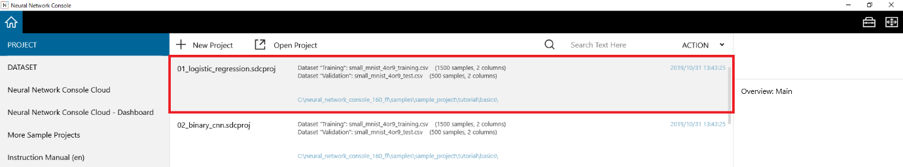

**Reference**

The MNIST dataset used in the sample project is downloaded from the following website, and the dataset file is prepared when the sample project is opened for the first time. Typically, it takes a few minutes for dataset preparation to complete.

http://yann.lecun.com/exdb/mnist/

If downloading of the dataset fails in an environment where a proxy is in use, on the ENGINE tab of the setup window, add the proxy setting in the exiting environment variables.

HTTP_PROXY=http://(HTTP proxy server address):(port number)

HTTPS_PROXY=https://(HTTPS proxy server address):(port number)

Viewing the contents of the opened sample project
~~~~~~~~~~~~~~~~~~~~~~~~~~~~~~~~~~~~~~~~~~~~~~~~~

On the EDIT tab, check that a single-layer network (logistic regression) has been loaded for performing binary classification, which determines whether each of the 1 by 28 by 28 monochrome handwritten character images (images of 4 and 9) from the MNIST handwritten character classification dataset is a 9.

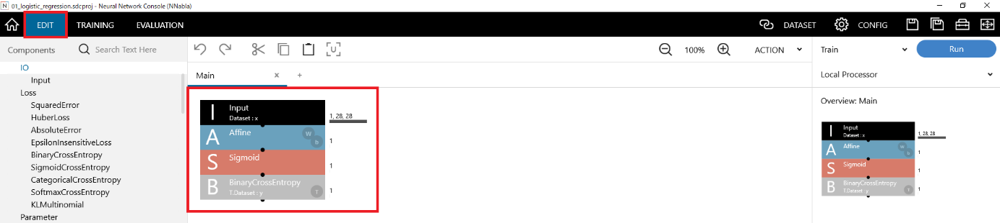

On the Dataset tab, check that small MNIST training and validation datasets (images of 4 and 9 and labels indicating whether each image is a 9 where “4” is category index 0 and “9” is category index 1) extracted from the full MNIST dataset have been loaded.

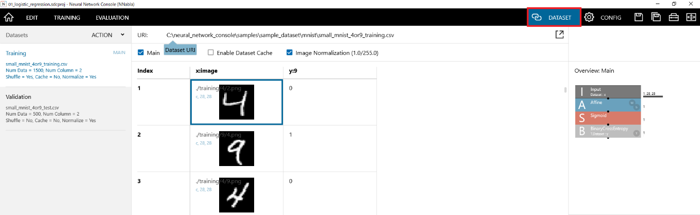

Executing training
~~~~~~~~~~~~~~~~~~

On the EDIT tab, click the Run Training button (shortcut: F5) to start the training process.

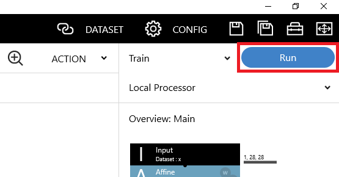

The TRAINING tab shows the progress of training and the learning curve.

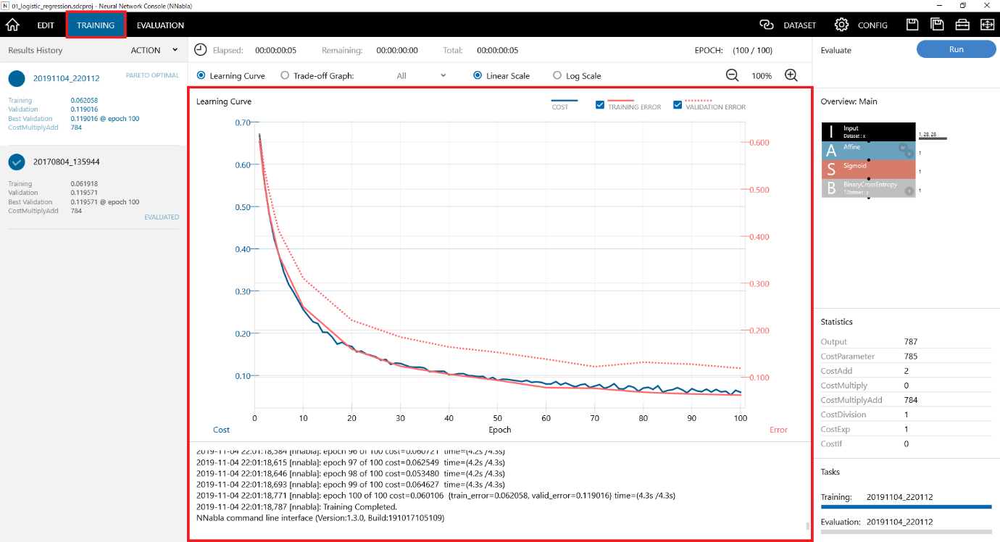

*Epoch*, the horizontal axis of the graph, indicates the number of repeated generations (epochs) of optimization. *Cost* indicates the output of the loss function at the optimization stage, and *errors* indicate the outputs of the loss functions of the training data and validation data at the end of each epoch. As shown in the figure, if the cost and error values decrease as the number of epochs increases, optimization can be considered to be running properly.

Executing evaluation
~~~~~~~~~~~~~~~~~~~~

On the TRAINING tab, click the Run Evaluation button (shortcut: F6) to start the evaluation process.

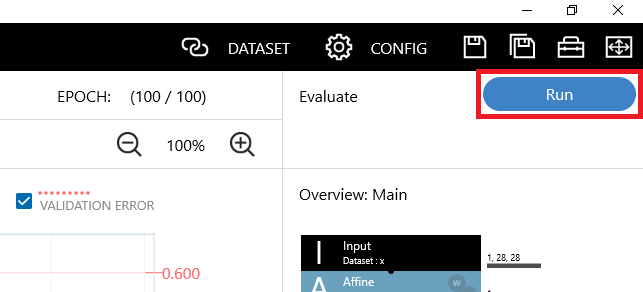
  
The EVALUATION tab shows the progress of the evaluation and the evaluation results.

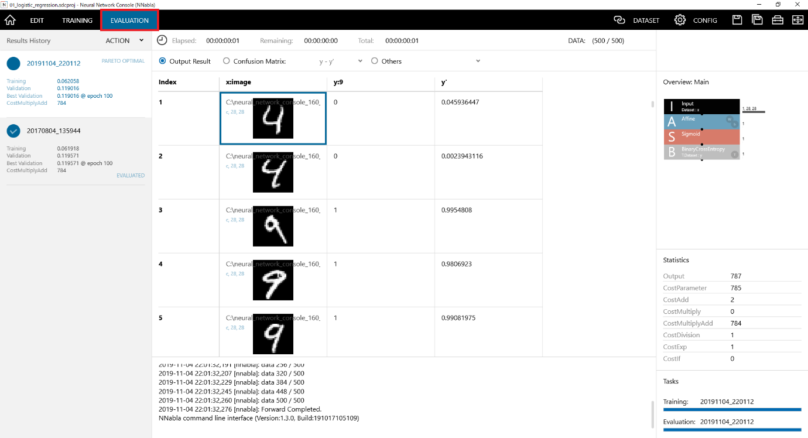

The evaluation results are shown in a table consisting of the validation dataset and an additional column (y’) containing the estimated results produced by the trained neural network. Column y’ in 01_logistic_regression.sdcproj indicates the probability of y being a 1 (the input image being a 9).

Click Confusion Matrix to show the accuracy evaluation result.

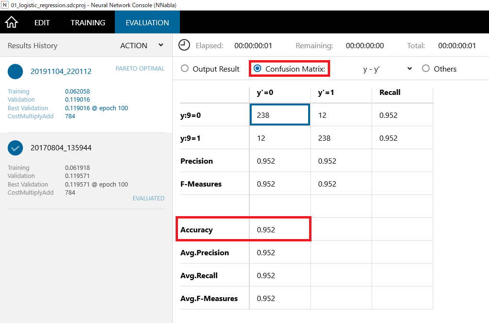

**Accuracy** indicates the classification accuracy. In this example, we can see that 4s and 9s in the validation dataset were classified with 95.2% accuracy.

Designing and training a two-layer neural network
-------------------------------------------------

Creating a new project
~~~~~~~~~~~~~~~~~~~~~~

Start |Console|, and click + New Project to create a new project.

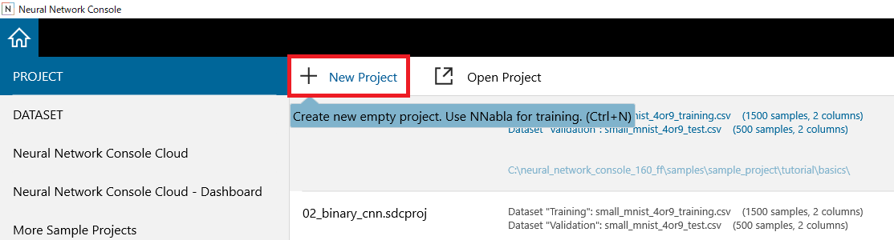
  
Assigning the datasets
~~~~~~~~~~~~~~~~~~~~~~

On the DATASET tab, click the dataset assignment button (immediately below the dataset tab button in the screen shot), and assign small_mnist_4or9_training.csv to the training dataset.

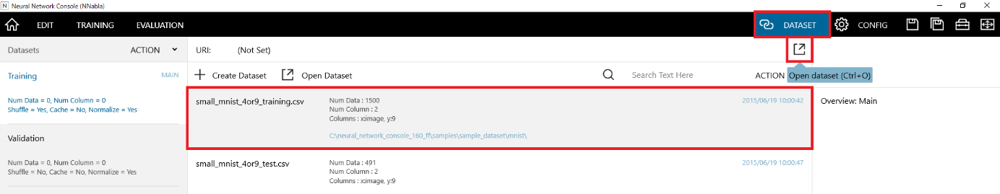
  
Click Validation under Dataset, and select the validation dataset. Like the training dataset, select small_mnist_4or9_test.csv for the validation dataset.

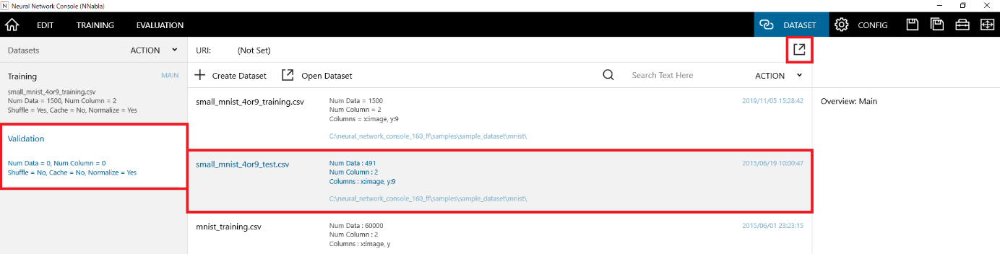
  
Designing the two-layer neural network
~~~~~~~~~~~~~~~~~~~~~~~~~~~~~~~~~~~~~~

1. Under Components at the left on the EDIT tab, double-click, Input, Affine, Tanh, Affine, Sigmoid, and BinaryCrossEntropy one by one to add layers to the network graph.

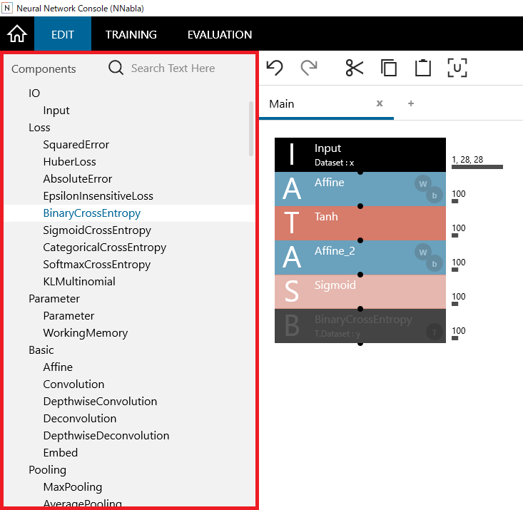

**Reference**

Affine is in the Basic category (fourth from the top), Tanh and Sigmoid is in the Activation category (sixth from the top), and BinaryCrossEntropy is in the Loss category (second from the top).

2. Click Input layer to select it. Input “1,28,28” (the default value), which is the size of variable *x* (input data), in the Size box (click and input) under Layer Property.

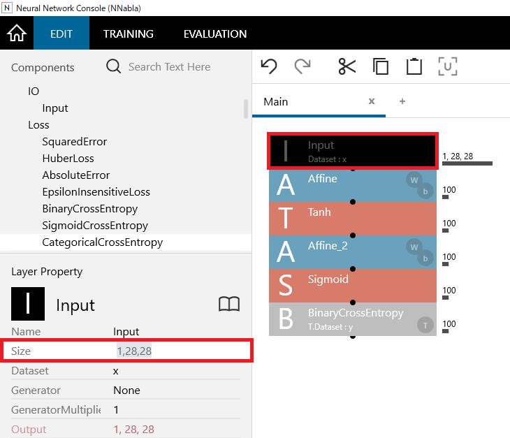

3. Click the first Affine layer to select it. Set the number of intermediate layer nodes (e.g., 100) (the default value) in the OutShape box under Layer Property.

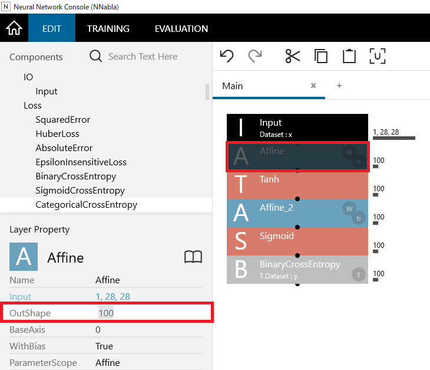

4. Click the second Affine layer to select it. Set the number of output layer nodes (1, which is the size of variable *y* (output data) in this example) in the OutShape box under Layer Property.

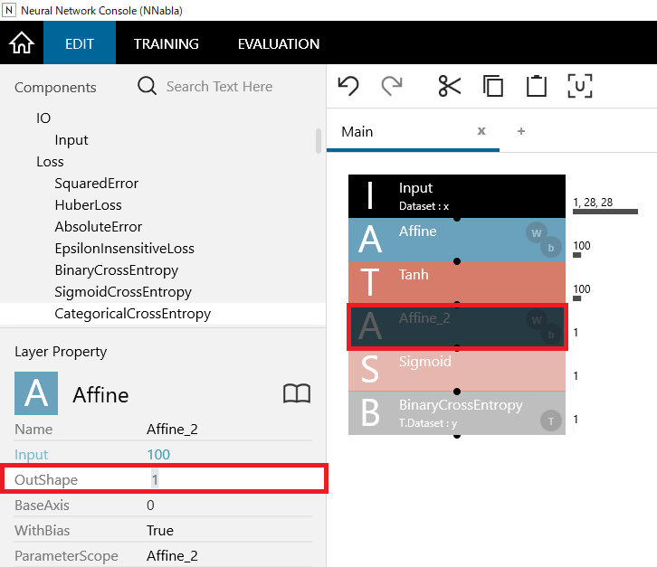

.. _executing-training-1:

Executing training
~~~~~~~~~~~~~~~~~~

Click the Run Training button (shortcut: F5). If the project is not saved, a message prompting you to save appears. When you enter a file name and save the project, training will start.

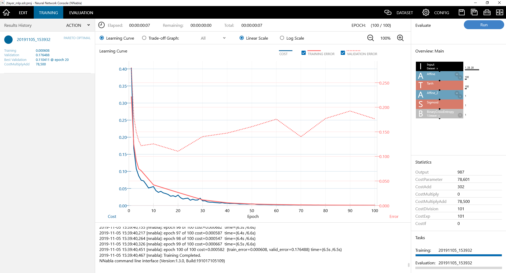

