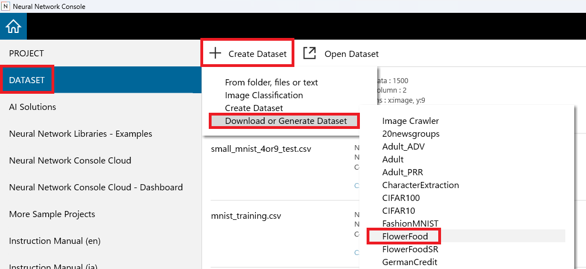
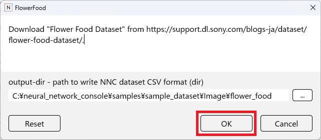
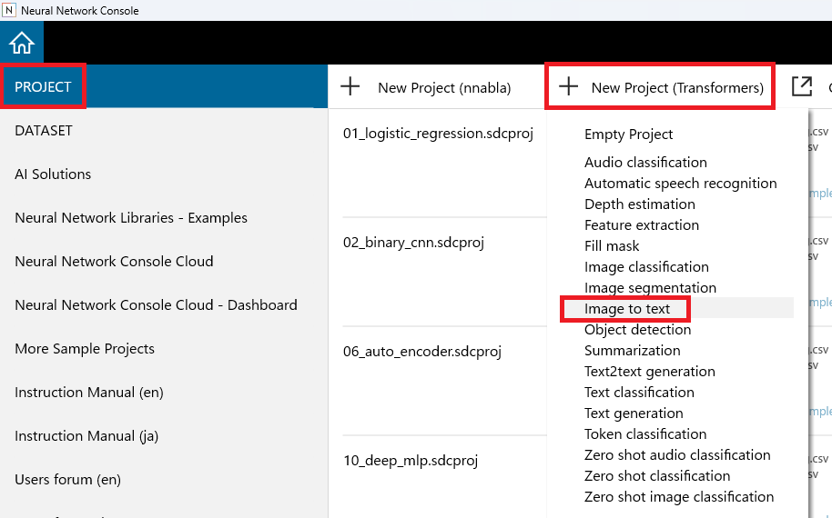
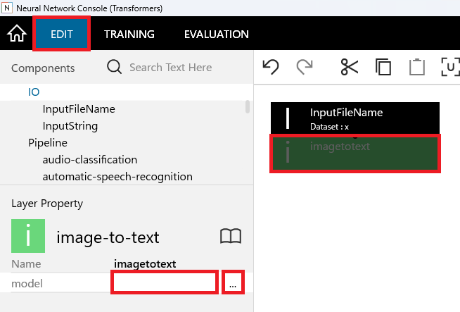
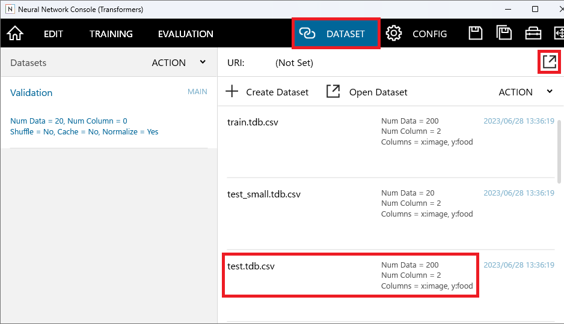
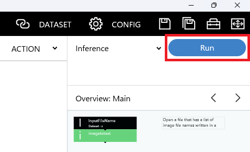

.. _#Tutorial(Transformers):

Tutorial(Transformers)
======================

Performing inference using pre-trained models published at HuggingFace.

Image to Text Conversion
------------------------

In this tutorial, we will use the FlowerFood dataset, which contains photos of food and flowers, and the Image to Text model. We will demonstrate an example of converting the images in the dataset to text.

Downloading the Flower Food Dataset
~~~~~~~~~~~~~~~~~~~~~~~~~~~~~~~~~~~

Download the Flower Food dataset to use for Image to Text execution.

On the dataset management window, click +Create Dataset, then select Download or Generate Dataset, and choose FlowerFood.

Click the OK button to download the Flower Food dataset.

Creating the Transformers Project
~~~~~~~~~~~~~~~~~~~~~~~~~~~~~~~~~

On the project window, click +New Project (Transformers), then select Image to Text.

Selecting the Model for Inference
~~~~~~~~~~~~~~~~~~~~~~~~~~~~~~~~~

Click on the imagetotext layer in the EDIT tab, then click on the right column of the model in the layer properties and click the ... button.

The HuggingFace website will open in your browser, displaying a list of pre-trained models for image to text. To see more details about each model, such as performance and license, click on the model name to display the model card.

Once you have decided on the model to use, copy the model name (e.g., nlpconnect/vit-gpt2-image-captioning) to your clipboard.

Paste the copied model name into the model property of the imagetotext layer.

**Note**

If you just want to try running the inference, you can leave the model property empty. In this case, the default model for each task will be used for inference.

However, if no model is specified, the inference result will be undefined, so you need to input the model property when using it in practice.

Specifying the Dataset for Inference
~~~~~~~~~~~~~~~~~~~~~~~~~~~~~~~~~~~~

In the DATASET tab, click the Open Dataset button and click on the test.tdb.csv from the Flower Food dataset in the list.

Running the Inference
~~~~~~~~~~~~~~~~~~~~~

Click the Run button on the right of the Inference at the top right of the screen to execute the inference.

Follow the message prompting to save the project and save it with an appropriate file name.

After a short wait, the results of the inference will be displayed in the Evaluation tab.

**Note**

The first time you run a model, it will require time for the model to be downloaded, so it may take a long time until the inference is complete.

If the GPU memory you are using is not sufficient or additional library installation is required, the inference may fail.

To install additional libraries, launch the command prompt by selecting More Tools, Command Prompt from the right-click menu in the training results list.

You can now install additional Python libraries by typing "python -m pip install (name of the library you want to install)".

**Note**

Most post-processing plugins do not support Transformers.
