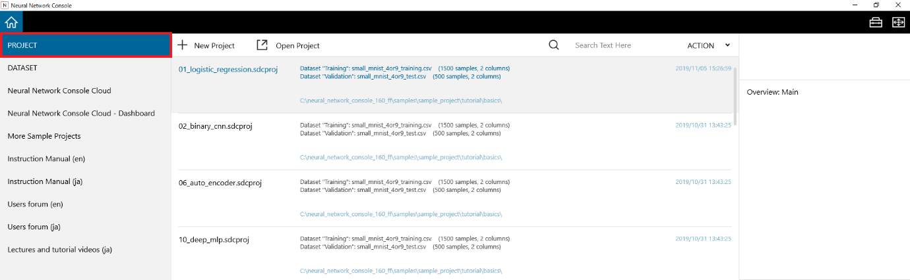

Project selection window
========================

|Console| manages a series of tasks, namely training and evaluation, in Deep Learning development as projects. A project stores the network structure used for training, the datasets, the parameters, and the training and evaluation results.

In the project selection window, you can create a new project or open a project you used in the past.

Using the project selection window
----------------------------------

Creating a new empty project
~~~~~~~~~~~~~~~~~~~~~~~~~~~~

Click +New Project (nnabla).

Or, press Ctrl+N on the keyboard.

A new empty project is created, and the project window appears. For instructions on how to use the project window, see ":ref:`Using the project window <#using-the-project-window>`”.

Creating a new project for inference using a pre-trained model
~~~~~~~~~~~~~~~~~~~~~~~~~~~~~~~~~~~~~~~~~~~~~~~~~~~~~~~~~~~~~~

1. Click on "+ New Project (Transformers)".

2. From the popup menu, select the type of inference project you want to create.

.. list-table::
   :widths: 30 70
   :class: longtable

   * - Empty project
     - Create an empty inference project.

   * - Audio classification
     - Create a project for audio waveform classification.

   * - Automatic speech recognition
     - Create a project for speech recognition.

   * - Depth estimation
     - Create a project for image depth estimation.

   * - Feature extraction
     - Create a project for feature extraction from input data.

   * - Fill mask
     - Create a project to predict words in masked parts <mask> of input text.

   * - Image classification
     - Create a project for image classification.

   * - Image segmentation
     - Create a project for semantic image segmentation.

   * - Image to text
     - Create a project for image captioning.

   * - Object detection
     - Create a project for object detection in images.

   * - Summarization
     - Create a project for text summarization.

   * - Text2text generation
     - Create a project to generate text based on input text.

   * - Text classification
     - Create a project for text classification.

   * - Text generation
     - Create a project for text generation following input string.

   * - Token classification
     - Create a project for token classification in text.

   * - Zero shot audio classification
     - Create a project for audio waveform classification to classes specified with text.

   * - Zero shot classification
     - Create a project for text classification to classes specified with text.

   * - Zero shot image classification
     - Create a project for image classification to classes specified with text.

A new empty inference project is created, and the project window appears. For instructions on how to use the project window, see ":ref:`Using the project window <#using-the-project-window>`”.

Opening a project file stored on the disk
~~~~~~~~~~~~~~~~~~~~~~~~~~~~~~~~~~~~~~~~~

1. Click Open Project.

..

   Or, press Ctrl+O on the keyboard.

2. Select the project file (*.sdcproj file) you want to open.

The selected project file opens, and the project window appears.

Opening a project file you used in the past
~~~~~~~~~~~~~~~~~~~~~~~~~~~~~~~~~~~~~~~~~~~

Click a project file you used in the past shown in the project selection window.

Or, move the cursor to the project file, and press Enter on the keyboard.

The selected project file opens, and the project window appears.

Filtering the project files you used in the past
~~~~~~~~~~~~~~~~~~~~~~~~~~~~~~~~~~~~~~~~~~~~~~~~

Enter a search string in the text box to the right of the magnifying glass icon at the upper right of the project selection window.

Only the projects that contain the specified string in the file name or other descriptions are shown.

**Reference**

You can specify multiple search strings by separating them with a space. Enclose search strings that include spaces with double quotations.

Opening a folder containing project files you used in the past
~~~~~~~~~~~~~~~~~~~~~~~~~~~~~~~~~~~~~~~~~~~~~~~~~~~~~~~~~~~~~~

Right-click a project file you used in the past to open a shortcut menu, and click Open File Location.

Removing project files you used in the past from the project selection window
~~~~~~~~~~~~~~~~~~~~~~~~~~~~~~~~~~~~~~~~~~~~~~~~~~~~~~~~~~~~~~~~~~~~~~~~~~~~~

Right-click a project file you used in the past to open a shortcut menu, and click Remove.

**Reference**

The project file you remove is only removed from the project selection window, not from the disk.

**Reference**

A project file you removed will reappear in the project selection window if you open it again from Open Project.

Collectively removing project files you used in the past but are no longer available on the disk from the project selection window
~~~~~~~~~~~~~~~~~~~~~~~~~~~~~~~~~~~~~~~~~~~~~~~~~~~~~~~~~~~~~~~~~~~~~~~~~~~~~~~~~~~~~~~~~~~~~~~~~~~~~~~~~~~~~~~~~~~~~~~~~~~~~~~~~~

1. Right-click a project file to open a shortcut menu, and click Remove Dead Links.

2. When a dialog box appears asking you to confirm the number of project files to be removed, click Yes.

