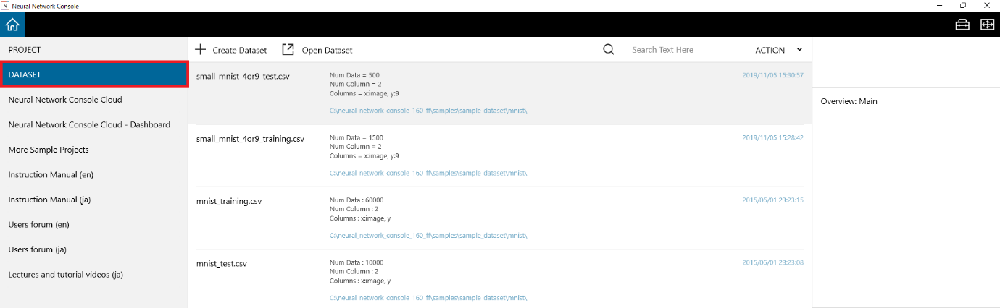
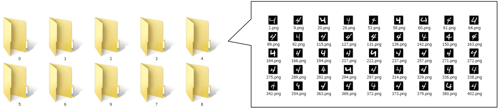
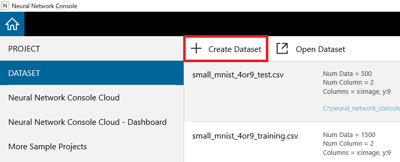
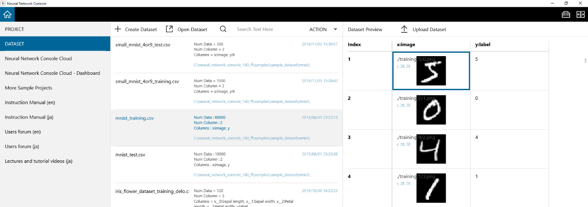
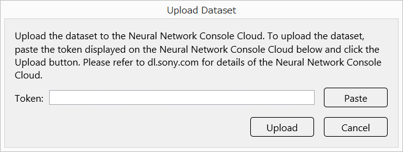

Dataset management window
=========================

On the dataset management window, you can create or add datasets and preview datasets you used in the past.

Using the dataset management window
-----------------------------------

.. _#creating-an-image-classification-dataset-based-on-images-grouped-in-different-folders-for-each-image-category:

Creating an image classification dataset based on images grouped in different folders for each image category
~~~~~~~~~~~~~~~~~~~~~~~~~~~~~~~~~~~~~~~~~~~~~~~~~~~~~~~~~~~~~~~~~~~~~~~~~~~~~~~~~~~~~~~~~~~~~~~~~~~~~~~~~~~~~

1. Have the image files grouped in folders ready.

2. In the window that appears after the application starts, select DATASET to open the dataset management window.

3. Click Create Dataset.

..

   Or, press Ctrl+N on the keyboard.

4. Click Image Classification.

An image classification dataset creation dialog box appears.

   .. image:: figures/image28.png
      :align: center

4. Specify the settings for creating the dataset.

.. list-table::
   :widths: 30 70
   :class: longtable

   * - Source Dir
     - Specify the folder containing the folders with grouped images.

   * - Output Dir
     - Specify the folder to output the created dataset to.

   * - Shaping Mode
     -
        If the aspect ratio of the images in each folder is different from the aspect ratio indicated by the specified size, specify the method for aligning the aspect ratio.

        Trimming: The edges are trimmed to align the aspect ratio.

        Padding: The edges are padded with zeros to align the aspect ratio.

        Resize: The image is resized to the specified size, ignoring the aspect ratio.

   * - Output Color Ch
     - Set the number of color channels in the output images to 1 (monochrome) or 3 (RGB color).

   * - Output Width
     - Specify the output image width.

   * - Output Height
     - Specify the output image height.

   * - Shuffle the order of the data
     - Sets the data order to shuffle (ON by default).

   * - File Name
     - Specify the name of the dataset CSV file to be created.

   * - Ratio (%)
     -
        Set the ratio of the data used in the dataset CSV file to be created.

        The total of the ratios of File 1 and File 2 must be 100 (%).

5. Click Apply to start creating the dataset.

Creating other datasets with a preprocessing plugin
~~~~~~~~~~~~~~~~~~~~~~~~~~~~~~~~~~~~~~~~~~~~~~~~~~~

1. In the window that appears after the application starts, select DATASET to open the dataset management window.

2. Click Create Dataset.

..

   Or, press Ctrl+N on the keyboard.

3. Click the name of the plugin you want to use for preprocessing from "Create Dataset" or "Download or Generate Dataset". The plugin dialog box appears.

4. Enter the parameters for the plugin.

5. Click OK to run the plugin.

**Reference**

For details on each plugin, see the Plugin Reference.

To directly create a dataset with only one x column
~~~~~~~~~~~~~~~~~~~~~~~~~~~~~~~~~~~~~~~~~~~~~~~~~~~

Create a dataset CSV file that uses the text of each line entered in the text box as the value of variable x.

1. In the window that appears after the application starts, select DATASET to open the dataset management window.

2. Click Create Dataset.

..

   Or, press Ctrl+N on the keyboard.

3. Click From folder, files or text.

4. Enter the data for each row of the dataset directly into the text box.

..

   To add file names of files contained in a folder to the text box, click "From Folder...", specify the top-level folder containing the files, and select Open.

   To add the filenames of one or more files to the text box, click "From Files...", select the files you want to add (you can select more than one), and select Open.

5. Click "Save As..." at the bottom right of the window to save the contents of the text box as a dataset CSV file.

Opening a dataset stored on the disk
~~~~~~~~~~~~~~~~~~~~~~~~~~~~~~~~~~~~

1. Click Open Dataset.

..

   Or, press Ctrl+O on the keyboard.

2. Select the dataset file (.csv file) you want to open.

Previewing the datasets you used in the past
~~~~~~~~~~~~~~~~~~~~~~~~~~~~~~~~~~~~~~~~~~~~

Click a dataset you used in the past shown in the dataset management window.

Or, use the up and down arrow keys to select the dataset.

A preview of the selected dataset appears on the right side of the window.

Filtering the datasets you used in the past
~~~~~~~~~~~~~~~~~~~~~~~~~~~~~~~~~~~~~~~~~~~

Enter a search string in the text box next to the magnifying glass icon at the upper right of the dataset management window.

Only the datasets that contain the specified string in the file name or description are shown.

**Reference**

You can specify multiple search strings by separating them with a space. Enclose search strings that include spaces with double quotations.

Opening a folder containing datasets you used in the past
~~~~~~~~~~~~~~~~~~~~~~~~~~~~~~~~~~~~~~~~~~~~~~~~~~~~~~~~~

Right-click a dataset you used in the past to open a shortcut menu, and click Open File Location.

Removing datasets you used in the past from the dataset management window
~~~~~~~~~~~~~~~~~~~~~~~~~~~~~~~~~~~~~~~~~~~~~~~~~~~~~~~~~~~~~~~~~~~~~~~~~

Right-click a dataset you used in the past to open a shortcut menu, and click Remove.

**Reference**

The dataset you remove is only removed from the dataset management window, not from the disk.

**Reference**

A dataset you removed will reappear in the dataset management window if you open it again from Open Dataset.

Uploading a dataset to the |Console| Cloud
~~~~~~~~~~~~~~~~~~~~~~~~~~~~~~~~~~~~~~~~~~~~~~~~~~~~~~~

1. From the datasets shown in the dataset management window, click the dataset you want to upload.

Or, use the up and down arrow keys to select the dataset.

2. In the dataset preview at the right side of the window, click Upload Dataset. A Upload Dataset dialog box appears.

3. Copy the token displayed in the upload window of the |Console| Cloud, and click Paste to paste it in the Token box.

4. Click Upload.

