Project window
==============

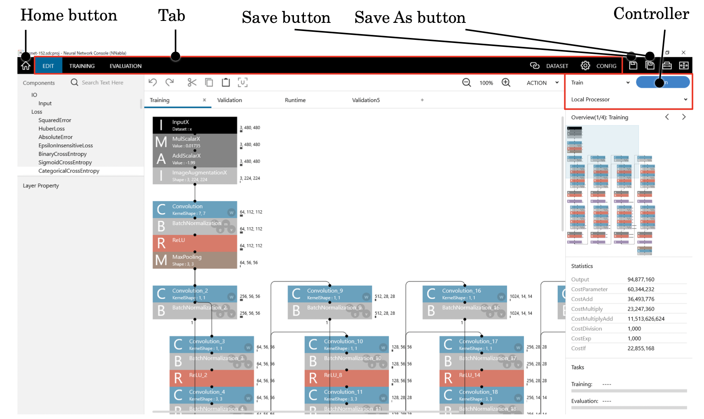

The project window is used to perform a sequence of Deep Learning development tasks from project editing, training, to evaluation.

.. _#using-the-project-window:

Using the project window
------------------------

Returning to the project selection window
~~~~~~~~~~~~~~~~~~~~~~~~~~~~~~~~~~~~~~~~~

Click the home button.

Or, press Ctrl+W on the keyboard.

**Notes**

When the project has been edited, a message box appears asking whether you want to save the project.

**Notes**

When training is in progress, a message box appears asking whether you want to stop the training.

Saving (overwriting) the project you are editing
~~~~~~~~~~~~~~~~~~~~~~~~~~~~~~~~~~~~~~~~~~~~~~~~

Click the Save button.

Or, press Ctrl+S on the keyboard.

**Notes**

When saving a project for the first time, the Save button works the same as the Save As button.

Saving the project you are editing in a new project file
~~~~~~~~~~~~~~~~~~~~~~~~~~~~~~~~~~~~~~~~~~~~~~~~~~~~~~~~

1. Click the Save As button.

2. Specify the save destination project file (*.sdcproj file).

Editing the network structure of a neural network used for training
~~~~~~~~~~~~~~~~~~~~~~~~~~~~~~~~~~~~~~~~~~~~~~~~~~~~~~~~~~~~~~~~~~~

Click the EDIT tab.

The edit tab appears. For instructions on how to use the edit tab, see ":ref:`Using the edit tab <#using-the-edit-tab>`”.

Specifying and viewing the training dataset
~~~~~~~~~~~~~~~~~~~~~~~~~~~~~~~~~~~~~~~~~~~

Click the DATASET tab.

The Dataset tab appears. For instructions on how to use the Dataset tab, see ":ref:`Using the Dataset tab <#using-the-dataset-tab>`”.

Changing the training parameter settings
~~~~~~~~~~~~~~~~~~~~~~~~~~~~~~~~~~~~~~~~

Click the CONFIG tab.

The Config tab appears. For instructions on how to use the Config tab, see ":ref:`Using Global Config on the Config tab <#using-global-config-on-the-config-tab>`”.

Executing neural network training
~~~~~~~~~~~~~~~~~~~~~~~~~~~~~~~~~

On the EDIT tab, click Run on the controller.

Or, press F5 on the keyboard.

Neural network training starts, and the Training Results tab for viewing the progress appears. For instructions on how to use the Training Results tab, see ":ref:`Using the Training Results tab <#using-the-training-results-tab>`”.

**Notes**

If training cannot be started properly such as when there is a problem with the network structure you are editing or when datasets are not specified correctly, an error message will appear. You can move to the error location by double-clicking the error message line.

Scheduling a training task with different settings while neural network training is in progress
~~~~~~~~~~~~~~~~~~~~~~~~~~~~~~~~~~~~~~~~~~~~~~~~~~~~~~~~~~~~~~~~~~~~~~~~~~~~~~~~~~~~~~~~~~~~~~~

On the EDIT tab, click Schedule on the controller.

Or, press F5 on the keyboard.

A training task with the current settings is scheduled on the Training Results tab. The scheduled training task is executed as soon as the current training session is completed.

Viewing the training progress and past training results
~~~~~~~~~~~~~~~~~~~~~~~~~~~~~~~~~~~~~~~~~~~~~~~~~~~~~~~

Click the TRAINING tab.

The Training Results tab appears. For a description of the Training Results tab, see ":ref:`Using the Training Results tab <#using-the-training-results-tab>`".

Performing accuracy evaluation using a neural network trained in the past
~~~~~~~~~~~~~~~~~~~~~~~~~~~~~~~~~~~~~~~~~~~~~~~~~~~~~~~~~~~~~~~~~~~~~~~~~

Click the EVALUATION tab.

The Evaluation tab appears. For a description of the Evaluation tab, see ":ref:`Using the Evaluation tab <#using-the-evaluation-tab>`".

.. _#using-the-edit-tab:

Using the edit tab
------------------

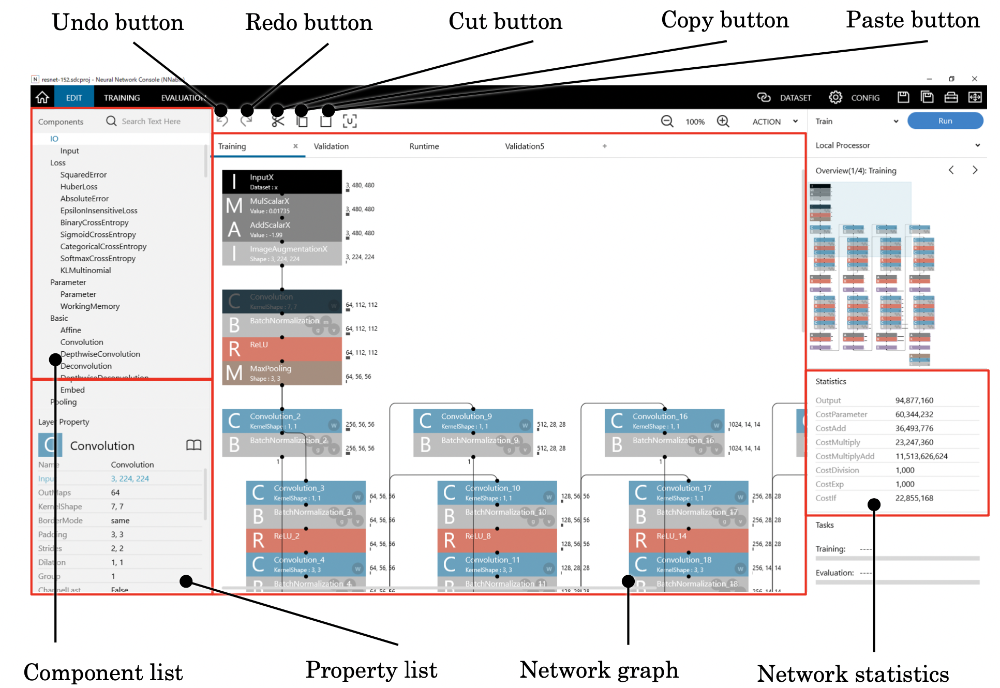

The edit tab is used to edit the network structure of a neural network used for training.

|Console| expresses neural network structures using a combination of predefined components (functions) called layers.

Adding a new layer to the network graph
~~~~~~~~~~~~~~~~~~~~~~~~~~~~~~~~~~~~~~~

Drag the layer you want to add to the network graph from the component list on the left side of the edit tab.

Or, double-click the layer on the component list.

Or, click the layer on the component list or select it using the up and down arrow keys, and then press Enter on the keyboard.

Or, click the layer on the component list or select it using the up and down arrow keys, and then double-click the network graph.

**Reference**

If you add a layer by double-clicking on the component list or by pressing Enter when a layer is selected on the network graph, the new layer is automatically linked to the selected layer.

Selecting a single layer
~~~~~~~~~~~~~~~~~~~~~~~~

Click a layer on the network graph.

Or, click the network graph, and then move to the target layer using the arrow keys.

Selecting several layers
~~~~~~~~~~~~~~~~~~~~~~~~

While holding down the Ctrl key, click layers on the network graph.

Or, select the first layer, and then use the arrow keys while holding down the Ctrl key.

Or, click an empty area on the network graph, and drag to select a range of layers.

Selecting all layers
~~~~~~~~~~~~~~~~~~~~

Right-click the network graph to open a shortcut menu, and click Select All.

Or, press Ctrl+A on the keyboard.

Inverting the layer selection
~~~~~~~~~~~~~~~~~~~~~~~~~~~~~

Right-click the network graph to open a shortcut menu, and click Inverse Layer Selection.

Clearing the layer selection
~~~~~~~~~~~~~~~~~~~~~~~~~~~~

Click an area that is not a layer or link on the network graph.

Or, right-click the network graph to open a shortcut menu, and click Clear Selection.

Or, press Esc on the keyboard.

Moving the layer coordinates
~~~~~~~~~~~~~~~~~~~~~~~~~~~~

1. Select the layer you want to move.

2. Drag the layer to move it.

Deleting a layer
~~~~~~~~~~~~~~~~

1. Select the layer you want to delete.

2. Right-click the network graph to open a shortcut menu, and click Delete.

..

   Or, press Delete on the keyboard.

**Notes**

When you delete a layer, the link connected to the layer is also deleted.

Inserting a new layer at an existing layer position
~~~~~~~~~~~~~~~~~~~~~~~~~~~~~~~~~~~~~~~~~~~~~~~~~~~

1. Click the layer on the component list or select it using the up and down arrow keys.

2. On the network graph, select the layer where you want to insert the selected layer into.

3. Press Insert on the keyboard.

Deleting a layer while retaining the link structure
~~~~~~~~~~~~~~~~~~~~~~~~~~~~~~~~~~~~~~~~~~~~~~~~~~~

1. Select the layer you want to delete.

2. Press the Backspace key on the keyboard.

Connecting (linking) two layers
~~~~~~~~~~~~~~~~~~~~~~~~~~~~~~~

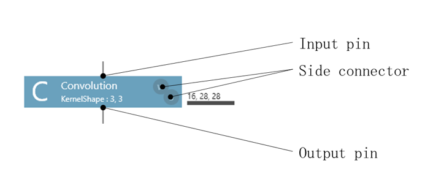

On the network graph, drag the link destination layer just below the link source layer.

Or, drag the output pin of the link source layer to the input pin or side connector of the link destination layer.

Or, select the link source layer, and then while holding down the Shift key, click the link destination layer.

Changing the link destination
~~~~~~~~~~~~~~~~~~~~~~~~~~~~~

On the network graph, drag the link you want to change.

**Reference**

You can change the link source layer by dragging the end of the link on the output pin side and the link destination layer by dragging the end of the link on the input pin side.

Selecting a link
~~~~~~~~~~~~~~~~

Click a link on the network graph.

Deleting a link
~~~~~~~~~~~~~~~

1. Select the link you want to delete.

2. Right-click the network graph to open a shortcut menu, and click Delete.

..

   Or, press Delete on the keyboard.

Undoing past edits
~~~~~~~~~~~~~~~~~~

Click the Undo button at the top of the window.

Or, right-click the network graph to open a shortcut menu, and click Undo.

Or, press Ctrl+Z on the keyboard.

**Reference**

|Console| allows you to undo up to the last 100 edits.

Redoing edits that have been undone
~~~~~~~~~~~~~~~~~~~~~~~~~~~~~~~~~~~

Click the Redo button at the top of the window.

Or, right-click the network graph to open a shortcut menu, and click Redo.

Or, press Ctrl+Y on the keyboard.

Or, press Ctrl+Shift+Z on the keyboard.

**Notes**

If you perform any edits other than undo, you will not be able to redo past edits.

Cutting a layer into the clipboard
~~~~~~~~~~~~~~~~~~~~~~~~~~~~~~~~~~

1. Select the layer you want to cut.

2. Click the Cut button at the top of the window.

..

   Or, right-click the network graph to open a shortcut menu, and click Cut.

   Or, press Ctrl+X on the keyboard.

Copying a layer into the clipboard
~~~~~~~~~~~~~~~~~~~~~~~~~~~~~~~~~~

1. Select the layer you want to copy.

2. Click the Copy button at the top of the window.

..

   Or, right-click the network graph to open a shortcut menu, and click Copy.

   Or, press Ctrl+C on the keyboard.

Pasting a layer from the clipboard
~~~~~~~~~~~~~~~~~~~~~~~~~~~~~~~~~~

Click the Paste button at the top of the window.

Or, right-click the network graph to open a shortcut menu, and click Paste.

Or, press Ctrl+V on the keyboard.

Duplicating a selected layer
~~~~~~~~~~~~~~~~~~~~~~~~~~~~

Press Ctrl+D on the keyboard.

Or, while holding down Alt on the keyboard, drag the selected layer.

Searching a layer containing a specific character string
~~~~~~~~~~~~~~~~~~~~~~~~~~~~~~~~~~~~~~~~~~~~~~~~~~~~~~~~

Enter the layer name in the search bar above the network graph.

A layer that contains the entered character string in the component name or layer name is selected.

Searching the next layer containing a specific character string
~~~~~~~~~~~~~~~~~~~~~~~~~~~~~~~~~~~~~~~~~~~~~~~~~~~~~~~~~~~~~~~

With the cursor placed over the search bar above the network graph, press Enter on the keyboard.

Or, press F3 on the keyboard.

Searching the previous layer containing a specific character string
~~~~~~~~~~~~~~~~~~~~~~~~~~~~~~~~~~~~~~~~~~~~~~~~~~~~~~~~~~~~~~~~~~~

Press Shift+F3 on the keyboard.

Replacing a layer with another layer
~~~~~~~~~~~~~~~~~~~~~~~~~~~~~~~~~~~~

1. Right-click the network graph to open a shortcut menu, and click Replace.

2. Select the layer to be replaced in From, and the layer to be replaced with in To.

3. To replace the layer in all the networks contained in a project, select All for Target network, and to replace the layer only in the network currently displayed, select Current.

4. To replace all the layers contained in the network specified in Target network, select All for Target layer, and to replace only the layer(s) currently selected, select Selection.

5. Click the Replace button to execute the replacement.

Automatically arranging layers
~~~~~~~~~~~~~~~~~~~~~~~~~~~~~~

Right-click the network graph to open a shortcut menu, and click Arrange Layers.

Clearing all parameter files in networks
~~~~~~~~~~~~~~~~~~~~~~~~~~~~~~~~~~~~~~~~

Right-click the network graph to open a shortcut menu, and click Clear all parameter files. The properties that specify the parameter file, such as W.File or b.File in Affine or Convolution will be cleared at once.

Moving the display range of the network graph
~~~~~~~~~~~~~~~~~~~~~~~~~~~~~~~~~~~~~~~~~~~~~

Drag the scroll bar shown at the right and at the bottom of the network graph.

Or, use the mouse wheel. Rotate only the mouse wheel to scroll vertically. Rotate the mouse wheel while holding down Shift to scroll horizontally.

Zooming the network graph display
~~~~~~~~~~~~~~~~~~~~~~~~~~~~~~~~~

1. Click the network graph.

2. While holding down Ctrl, rotate the mouse wheel.

..

   Or, while holding down Ctrl, press the plus (+) or minus (-) key.

Or, right-click the network graph to open a shortcut menu, and click Zoom and then Zoom In or Zoom Out.

Resetting the zoom ratio of the network graph display to default
~~~~~~~~~~~~~~~~~~~~~~~~~~~~~~~~~~~~~~~~~~~~~~~~~~~~~~~~~~~~~~~~

1. Click the network graph.

2. While holding down Ctrl, press the 0 (zero) key.

Or, right-click the network graph to open a shortcut menu, and click Zoom and then Default.

Editing layer properties
~~~~~~~~~~~~~~~~~~~~~~~~

1. Select one or more layers that you want to edit the properties of.

2. Of the properties shown in the Property list, click the value of the property you want to edit.

..

   Or, click the Property list, move to the target property using the arrow keys, and press Enter.

3. For properties that require you to enter a string, type the value from the keyboard. For properties that you select from the available options, select the value using the mouse or the up and down arrow keys.

4. Editing ends when you move to a different editing task, press Enter, or press ESC.

For property values, you can specify the following values in addition to normal values and character strings.

.. list-table::
   :class: longtable

   * - Property value
     - Description
     - Examples

   * - \* (asterisk)+another property name
     - The value of another property in the same layer is copied and used.
     - -  Set the OutShape property of the Affine layer to “*Input” in order to set the output size to the same size as the input.

   * - \* (asterisk)+argument layer name
     - The Value property value in the argument layer with the specified name in the current network is copied and used.
     - -  Prepare an argument layer named ConvKernel, and set Kernel Shape of multiple convolution layers to “*ConvKernel”. This allows KernelShape of the multiple convolution layers to be specified by editing the Value property of the argument layer.

   * - \*Default
     - The default value of the property is used.
     - -  Use the value specified by the Value property of the Argument layer in the Unit as the property value of the Unit layer.

   * - Expression, comma-separated expression
     -
        Arithmetic operations and arithmetic operations constructed with parentheses can be used.

        Other properties of the same layer and argument layers can be used as variables in expressions.

        When the variable is an array, the bracket operator can be used to specify the index of an array element.
     -
        -  Set OutMaps of a convolution layer to “Input[0]*2” in order to make OutMaps twice the number of input maps.

        -  Set Padding of a convolution layer to “KernelShape[0]/2,KernelShape[1]/2” in order to make Padding half KernelShape.

**Reference**

Properties that have been changed from the default values will appear in bold, and properties with a value other than the normal numerical value or character string will appear in blue.

**Notes**

Edits are applied immediately when you enter a value (they are applied before you press Enter). If you want to restore the value to its original value, use the undo function.

**Notes**

Editable properties appear dark black. Other property values are automatically calculated based on the layer link status or other property values.

**Notes**

A warning mark appears on the right side of the Property list for properties set to invalid values or those that are in conflict as a result of linking to other layers. In addition, on the Network graph, a warning mark appears in the upper right of a layer containing properties in conflict. In such circumstances, review the layer links, or correct the property values.

Editing the properties of multiple layers collectively
~~~~~~~~~~~~~~~~~~~~~~~~~~~~~~~~~~~~~~~~~~~~~~~~~~~~~~

Edit the properties while multiple layers are selected.

When you enter a value in a property, the values of the properties with the same name on all selected layers will be changed.

Changing the column width of the property list
~~~~~~~~~~~~~~~~~~~~~~~~~~~~~~~~~~~~~~~~~~~~~~

Adjust the width of the columns by dragging the column boundaries of the property list left or right.

Creating layer units
~~~~~~~~~~~~~~~~~~~~

1. Select one or more layers you want to create a unit of.

2. Click Create Unit. A Create Unit dialog box appears.

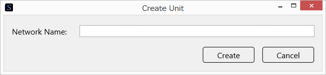

3. Enter the name of the unit network, and click Create.

Viewing the amount of memory and calculation each layer needs
~~~~~~~~~~~~~~~~~~~~~~~~~~~~~~~~~~~~~~~~~~~~~~~~~~~~~~~~~~~~~

1. Select the layer you want to view the needed amount of memory and calculation for.

2. View the following values in the Property list.

.. list-table::
   :widths: 30 70
   :class: longtable

   * - Item
     - Description

   * - CostParameter
     - Total number of parameters that the layer has

   * - CostAdd
     - Number of additions that the layer needs for calculation

   * - CostMultiply
     - Number of multiplications that the layer needs for calculation

   * - CostMultiplyAdd
     - Number of multiplications and additions that the layer needs for calculation

   * - CostDivision
     - Number of divisions that the layer needs for calculation

   * - CostExp
     - Number of exponentiations that the layer needs for calculation

   * - CostIf
     - Number of conditional branching decisions that the layer needs for calculation

**Reference**

Items that never need any amount of memory or calculation do not appear in the Property list.

Viewing the description of layers on the Web
~~~~~~~~~~~~~~~~~~~~~~~~~~~~~~~~~~~~~~~~~~~~

1. Select the layer you want to view the description of.

2. Click the description icon (an icon of a book) in the upper right of the property list.

..

   Or, press Ctrl+F1 on the keyboard.

The browser starts, and a page containing the description of the selected layer opens.

Viewing the statistics of the entire network
~~~~~~~~~~~~~~~~~~~~~~~~~~~~~~~~~~~~~~~~~~~~

View the network statistics at the right on the edit tab.

Network statistics show the following statistics.

.. list-table::
   :widths: 30 70
   :class: longtable

   * - Item
     - Description

   * - Output
     - Number of intermediate calculated values (buffers) that need to be retained in the calculation process

   * - CostParameter
     - Total number of parameters that the entire neural network has

   * - CostAdd
     - Number of additions needed in a single neural network calculation

   * - CostMultiply
     - Number of multiplications needed in a single neural network calculation

   * - CostMultiplyAdd
     - Number of multiplications and additions needed in a single neural network calculation

   * - CostDivision
     - Number of divisions needed in a single neural network calculation

   * - CostExp
     - Number of exponentiations needed in a single neural network calculation

   * - CostIf
     - Number of conditional branching decisions needed in a single neural network calculation

Copying the statistics of the entire network to the clipboard
~~~~~~~~~~~~~~~~~~~~~~~~~~~~~~~~~~~~~~~~~~~~~~~~~~~~~~~~~~~~~

Right-click the network statistics to open a shortcut menu, and click Copy.

Viewing specific statistics in detail
~~~~~~~~~~~~~~~~~~~~~~~~~~~~~~~~~~~~~

Under Network Statistics, click the statistic that you want to view in detail.

Or, click Network Statistics, and then select the type of network statistics using the up and down arrow keys.

Or, select the statistics property from the Property list.

The percentage that the selected statistic occupies in each layer is shown to the right of the layer on the Network graph.

**Reference**

If no statistic is selected, the Output information is shown to the right of each layer by default.

Saving the network being edited in a file as an image
~~~~~~~~~~~~~~~~~~~~~~~~~~~~~~~~~~~~~~~~~~~~~~~~~~~~~

1. Right-click the network graph to open a shortcut menu, and click Save Network Bitmap.

2. Specify the save destination image file name.

Loading an nntxt, nnp, or ONNX file
~~~~~~~~~~~~~~~~~~~~~~~~~~~~~~~~~~~

1. Right-click the network graph to open a shortcut menu, and click Import->nntxt, nnp, ONNX.

2. Specify the nntxt, nnp, or ONNX file to load.

**Reference**

An nntxt file contains descriptions of the neural network structure that |Console| creates during training and the training settings. When an nntxt file is imported, the settings on the EDIT tab and CONFIG tab are loaded from the file.

An nnp file contains descriptions of the neural network structure, training settings, trained parameters, and the like that the Neural Network Libraries handle. When an nnp file is imported, the settings on the EDIT tab and CONFIG tab are loaded from the file. If the nnp file contains trained parameters, trained parameter files are loaded into Weight (W.File) and Bias (b.File) of Convolution, Affine, and the like.

Open Neural Network Exchange Format (ONNX) is an open file format that allows Deep Learning models to be shared between different software applications.

https://onnx.ai/

When an ONNX file is imported, the network structure is loaded into the EDIT tab with the trained parameters from the file assigned to Weight (W.File) and Bias (b.File) of Convolution, Affine, and the like.

Loading an nntxt, nnp, or ONNX file as unit
~~~~~~~~~~~~~~~~~~~~~~~~~~~~~~~~~~~~~~~~~~~

3. Right-click the network graph to open a shortcut menu, and click Import->nntxt, nnp, ONNX as Unit.

4. Specify the nntxt, nnp, or ONNX file to load.

Loading a network from Caffe prototxt (beta)
~~~~~~~~~~~~~~~~~~~~~~~~~~~~~~~~~~~~~~~~~~~~

1. Right-click the network graph to open a shortcut menu, and click Import->prototxt (Caffe) beta.

2. Specify the prototxt file to load.

**Notes**

Of the information written in prototxt, |Console| loads only the information that is compatible with |Console| and discards the other information. Layers not supported by |Console| are loaded as unsupported layers. Unsupported layers are dummy layers that are made available just for viewing their information and must be deleted before training is executed.

Exporting a network in Caffe prototxt format (beta)
~~~~~~~~~~~~~~~~~~~~~~~~~~~~~~~~~~~~~~~~~~~~~~~~~~~

1. Right-click the network graph to open a shortcut menu, and click Export->prototxt (Caffe) beta.

2. Specify the prototxt file to export to.

**Notes**

Of the available network information, |Console| exports only the information that is compatible with prototxt and discards the other information. To perform training on Caffe using the exported prototxt, additional information needed in training on Caffe must be included.

Exporting Python codes of network definitions that can be used with Neural Network Libraries
~~~~~~~~~~~~~~~~~~~~~~~~~~~~~~~~~~~~~~~~~~~~~~~~~~~~~~~~~~~~~~~~~~~~~~~~~~~~~~~~~~~~~~~~~~~~

Right-click the network graph to open a shortcut menu, and click Export->Python Code(NNabla).

The Python code of network definitions is copied to the Clipboard.

Exporting a network to a pptx file
~~~~~~~~~~~~~~~~~~~~~~~~~~~~~~~~~~

Right-click the network graph to open a shortcut menu, and click Export->pptx beta.

The exported pptx file is opened with the associated application.

Exporting a training result report to a html file
~~~~~~~~~~~~~~~~~~~~~~~~~~~~~~~~~~~~~~~~~~~~~~~~~

Right-click the network graph to open a shortcut menu, and click Export->html beta.

The exported html file is opened with the associated application.

Adding additional network structures to a project
~~~~~~~~~~~~~~~~~~~~~~~~~~~~~~~~~~~~~~~~~~~~~~~~~

Click the “+” button at the top of the network graph.

Changing the network structure you want to edit
~~~~~~~~~~~~~~~~~~~~~~~~~~~~~~~~~~~~~~~~~~~~~~~

Click the appropriate tab at the top of the network graph.

Or, double-click a unit layer, and change the network structure to be edited to the network structure used in the unit layer.

**Notes**

In all network structures in a project, layers with the same name must have the same properties, with some exceptions. During training and evaluation, layers and parameters with the same name are shared between all network structures.

Changing a network structure name
~~~~~~~~~~~~~~~~~~~~~~~~~~~~~~~~~

1. Click the appropriate tab at the top of the network graph.

2. Click the tab name, and then click it again.

3. Type the network structure name, and press Enter.

**Notes**

The name of the main network structure is “Main.” If you specify “Main” for a network structure name, a validation network structure “MainValidation” and runtime network structure “MainRuntime” are automatically generated based on the training neural network that you designed. If you specify a name other than “Main,” you will need to set the training, validation, and runtime network structures separately.

Deleting a network structure from a project
~~~~~~~~~~~~~~~~~~~~~~~~~~~~~~~~~~~~~~~~~~~

1. Click the appropriate tab at the top of the network graph to select the network structure you want to delete.

2. Click the “x” button at the right edge of the network structure.

Rearranging the network structures
~~~~~~~~~~~~~~~~~~~~~~~~~~~~~~~~~~

Drag horizontally the tab at the top of the network graph.

.. _#using-the-dataset-tab:

Using the Dataset tab
---------------------

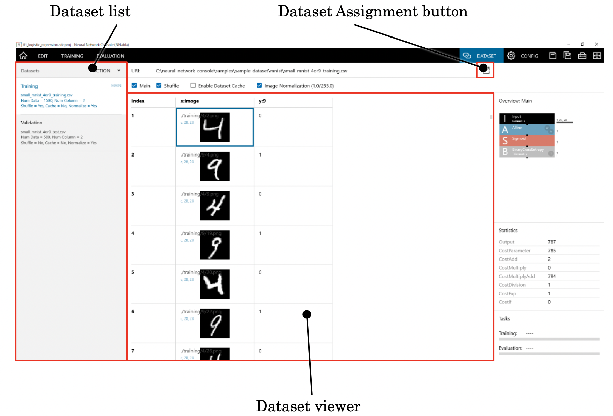

The dataset tab is used to specify and view the datasets that will be used in neural network training.

Specifying a CSV file containing training and validation datasets
~~~~~~~~~~~~~~~~~~~~~~~~~~~~~~~~~~~~~~~~~~~~~~~~~~~~~~~~~~~~~~~~~

1. From the data list, select the dataset CSV file. As the name suggests, the default Training dataset is for training, and the Validation dataset is for validation.

2. Click the Dataset Assignment button.

3. In the dataset list that appears, select the dataset.

..

   Or, click the Create Dataset button to create a new dataset.

   Or, click the Open Dataset button to open a dataset CSV file on your computer.

Viewing the content of a dataset
~~~~~~~~~~~~~~~~~~~~~~~~~~~~~~~~

1. From the data list, select the dataset you want to view.

2. View the content of the dataset in the dataset viewer area. The dataset viewer area shows the content of the specified dataset in tabular form.

**Reference**

Cells that image file names are assigned to show image previews. Cells that data CSV file names or wav file names are assigned to show graphs of the matrix data.

Specifying the dataset for determining the length of one epoch
~~~~~~~~~~~~~~~~~~~~~~~~~~~~~~~~~~~~~~~~~~~~~~~~~~~~~~~~~~~~~~

1. From the data list, select the dataset that will be used to determine the length of one epoch.

2. Select the Main check box.

**Reference**

The number of data samples used for training in one epoch is determined based on the dataset specified for Main. For example, if dataset A containing 10000 data samples and dataset B containing 30000 data samples are used for training and the Main dataset is set to B, one epoch is assumed to be the point at which 30000 data points have been trained. With this setting, dataset A is used three times during one epoch of training.

Shuffling a dataset during execution
~~~~~~~~~~~~~~~~~~~~~~~~~~~~~~~~~~~~

1. From the data list, select the dataset you want to shuffle.

2. Select the Shuffle check box.

**Notes**

Shuffling is performed in units of cache files, which are created for every 100 data samples before a new training epoch begins, and between the 100 data samples in each cache file.

Make sure not to specify shuffling for the dataset used for validation performed with the Evaluation button. Validation performed with the Evaluation button requires the data order of the CSV file and that of the cache file be the same.

Using previously created dataset cache to reduce the time it takes for training to begin
~~~~~~~~~~~~~~~~~~~~~~~~~~~~~~~~~~~~~~~~~~~~~~~~~~~~~~~~~~~~~~~~~~~~~~~~~~~~~~~~~~~~~~~~

1. From the data list, select the dataset you want to reuse from the cache.

2. Select the Enable Dataset Cache box.

**Notes**

If the Enable Dataset Cache check box is selected and a dataset cache is available, the cache is always used. As such, even if the content of the dataset is updated, the existing cache is used without updating the cache. To update the content of the cache when the content of the dataset is updated, clear the Enable Dataset Cache check box, and execute training.

Scaling the brightness down by a factor of 255 and normalizing the input values in the range of 0.0 to 1.0 for image data included in a dataset before applying it to the neural network
~~~~~~~~~~~~~~~~~~~~~~~~~~~~~~~~~~~~~~~~~~~~~~~~~~~~~~~~~~~~~~~~~~~~~~~~~~~~~~~~~~~~~~~~~~~~~~~~~~~~~~~~~~~~~~~~~~~~~~~~~~~~~~~~~~~~~~~~~~~~~~~~~~~~~~~~~~~~~~~~~~~~~~~~~~~~~~~~~~~~~~~~

1. From the data list, select the dataset you want to normalize the image brightness of.

2. Select the Image Normalization (1.0/255.0) check box.

**Reference**

Image normalization is processed by the CPU. When handling large image data, training performance may improve by setting Image Normalization to off and performing 1/255 scaling (set the Value property to 1/255 = 0.0039215686...) using the MulScalar layer, which can be processed with the GPU, instead.

Switching the display method of the CSV or wav file included in a dataset
~~~~~~~~~~~~~~~~~~~~~~~~~~~~~~~~~~~~~~~~~~~~~~~~~~~~~~~~~~~~~~~~~~~~~~~~~

Set CSV Graph Type to one of the following four options.

.. list-table::
   :widths: 30 70
   :class: longtable

   * - Line (summary)
     - 248 rows and 10 columns from the top of the data will be shown in a line graph with different color lines by column. If a value in the data CSV file is outside the -1.0 to 1.0 range, an overload message appears

   * - Line (all)
     - The entire data will be shown in a line graph by column

   * - 2D plot
     - The entire data will be shown in a heat map with the vertical direction as rows and horizontal direction as columns

   * - 2D plot (transposed)
     - The entire data will be shown in a heat map with the vertical direction as rows and horizontal direction as columns

Adding a new dataset
~~~~~~~~~~~~~~~~~~~~

Click the hamburger menu or right-click the Dataset list to open a shortcut menu, and click Add.

Renaming a dataset
~~~~~~~~~~~~~~~~~~

1. Click the hamburger menu or right-click the Dataset list to open a shortcut menu, and click Rename.

..

   Or, on the Dataset list, double-click the dataset you want to rename.

2. Type the new name, and press Enter.

Deleting a dataset
~~~~~~~~~~~~~~~~~~

1. From the data list, select the dataset you want to delete.

2. Click the hamburger menu or right-click the Dataset list to open a shortcut menu, and click Delete.

..

   Or, press Delete on the keyboard.

Rearranging Datasets
~~~~~~~~~~~~~~~~~~~~

1. From the data list, select the dataset you want to rearrange.

2. Click the hamburger menu or right-click the Dataset list to open a shortcut menu, and click Move Up or Move Down.

Selecting a specific cell in the dataset viewer
~~~~~~~~~~~~~~~~~~~~~~~~~~~~~~~~~~~~~~~~~~~~~~~

Click a cell you want to select.

Or, move the cursor in the dataset viewer using the arrow keys, Page Up, Page Down, Home, and End keys or mouse wheel (rotate only the mouse wheel to move vertically, rotate the mouse wheel while holding down Shift to move horizontally).

Moving the display range of the dataset viewer
~~~~~~~~~~~~~~~~~~~~~~~~~~~~~~~~~~~~~~~~~~~~~~

Drag the scroll bars on the right and at the bottom of the dataset viewer.

Or, move the cursor outside the dataset viewer using the arrow keys, Page Up, Page Down, Home, and End keys or mouse wheel (rotate only the mouse wheel to move vertically, rotate the mouse wheel while holding down Shift to move horizontally).

**Reference**

If the dataset fits in one page, the vertical and horizontal scroll bars do not appear.

Opening a specific image or file in a dataset with an external app
~~~~~~~~~~~~~~~~~~~~~~~~~~~~~~~~~~~~~~~~~~~~~~~~~~~~~~~~~~~~~~~~~~

Double-click a cell containing a file name.

Or, right-click a cell containing a file name to open a shortcut menu, and click Open.

Or, select a cell containing a file name, and press Enter.

Opening a folder containing a specific image or file in the dataset
~~~~~~~~~~~~~~~~~~~~~~~~~~~~~~~~~~~~~~~~~~~~~~~~~~~~~~~~~~~~~~~~~~~

Right-click a cell containing a file name to open a shortcut menu, and click Open File Location.

Opening a dataset CSV file in an external application
~~~~~~~~~~~~~~~~~~~~~~~~~~~~~~~~~~~~~~~~~~~~~~~~~~~~~
1. Right-click on the dataset viewer.

2. Select Open Table from the popup menu.

Or, double-click on the URI of the dataset.

Saving the CSV file of a dataset with a different name
~~~~~~~~~~~~~~~~~~~~~~~~~~~~~~~~~~~~~~~~~~~~~~~~~~~~~~

Right-click the dataset viewer to open a shortcut menu, and click Save CSV as.

.. _#checking-the-consistency-of-a-dataset:

Checking the consistency of a dataset
~~~~~~~~~~~~~~~~~~~~~~~~~~~~~~~~~~~~~

Right-click the dataset viewer to open a shortcut menu, and click Check Consistency.

Training and validation datasets are checked to determine whether the file names, number of variables, the size of each variable, and the like are set properly. If there is inconsistency, the error location and the description of the inconsistency are shown.

.. _#using-global-config-on-the-config-tab:

Using Global Config on the Config tab
-------------------------------------

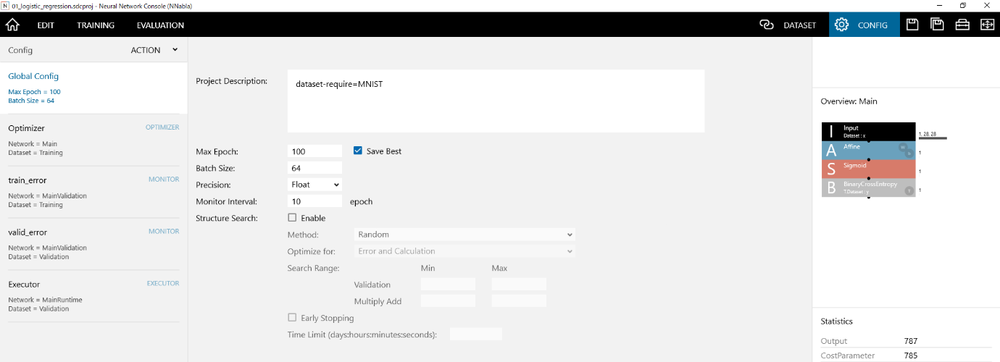

The Global Config tab is used to configure and view neural network training settings.

Editing the project comment
~~~~~~~~~~~~~~~~~~~~~~~~~~~

Enter any comment you like using text in Project Description.

Specifying the number of epochs until the completion of training optimization
~~~~~~~~~~~~~~~~~~~~~~~~~~~~~~~~~~~~~~~~~~~~~~~~~~~~~~~~~~~~~~~~~~~~~~~~~~~~~

Enter the number of epochs in Max Epoch.

To simply output an untrained designed network with the parameter properties (e.g., Weight, Bias) specified in all layers that have parameters, set Max Epoch to 0.

Specifying the conditions for saving a neural network from the training results
~~~~~~~~~~~~~~~~~~~~~~~~~~~~~~~~~~~~~~~~~~~~~~~~~~~~~~~~~~~~~~~~~~~~~~~~~~~~~~~

To save the neural network of the last epoch, clear the Save Best check box. To save the neural network of the Epoch with the smallest error in the validation dataset, select the Save Best check box.

Specifying the batch size to use when optimizing using a mini-batch
~~~~~~~~~~~~~~~~~~~~~~~~~~~~~~~~~~~~~~~~~~~~~~~~~~~~~~~~~~~~~~~~~~~

Enter the number of data samples to use for each parameter update in Batch Size.

**Notes**

The batch size value must be set to a value less than the number of data samples contained in each dataset used for training.

Specifying the calculation precision used for evaluation during training
~~~~~~~~~~~~~~~~~~~~~~~~~~~~~~~~~~~~~~~~~~~~~~~~~~~~~~~~~~~~~~~~~~~~~~~~

Set Precision to one of the following two options.

.. list-table::
   :widths: 30 70
   :class: longtable

   * - Item
     - Description

   * - Float
     - Calculation is performed using 32-bit floating-point numbers.

   * - Half
     -
        Calculation is basically performed using 16-bit floating-point numbers, but a portion of it is performed using 32-bit floating-point numbers (Mixed Precision).

        Selecting Half is advantageous in that the amount of used memory is reduced, allowing larger networks to be trained, and that the calculation speed is increased when a NVIDIA VOLTA generation GPU or later is used.

**Notes**

Half can be specified only when an NVIDIA Pascal generation GPU or later is in use.

Note when Half is specified, training may not progress properly depending on the network structure. In such cases, it may be possible to obtain the same performance as when training is performed using Float by applying Loss Scaling.

To perform loss scaling on |Console|, scale the loss value with a MulScaler layer inserted after the loss function. If Sgd, Momentum, Nesterov, or other Updater that does not automatically adjust the learning rate is in use, set the learning rate to 1/scale.

Specifying the frequency of performing accuracy evaluation
~~~~~~~~~~~~~~~~~~~~~~~~~~~~~~~~~~~~~~~~~~~~~~~~~~~~~~~~~~

Specify the accuracy evaluation interval in Monitor Interval in units of epochs. If the default value of 10 is specified, accuracy evaluation is performed every 10 epochs. To perform accuracy evaluation every epoch, set this to 1.

**Reference**

During epoch 1 to 5, accuracy evaluation is performed every epoch regardless of the Monitor Interval value.

Setting the automatic evaluation to on or off
~~~~~~~~~~~~~~~~~~~~~~~~~~~~~~~~~~~~~~~~~~~~~

Click Auto Evaluation to set the automatic evaluation to on or off.

When training is executed with Auto Evaluation set to on, evaluation will be executed automatically when training is completed.

Setting the automatic optimization of network structure to on or off
~~~~~~~~~~~~~~~~~~~~~~~~~~~~~~~~~~~~~~~~~~~~~~~~~~~~~~~~~~~~~~~~~~~~

Click Structure Search to set the automatic optimization of network structure to on or off.

When training is executed with Structure Search set to Enable, optimization is performed to find network structures with a higher accuracy and less amount of computation.

**Notes**

When training is executed with Structure Search set to Enable, training continues indefinitely unless the user explicitly stops it such as by pressing the Stop Training button.

Selecting the automatic network structure optimization algorithm
~~~~~~~~~~~~~~~~~~~~~~~~~~~~~~~~~~~~~~~~~~~~~~~~~~~~~~~~~~~~~~~~

Set Method under Structure Search to one of the following two options.

.. list-table::
   :widths: 30 70
   :class: longtable

   * - Item
     - Description

   * - Random
     - Automatic network structure search using evolutionary computation is performed. In exchange for trying various network structures, optimization takes more time.

   * - Network Feature + Gaussian Process
     - Automatic network structure search using the network features and Bayesian optimization based on Gaussian process is performed. This allows better networks to be found more quickly.

Selecting what to optimize in the automatic network structure optimization
~~~~~~~~~~~~~~~~~~~~~~~~~~~~~~~~~~~~~~~~~~~~~~~~~~~~~~~~~~~~~~~~~~~~~~~~~~

Set Optimize for under Structure Search to one of the following two options.

.. list-table::
   :widths: 30 70
   :class: longtable

   * - Item
     - Description

   * - Error
     - A network with less error is searched for. Specify this when you want to search for the highest performance network regardless of the amount of computation.

   * - Error and Calculation
     - A network with less error and less amount of computation is searched for.

**Notes**

If Optimize for is set to Error, we recommend that you limit the search range of the number of multiplications and additions using the method explained below. If you do not specify a limit, a network with extremely large amount of computation will be searched for, and optimization may take a long time.

Limiting the search range based on the accuracy or the number of multiplications and additions of the validation dataset during automatic network structure optimization
~~~~~~~~~~~~~~~~~~~~~~~~~~~~~~~~~~~~~~~~~~~~~~~~~~~~~~~~~~~~~~~~~~~~~~~~~~~~~~~~~~~~~~~~~~~~~~~~~~~~~~~~~~~~~~~~~~~~~~~~~~~~~~~~~~~~~~~~~~~~~~~~~~~~~~~~~~~~~~~~~~~~~~~~

Under Search Range, set the Min (minimum) and Max (maximum) values for Validation (validation dataset error) and Multiply Add (the number of multiplications and additions). To not specify the minimum and maximum limits, delete the values so that the boxes are empty.

For example, if you set Validation Max to 0.05 and Multiply Add Max to 2000000, automatic structure search is performed in a range in which the validation dataset error does not exceed 0.05 and the Multiply Add range does not exceed 2000000. (The validation dataset error may exceed the range in the final result, but training results that exceed the range are not used for searching).

Stopping searches that performance improvement cannot be expected during automatic network structure optimization
~~~~~~~~~~~~~~~~~~~~~~~~~~~~~~~~~~~~~~~~~~~~~~~~~~~~~~~~~~~~~~~~~~~~~~~~~~~~~~~~~~~~~~~~~~~~~~~~~~~~~~~~~~~~~~~~~

Select the Early Stopping check box. Then, set Time Limit to the maximum amount of time that will be spent in a single network evaluation in the days:hours:minutes:seconds format (2-digit numbers each). To not specify the time limit, delete the Time Limit values so that the boxes are empty.

If the Early Stopping check box is selected, the learning curve is compared to the result of past training that used a network structure with less multiplications and additions than the network structure being searched for. If the number of errors is twice as large or greater in the same epoch, the training is stopped at that point, and the evaluation of the next structure begins.

If a time limit is specified, when the time in evaluating a network exceeds the specified time, the training is stopped at that point, and the evaluation of the next structure begins.

Setting the out-of-core training to on or off
~~~~~~~~~~~~~~~~~~~~~~~~~~~~~~~~~~~~~~~~~~~~~

Click Enable in Out-of-Core Training to set the out-of-core training on or off.

By enabling out-of-core training, it is possible to train a model that exceeds the limit of the GPU memory size while swapping the intermediate calculation results in the GPU memory to the main memory of the CPU.

**Notes**

If there is not enough memory capacity on the CPU side, the memory capacity on the CPU side may be overwhelmed and memory shortage may occur.

Specifying the GPU memory size and window length used for out-of-core training
~~~~~~~~~~~~~~~~~~~~~~~~~~~~~~~~~~~~~~~~~~~~~~~~~~~~~~~~~~~~~~~~~~~~~~~~~~~~~~

Specify the respective sizes in bytes for the GPU Memory and Window Size for out-of-core training.

.. list-table::
   :widths: 30 70
   :class: longtable

   * - GPU Memory
     -
        Specifies the GPU memory size in bytes to be set as the upper limit when scheduling swap from GPU memory to CPU memory.

        Swap schedule to CPU memory is searched to fit within this GPU memory size.

        Specify 0 to use the default recommended value.

   * - Window Size
     -
        Specifies the window size in bytes to use when scheduling swap from GPU memory to CPU memory.

        Swap of the intermediate calculation result that exists within the size specified by the window size is scheduled from the viewpoint of each calculation process that occurs in Forward, Backward, and Update when updating the parameters of the neural network.

        A guideline is about 1.5 times the GPU Memory size.

        Specify 0 to use the default recommended value

**Notes**

The size specified in GPU Memory is a guide, and the actual GPU memory usage may exceed the value specified here. When manually specifying the GPU Memory, adjust this value as long as the GPU does not run out of memory.

Using Optimizer on the Config tab
---------------------------------

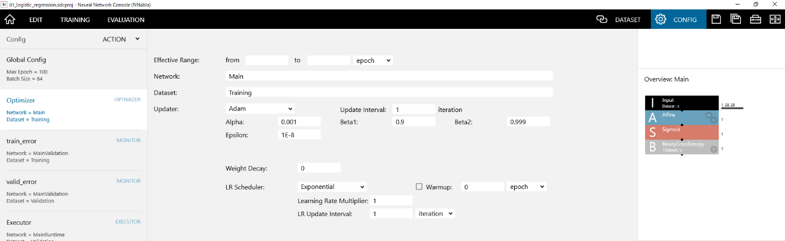

Specifying the range to apply the optimizer
~~~~~~~~~~~~~~~~~~~~~~~~~~~~~~~~~~~~~~~~~~~

Specify the boundaries in the Effective Range’s from and to boxes in units of iterations or epochs.

For example, to apply the optimizer between 50 epoch to 100 epoch, enter 50 in the from box and 100 in the to box. To apply the optimizer over the entire range from 1 epoch to the maximum epoch, leave the from and to boxes blank.

Specifying the name of the network used for optimization
~~~~~~~~~~~~~~~~~~~~~~~~~~~~~~~~~~~~~~~~~~~~~~~~~~~~~~~~

Set Network to the name of the network created on the edit tab.

Specifying the name of the dataset used for optimization
~~~~~~~~~~~~~~~~~~~~~~~~~~~~~~~~~~~~~~~~~~~~~~~~~~~~~~~~

Set data to the name of the dataset loaded on the dataset tab. To use several datasets simultaneously with the optimizer, specify the dataset names by separating each name with a comma.

Specifying the parameter update method
~~~~~~~~~~~~~~~~~~~~~~~~~~~~~~~~~~~~~~

1. From the Config list, select Optimizer.

2. Select an updater from the following (Adam by default).

.. list-table::
   :widths: 30 70
   :class: longtable

   * - Updater
     - Update expression

   * - AdaBelief
     -
        .. math:: m_{t} = \beta_{1}m_{t - 1} + \left( 1 - \beta_{1} \right)g_{t}

        .. math:: v_{t} = \beta_{2}v_{t - 1} + \left( 1 - \beta_{2} \right){(g_{t} - m_{t})}^{2}

        .. math:: {\widehat{m}}_{t} = \frac{m_{t}}{1 - \beta_{1}^{t}}

        .. math:: {\widehat{v}}_{t} = \frac{v_{t}}{1 - \beta_{2}^{t}}

        .. math:: \theta_{t + 1} = \theta_{t} - \alpha\frac{{\widehat{m}}_{t}}{\sqrt{{\widehat{v}}_{t} + \varepsilon} + \varepsilon}

        - If 1 is specified for the AMSGrad, the following formula will be added.

        .. math:: {\widehat{v}}_{t} = \max\left( {\widehat{v}}_{t - 1},\ v_{t} \right)

        - If 1 is specified for the WD Decouple, it will do the decoupled weight decay as it does in AdamW.
        - If 1 is specified for the Fixed Decay, the weight decay value is fixed under the condition that WD Decouple is 1.
        - If 1 is specified for the Rectify, rectify processing like that performed by RAdam will be added.

        - AdaBelief Optimizer: Adapting Stepsizes by the Belief in Observed Gradients

          - Juntang Zhuang, Tommy Tang, Yifan Ding, Sekhar Tatikonda, Nicha Dvornek, Xenophon Papademetris, James S. Duncan
          - https://arxiv.org/abs/2010.07468

   * - Adadelta
     -
        .. math:: \mathrm{\Delta}\theta_{t} = - \frac{{\text{RMS}\lbrack\mathrm{\Delta}\theta\rbrack}_{t - 1}}{{\text{RMS}\lbrack g\rbrack}_{t}}g_{t}

        .. math:: \theta_{t + 1} = \theta_{t} + \eta{\mathrm{\Delta}\theta}_{t}

        - ADADELTA: An Adaptive Learning Rate Method

          - Matthew D. Zeiler
          - https://arxiv.org/abs/1212.5701

   * - Adagrad
     -
        .. math:: r_{t} = r_{t - 1} + g_{t}^{2}

        .. math:: \theta_{t + 1} = \theta_{t} - \frac{\eta}{\sqrt{r} + \varepsilon}g_{t}

        - Adaptive Subgradient Methods for Online Learning and Stochastic Optimization

          - John Duchi, Elad Hazan and Yoram Singer
          - http://www.jmlr.org/papers/volume12/duchi11a/duchi11a.pdf

   * - Adam
     -
        .. math:: m_{t} = \beta_{1}m_{t - 1} + \left( 1 - \beta_{1} \right)g_{t}

        .. math:: v_{t} = \beta_{2}v_{t - 1} + \left( 1 - \beta_{2} \right)g_{t}^{2}

        .. math:: {\widehat{m}}_{t} = \frac{m_{t}}{1 - \beta_{1}^{t}}

        .. math:: {\widehat{v}}_{t} = \frac{v_{t}}{1 - \beta_{2}^{t}}

        .. math:: \theta_{t + 1} = \theta_{t} - \alpha\frac{{\widehat{m}}_{t}}{\sqrt{{\widehat{v}}_{t}} + \varepsilon}

        - Adam: A Method for Stochastic Optimization.

          - Kingma and Ba
          - https://arxiv.org/abs/1412.6980

   * - AdamW
     -
        .. math:: m_{t} = \beta_{1}m_{t - 1} + \left( 1 - \beta_{1} \right)g_{t}

        .. math:: v_{t} = \beta_{2}v_{t - 1} + \left( 1 - \beta_{2} \right)g_{t}^{2}

        .. math:: {\widehat{m}}_{t} = \frac{m_{t}}{1 - \beta_{1}^{t}}

        .. math:: {\widehat{v}}_{t} = \frac{v_{t}}{1 - \beta_{2}^{t}}

        .. math:: \theta_{t + 1} = \theta_{t} - \alpha\frac{{\widehat{m}}_{t}}{\sqrt{{\widehat{v}}_{t}} + \varepsilon} - \ \eta_{t}\lambda\theta_{t}

        - Decoupled Weight Decay Regularization

          - Ilya Loshchilov, Frank Hutter
          - https://arxiv.org/abs/1711.05101

   * - Adamax
     -
        .. math:: m_{t} = \beta_{1}m_{t - 1} + \left( 1 - \beta_{1} \right)g_{t}

        .. math:: u_{t} = max(\beta_{2}u_{t - 1}, |g_{t}|)

        .. math:: {\widehat{m}}_{t} = \frac{m_{t}}{1 - \beta_{1}^{t}}

        .. math:: \theta_{t + 1} = \theta_{t} - \alpha\frac{{\widehat{m}}_{t}}{u_{t} + \varepsilon}

        Adam: A Method for Stochastic Optimization.

        Kingma and Ba

        https://arxiv.org/abs/1412.6980

   * - AdaBound
     -
        .. math:: w_{t+1} \leftarrow w_t - \eta_t \circledcirc m_t

        .. math:: \eta t = \text{clip}\left( \alpha\frac{\sqrt{1 - \beta_{2}^{t}}}{\left( 1 - \beta_{1}^{t} \right)\left( \sqrt{v_{t}} + \varepsilon \right)},\eta l(t),\eta u(t) \right)

        .. math:: \eta_l(t)=(1-\frac{1}{(1-\beta)t+1})\alpha

        .. math:: \eta_u(t)=(1+\frac{1}{(1-\beta)t})\alpha

        - Adaptive Gradient Methods with Dynamic Bound of Learning Rate.

          - L. Luo, Y. Xiong, Y. Liu and X. Sun.
          - https://arxiv.org/abs/1902.09843

   * - AMSGRAD
     -
        .. math:: m_{t} = \beta_{1}m_{t - 1} + \left( 1 - \beta_{1} \right)g_{t}

        .. math:: v_{t} = \beta_{2}v_{t - 1} + \left( 1 - \beta_{2} \right){g_{t}}^{2}

        .. math:: {\widehat{v}}_{t} = \max\left( {\widehat{v}}_{t - 1},\ v_{t} \right)

        .. math:: \theta_{t + 1} = \theta_{t} - \alpha\frac{m_{t}}{\sqrt{{\widehat{v}}_{t}} + \varepsilon}

        - On the convergence of ADAM and beyond.

          - Reddi et al.
          - https://openreview.net/pdf?id=ryQu7f-RZ

   * - AMSBound
     -
        .. math:: w_{t+1} \leftarrow w_t - \eta_t \circledcirc m_t

        .. math:: \eta t = \text{clip}\left( \alpha\frac{\sqrt{1 - \beta_{2}^{t}}}{\left( 1 - \beta_{1}^{t} \right)\left( \sqrt{{\widehat{v}}_{t}} + \varepsilon \right)},\eta l(t),\eta u(t) \right)

        .. math:: {\widehat{v}}_{t} = \max\left( {\widehat{v}}_{t - 1},\ v_{t} \right)

        .. math:: \eta_l(t)=(1-\frac{1}{(1-\beta)t+1})\alpha

        .. math:: \eta_u(t)=(1+\frac{1}{(1-\beta)t})\alpha

        - Adaptive Gradient Methods with Dynamic Bound of Learning Rate.

          - L. Luo, Y. Xiong, Y. Liu and X. Sun.
          - https://arxiv.org/abs/1902.09843

   * - Momentum
     -
        .. math:: v_{t} = \gamma v_{t - 1} + \eta g_{t}

        .. math:: \theta_{t + 1} = \theta_{t} - v_{t}

        - On the momentum term in gradient descent learning algorithms

          - Ning Qian
          - http://www.columbia.edu/~nq6/publications/momentum.pdf

   * - Nag
     -
        .. math:: v_{t} = \gamma v_{t - 1} - \eta g_{t}

        .. math:: \theta_{t + 1} = \theta_{t} - \gamma v_{t - 1} + (1 + \gamma)v_{t}

        - A method for unconstrained convex minimization problem with the rate of convergence o(1/k2)

          - Yurii Nesterov

   * - RMSprop
     -
        .. math:: r_{t} = \gamma r_{t - 1} + (1 - \gamma)g_{t}^{2}

        .. math:: \theta_{t + 1} = \theta_{t} - \frac{\eta}{\sqrt{r} + \varepsilon}g_{t}

        - Lecture 6a : Overview of mini-batch gradient descent

          - Geoff Hinton
          - http://www.cs.toronto.edu/~tijmen/csc321/slides/lecture_slides_lec6.pdf

   * - Sgd
     - .. math:: \theta_{t + 1} = \theta_{t} - \eta g_{t}

   * - SgdW
     -
        .. math:: v_{t} = \gamma v_{t - 1} + \eta g_{t} - \frac{\eta}{\eta_{0}}\lambda v_{t - 1}

        .. math:: \theta_{t + 1} = \theta_{t} - v_{t}

        - Decoupled Weight Decay Regularization

          - Ilya Loshchilov, Frank Hutter
          - https://arxiv.org/abs/1711.05101

:math:`\theta`
      Parameter to be updated
:math:`g`
      Gradient
:math:`\eta, \alpha`
      Learning Rate, Alpha (learning rate)
:math:`\gamma, \beta_1, \beta_2`
      Momentum, or Decay, Beta1, Beta2 (Decay parameters)
:math:`\epsilon`
      Epsilon (a small value used to prevent division by zero)
:math:`\lambda`
      Weight Decay

Setting the Weight Decay (L2 regularization) strength
~~~~~~~~~~~~~~~~~~~~~~~~~~~~~~~~~~~~~~~~~~~~~~~~~~~~~

Specify the weight decay coefficient in Weight Decay.

Specifying the learning rate decay mode
~~~~~~~~~~~~~~~~~~~~~~~~~~~~~~~~~~~~~~~

1. From the Config list, select Optimizer.

2. Select an LR Scheduler (Learning Rate Scheduler) for the updater from the following (Exponential by default).

3. To perform Linear Warmup, select the Warmup check box, and specify the Warmup length in iterations or epochs.

.. list-table::
   :widths: 30 70
   :class: longtable

   * - LR Scheduler
     - Description

   * - Cosine
     -
        The learning rate is decayed according to the following formula.

        .. math:: \eta_{t} = \frac{\eta_{0}}{2}\left( 1 + cos\left( \frac{t}{T}\pi \right) \right)

        :math:`t`
              Parameter update count up to the present
        :math:`\eta_t`
              Learning rate to use for parameter updating
        :math:`\eta_0`
              Learning rate specified by Updater
        :math:`T`
              Parameter update count up to training completion

   * - Exponential
     -
        The learning rate is decayed using the exponential function.

        - Specify the rate to decay the learning rate in Learning Rate Multiplier. Specify the interval for decaying the learning rate in units of mini-batches in LR Update Interval.
        - For example, to decay the learning rate 0.9999 times every mini-batch, set Learning Rate Multiplier to 0.9999 and LR Update Interval to 1 iteration. To decay the learning rate 0.1 times every 20 epochs, set Learning Rate Multiplier to 0.1 and LR Update Interval to 20 epoch.

   * - Polynomial
     -
        The learning rate is decayed using the following polynomial.

        .. math:: \eta_{t} = \eta_{0}\left( 1 - \left( \frac{t}{T} \right)^{p} \right)

        Specify the rate to use in p in Power.

        :math:`t`
              Parameter update count up to the present
        :math:`\eta_t`
              Learning rate to use for parameter updating
        :math:`\eta_0`
              Learning rate specified by Updater
        :math:`T`
              Parameter update count up to training completion

   * - Step
     -
        The learning rate is decayed by the specified multiplying factor every specified iteration or every epoch.

        - Specify the rate to decay the learning rate in Learning Rate Multiplier. Specify the timing for decaying the learning rate in LR Update Steps using comma-separated values.
        - For example, to decay the learning rate 0.1 times at 200,000, 300,000, and 400,000 iterations, set Learning Rate Multiplier to 0.1 and LR Update Steps to “200000,300000,400000” iterations.
        - For example, to decay the learning rate 0.1 times at 30, 60, and 80 epochs, set Learning Rate Multiplier to 0.1 and LR Update Steps to “30,60,80” epochs.

Updating parameters once every several mini-batches
~~~~~~~~~~~~~~~~~~~~~~~~~~~~~~~~~~~~~~~~~~~~~~~~~~~

Specify the parameter update interval in Update Interval. For example, to calculate four gradients using mini-batches containing 64 data samples and update the parameters using these gradients every four mini-batches, set Batch Size to 64 and Update Interval to 4.

**Notes**

To perform optimization using multiple training networks, Update Interval must be set to 1.

Adding a new optimizer
~~~~~~~~~~~~~~~~~~~~~~

Click the hamburger menu or right-click the Config list to open a shortcut menu, and click Add Optimizer.

Renaming an optimizer
~~~~~~~~~~~~~~~~~~~~~

1. Click the hamburger menu or right-click the Config list to open a shortcut menu, and click Rename.

..

   Or, on the Config list, double-click the optimizer you want to rename.

2. Type the new name, and press Enter.

Deleting an optimizer
~~~~~~~~~~~~~~~~~~~~~

1. From the Config list, select the optimizer you want to delete.

2. Click the hamburger menu or right-click the Config list to open a shortcut menu, and click Delete.

..

   Or, press Delete on the keyboard.

Rearranging optimizers
~~~~~~~~~~~~~~~~~~~~~~

1. From the Config list, select the optimizer you want to rearrange.

2. Click the hamburger menu or right-click the Config to open a shortcut menu, and click Move Up or Move Down.

Using Monitor on the Config tab
-------------------------------

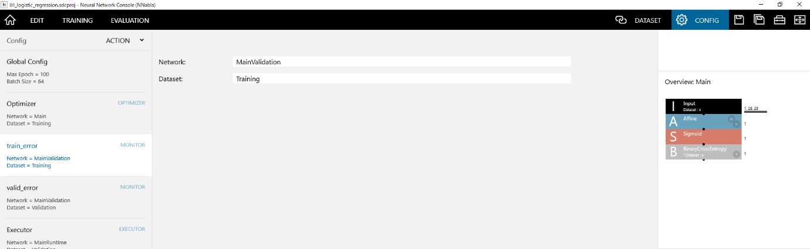

Specifying the name of the network used for evaluation during training
~~~~~~~~~~~~~~~~~~~~~~~~~~~~~~~~~~~~~~~~~~~~~~~~~~~~~~~~~~~~~~~~~~~~~~

Set Network to the name of the network created on the edit tab.

**Reference**

Train error and valid error on the learning curve are plotted according to the Monitor settings on the Config tab. By default, the network name is set to the MainValidation network, which is automatically generated from the Main network created on the edit tab.

Specifying the name of the dataset used for evaluation during training
~~~~~~~~~~~~~~~~~~~~~~~~~~~~~~~~~~~~~~~~~~~~~~~~~~~~~~~~~~~~~~~~~~~~~~

Set data to the name of the dataset loaded on the dataset tab. To use several datasets simultaneously with the monitor, specify the dataset names by separating each name with a comma.

Using Executor on the Config tab
--------------------------------

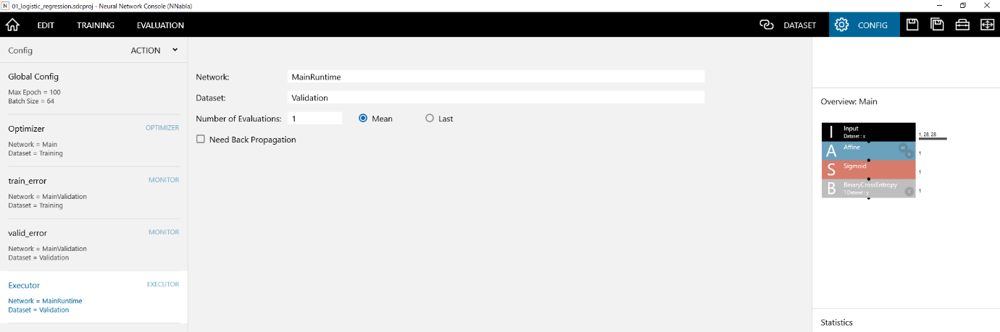

Specifying the name of the network used for evaluation performed with the Run Evaluation button
~~~~~~~~~~~~~~~~~~~~~~~~~~~~~~~~~~~~~~~~~~~~~~~~~~~~~~~~~~~~~~~~~~~~~~~~~~~~~~~~~~~~~~~~~~~~~~~

Set Network to the name of the network created on the edit tab.

**Reference**

By default, the network name is set to the MainRuntime network, which is automatically generated from the Main network created on the edit tab.

Specifying the name of the dataset used for evaluation performed with the Run Evaluation button
~~~~~~~~~~~~~~~~~~~~~~~~~~~~~~~~~~~~~~~~~~~~~~~~~~~~~~~~~~~~~~~~~~~~~~~~~~~~~~~~~~~~~~~~~~~~~~~

Set data to the name of the dataset loaded on the dataset tab.

Evaluating each data sample several times during evaluation
~~~~~~~~~~~~~~~~~~~~~~~~~~~~~~~~~~~~~~~~~~~~~~~~~~~~~~~~~~~

Set Number of Evaluations to the number of times you want to evaluate. For example, if you want to perform classification 16 times on the same data sample and use the average or the final result for classification, set Number of Evaluations to 16.

**Reference**

If the evaluation network includes layers that use Dropout, ImageAugmentation, or other random number processing, evaluating the same data sample several times and using the average for the evaluation result will improve the accuracy.

**Notes**

If you specify Number of Evaluations, the evaluation will take the specified number of times longer.

Using the average of several evaluation results for the final evaluation result
~~~~~~~~~~~~~~~~~~~~~~~~~~~~~~~~~~~~~~~~~~~~~~~~~~~~~~~~~~~~~~~~~~~~~~~~~~~~~~~

Select the Mean check box.

Using the standard deviation of several evaluation results for the final evaluation result
~~~~~~~~~~~~~~~~~~~~~~~~~~~~~~~~~~~~~~~~~~~~~~~~~~~~~~~~~~~~~~~~~~~~~~~~~~~~~~~~~~~~~~~~~~

Select the Std check box.

Using the last result of several evaluation results for the final evaluation result
~~~~~~~~~~~~~~~~~~~~~~~~~~~~~~~~~~~~~~~~~~~~~~~~~~~~~~~~~~~~~~~~~~~~~~~~~~~~~~~~~~~

Select the Last check box.

Performing back propagation also during evaluation calculation
~~~~~~~~~~~~~~~~~~~~~~~~~~~~~~~~~~~~~~~~~~~~~~~~~~~~~~~~~~~~~~

Select the Need Back Propagation check box.

Adding a new executor
~~~~~~~~~~~~~~~~~~~~~

Click the hamburger menu or right-click the Config list to open a shortcut menu, and click Add Executor.

Renaming an executor
~~~~~~~~~~~~~~~~~~~~

1. Click the hamburger menu or right-click the Config list to open a shortcut menu, and click Rename.

..

   Or, on the Config list, double-click the executor you want to rename.

2. Type the new name, and press Enter.

Deleting an executor
~~~~~~~~~~~~~~~~~~~~

1. From the Config list, select the executor you want to delete.

2. Click the hamburger menu or right-click the Config list to open a shortcut menu, and click Delete.

..

   Or, press Delete on the keyboard.

Rearranging Executor
~~~~~~~~~~~~~~~~~~~~

1. From the Config list, select the executor you want to rearrange.

2. Click the hamburger menu or right-click the Config to open a shortcut menu, and click Move Up or Move Down.

.. _#using-the-training-results-tab:

Using the Training Results tab
------------------------------

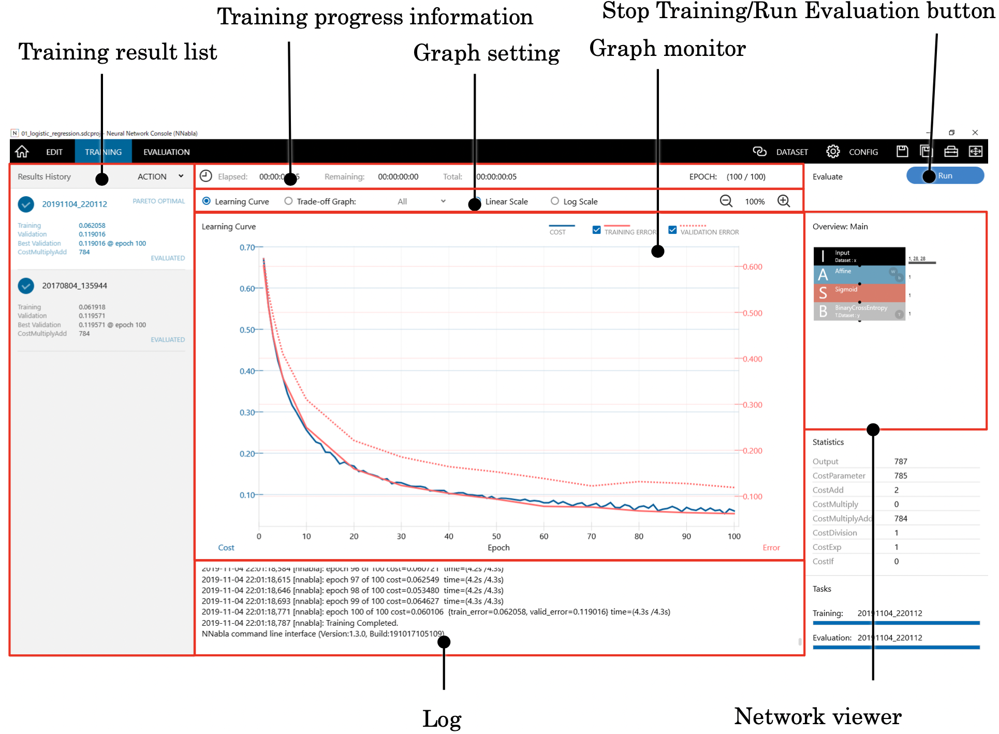

The Training Results tab is used to view the progress of the current training and compare several training results.

Viewing the training progress
~~~~~~~~~~~~~~~~~~~~~~~~~~~~~

View the training progress information, graph monitor, and log.

EPOCH in the training progress information area indicates how many epochs have been completed out of the number of optimization epochs (Max Epoch) for a complete training specified on the Config tab.

Elapsed, Remaining, and Total in the training progress information area indicate the time elapsed from the training start point to the current point, the estimated time from the current point to training completion, and the estimated time from the training start point to training completion, respectively.

The graph monitor shows the learning curve. The horizontal axis indicates the number of training epochs, the left vertical axis indicates the cost function of the training data, and the right vertical axis indicates the error function of the training data and validation data.

The log shows the log output by the Neural Network Libraries.

**Reference**

If an error occurs during training due to an improperly configured learning engine, network inconsistency, dataset inconsistency, training parameter error, or some other reason, you may be able to determine the cause by viewing the log. For details, see the ":ref:`FAQ <#during-training-execution>`".

Stopping an ongoing training
~~~~~~~~~~~~~~~~~~~~~~~~~~~~

Click Stop on the controller.

Or, press Shift+F5 on the keyboard.

Showing the tradeoff relationship between errors and cost of all past training results
~~~~~~~~~~~~~~~~~~~~~~~~~~~~~~~~~~~~~~~~~~~~~~~~~~~~~~~~~~~~~~~~~~~~~~~~~~~~~~~~~~~~~~

Click Trade-off Graph in the graph setting area.

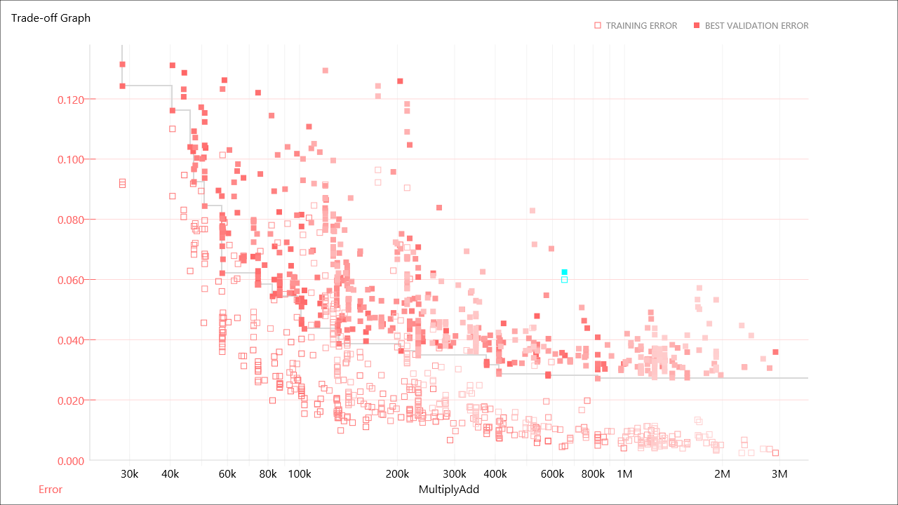

The graph monitor shows a tradeoff relationship graph with errors on the vertical axis, the number of multiplications and additions on the horizontal axis by default, and points representing each training result.

**Reference**

If you select Pareto Only from the drop-down list box to the right of Trade-off Graph in the graph setting area, the displayed data points can be limited to those whose error or number of multiplications and additions exceeds that of all other past training results.

**Reference**

If you select Previous from the drop-down list box to the right of Trade-off Graph in the graph setting area, the displayed data points can be limited to those of results earlier than the currently selected training result.

Changing the horizontal axis of the Trade-Off Graph
~~~~~~~~~~~~~~~~~~~~~~~~~~~~~~~~~~~~~~~~~~~~~~~~~~~

Click the Trade-Off Graph horizontal axis label (CostMultiplyAdd by default), and select the one you want from the displayed drop-down list box.

Viewing specific training results of the past
~~~~~~~~~~~~~~~~~~~~~~~~~~~~~~~~~~~~~~~~~~~~~

On the list of past training results shown in the training result list, click the training result you want to view.

Or, click a data point on the Trade-off graph shown in the graph monitor.

The contents of the training progress, graph monitor, overview, and log are updated for the selected training result.

Opening a folder containing a training result file
~~~~~~~~~~~~~~~~~~~~~~~~~~~~~~~~~~~~~~~~~~~~~~~~~~

1. On the training result list, click the training result that is contained in the folder you want to open.

2. Right-click the training result list to open a shortcut menu, and click Open Result Location.

Or, double-click the training result that is contained in the folder you want to open.

**Reference**

Training result files are stored in a folder with the project file name (without the extension) with “.files” extension and in the folder with a name showing the date and time when the training was executed.

Changing the name of a training result
~~~~~~~~~~~~~~~~~~~~~~~~~~~~~~~~~~~~~~

1. On the list of past training results shown in the training result list, click the training result that you want to rename twice.

..

   Or, right-click the training result list to open a shortcut menu, and click Rename.

2. Type the new name, and press Enter.

Editing the comment of a training result
~~~~~~~~~~~~~~~~~~~~~~~~~~~~~~~~~~~~~~~~

1. On the list of past training results shown in the training result list, select the training result whose comment you want to edit.

2. Right-click the training result list to open a shortcut menu, and click Edit Comment.

3. Enter the comment text, and press Enter.

Updating the list of training results
~~~~~~~~~~~~~~~~~~~~~~~~~~~~~~~~~~~~~

Right-click the training result list to open a shortcut menu, and click Refresh.

Comparing the learning curves of two training results
~~~~~~~~~~~~~~~~~~~~~~~~~~~~~~~~~~~~~~~~~~~~~~~~~~~~~

1. On the training result list, click the first training result.

2. Right-click the training result list to open a shortcut menu, and click Open Learning Curve for Comparison.

3. On the training result list, click the second training result.

On the graph monitor under Learning Curve, the learning curve of the first training result is shown with a light line and the learning curve of the second with a normal line.

Finishing comparing the learning curves of two training results
~~~~~~~~~~~~~~~~~~~~~~~~~~~~~~~~~~~~~~~~~~~~~~~~~~~~~~~~~~~~~~~

Right-click the training result list to open a shortcut menu, and click Clear Learning Curve for Comparison.

Changing the items shown on the graph monitor
~~~~~~~~~~~~~~~~~~~~~~~~~~~~~~~~~~~~~~~~~~~~~

Or, right-click the graph monitor to open a shortcut menu, and click View and then the item to be shown from the following three options.

.. list-table::
   :widths: 30 70
   :class: longtable

   * - Item
     - Description

   * - Training & Validation (default)
     - The error function values of both the training data and validation data are shown.

   * - Training
     - Only the error function values of the training data are shown.

   * - Validation
     - Only the error function values of the validation data are shown.

Changing the vertical axis of the graph monitor to a logarithmic axis
~~~~~~~~~~~~~~~~~~~~~~~~~~~~~~~~~~~~~~~~~~~~~~~~~~~~~~~~~~~~~~~~~~~~~

Click Log Scale in the graph setting area.

To revert from the logarithmic axis to the linear axis, click Linear Scale.

Zooming the vertical axis of the graph monitor
~~~~~~~~~~~~~~~~~~~~~~~~~~~~~~~~~~~~~~~~~~~~~~

1. Click the graph monitor to select it.

2. While holding down Ctrl, rotate the mouse wheel.

..

   Or, while holding down Ctrl, press the plus (+) or minus (-) key.

Or, right-click the graph monitor to open a shortcut menu, and click Zoom and then Zoom In or Zoom Out.

Resetting the zoom ratio of the vertical axis of the graph monitor
~~~~~~~~~~~~~~~~~~~~~~~~~~~~~~~~~~~~~~~~~~~~~~~~~~~~~~~~~~~~~~~~~~

1. Click the graph monitor to select it.

2. While holding down Ctrl, press the 0 (zero) key.

Or, right-click the network graph to open a shortcut menu, and click Zoom and then Default.

Saving the graph values shown on the graph monitor to a CSV file
~~~~~~~~~~~~~~~~~~~~~~~~~~~~~~~~~~~~~~~~~~~~~~~~~~~~~~~~~~~~~~~~

1. Right-click the graph monitor to open a shortcut menu, and click Save CSV as.

2. Specify the save destination CSV file name.

Saving the graph shown on the graph monitor as an image
~~~~~~~~~~~~~~~~~~~~~~~~~~~~~~~~~~~~~~~~~~~~~~~~~~~~~~~

1. Right-click the graph monitor to open a shortcut menu, and click Save Graph BMP as.

2. Specify the save destination image file name.

**Reference**

The resolution of the saved image will be 1280×720 pixels (fixed).

Exporting a trained model in Neural Network Libraries (nnp) file format
~~~~~~~~~~~~~~~~~~~~~~~~~~~~~~~~~~~~~~~~~~~~~~~~~~~~~~~~~~~~~~~~~~~~~~~

1. On the training result list, click the training result you want to export in nnp format.

2. Right-click the training result list to open a shortcut menu, and click Export->NNP (Neural Network Libraries file format).

An nnp file is generated with the name “model.nnp” in the folder containing the training result file.

**Reference**

An nnp file contains descriptions of the neural network structure, training settings, trained parameters, and the like that the Neural Network Libraries handle.

Models exported in nnp format can be used through the Neural Network Libraries Python API, command line interface, and C++ command line interface.

Exporting a trained model in NNabla C Runtime (nnb) file format
~~~~~~~~~~~~~~~~~~~~~~~~~~~~~~~~~~~~~~~~~~~~~~~~~~~~~~~~~~~~~~~

1. On the training result list, click the training result you want to export in nnb format.

2. Right-click the training result list to open a shortcut menu, and click Export->NNB (NNabla C Runtime file format).

An nnb file is generated with the name “model.nnb” in the folder containing the training result file.

**Reference**

An nnb file contains descriptions of the neural network structure and trained parameters that the Neural Network Libraries NNabla C Runtime handles.

Models exported in nnb format can be used through the Neural Network Libraries NNabla C Runtime.

Exporting a trained model in ONNX format
~~~~~~~~~~~~~~~~~~~~~~~~~~~~~~~~~~~~~~~~

1. On the training result list, click the training result you want to export in ONNX format.

2. Right-click the training result list to open a shortcut menu, and click Export->ONNX.

An ONNX file is generated with the name “model.onnx” in the folder containing the training result file.

**Reference**

Open Neural Network Exchange Format (ONNX) is an open file format that allows Deep Learning models to be shared between different software applications.

https://onnx.ai/

Models exported in ONNX format can be used through software applications that support the ONNX format.

Exporting a trained model in saved_model format (beta)
~~~~~~~~~~~~~~~~~~~~~~~~~~~~~~~~~~~~~~~~~~~~~~~~~~~~~~

1. On the training result list, click the training result you want to export in saved_model (TensorFlow saved_model) format.

2. Right-click the training result list to open a shortcut menu, and click Export->saved_model (TensorFlow saved_model).

A saved_model folder is generated in the folder containing the training result file.

Exporting a trained model in tflite format
~~~~~~~~~~~~~~~~~~~~~~~~~~~~~~~~~~~~~~~~~~

3. On the training result list, click the training result you want to export in tflite (TensorFlow lite) format.

4. Right-click the training result list to open a shortcut menu, and click Export->tflite (TensorFlow lite).

A tflite file is generated with the name “model.tflite” in the folder containing the training result file.

Exporting a training result report to a pptx file (beta)
~~~~~~~~~~~~~~~~~~~~~~~~~~~~~~~~~~~~~~~~~~~~~~~~~~~~~~~~

1. On the training result list, click the training result you want to export in pptx format.

2. Right-click the training result list to open a shortcut menu, and click Export->pptx beta.

The exported pptx file is opened with the associated application.

Exporting a training result report to a html file (beta)
~~~~~~~~~~~~~~~~~~~~~~~~~~~~~~~~~~~~~~~~~~~~~~~~~~~~~~~~

1. On the training result list, click the training result you want to export in html format.

2. Right-click the training result list to open a shortcut menu, and click Export->html beta.

The exported html file is opened with the associated application.

Changing an incomplete training network to training completed status
~~~~~~~~~~~~~~~~~~~~~~~~~~~~~~~~~~~~~~~~~~~~~~~~~~~~~~~~~~~~~~~~~~~~

1. On the training result list, click an incomplete training result.

2. Right-click the training result list to open a shortcut menu, and click Force Complete.

3. In the confirmation dialog box, click OK.

**Reference**

One of the uses of this function is to make evaluation execution possible for a network whose training has been aborted before completion.

Resuming suspended training
~~~~~~~~~~~~~~~~~~~~~~~~~~~

1. On the training result list, click an incomplete training result.

2. Right-click the training result list to open a shortcut menu, and click Resume Training.

**Notes**

The state of the optimizer and the random state cannot be restored to the state when training was suspended. Therefore, the training result after interruption and resumption will not be the same as when training is continued to the end without interruption.

Retraining using a network structure contained in a past training result
~~~~~~~~~~~~~~~~~~~~~~~~~~~~~~~~~~~~~~~~~~~~~~~~~~~~~~~~~~~~~~~~~~~~~~~~

1. On the training result list, click the training result that you want to retrain.

2. Right-click the training result list to open a shortcut menu, click Retrain (in place) (to overwrite the selected training result folder) or Retrain (not in place) (to create a new training result folder and save the training result there).

3. If you select in place, click OK in the training execution confirmation dialog box.

Retraining using a network structure contained in all past training results
~~~~~~~~~~~~~~~~~~~~~~~~~~~~~~~~~~~~~~~~~~~~~~~~~~~~~~~~~~~~~~~~~~~~~~~~~~~

1. Right-click the training result list to open a shortcut menu, and click Retrain All (in place).

2. In the training execution confirmation dialog box, click OK.

**Notes**

All existing training results are overwritten with new training results.

Canceling a scheduled training task
~~~~~~~~~~~~~~~~~~~~~~~~~~~~~~~~~~~

1. On the training result list, click the scheduled training task you want to cancel.

2. Right-click the training result list to open a shortcut menu, and click Cancel Schedule.

Canceling all scheduled training tasks
~~~~~~~~~~~~~~~~~~~~~~~~~~~~~~~~~~~~~~

Right-click the training result list to open a shortcut menu, and click Cancel All Scheduled Task.

Resuming the execution of a scheduled task that is paused
~~~~~~~~~~~~~~~~~~~~~~~~~~~~~~~~~~~~~~~~~~~~~~~~~~~~~~~~~

Right-click the training result list to open a shortcut menu, and click Resume Scheduled Task.

Deleting a past training result from the disk
~~~~~~~~~~~~~~~~~~~~~~~~~~~~~~~~~~~~~~~~~~~~~

1. On the training result list, click the training result you want to delete.

2. Right-click the training result list to open a shortcut menu, and click Delete from Disk.

3. In the deletion confirmation dialog box, click OK.

**Notes**

When you perform this operation, the training result is deleted directly from the disk without going through the recycle bin.

Deleting all training results that have not completed training
~~~~~~~~~~~~~~~~~~~~~~~~~~~~~~~~~~~~~~~~~~~~~~~~~~~~~~~~~~~~~~

1. Right-click the training result list to open a shortcut menu, and click Delete All Incomplete Results from Disk.

2. In the deletion confirmation dialog box, click OK.

**Notes**

When you perform this operation, the training result is deleted directly from the disk without going through the recycle bin.

Switching the views of multiple networks on overview
~~~~~~~~~~~~~~~~~~~~~~~~~~~~~~~~~~~~~~~~~~~~~~~~~~~~

Click the network switch button at the upper right of the overview.

Plotting and viewing trained parameters
~~~~~~~~~~~~~~~~~~~~~~~~~~~~~~~~~~~~~~~

1. On the training result list, click the training result containing the network you want to view the parameters of.

2. On the overview, double-click the layer that you want to view the parameters of.

..

   Or, right-click the layer that you want to view the parameters of to open a shortcut menu, and click Plot Weight.

The graph monitor shows the visualized parameter and the parameter contribution ratio determined from the principal component analysis results of the parameter. The horizontal axis of the contribution ratio graph indicates the number of dimensions of the parameter and the vertical axis the accumulated contribution ratio.

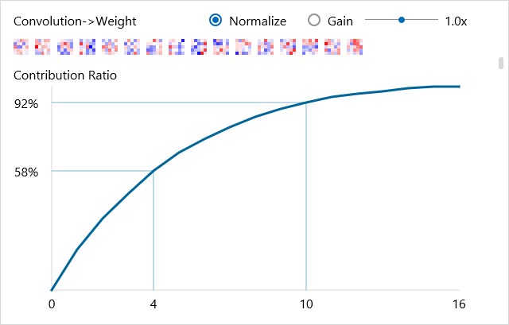

Scrolling the trained parameter plot
~~~~~~~~~~~~~~~~~~~~~~~~~~~~~~~~~~~~

Drag the scroll bar shown at the right of the graph monitor.

Or, rotate the mouse wheel.

Zooming the trained parameter plot
~~~~~~~~~~~~~~~~~~~~~~~~~~~~~~~~~~

1. Click the graph monitor to select it.

2. While holding down Ctrl, rotate the mouse wheel.

..

   Or, while holding down Ctrl, press the plus (+) or minus (-) key.

Or, right-click the graph monitor to open a shortcut menu, and click Zoom and then Zoom In or Zoom Out.

Resetting the zoom ratio of the trained parameter plot
~~~~~~~~~~~~~~~~~~~~~~~~~~~~~~~~~~~~~~~~~~~~~~~~~~~~~~

1. Click the graph monitor to select it.

2. While holding down Ctrl, press the 0 (zero) key.

Or, right-click the graph monitor to open a shortcut menu, and click Zoom and then Default.

Normalizing the trained parameter plot
~~~~~~~~~~~~~~~~~~~~~~~~~~~~~~~~~~~~~~

Select the Normalize check box.

Changing the gain of the trained parameter plot
~~~~~~~~~~~~~~~~~~~~~~~~~~~~~~~~~~~~~~~~~~~~~~~

Drag the Gain slider horizontally.

Opening a network structure contained in a past training result in the edit tab
~~~~~~~~~~~~~~~~~~~~~~~~~~~~~~~~~~~~~~~~~~~~~~~~~~~~~~~~~~~~~~~~~~~~~~~~~~~~~~~

1. On the training result list, click the training result containing the network structure you want to open.

2. Right-click the training result list or the overview showing the network to open a shortcut menu, and click Open in EDIT Tab. The network structure shown on the overview is opened in the edit tab.

Opening with parameters a network structure contained in a past training result in the edit tab
~~~~~~~~~~~~~~~~~~~~~~~~~~~~~~~~~~~~~~~~~~~~~~~~~~~~~~~~~~~~~~~~~~~~~~~~~~~~~~~~~~~~~~~~~~~~~~~

1. On the training result list, click the training result containing the network structure you want to open.

2. Right-click the training result list or the overview showing the network to open a shortcut menu, and click Open in EDIT Tab with Weight. The network structure shown on the overview of the edit tab is opened with trained network parameter files entered in Convolution, Affine, and other weights (W.File) and biases (b.File).

Starting a command prompt for using Neural Network Libraries
~~~~~~~~~~~~~~~~~~~~~~~~~~~~~~~~~~~~~~~~~~~~~~~~~~~~~~~~~~~~

1. On the training result list, click the training result that is contained in the folder that you want to start the command prompt in.

2. Right-click the training result list to open a shortcut menu, and click MoreTools->Command Prompt.

Showing history of CPU/GPU usage during training
~~~~~~~~~~~~~~~~~~~~~~~~~~~~~~~~~~~~~~~~~~~~~~~~

One the log, click CPU usage or GPU usage.

**Reference**

If the training process does not take time, CPU/GPU usage may not be displayed.

.. _#using-the-evaluation-tab:

Using the Evaluation tab
------------------------

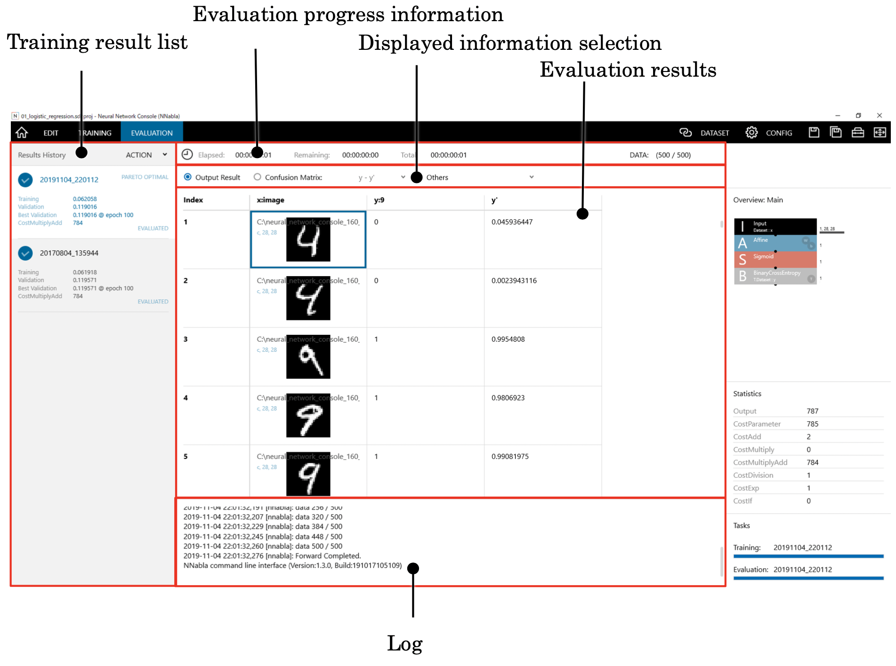

The Evaluation tab is used to perform computation on a validation dataset using a trained neural network and evaluate the results.

Evaluating a trained neural network
~~~~~~~~~~~~~~~~~~~~~~~~~~~~~~~~~~~

1. On the training result list, click the training result you want to evaluate.

2. Click the Run Evaluation button.

..

   Or, press F6 on the keyboard.

Viewing the evaluation progress
~~~~~~~~~~~~~~~~~~~~~~~~~~~~~~~

View the evaluation progress information and log.

DATA in the evaluation progress information area shows the number of data samples that have been evaluated at the current point.

Elapsed, Remaining, and Total in the evaluation progress information area indicate the time elapsed from the evaluation start point to the current point, the estimated time from the current point to evaluation completion, and the estimated time from the evaluation start point to evaluation completion, respectively.

The log shows the log output by the evaluation engine.

Stopping an ongoing evaluation
~~~~~~~~~~~~~~~~~~~~~~~~~~~~~~

Click Stop on the controller.

Or, press Shift+F6 on the keyboard.

Viewing the results of computation using a neural network
~~~~~~~~~~~~~~~~~~~~~~~~~~~~~~~~~~~~~~~~~~~~~~~~~~~~~~~~~

In the displayed information selection area, click Output Result.

In the evaluation result area, the neural network computation results on the validation dataset are shown.

**Reference**

In the evaluation result area, the computation results are shown by adding a new column containing the neural network computation results to the validation dataset itself. If the validation dataset has multiple columns that overflow from the window, scroll the evaluation results to the right to view the computation results existing outside the window.

**Reference**

The table shown in the evaluation result area is saved in output_result.csv in the folder containing the training result file. You can open this file in an external application for evaluation.

Viewing the performance with a confusion matrix when there is a classification problem
~~~~~~~~~~~~~~~~~~~~~~~~~~~~~~~~~~~~~~~~~~~~~~~~~~~~~~~~~~~~~~~~~~~~~~~~~~~~~~~~~~~~~~

1. In the displayed information selection area, click Confusion Matrix.

2. In the displayed information selection area, select the variable to show the confusion matrix of in the drop-down list to the right of Confusion Matrix.

Viewing data that has been misclassified in a classification problem
~~~~~~~~~~~~~~~~~~~~~~~~~~~~~~~~~~~~~~~~~~~~~~~~~~~~~~~~~~~~~~~~~~~~

Right-click the cell you want to list the data of in Confusion Matrix to open a shortcut menu, and click List.

Or, in Confusion Matrix, double-click the cell you want to list the data of.

Recreating confusion matrix that has changed the threshold of the binary classification
~~~~~~~~~~~~~~~~~~~~~~~~~~~~~~~~~~~~~~~~~~~~~~~~~~~~~~~~~~~~~~~~~~~~~~~~~~~~~~~~~~~~~~~

1. Right-click in Confusion Matrix to open a shortcut menu, and click Recreate.

2. Specify the binary classification threshold and click OK.

Sorting the output result by a specific column
~~~~~~~~~~~~~~~~~~~~~~~~~~~~~~~~~~~~~~~~~~~~~~

Right-click the cell of a column you want to sort by in Output Result to open a shortcut menu, and click Sort.

Or, in Output Result, double-click the cell of a column you want to sort by.

Saving the table of evaluation results to a CSV file
~~~~~~~~~~~~~~~~~~~~~~~~~~~~~~~~~~~~~~~~~~~~~~~~~~~~

1. Right-click the evaluation to open a shortcut menu, and click Save CSV as.

2. Specify the save destination CSV file name.

Other functions available on the project window
-----------------------------------------------

Creating a training result file for the project being edited without performing training
~~~~~~~~~~~~~~~~~~~~~~~~~~~~~~~~~~~~~~~~~~~~~~~~~~~~~~~~~~~~~~~~~~~~~~~~~~~~~~~~~~~~~~~~

On the EDIT tab, click Train on the controller. With Create Training Result selected, click Run on the controller.

**Reference**

This function can be used to export calculation graphs without parameters as training results, re-edit a network loaded with the “Open in EDIT Tab with Weight” function and export it to a training result file, or view the initial values of a neural network before training. The operation of this function is the same as when training is executed with Max Epoch set to 0.

Measuring the execution speed of the neural network being designed in detail
~~~~~~~~~~~~~~~~~~~~~~~~~~~~~~~~~~~~~~~~~~~~~~~~~~~~~~~~~~~~~~~~~~~~~~~~~~~~

On the EDIT tab, click Train on the controller. With Profile selected, click Run on the controller.

Detailed measurement results will be saved to profile.csv in the training result folder.

.. _starting-a-command-prompt-for-using-neural-network-libraries-1:

Starting a command prompt for using Neural Network Libraries
~~~~~~~~~~~~~~~~~~~~~~~~~~~~~~~~~~~~~~~~~~~~~~~~~~~~~~~~~~~~

1. On the training result list or in the evaluation results, click the training result or the data that is contained in the folder that you want to start the command prompt in.

2. Right-click the training result list to open a shortcut menu, and click MoreTools->Command Prompt.

Applying a plugin to the output result
~~~~~~~~~~~~~~~~~~~~~~~~~~~~~~~~~~~~~~

1. On the training result list or in the evaluation results, click the training result or the data that you want to apply a plugin to.

2. Right-click the evaluation result to open a shortcut menu, and click Plugin and then the name of the plugin you want to use. A plugin execution window opens.

3. Enter parameters for executing the plugin.

4. Click OK to execute the plugin. The plugin execution result is displayed.

**Reference**

For details on each plugin, see the Plugin Reference.

Viewing the results of a plugin, profile, and other processes
~~~~~~~~~~~~~~~~~~~~~~~~~~~~~~~~~~~~~~~~~~~~~~~~~~~~~~~~~~~~~

1. In the displayed information selection area on the Evaluation tab, click Others.

2. In the displayed information selection area, select the file you want to show from the drop-down list to the right of Others.

**Notes**

If the plugin processing results are output to a folder other than that containing the training result file, you cannot select or view using Others. To view the plugin processing results in such a case, view the output file directly using Explorer or the like.

Registering the existing project file as a custom unit
~~~~~~~~~~~~~~~~~~~~~~~~~~~~~~~~~~~~~~~~~~~~~~~~~~~~~~

1. On the EDIT tab, right-click the component list to open a shortcut menu, and click Register Custom Unit.

2. Select the project file (*.sdcproj file) you want to register as a custom unit.

The selected project file will be registered in the Custom Unit category at the end of the component list.

Adding a registered custom unit to the network graph
~~~~~~~~~~~~~~~~~~~~~~~~~~~~~~~~~~~~~~~~~~~~~~~~~~~~

On the EDIT tab, drag the custom unit you want to add to the network graph from the component list.

Or, double-click the custom unit on the component list.

**Reference**

This will add a unit to the network graph that uses the first network included in the registered project file. At the same time, other networks included in the registered project file will be added to the project.

**Notes**

If the project already contains a network with the same name as the network included in the registered project file, that network will not be loaded.

Deleting a registered custom unit
~~~~~~~~~~~~~~~~~~~~~~~~~~~~~~~~~

1. On the EDIT tab, select the custom unit you want to delete from the component list.

2. Right-click the component list to open a shortcut menu and click Delete Custom Unit.

Updating the list of custom unit
~~~~~~~~~~~~~~~~~~~~~~~~~~~~~~~~

Right-click the component list to open a shortcut menu, and click Refresh.

