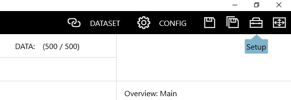
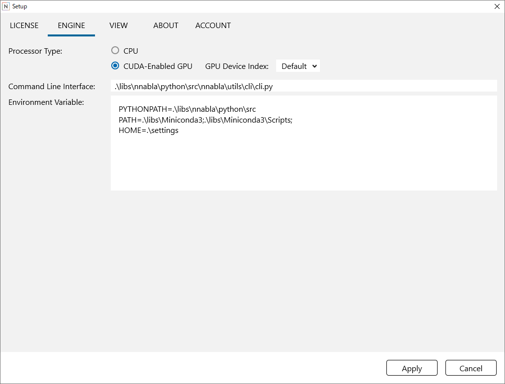

Setup window
============

To open the setup window, click the Setup button in the upper right of the window.

Using the engine setup window
-----------------------------

Switching between CPU execution and GPU execution
~~~~~~~~~~~~~~~~~~~~~~~~~~~~~~~~~~~~~~~~~~~~~~~~~

Click CPU or CUDA-Enabled GPU next to Processor Type.

Selecting the GPU to use on a multiple GPU environment
~~~~~~~~~~~~~~~~~~~~~~~~~~~~~~~~~~~~~~~~~~~~~~~~~~~~~~

Use GPU Device Index to specify the index (0 to 7) of the GPU to use.

Changing the location of the related libraries that |Console| uses
~~~~~~~~~~~~~~~~~~~~~~~~~~~~~~~~~~~~~~~~~~~~~~~~~~~~~~~~~~~~~~~~~~~~~~~~~~~~~~~

Through the Command Line Interface, specify the path to NNabla cli.py.

In the Environment Variable box, specify the environment variables that will be used during Neural Network Libraries execution.

**Notes**

Normally, users do not need to change these settings.

Using the display setup window
------------------------------

Changing the display language
~~~~~~~~~~~~~~~~~~~~~~~~~~~~~

Click Language to select the display language.

Zooming the GUI display size
~~~~~~~~~~~~~~~~~~~~~~~~~~~~

Drag the GUI Scale slider to specify the zoom ratio.

**Reference**

You can zoom the GUI display size when the setup window is not open. While holding down Ctrl and Shift, press the plus (+) or minus (-) key or rotate the mouse wheel.

Turning on and off the GUI animation (transition)
~~~~~~~~~~~~~~~~~~~~~~~~~~~~~~~~~~~~~~~~~~~~~~~~~

Click Transition to turn animation on and off.

Changing the default display style of graph display for CSV data and Wav files
~~~~~~~~~~~~~~~~~~~~~~~~~~~~~~~~~~~~~~~~~~~~~~~~~~~~~~~~~~~~~~~~~~~~~~~~~~~~~~

Click the CSV Graph Type to select the default display format.

Turning on and off preview playback of audio file
~~~~~~~~~~~~~~~~~~~~~~~~~~~~~~~~~~~~~~~~~~~~~~~~~

Click Play when selecting audio file to turn preview playback on and off. If this is checked, the audio is played as soon as you select a cell with an audio waveform file on a tubular such as the DATASET tab.

Using the version information window
------------------------------------

Viewing the |Console| version and related information
~~~~~~~~~~~~~~~~~~~~~~~~~~~~~~~~~~~~~~~~~~~~~~~~~~~~~~~~~~~~~~~~~~

Click the About tab.

