Layer reference
===============

This chapter describes the layers and their properties that can be used in the nnabla project with the |Console|.

Common layer properties
-----------------------

Common layer properties include the layer name and the properties that are automatically calculated based on the inter-layer link status and layer-specific properties.

.. list-table::
   :widths: 30 70
   :class: longtable

   * - Name
     -
        This indicates the layer name.
        
        Each layer name must be unique in the graph.

   * - Input
     - This indicates the layer’s input size.

   * - Output
     - This indicates the layer’s output size.

   * - CostParameter
     - This indicates the number of parameters that the layer contains.

   * - CostAdd
     - This indicates the number of multiplications that is required in forward calculation and the number of additions that cannot be performed during the same time.

   * - CostMultiply
     - This indicates the number of additions that is required in forward calculation and the number of multiplications that cannot be performed during the same time.

   * - CostMultiplyAdd
     - This indicates the number of multiplications and additions that is required in forward calculation (the number of multiplications and the number of additions that can be performed during the same time).

   * - CostDivision
     - This indicates the number of divisions that is required in forward calculation.

   * - CostExp
     - This indicates the number of exponentiation that is required in forward calculation.

   * - CostIf
     - This indicates the number of conditional decisions that is required in forward calculation.

Input and output layers
-----------------------

Input
~~~~~

This is the neural network input layer.

.. list-table::
   :widths: 30 70
   :class: longtable

   * - Size
     -
        Specify the input size.
        
        For image data, the size is specified in the “the number of colors,height,width” format. For example, for a RGB color image whose width is 32 and height is 24, specify “3,24,32”. For a monochrome image whose width is 64 and height is 48, specify “1,48,64”.
        
        For CSV data, the size is specified in the “the number of rows, the number of columns” format. For example, for CSV data consisting of 16 rows and 1 column, specify “16,1”. For CSV data consisting of 12 rows and 3 columns, specify “12,3”.

   * - Dataset
     - Specify the name of the variable to input into this Input layer.

   * - Generator
     -
        Specify the generator to use in this input layer. If the Generator property is not set to None, the data that the generator generates is used in place of the variable specified by Dataset during optimization.
        
        None
            Data generation is not performed.
        
        Uniform
            Uniform random numbers between -1.0 and 1.0 are generated.
        
        Normal
            Gaussian random numbers with 0.0 mean and 1.0 variance are generated.
        
        Constant
            Data whose elements are all constant (1.0) is generated.

   * - GeneratorMultiplier
     - Specify the multiplier to apply to the values that the generator generates.

Loss layer
----------

SquaredError
~~~~~~~~~~~~

This is the output layer of a neural network that minimizes the squared errors between the variables and dataset variables. It is used when solving regression problems with neural networks (when optimizing neural networks that output continuous values).

.. list-table::
   :widths: 30 70
   :class: longtable

   * - T.Dataset
     - Specify the name of the variable expected to be the output of this SquaredError layer.

   * - T.Generator
     -
        Specify the generator to use in place of the dataset. If the Generator property is not set to None, the data that the generator generates is used in place of the variable specified by T.Dataset during optimization.
        
        None
            Data generation is not performed.
        
        Uniform
            Uniform random numbers between -1.0 and 1.0 are generated.
        
        Normal
            Gaussian random numbers with 0.0 mean and 1.0 variance are generated.
        
        Constant
            Data whose elements are all constant (1.0) is generated.

   * - T.GeneratorMultiplier
     - Specify the multiplier to apply to the values that the generator generates.

HuberLoss
~~~~~~~~~

This is the output layer of a neural network that minimizes the Huber loss between the variables and dataset variables. Like Squared Error, this is used when solving regression problems with neural networks. Using this in place of Squared Error has the effect of stabilizing the training process.

.. math::

   L = \left\{\begin{matrix}
   i^2 &  for \left| i \right| \leqq \delta,  \\
   \delta(2|i| - \delta) & otherwise. \\
   \end{matrix}\right.

(i indicates the difference between the dataset and inputs.)

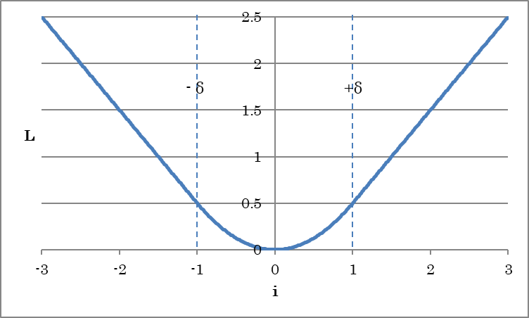

.. list-table::
   :widths: 30 70
   :class: longtable

   * - Delta
     - Specify δ, which is used as a threshold for increasing the loss linearly.

Other properties are the same as those of SquaredError.

AbsoluteError
~~~~~~~~~~~~~

This is the output layer of a neural network that minimizes the absolute errors between the variables and dataset variables. It is used when solving regression problems with neural networks (when optimizing neural networks that output continuous values). The properties are the same as those of SquaredError.

EpsilonInsensitiveLoss
~~~~~~~~~~~~~~~~~~~~~~

This is the output layer of a neural network that minimizes the absolute errors relative to the dataset variables when the absolute errors exceed the range specified by Epsilon. It is used when solving regression problems with neural networks (when optimizing neural networks that output continuous values).

.. math::

   L = \left\{\begin{matrix}
   0 &  if \left| i \right| < \epsilon,  \\
   |i| - \epsilon & otherwise. \\
   \end{matrix}\right.

(i indicates the difference between the dataset and inputs.)

.. list-table::
   :widths: 30 70
   :class: longtable

   * - Epsilon
     - Specify the value of ε.

Other properties are the same as those of SquaredError.

BinaryCrossEntropy
~~~~~~~~~~~~~~~~~~

This is the output layer of a neural network that minimizes the cross entropy between the variables and dataset variables. It is used to solve binary classification problems (0 or 1). The input to BinaryCrossEntropy must be between 0.0 and 1.0 (probability), and the dataset variable must be 0 or 1. The properties are the same as those of SquaredError.

SigmoidCrossEntropy
~~~~~~~~~~~~~~~~~~~

This is the output layer of a neural network that minimizes the cross entropy between the variables and dataset variables. SigmoidCrossEntropy is equivalent to Sigmoid+BinaryCrossEntropy during training, but computing them at once has the effect of reducing computational error. The properties are the same as those of SquaredError.

**Reference**

If SigmoidCrossEntropy is used in place of Sigmoid+BinaryCrossEntropy, continuous values without undergoing Sigmoid processing will be output for the evaluation results.

CategoricalCrossEntropy
~~~~~~~~~~~~~~~~~~~~~~~

This is the output layer of a neural network that minimizes the cross entropy between the variables and dataset variables provided by the category index. The properties are the same as those of SquaredError.

SoftmaxCrossEntropy
~~~~~~~~~~~~~~~~~~~

This is the output layer of a neural network that minimizes the cross entropy between the variables and dataset variables provided by the category index. SoftmaxCrossEntropy is equivalent to Softmax+CategoricalCrossEntropy during training, but computing them at once has the effect of reducing computational error. The properties are the same as those of SquaredError.

**Reference**

If SoftmaxCrossEntropy is used in place of Softmax+CategoricalCrossEntropy, continuous values without undergoing Softmax processing will be output for the evaluation results.

KLMultinomial
~~~~~~~~~~~~~

This is the output layer of a neural network that minimizes the Kullback Leibler distance between the probability distribution (p), which is a polynomial distribution input, and the dataset variable (q). The properties are the same as those of SquaredError.

Parameter layer
---------------

Parameter
~~~~~~~~~

This is a neural network parameter.

.. list-table::
   :widths: 30 70
   :class: longtable

   * - Size
     - Specify the size of the parameter.

   * - File
     -
        When using a pre-trained parameter, specify the file containing the parameter with an absolute path.
        
        If a file is specified and the parameter is to be loaded from a file, initialization with the initializer will be disabled.

   * - Initializer
     -
        Specify the initialization method for the parameter.
        
        Uniform
            Initialization is performed using uniform random numbers between -1.0 and 1.0.
        
        UniformAffineGlorot
            Initialization is performed by applying the multiplier recommended by Xavier Glorot to uniform random numbers.
        
        UniformConvolutionGlorot
            Initialization is performed by applying the multiplier recommended by Xavier Glorot to uniform random numbers.
        
        Normal
            Initialization is performed using Gaussian random numbers with 0.0 mean and 1.0 variance (default).
        
        NormalAffineHeForward
            Initialization is performed by applying the multiplier recommended by Kaiming He to Gaussian random numbers (Forward Case).
        
        NormalAffineHeBackward
            Initialization is performed by applying the multiplier recommended by Kaiming He to Gaussian random numbers (Backward Case).
        
        NormalAffineGlorot
            Initialization is performed by applying the multiplier recommended by Xavier Glorot to Gaussian random numbers.
        
        NormalConvolutionHeForward
            Initialization is performed by applying the multiplier recommended by Kaiming He to Gaussian random numbers (Forward Case).
        
        NormalConvolutionHeBackward
            Initialization is performed by applying the multiplier recommended by Kaiming He to Gaussian random numbers (Backward Case).
        
        NormalConvolutionGlorot
            Initialization is performed by applying the multiplier recommended by Xavier Glorot to Gaussian random numbers.
        
        Constant
            All elements are initialized with a constant (1.0).
        
        |
        
        To perform initialization for Convolution whose ChannelLast property is True, select the initialization method containing CLConv.

   * - InitializerMultiplier
     - Specify the multiplier to apply to the values that the initializer generates.

   * - LRateMultiplier
     - Specify the multiplier to apply to the Learning Rate specified on the Config tab. This multiplier is used to update the parameter.

**Reference**

A parameter defined with the Parameter layer can be used by connecting to the W and b side connectors of Affine or Convolution or in other similar ways.

WorkingMemory
~~~~~~~~~~~~~

This is a buffer for temporarily storing computation results. Data input in WorkingMemory is stored in WorkingMemory. Data stored in WorkingMemory can be retrieved from the output of WorkingMemory with the same name placed in another network.

.. list-table::
   :widths: 30 70
   :class: longtable

   * - Size
     - Specify the size of the buffer.

   * - File
     -
        To specify the content of the buffer in advance, specify the file containing the data with an absolute path.
        
        If a file is specified and the data is to be loaded from a file, initialization with the initializer will be disabled.

   * - Initializer
     -
        Specify the initialization method for the parameter.
        
        Uniform
            Initialization is performed using uniform random numbers between -1.0 and 1.0.
        
        Normal
            Initialization is performed using Gaussian random numbers with 0.0 mean and 1.0 variance (default).
        
        Constant
            All elements are initialized with a constant (1.0).

   * - InitializerMultiplier
     - Specify the multiplier to apply to the values that the initializer generates.

Basic layers
------------

Affine
~~~~~~

The affine layer is a fully-connected layer that has connections from all inputs to all output neurons specified with the OutShape property.

.. math:: o = W_i + b

(where i is the input, o is the output, W is the weight, and b is the bias term.)

.. list-table::
   :widths: 30 70
   :class: longtable

   * - OutShape
     - Specify the number of output neurons of the Affine layer.

   * - WithBias
     - Specify whether to include the bias term (b).

   * - ParameterScope
     -
        Specify the name of the parameter used by this layer.
        
        The parameter is shared between layers with the same ParameterScope.

   * - W.File
     -
        When using pre-trained weight W, specify the file containing W with an absolute path.
        
        If a file is specified and weight W is to be loaded from a file, initialization with the initializer will be disabled.

   * - W.Initializer
     -
        Specify the initialization method for weight W.
        
        Uniform
            Initialization is performed using uniform random numbers between -1.0 and 1.0.
        
        UniformAffineGlorot
            Initialization is performed by applying the multiplier recommended by Xavier Glorot to uniform random numbers.
        
        Normal
            Initialization is performed using Gaussian random numbers with 0.0 mean and 1.0 variance.
        
        NormalAffineHeForward
            Initialization is performed by applying the multiplier recommended by Kaiming He to Gaussian random numbers (Forward Case).
        
        NormalAffineHeBackward
            Initialization is performed by applying the multiplier recommended by Kaiming He to Gaussian random numbers (Backward Case).
        
        NormalAffineGlorot
            Initialization is performed by applying the multiplier recommended by Xavier Glorot to Gaussian random numbers (default).
        
        Constant
            All elements are initialized with a constant (1.0).

   * - W.InitializerMultiplier
     - Specify the multiplier to apply to the values that the initializer generates.

   * - W.LRateMultiplier
     -
        Specify the multiplier to apply to the Learning Rate specified on the Config tab. This multiplier is used to update weight W.
        
        For example, if the Learning Rate specified on the Config tab is 0.01 and W.LRateMultiplier is set to 2, weight W will be updated using a Learning Rate of 0.02.

   * - b.\*
     - This is used to set the bias b. The properties are the same as those of W.

Convolution
~~~~~~~~~~~

The convolution layer is used to convolve the input.

One-dimensional convolution

    .. math:: O_{x,m} = \sum _{i,n} {W_{i, n,m}I_{x+i,n}} + b_{m}

Two-dimensional convolution

    .. math:: O_{i,j,n} = \sum_{i,j,n}{W_{i,j,n,m}I{x+i,y+j,n}} + b_m

(where O is the output; I is the input; i,j is the kernel size; x,y,n is the input index; m is the output map (OutMaps property), W is the kernel weight, and b is the bias term of each kernel)

.. list-table::
   :widths: 30 70
   :class: longtable

   * - KernelShape
     -
        Specify the convolution kernel size.
        
        For example, to convolve an image with a 3 (height) by 5 (width) two-dimensional kernel, specify “3,5”.
        
        For example, to convolve an one-dimensional time series signal with a 7-tap filter, specify “7”.

   * - WithBias
     - Specify whether to include the bias term (b).

   * - OutMaps
     -
        Specify the number of convolution kernels (which is equal to the number of output data samples).
        
        For example, to convolve an input with 16 types of filters, specify “16”.

   * - BorderMode
     -
        Specify the convolution border.
        
        valid
            Convolution is performed within the border of the kernel shape for the input data size of each axis.
            In this case, the size of each axis of the output data is equal to input size - kernel shape + 1.
        
        full
            Convolution is performed within the border even with a single sample for the input data of each axis.
            Insufficient data (kernel shape - 1 to the top, bottom, left, and right) within the border are padded with zeros.
            In this case, the size of each axis of the output data is equal to input size + kernel shape - 1.
        
        same
            Convolution is performed within a border that would make the input data size the same as the output data size.
            Insufficient data (kernel shape/2 - 1 to the top, bottom, left, and right) within the border are padded with zeros.

   * - Padding
     -
        Specify the size of zero padding to add to the ends of the arrays before the convolution process. For example, to insert 3 pixels vertically and 2 pixels horizontally, specify “3,2”.
        
        \* ConvolutionPaddingSize
            A value calculated from BorderMode is used for Padding.

   * - Strides
     -
        Specify for every how many samples kernel convolution is to be performed.
        
        The output size of an axis with Stride set to a value other than 1 will be downsampled by the specified value.
        
        For example, to convolve every two samples in the X-axis direction and every three samples in the Y-axis direction, specify “3,2”.

   * - Dilation
     - Specify the factor by which the kernel is to be dilated using a stride value in units of kernel sizes. For example, to dilate a 3 (height) by 5 (width) two-dimensional kernel to three times the height and two times the width and perform convolution on a 7 by 9 area, specify “3,2”.

   * - Group
     - Specify the unit for grouping OutMaps.

   * - ChannelLast
     - The last dimension of the input is used as an input map.

   * - ParameterScope
     -
        Specify the name of the parameter used by this layer.
        
        The parameter is shared between layers with the same ParameterScope.

   * - W.File
     -
        When using pre-trained weight W, specify the file containing W with an absolute path.
        
        If a file is specified and weight W is to be loaded from a file, initialization with the initializer will be disabled.

   * - W.Initializer
     -
        Specify the initialization method for weight W.
        
        Uniform
            Initialization is performed using uniform random numbers between -1.0 and 1.0.
        
        UniformConvolutionGlorot
            Initialization is performed by applying the multiplier recommended by Xavier Glorot to uniform random numbers.
        
        Normal
            Initialization is performed using Gaussian random numbers with 0.0 mean and 1.0 variance.
        
        NormalConvolutionHeForward
            Initialization is performed by applying the multiplier recommended by Kaiming He to Gaussian random numbers (Forward Case).
        
        NormalConvolutionHeBackward
            Initialization is performed by applying the multiplier recommended by Kaiming He to Gaussian random numbers (Backward Case).
        
        NormalConvolutionGlorot
            Initialization is performed by applying the multiplier recommended by Xavier Glorot to Gaussian random numbers (default).
        
        Constant
            All elements are initialized with a constant (1.0).
        
        |

        To perform initialization for Convolution whose ChannelLast property is True, select the initialization method containing CLConv.

   * - W.InitializerMultiplier
     - Specify the multiplier to apply to the values that the initializer generates.

   * - W.LRateMultiplier
     -
        Specify the multiplier to apply to the Learning Rate specified on the Config tab. This multiplier is used to update weight W.
        
        For example, if the Learning Rate specified on the Config tab is 0.01 and W.LRateMultiplier is set to 2, weight W will be updated using a Learning Rate of 0.02.

   * - b.\*
     - This is used to set the bias b. The properties are the same as those of W.

DepthwiseConvolution
~~~~~~~~~~~~~~~~~~~~

The convolution layer is used to convolve the input for each map. The operation of DepthwiseConvolution is equivalent to that of convolution whose Group value is the same as the number of input maps and OutMaps.

Two-dimensional convolution, when Multiplier=1

    .. math:: O_{x,y,n} = \sum_{i,j}{W_{i,j}I{x+i,y+j,n}} + b_n

(where O is the output; I is the input; i,j is the kernel size; x,y,n is the input index; W is the kernel weight, and b is the bias term of each kernel)

.. list-table::
   :widths: 30 70
   :class: longtable

   * - KernelShape
     -
        Specify the convolution kernel size.
        
        For example, to convolve an image with a 3 (height) by 5 (width) two-dimensional kernel, specify “3,5”.
        
        For example, to convolve an one-dimensional time series signal with a 7-tap filter, specify “7”.

   * - WithBias
     - Specify whether to include the bias term (b).

   * - BorderMode
     -
        Specify the convolution border.
        
        valid
            Convolution is performed within the border of the kernel shape for the input data size of each axis.
            In this case, the size of each axis of the output data is equal to input size - kernel shape + 1.
        
        full
            Convolution is performed within the border even with a single sample for the input data of each axis.
            Insufficient data (kernel shape - 1 to the top, bottom, left, and right) within the border are padded with zeros.
            In this case, the size of each axis of the output data is equal to input size + kernel shape - 1.
        
        same
            Convolution is performed within a border that would make the input data size the same as the output data size.
            Insufficient data (kernel shape/2 - 1 to the top, bottom, left, and right) within the border are padded with zeros.

   * - Padding
     -
        Specify the size of zero padding to add to the ends of the arrays before the convolution process. For example, to insert 3 pixels vertically and 2 pixels horizontally, specify “3,2”.
        
        \* ConvolutionPaddingSize
            A value calculated from BorderMode is used for Padding.

   * - Strides
     -
        Specify for every how many samples kernel convolution is to be performed.
        
        The output size of an axis with Stride set to a value other than 1 will be downsampled by the specified value.
        
        For example, to convolve every two samples in the X-axis direction and every three samples in the Y-axis direction, specify “3,2”.

   * - Dilation
     - Specify the factor by which the kernel is to be dilated using a stride value in units of kernel sizes. For example, to dilate a 3 (height) by 5 (width) two-dimensional kernel to three times the height and two times the width and perform convolution on a 7 by 9 area, specify “3,2”.

   * - Multiplier
     - Specify the magnification of the number of output images relative to the number of input images.

   * - ParameterScope
     -
        Specify the name of the parameter used by this layer.
        
        The parameter is shared between layers with the same ParameterScope.

   * - W.File
     -
        When using pre-trained weight W, specify the file containing W with an absolute path.
        
        If a file is specified and weight W is to be loaded from a file, initialization with the initializer will be disabled.

   * - W.Initializer
     -
        Specify the initialization method for weight W.
        
        Uniform
            Initialization is performed using uniform random numbers between -1.0 and 1.0.
        
        UniformConvolutionGlorot
            Initialization is performed by applying the multiplier recommended by Xavier Glorot to uniform random numbers.
        
        Normal
            Initialization is performed using Gaussian random numbers with 0.0 mean and 1.0 variance.
        
        NormalConvolutionHeForward
            Initialization is performed by applying the multiplier recommended by Kaiming He to Gaussian random numbers (Forward Case).
        
        NormalConvolutionHeBackward
            Initialization is performed by applying the multiplier recommended by Kaiming He to Gaussian random numbers (Backward Case).
        
        NormalConvolutionGlorot
            Initialization is performed by applying the multiplier recommended by Xavier Glorot to Gaussian random numbers (default).
        
        Constant
            All elements are initialized with a constant (1.0).

   * - W.InitializerMultiplier
     - Specify the multiplier to apply to the values that the initializer generates.

   * - W.LRateMultiplier
     -
        Specify the multiplier to apply to the Learning Rate specified on the Config tab. This multiplier is used to update weight W.
        
        For example, if the Learning Rate specified on the Config tab is 0.01 and W.LRateMultiplier is set to 2, weight W will be updated using a Learning Rate of 0.02.

   * - b.\*
     - This is used to set the bias b. The properties are the same as those of W.

Deconvolution
~~~~~~~~~~~~~

The deconvolution layer is used to deconvolve the input. The properties of deconvolution are the same as those of convolution.

DepthwiseDeconvolution
~~~~~~~~~~~~~~~~~~~~~~

The DepthwiseDeconvolution layer is used to deconvolve the input for each map. The operation of DepthwiseDeconvolution is equivalent to that of deconvolution whose Group value is the same as the number of input maps and OutMaps.

DeformableConvolution
~~~~~~~~~~~~~~~~~~~~~

2-D Deformable Convolution layer. Another convolution with fixed output channels must be passed externally to calculate the offsets and mask. Mask should be normalized to  [0, 1] interval.

Deformable Convolutional Networks

Jifeng Dai, Haozhi Qi, Yuwen Xiong, Yi Li, Guodong Zhang, Han Hu, Yichen Wei

https://arxiv.org/abs/1703.06211

Deformable ConvNets v2: More Deformable, Better Results

Xizhou Zhu, Han Hu, Stephen Lin, Jifeng Dai

https://arxiv.org/abs/1811.11168

Connect the output of Convolution layer where the value of OutMaps is twice the size of the KernelShape of DeformableConvolution to connector O. For example, if the KernelShape of the DeformableConvolution is 3,3, specify 18 of 3 x 3 x 2 as the value of the OutMaps of the Convolution layer. This is used as the offset for each of the X and Y directions for each pixel in the kernel.

Connect the output of Convolution layer where the value of OutMaps is the size of the KernelShape of DeformableConvolution to connector M. For example, if the KernelShape of the DeformableConvolution is 3,3, specify 9 of 3 x 3 as the value of the OutMaps of the Convolution layer. This is used as the mask for each pixel in the kernel.

AdaptiveSeparableConvolution
~~~~~~~~~~~~~~~~~~~~~~~~~~~~

The AdaptiveSeparableConvolution layer is used to convolve for each map with vertical and horizontal kernel specified by the V and H side connector.

Video Frame Interpolation via Adaptive Separable Convolution

Simon Niklaus, Long Mai, Feng Liu

https://arxiv.org/abs/1708.01692

Implementing Adaptive Separable Convolution for Video Frame Interpolation

Mart Kartašev, Carlo Rapisarda, Dominik Fay

https://arxiv.org/abs/1809.07759

Connect the output of Convolution layer where the value of OutMaps is the KernelShape of the AdaptiveSeparableConvolution to the connector V and H. For example, if the KernelShape of the AdaptiveSeparableConvolution is 3,5, specify 3 as the value of the OutMaps of the Convolution layer connect to V, and specify 5 as the value of the OutMaps of the Convolution layer connect to H.

Embed
~~~~~

Inputs are assumed to be discrete symbols represented by integers ranging from 0 to N-1 (where N is the number of classes), and arrays of a specified size are assigned to each symbol. For example, this is used when the inputs are word indexes, and each word is converted into vectors in the beginning of a network. The output size is equal to input size × array size.

.. list-table::
   :widths: 30 70
   :class: longtable

   * - NumClass
     - Specify the number of classes N.

   * - Shape
     - Specify the size of the array assigned to a single symbol.

   * - ParameterScope
     -
        Specify the name of the parameter used by this layer.
        
        The parameter is shared between layers with the same ParameterScope.

   * - W.File
     -
        When using pre-trained weight W, specify the file containing W with an absolute path.
        
        If a file is specified and weight W is to be loaded from a file, initialization with the initializer will be disabled.

   * - W.Initializer
     -
        Specify the initialization method for weight W.
        
        Uniform
            Initialization is performed using uniform random numbers between -1.0 and 1.0.
        
        Normal
            Initialization is performed using Gaussian random numbers with 0.0 mean and 1.0 variance.
        
        Constant
            All elements are initialized with a constant (1.0).

   * - W.InitializerMultiplier
     - Specify the multiplier to apply to the values that the initializer generates.

   * - W.LRateMultiplier
     -
        Specify the multiplier to apply to the Learning Rate specified on the Config tab. This multiplier is used to update weight W.
        
        For example, if the Learning Rate specified on the Config tab is 0.01 and W.LRateMultiplier is set to 2, weight W will be updated using a Learning Rate of 0.02.

Pooling layer
-------------

MaxPooling
~~~~~~~~~~

MaxPooling outputs the maximum value of local inputs.

.. list-table::
   :widths: 30 70
   :class: longtable

   * - KernelShape
     -
        Specify the size of the local region for sampling the maximum value.
        
        For example, to output the maximum value over a 3 (height) by 5 (width) region, specify “3,5”.

   * - Strides
     -
        Specify for every how many samples maximum values are to be determined.
        
        The output size of each axis will be downsampled by the specified value.
        
        For example, to sample maximum values every two samples in the X-axis direction and every three samples in the Y-axis direction, specify “3,2”.
        
        \* Use the same value as KernelShape for KernelShape:Strides.

   * - IgnoreBorder
     -
        Specify the border processing method.
        
        True
            Processing is performed over regions that have enough samples to fill KernelShape. Samples near the border where there are not enough samples to fill KernelShape are ignored.
        
        False
            Samples near the border are not discarded. Processing is performed even over regions that only have one sample.

   * - Padding
     -
        Specify the size of zero padding to add to the ends of the arrays before the pooling process.
        
        For example, to add two pixels of zero padding to the top and bottom and one pixel of zero padding to the left and right of an image, specify “2,1”.

   * - ChannelLast
     - Ignore last dimension of input

SumPooling
~~~~~~~~~~

SumPooling outputs the sum of local inputs. The properties are the same as those of MaxPooling.

AveragePooling
~~~~~~~~~~~~~~

AveragePooling outputs the average of local inputs. The properties are the same as those of MaxPooling.

GlobalAveragePooling
~~~~~~~~~~~~~~~~~~~~

GlobalAveragePooling outputs the average of the entire last two dimensions of an array. GlobalAveragePooling is equivalent to AveragePooling with PoolShape and Strides set to the number of samples in the last two dimensions of the input array.

Unpooling
~~~~~~~~~

Unpooling copies an input to multiple inputs to generate data larger in size than the input data.

.. list-table::
   :widths: 30 70
   :class: longtable

   * - KernelShape
     -
        Specify the size of data to copy.
        
        For example, if you want to copy a data sample twice in the vertical direction and three times in the horizontal direction (output data whose size is twice as large in the vertical direction and three times as large in the horizontal direction), specify “2,3”.

Activation layer
----------------

Tanh
~~~~

Tanh outputs the result of taking the hyperbolic tangent of the input.

.. math:: y = tanh(x)

(where y is the output and x is the input)

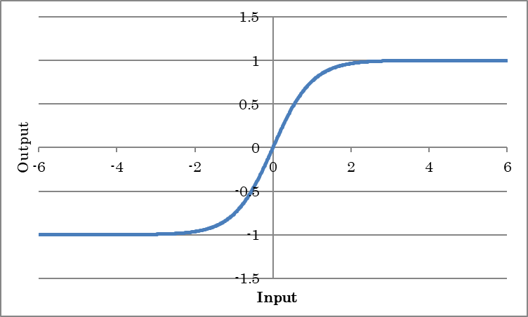

HardTanh
~~~~~~~~

HardTanh outputs -1 for inputs less than or equal to -1, +1 for inputs greater than equal to +1, and the input value for inputs that are between -1 and +1. This is an activation function that approximates using a lighter computation method than Tanh.

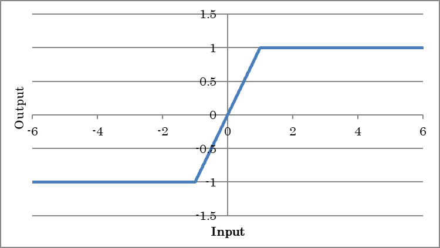

TanhShrink
~~~~~~~~~~

TanhShrink outputs the result of applying TanhShrink to the input.

.. math:: y = x - tanh(x)

(where y is the output and x is the input)

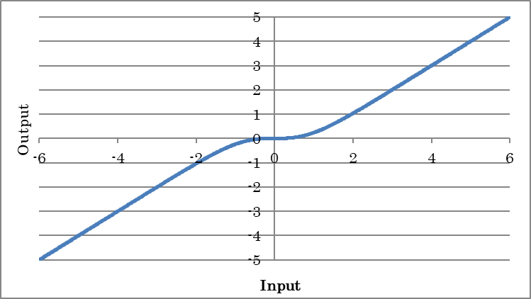

Sigmoid
~~~~~~~

Sigmoid outputs the result of taking the sigmoid of the input. This is used when you want to obtain probabilities or output values ranging from 0.0 to 1.0.

.. math:: y = sigmoid(x)

(where y is the output and x is the input)

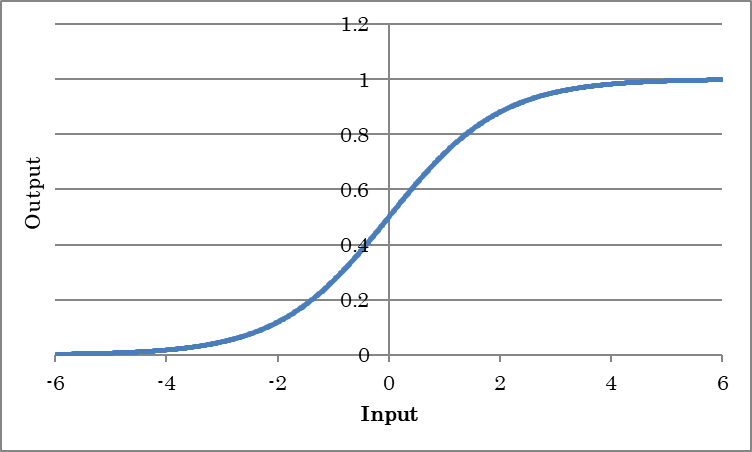

HardSigmoid
~~~~~~~~~~~

HardTanh outputs -0 for inputs less than or equal to -2.5, +1 for inputs greater than or equal to +2.5, and input value×0.2+0.5 for inputs that are between -2.5 and +2.5. It is an activation function that approximates using a lighter computation method than Sigmoid.

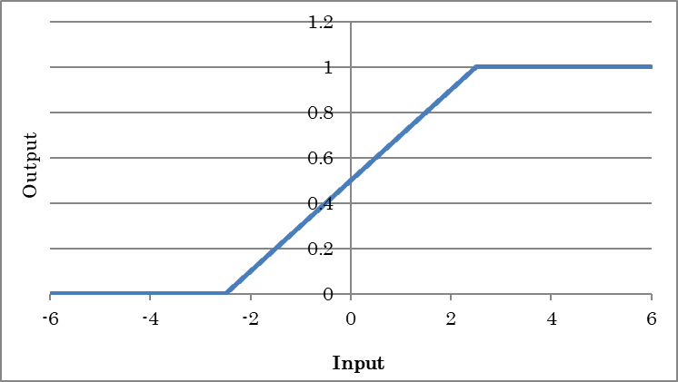

LogSigmoid
~~~~~~~~~~

LogSigmoid outputs the result of applying LogSigmoid to the input.

.. math:: y = \log(\frac{1}{1+\exp(-x)})

(where y is the output and x is the input)

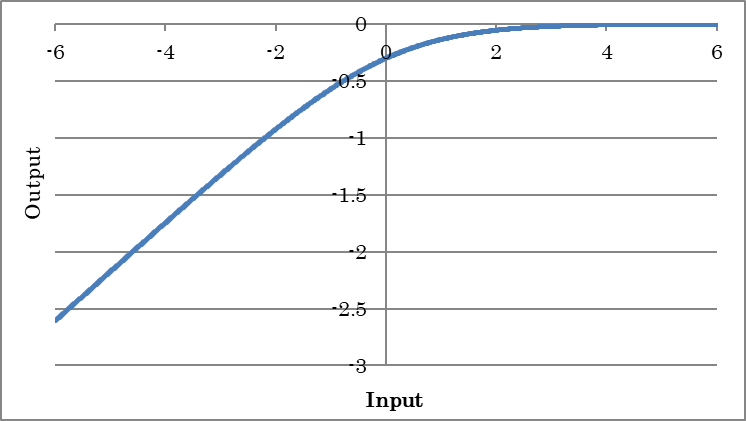

ReLU
~~~~

ReLU outputs the result of applying the rectified linear unit (ReLU) to the input.

.. math:: y = \max(0,x)

(where y is the output and x is the input)

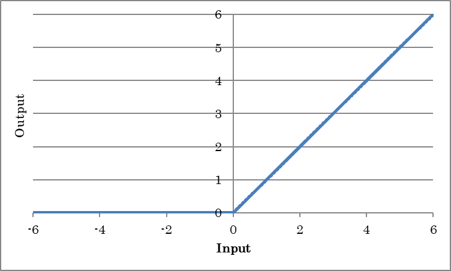

.. list-table::
   :widths: 30 70
   :class: longtable

   * - InPlace
     -
        If set to True, the memory needed for training is conserved by sharing the input and output buffers.
        
        To apply InPlace automatically when it is possible, specify \*AutoInPlaceOnce.

CReLU
~~~~~

Concatenated ReLU (CReLU) applies Relu to each of the negated input signals, concatenates each result on the axis indicated by the Axis property, and outputs the final result.

LeakyReLU
~~~~~~~~~

Unlike ReLU, which always outputs 0 for inputs less than or equal to 0, PReLU multiplies inputs less than or equal to 0 with a constant value to output results.

.. math:: y = \max(0, x) + a\min(0, x)

(where y is the output and x is the input)

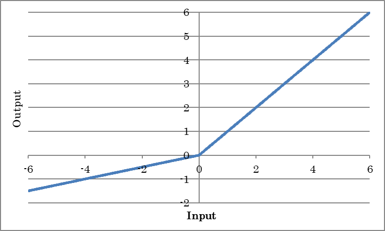

.. list-table::
   :widths: 30 70
   :class: longtable

   * - Alpha
     - Specify negative gradient a.

   * - InPlace
     -
        If set to True, the memory needed for training is conserved by sharing the input and output buffers.
        
        To apply InPlace automatically when it is possible, specify \*AutoInPlaceOnce.

PReLU
~~~~~

Unlike ReLU, which always outputs 0 for inputs less than or equal to 0, parametric ReLU (PReLU) multiplies inputs less than or equal to 0 with a constant value to output results. The value of a, which is a gradient less than 0, is obtained from training.

.. math:: y = \max(0, x) + a\min(0, x)

(where y is the output and x is the input)

.. list-table::
   :widths: 30 70
   :class: longtable

   * - BaseAxis
     - Of the available inputs, specify the index (that starts at 0) of the axis that individual a’s are to be trained on. For example, for inputs 4,3,5, to train individual a’s for the first dimension (four elements), set BaseAxis to 0.

   * - ParameterScope
     -
        Specify the name of the parameter used by this layer.
        
        The parameter is shared between layers with the same ParameterScope.

   * - slope.File
     -
        When using pre-trained gradient a, specify the file containing a with an absolute path.
        
        If a file is specified and weight slope is to be loaded from a file, initialization with the initializer will be disabled.

   * - slope.Initializer
     -
        Specify the initialization method for gradient a.
        
        Uniform
            Initialization is performed using uniform random numbers between -1.0 and 1.0.
        
        Normal
            Initialization is performed using Gaussian random numbers with 0.0 mean and 1.0 variance.
        
        Constant
            All elements are initialized with a constant (1.0).

   * - slope.InitializerMultiplier
     - Specify the multiplier to apply to the values that the initializer generates.

   * - slope.LRateMultiplier
     -
        Specify the multiplier to apply to the Learning Rate specified on the Config tab. This multiplier is used to update gradient a.
        
        For example, if the Learning Rate specified on the Config tab is 0.01 and slope.LRateMultiplier is set to 2, gradient a will be updated using a Learning Rate of 0.02.

ReLU6
~~~~~

ReLU6 outputs the result of applying ReLU to the input with the maximum output value limited to 6.

.. math:: y = \min(\max(0,x),6)

(where y is the output and x is the input)

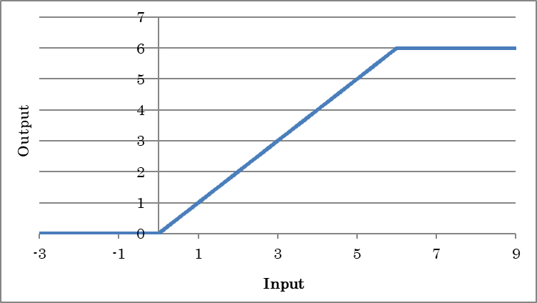

ELU
~~~

ELU outputs the result of applying the exponential linear unit (ELU) to the input.

.. math:: y = \max(0, x) + alpha(\exp(\min(0, x)) – 1)

(where y is the output and x is the input)

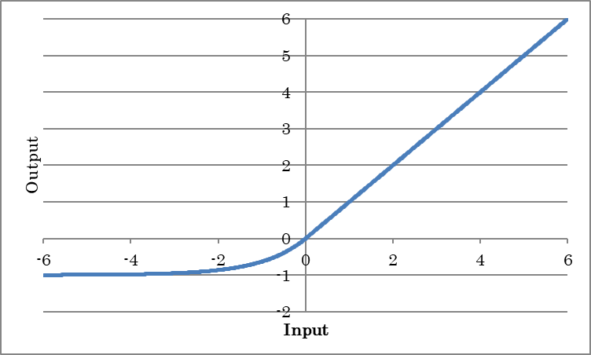

.. list-table::
   :widths: 30 70
   :class: longtable

   * - Alpha
     - Specify coefficient alpha for negative outputs.

CELU
~~~~

Concatenated ELU (CELU) applies ELU to each of the negated input signals, concatenates each result on the axis indicated by the Axis property, and outputs the final result.

SELU
~~~~

SELU outputs the result of applying the scaled exponential linear unit (SELU) to the input.

.. math:: y = lambda {max(0, x) + alpha(exp(min(0, x)) – 1)}

(where y is the output and x is the input)

.. list-table::
   :widths: 30 70
   :class: longtable

   * - Scale
     - Specify the whole scale lambda.

   * - Alpha
     - Specify coefficient alpha for negative outputs.

GELU
~~~~

GELU outputs the result of applying the Gaussian error unit (GELU) to the input.

.. math:: y = xP(X \leq x) = x\Phi(x)

.. math:: y = 0.5x(1+tanh(\frac{\sqrt{2}}{\pi}(x+0.044715 x^3)))

(where y is the output and x is the input)

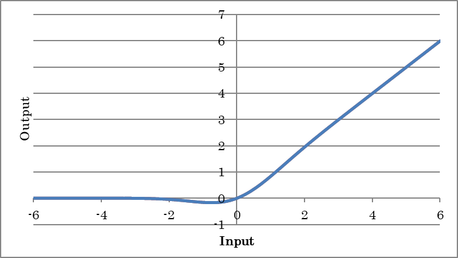

SoftPlus
~~~~~~~~

Softplus outputs the result of applying Softplust to the input.

.. math:: y = log(1+exp(x))

(where y is the output and x is the input)

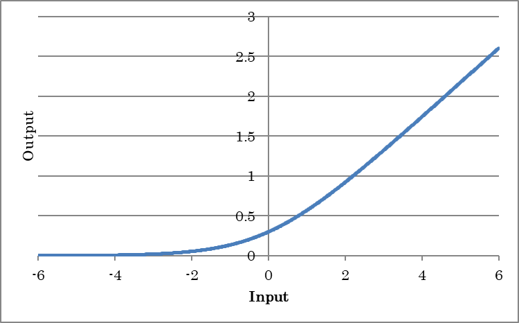

Sinc
~~~~

Sinc outputs the result of applying Sinc to the input.

.. math:: y = \frac{sin(x)}{x} \qquad (x != 0)

.. math:: y = 1 \qquad (x == 0)

(where y is the output and x is the input)

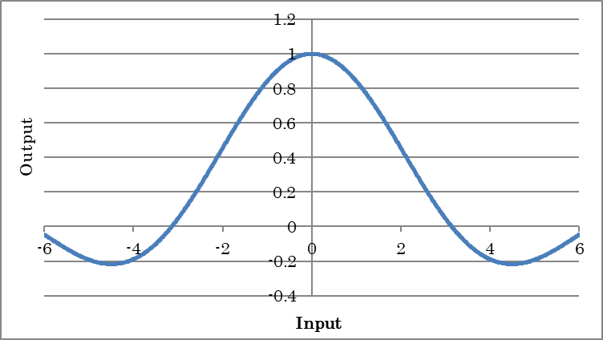

SoftSign
~~~~~~~~

SoftSign outputs the result of applying SoftSign to the input.

.. math:: y = \frac{x}{1+|x|}

(where y is the output and x is the input)

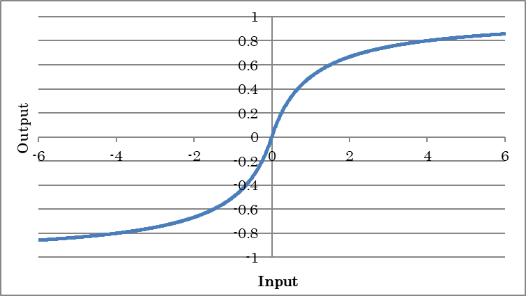

Swish
~~~~~

Swish outputs the result of taking the swish of the input.

.. math:: y = \frac{x}{1+\exp(-x)}

(where y is the output and x is the input)

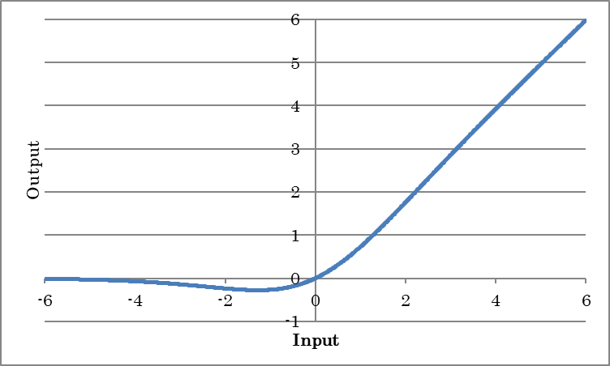

Mish
~~~~

Mish outputs the result of taking the mish of the input.

.. math:: y = x tanh(log(1+exp(x))

(where y is the output and x is the input)

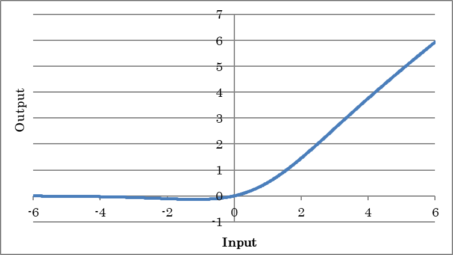

Abs
~~~

Abs outputs the absolute values of inputs.

.. math:: y = abs(x)

(where y is the output and x is the input)

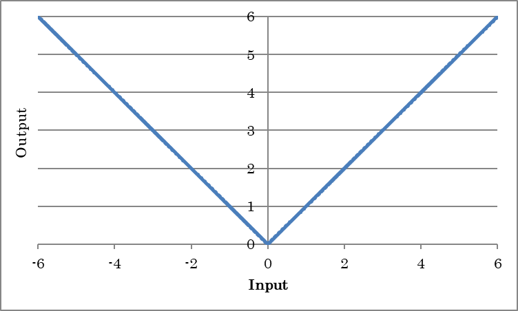

Softmax
~~~~~~~

Softmax outputs the Softmax of inputs. This is used when you want to obtain probabilities in a categorization problem or output values ranging from 0.0 to 1.0 that sum up to 1.0.

.. math:: y_i = \frac{\exp(x_i)}{\sum_{j}{\exp(x_j)}}

(where y is the output, x is the input, and i is the data index)

LogSoftmax
~~~~~~~~~~

LogSoftmax outputs the LogSoftmax of inputs.

.. math:: y_i = \log(\frac{\exp(x_i)}{\sum_{j}{\exp(x_j)}})

(where y is the output, x is the input, and i is the data index)

Loop Control layer
------------------

The Loop Control layer is for configuring networks with a loop structure, such as residual networks and recurrent neural networks.

RepeatStart
~~~~~~~~~~~

RepeatStart is a layer that indicates the start position of a loop. Layers placed between RepeatStart and RepeatEnd are created repeatedly for the number of times specified by the Times property of Repeat Start.

**Notes**

The array sizes of the layers between RepeatStart and RepeatEnd must be the same. Structures whose array sizes differ between repetitions cannot be written.

RepeatEnd
~~~~~~~~~

RepeatEnd is a layer that indicates the end position of a loop.

RecurrentInput
~~~~~~~~~~~~~~

RecurrentInput is a layer that indicates the time loop start position of a recurrent neural network. The axis specified by the Axis property is handled as the time axis. The length of a time loop is defined by the number of elements specified by the Axis property of the input data.

RecurrentOutput
~~~~~~~~~~~~~~~

RecurrentOutput is a layer that indicates the time loop end position of a recurrent neural network.

Delay
~~~~~

Delay is a layer that indicates the time delay signal in a recurrent neural network.

.. list-table::
   :widths: 30 70
   :class: longtable

   * - Size
     - Specify the size of the time delay signal.

   * - Initial.Dataset
     - Specify the name of the variable to be used as the initial value of the time delay signal.

   * - Initial.Generator
     -
        Specify the generator to use in place of the dataset. If the Generator property is not set to None, the data that the generator generates is used in place of the variable specified by T.Dataset during optimization.
        
        None
            Data generation is not performed.
        
        Uniform
            Uniform random numbers between -1.0 and 1.0 are generated.
        
        Normal
            Gaussian random numbers with 0.0 mean and 1.0 variance are generated.
        
        Constant
            Data whose elements are all constant (1.0) is generated.

   * - Initial.GeneratorMultiplier
     - Specify the multiplier to apply to the values that the generator generates.

Quantization layer
------------------

The quantization layer is used to quantize weights and data.

FixedPointQuantize
~~~~~~~~~~~~~~~~~~

FixedPointQuantize performs linear quantization.

.. list-table::
   :widths: 30 70
   :class: longtable

   * - Sign
     -
        Specify whether to include signs.
        
        When set to false, all values after quantization will be positive.

   * - N
     - Specify the number of quantization bits.

   * - Delta
     - Specify the quantization step size.

   * - STEFineGrained
     -
        Specify the gradient calculation method for backward processing.
        
        True
            The gradient is always 1.
        
        False
            The gradient is 1 between the maximum and minimum values of the range that can be expressed through quantization; otherwise it is 0.

MinMaxQuantize
~~~~~~~~~~~~~~

The MinMaxQuantize layer is used to quantize weights and data according to maximum and minimum values.

Quantization and Training of Neural Networks for Efficient Integer-Arithmetic-Only Inference
Benoit Jacob, Skirmantas Kligys, Bo Chen, Menglong Zhu, Matthew Tang, Andrew Howard, Hartwig Adam, and Dmitry Kalenichenko
https://arxiv.org/abs/1712.05877

.. list-table::
   :widths: 30 70
   :class: longtable

   * - Decay
     - Specify the decay rate of exponential moving average used when calculating the minimum and maximum values of the quantization range, "r" and "R".

   * - XMinMax
     - Specify whether to determine the minimum and maximum values of the quantization range, "r" and "R" from the maximum and minimum values of the input.

   * - EMA
     - Specify whether to use exponential moving average when calculating the minimum and maximum values of the quantization range, "r" and "R".

   * - STEFineGrained
     -
        Specify the gradient calculation method for backward processing.
        
        True
            The {0, 1}-mask computed from the min-max is applied to the gradient in the backward
        
        False
            The gradient is always 1.

   * - Epsilon
     - Specify the value to add to the denominator to prevent division by zero.

   * - r.*、R.*
     - 
       The minimum and maximum values of the quantization range.

       When XMinMax is True and EMA is True, "r" and "R" are updated by exponential moving average of maximum and minimum values of input in the forward processing.

       When XMinMax is True and EMA is False, "r" and "R" are overwritten by maximum and minimum values of input in the forward processing.

       When XMinMax is False and EMA is True, Quantization with "r" and "R" is performed in the forward processing, but "r" and "R" are not updated.

       When XMinMax is False and EMA is False, Gradients of "r" and "R" are computed in the backward processing.

   * - l.*、L.*
     - Minimum and maximum quantization level, typically 0 and 255.

Pow2Quantize
~~~~~~~~~~~~

Pow2Quantize performs power-of-two quantization.

.. list-table::
   :widths: 30 70
   :class: longtable

   * - Sign
     -
        Specify whether to include signs.
        
        When set to false, all values after quantization will be positive.

   * - WithZero
     -
        Specify whether to include zeros.
        
        When set to false, values after quantization will not include zeros.

   * - N
     - Specify the number of quantization bits.

   * - M
     - Specify the maximum value after quantization as 2^M.

   * - STEFineGrained
     -
        Specify the gradient calculation method for backward processing.
        
        True
            The gradient is always 1.
        
        False
            The gradient is 1 between the maximum and minimum values of the range that can be expressed through quantization; otherwise it is 0.

BinaryConnectAffine
~~~~~~~~~~~~~~~~~~~

BinaryConnectAffine is an Affine layer that uses W, which has been converted into binary values of -1 and +1.

.. math:: o = sign(W)i+b

(where i is the input, o is the output, W is the weight, and b is the bias term.)

.. list-table::
   :widths: 30 70
   :class: longtable

   * - Wb.\*
     - Specify the weight Wb settings to use after the conversion into binary values. The properties are the same as those of W for the Affine layer.

For details on other properties, see the Affine layer.

BinaryConnectConvolution
~~~~~~~~~~~~~~~~~~~~~~~~

BinaryConnectConvolution is a convolution layer that uses W, which has been converted into binary values of -1 and +1.

Two-dimensional convolution

    .. math:: O_{x,y,m} = \sum_{i,j,n}{sign(W_{i,j,n,m})I{x+i,y+j,n}} + b_m

(where O is the output; I is the input; i,j is the kernel size; x,y,n is the input index; m is the output map (OutMaps property), W is the kernel weight, and b is the bias term of each kernel)

.. list-table::
   :widths: 30 70
   :class: longtable

   * - Wb.\*
     - Specify the weight Wb settings to use after the conversion into binary values. The properties are the same as those of W for the Convolution layer.

For details on other properties, see the Convolution layer.

BinaryWeightAffine
~~~~~~~~~~~~~~~~~~

BinaryWeightAffine is an affine layer that uses W, which has been converted into binary values of -1 and +1, and then scalingto make the output closer to the normal Affine layer.

.. math:: o = a sign(W)i +b

(where i is the input, o is the output, W is the weight, a is the scale, and b is the bias term.)

BinaryWeightConvolution
~~~~~~~~~~~~~~~~~~~~~~~

BinaryWeightConvolution is an affine layer that uses W, which has been converted into binary values of -1 and +1, and then scalingto make the output closer to the normal Convolution layer.

Two-dimensional convolution

    .. math:: O_{x,y,m} = \sum_{i,j,n}{sign(W_{i,j,n,m})I_{x+i,y+j,n}} * a + b_m
              

(where O is the output; I is the input; i,j is the kernel size; x,y,n is the input index; m is the output map (OutMaps property), W is the kernel weight, a is the scale, and b is the bias term of each kernel)

BinaryTanh
~~~~~~~~~~

Binarytanh outputs -1 for inputs less than or equal to 0 and +1 for inputs great than 0.

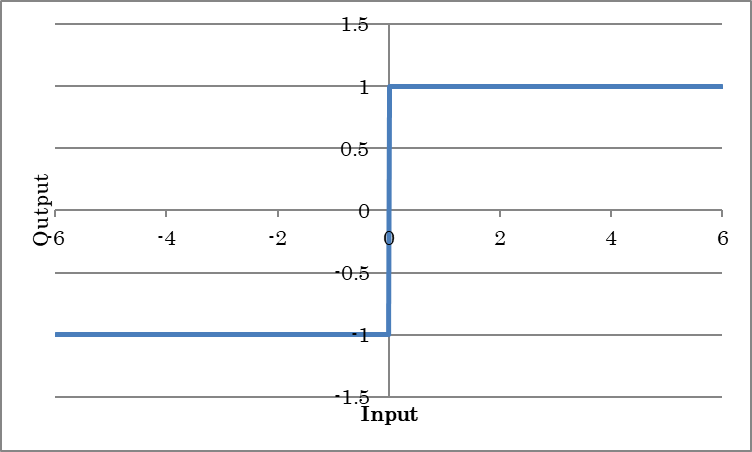

BinarySigmoid
~~~~~~~~~~~~~

BinarySigmoid outputs 0 for inputs less than or equal to 0 and +1 for inputs great than 0.

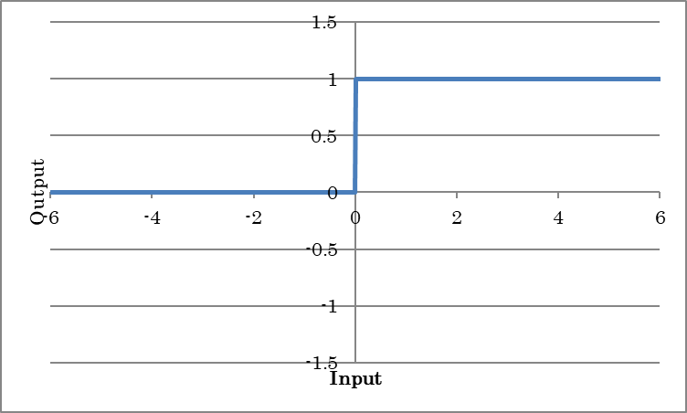

Unit layer
----------

The unit layer provides a function for inserting other networks in the middle of a network. By using the unit layer, you can insert a collection of layers defined as a network in the middle of another network.

A network that another network is inserted into using the unit layer is called a *caller network*, and the network to be inserted into another network using the unit layer is called a *unit network*.

Unit
~~~~

Inserts a unit network into the current caller network.

.. list-table::
   :widths: 30 70
   :class: longtable

   * - Network
     - Specify the name of the unit network to be inserted.

   * - ParameterScope
     -
        Specify the name of the parameter used by this unit.
        
        The parameter is shared between units with the same ParameterScope.

   * - (Other properties)
     - Specify the properties of the unit network to be inserted.

If the unit network specified by Network property has multiple Input layers and the Order property is specified for each, the Input layer with the Order value of 0 will be assigned to the input of the Unit layer, and Input layers with the Order value of greater than 0 will be assigned as the side connector of the Unit layer.

Argument
~~~~~~~~

Set the parameters of the unit network to allow editing as unit properties from the caller network. You can specify the name of an argument layer for the other layer properties in the unit network to use the argument layer values from the other layers in the unit network. The implemented argument layer values can be specified through the unit properties implemented in the caller network.

.. list-table::
   :widths: 30 70
   :class: longtable

   * - Value
     - Specify the default parameter value.

   * - Type
     -
        Specify the parameter type.
        
        Boolean
            True or False
        
        Int
            Integer
        
        IntArray
            Array of integers
        
        PInt
            Integer greater than equal to 1
        
        PIntArray
            Array of integers greater than equal to 1
        
        PIntArrays
            Array of array of integers greater than equal to 1
        
        UInt
            Unsigned integer
        
        UIntArray
            Array of unsigned integers
        
        Float
            Floating-point number
        
        FloatArray
            Array of floating-point numbers
        
        FloatArrays
            Array of array of floating-point numbers
        
        Text
            Character string
        
        File
            File name

   * - Search
     - Specify for the caller network whether to include the parameter in the automatic structure search.

Spectral layer
--------------

FFT
~~~

Performs a Fourier transform of the complex input and complex output. The last dimension of the input array must be complex (real part and imaginary part).

.. list-table::
   :widths: 30 70
   :class: longtable

   * - SignalNDim
     -
        Specify the number of dimensions of the signal to perform the Fourier transform of.
        
        For example, specify 1 for a one-dimensional Fourier transform and 2 for a two-dimensional Fourier transform.

   * - Normalized
     -
        Scales the Fourier transform result by a constant factor indicated by the following formula and exports the final result.
        
        :math:`\sqrt{\frac{1}{\prod_{i = 1}^{d}N_{i}}}`

IFFT
~~~~

Performs an inverse Fourier transform of the complex input and complex output.

.. list-table::
   :widths: 30 70
   :class: longtable

   * - SignalNDim
     -
        Specify the number of dimensions of the signal to perform the inverse Fourier transform of.
        
        For example, specify 1 for a one-dimensional inverse Fourier transform and 2 for a two-dimensional inverse Fourier transform.

   * - Normalized
     -
        Specify the constant to multiply the inverse Fourier transform result by.
        
        True
            :math:`\sqrt{\frac{1}{\prod_{i = 1}^{d}N_{i}}}`
        
        False
            :math:`\frac{1}{\prod_{i = 1}^{d}N_{i}}`

Arithmetic operation layer
--------------------------

Sum
~~~

Sum determines the sum of the values of the specified dimension.

.. list-table::
   :widths: 30 70
   :class: longtable

   * - Axis
     - Specify the index (that start at 0) of the axis to sum the values of.

   * - KeepDims
     - Specify whether to hold the axis whose values have been summed.

CumSum
~~~~~~

CumSum determines the cumulative sum of the values of the specified dimension.

.. list-table::
   :widths: 30 70
   :class: longtable

   * - Axis
     - Specify the index (that start at 0) of the axis to sum the values of.

   * - Exclusive
     - Specify whether to exclude own value from the cumulative sum.

   * - Reverse
     - Specify whether to calculate the cumulative sum in the opposite direction

Mean
~~~~

Sum determines the mean of the values of the specified dimension.

.. list-table::
   :widths: 30 70
   :class: longtable

   * - Axis
     - Specify the index (that start at 0) of the axis whose values will be averaged

   * - KeepDims
     - Specify whether to hold the axis whose values have been averaged.

Prod
~~~~

Prod determines the product of the values of the specified dimension.

.. list-table::
   :widths: 30 70
   :class: longtable

   * - Axis
     - Specify the index (that start at 0) of the axis to multiply the values of.

   * - KeepDims
     - Specify whether to hold the axis whose values have been multiplied.

CumProd
~~~~~~~

CumProd determines the cumulative product of the values of the specified dimension.

.. list-table::
   :widths: 30 70
   :class: longtable

   * - Axis
     - Specify the index (that start at 0) of the axis to product the values of.

   * - Exclusive
     - Specify whether to exclude own value from the cumulative product.

   * - Reverse
     - Specify whether to calculate the cumulative product in the opposite direction

Max
~~~

Max determines the maximum of the values of the specified dimension.

.. list-table::
   :widths: 30 70
   :class: longtable

   * - Axis
     - Specify the index (that start at 0) of the axis on which to determine the maximum value.

   * - KeepDims
     - Specify whether to hold the axis whose maximum value has been determined.

   * - OnlyIndex
     -
        Specify the Max output type.
        
        True
            The index with the maximum value is output.
        
        False
            The maximum value is output.

Min
~~~

Min determines the minimum of the values of the specified dimension.

.. list-table::
   :widths: 30 70
   :class: longtable

   * - Axis
     - Specify the index (that start at 0) of the axis on which to determine the minimum value.

   * - KeepDims
     - Specify whether to hold the axis whose minimum value has been determined.

   * - OnlyIndex
     -
        Specify the Min output type.
        
        True
            The index with the minimum value is output.
        
        False
            The minimum value is output.

Norm
~~~~

Norm calculates the norm of the values of the specified dimension.

.. list-table::
   :widths: 30 70
   :class: longtable

   * - P
     - Specify the norm order p

   * - Axes
     -
        Specify the index (-1 and integers greater than or equal to 0) of the axis used to calculate the norm.
        
        For example, for inputs 4,3,5, to calculate the norm based on the first dimension (4 elements), set Axes to 0. To calcumate the norm based on the second and third dimensions (elements 3,5), set Axes to 1,2.

   * - KeepDims
     - Specify whether to hold the axis whose norm has been determined.

Log
~~~

Log calculates the natural logarithm with base e.

Exp
~~~

Exp calculates the exponential function with base e.

Sign
~~~~

Sign outputs -1 for negative inputs, +1 for positive inputs, and alpha for 0.

.. list-table::
   :widths: 30 70
   :class: longtable

   * - Alpha
     - Specify the output corresponding to input 0.

**Reference**

When compared to BinaryTanh, the operation is similar to forward computation (except for the behavior when the input is 0), but the operation of backward computation is different. Unlike BinaryTanh, which sets the derivative to 0 when the absolute value of the input data is 1 or greater, Sign passes through the back propagation derivative as its own derivative.

BatchMatmul
~~~~~~~~~~~

BatchMatmul calculates the matrix multiplication of the matrix expressed by the last two dimensions of input (A) and connector R input (B). If matrix A is L×N and matrix B is N×M, the output matrix will be L×M.

BatchInv
~~~~~~~~

BatchInv outputs the inverse matrix of the last two dimensions of the input.

BatchDet
~~~~~~~~

BatchDet outputs the determinant of the last two-dimensional matrix of the input.

BatchLogdet
~~~~~~~~~~~

BatchLogdet outputs a log of the absolute value of the determinant of the last two-dimensional matrix of the input.

Round
~~~~~

Round rounds the input value.

Ceil
~~~~

Ceil rounds up the fraction of the input value.

Floor
~~~~~

Floor truncates the fraction of the input value.

Trigonometric layer
-------------------

The trigonometric layer calculates the trigonometric function of each element.

.. list-table::
   :widths: 30 70
   :class: longtable
   :header-rows: 1

   * - Layer name
     - Expression

   * - Sin
     - :math:`y = sin(x)`

   * - Cos
     - :math:`y = cos(x)`

   * - Tan
     - :math:`y = tan(x)`

   * - Sinh
     - :math:`y = sinh(x)`

   * - Cosh
     - :math:`y = cosh(x)`

   * - ASin
     - :math:`y = arcsin(x)`

   * - ACos
     - :math:`y = arccos(x)`

   * - ATan
     - :math:`y = arctan(x)`

   * - ATan2
     - :math:`y = arctan2(x_1, x_2)`

   * - ASinh
     - :math:`y = asinh(x)`

   * - ACosh
     - :math:`y = asinh(x)`

   * - ATanh
     - :math:`y = atanh(x)`

(where x, x\ :sub:`1`, and x\ :sub:`2` are inputs and y is the output)

Scalar arithmetic operation layer (Arithmetic (Scalar))
-------------------------------------------------------

Various arithmetic operations is performed on each element using a real number specified by the Value property.

.. list-table::
   :widths: 30 70
   :class: longtable
   :header-rows: 1

   * - Layer name
     - Expression

   * - AddScalar
     - :math:`y = x+value`

   * - MulScalar
     - :math:`y = x*value`

   * - RSubScalar
     - :math:`y = value-x`

   * - RDivScalar
     - :math:`y = value/x`

   * - PowScalar
     - :math:`y = x ^ {value}`

   * - RPowScalar
     - :math:`y = value ^ {x}`

   * - MaximumScalar
     - :math:`y = max(x, value)`

   * - MinimumScalar
     - :math:`y = min(x, value)`

(where x is the input, y is the output, and value is the real number)

Two-input arithmetic operation layer (Arithmetic (2 Inputs))
------------------------------------------------------------

Various arithmetic operations are performed on each element using two inputs.

Connect :math:`x_1` to the input pin and :math:`x_2` to the side connector.

.. list-table::
   :widths: 30 70
   :class: longtable
   :header-rows: 1

   * - Layer
     - Expression

   * - Add2
     - :math:`y = x_1 + x_2`

   * - Sub2
     - :math:`y = x_1 - x_2`

   * - Mul2
     - :math:`y = x_1 * x_2`

   * - Div2
     -
        :math:`y = x_1 / x_2`
        
        Connect the input for x\ :sub:`2` in the right hand side to connector R.

   * - Pow2
     -
        :math:`y = x_1^{X_2}`
        
        Connect the input for x\ :sub:`2` in the right hand side to connector R.

   * - Maxmum2
     - :math:`y = max(x_1, x_2)`

   * - Minimum2
     - :math:`y = min(x_1, x_2)`

(where x\ :sub:`1`, and x\ :sub:`2` are inputs and y is the output)

N-input arithmetic operation layer (Arithmetic (N Inputs))
----------------------------------------------------------

Various arithmetic operations are performed on each element using at least two inputs.

.. list-table::
   :widths: 30 70
   :class: longtable
   :header-rows: 1

   * - Layer
     - Expression

   * - AddN
     - :math:`y = \sum{x_i}`

   * - MulN
     - :math:`y = \prod {x_i}`

(where x\ :sub:`1` is the input and y is the output)

Logical operation layer
-----------------------

Various logical operations are performed on each element using two inputs or one input and a value specified by the Value property. The logical operation output is 0 or 1.

Connect :math:`x_1` to the input pin and :math:`x_2` to the side connector.

.. list-table::
   :widths: 30 70
   :class: longtable
   :header-rows: 1

   * - Layer name
     - Process

   * - LogicalAnd
     - :math:`y =  x_1 and x_2`

   * - LogicalOr
     - :math:`y =  x_1 or x_2`

   * - LogicalXor
     - :math:`y =  x_1 xor x_2`

   * - Equal
     - :math:`y =  x_1 == x_2`

   * - NotEqual
     - :math:`y =  x_1 != x_2`

   * - GreaterEqual
     - :math:`y =  x_1 >= x_2`

   * - Greater
     - :math:`y =  x_1 > x_2`

   * - LessEqual
     - :math:`y =  x_1 <= x_2`

   * - Less
     - :math:`y =  x_1 < x_2`

   * - LogicalAndScalar
     - :math:`y =  x and value`

   * - LogicalOrScalar
     - :math:`y =  x or value`

   * - LogicalXorScalar
     - :math:`y =  x xor value`

   * - EqualScalar
     - :math:`y =  x == value`

   * - NotEqualScalar
     - :math:`y =  x != value`

   * - GreaterEqualScalar
     - :math:`y =  x >= value`

   * - GreaterScalar
     - :math:`y =  x > value`

   * - LessEqualScalar
     - :math:`y =  x <= value`

   * - LessScalar
     - :math:`y =  x < value`

   * - LogicalNot
     - :math:`y =  !x`

   * - IsNaN
     - :math:`y =  x == NaN`

   * - IsInf
     - :math:`y =  x == inf or x== -inf`

(where x, x\ :sub:`1`, and x\ :sub:`2` are inputs and y is the output)

**Notes**

The logical operation layer does not support back propagation.

Evaluation layer
----------------

BinaryError
~~~~~~~~~~~

The input data and variable T in the dataset indicating correct values are converted into binary values (0 or 1) depending on whether the values are greater than equal to 0.5. Then, each unmatched data samples are evaluated. If the input data match the correct binary value, 0 is output. Otherwise, 1 is output.

.. list-table::
   :widths: 30 70
   :class: longtable

   * - T.Dataset
     - Specify the name of the variable expected to be the output of this layer.

   * - T.Generator
     -
        Specify the generator to use in place of the dataset. If the Generator property is not set to None, the data that the generator generates is used in place of the variable specified by T.Dataset during optimization.
        
        None
            Data generation is not performed.
        
        Uniform
            Uniform random numbers between -1.0 and 1.0 are generated.
        
        Normal
            Gaussian random numbers with 0.0 mean and 1.0 variance are generated.
        
        Constant
            Data whose elements are all constant (1.0) is generated.

   * - T.GeneratorMultiplier
     - Specify the multiplier to apply to the values that the generator generates.

TopNError
~~~~~~~~~

Based on the input data indicating the probability or score of each category and variable T in the dataset indicating the category index, each data sample is evaluated as to whether the probability or score of the correct category is within the top N of all categories. If the probability or score of the correct category is within the top N, 0 is output. Otherwise, 1 is output.

.. list-table::
   :widths: 30 70
   :class: longtable

   * - Axis
     - Specify the index of the axis indicating the category.

   * - N
     -
        Specify the lowest ranking N that will be considered correct.
        
        For example, if you want to allow only the maximum probability or score of the correct category to be considered correct, specify 1. If you want to allow only the top five probabilities or scores of the correct category to be considered correct, specify 5.

   * - T.Dataset
     - Specify the name of the variable expected to be the output of this layer.

   * - T.Generator
     -
        Specify the generator to use in place of the dataset. If the Generator property is not set to None, the data that the generator generates is used in place of the variable specified by T.Dataset during optimization.
        
        None
            Data generation is not performed.
        
        Uniform
            Uniform random numbers between -1.0 and 1.0 are generated.
        
        Normal
            Gaussian random numbers with 0.0 mean and 1.0 variance are generated.
        
        Constant
            Data whose elements are all constant (1.0) is generated.

   * - T.GeneratorMultiplier
     - Specify the multiplier to apply to the values that the generator generates.

Normalization layers
--------------------

BatchNormalization
~~~~~~~~~~~~~~~~~~

The input is normalized to 0 mean and 1 variance. Inserting this layer after Convolution or Affine has the effect of improving accuracy and accelerating convergence.

.. math:: y_i = (x_i-mean(x)) * \frac{\gamma_i}{\sum{x}} + \beta_i

(where y is the output, x is the input, and i is the data index)

Batch Normalization
            Accelerating Deep Network Training by Reducing Internal Covariate Shift

Sergey Ioffe, Christian Szegedy

https://arxiv.org/abs/1502.03167

.. list-table::
   :widths: 30 70
   :class: longtable

   * - Axes
     - Of the available inputs, specify the index (that starts at 0) of the axis to be normalized individually. For example, for inputs 4,3,5, to individually normalize the first dimension (four elements), set Axes to 0. To individually normalize the second and third dimensions (elements 3,5), set Axes to 1,2.

   * - DecayRate
     - Specify the decay rate (0.0 to 1.0) to apply when updating the mean and standard deviation of the input data during training. The closer the value is to 1.0, the more the mean and standard deviation determined from past data are retained.

   * - Epsilon
     - Specify the value to add to the variance of the input data to prevent division by zero during normalization.

   * - BatchStat
     -
        Specify whether to use the average variance calculated for each mini-batch in batch normalization.
        
        True
            The average variance calculated for each mini-batch is used.
        
        False
            The moving average and moving variance calculated when BatchStat=True is used.

   * - ParameterScope
     -
        Specify the name of the parameter used by this layer.
        
        The parameter is shared between layers with the same ParameterScope.

   * - beta.File
     -
        When using pre-trained beta, specify the file containing beta with an absolute path.
        
        If a beta is specified and is to be loaded from a file, initialization with the initializer will be disabled.

   * - beta.Initializer
     -
        Specify the initialization method for beta.
        
        Uniform
            Initialization is performed using uniform random numbers between -1.0 and 1.0.
        
        Normal
            Initialization is performed using Gaussian random numbers with 0.0 mean and 1.0 variance.
        
        Constant
            All elements are initialized with a constant (1.0).

   * - beta.InitializerMultiplier
     - Specify the multiplier to apply to the values that the initializer generates.

   * - beta.LRateMultiplier
     -
        Specify the multiplier to apply to the Learning Rate specified on the Config tab. This multiplier is used to update beta.
        
        For example, if the Learning Rate specified on the Config tab is 0.01 and beta.LRateMultiplier is set to 2, beta will be updated using a Learning Rate of 0.02.

   * - gamma.\*
     - Specify the standard deviation after normalization.

   * - mean.\*
     - Specify the mean of the input data.

   * - var.\*
     - Specify the standard deviation of the input data.

FusedBatchNormalization
~~~~~~~~~~~~~~~~~~~~~~~

FusedBatchNormalization collectively performs BatchNormalization and activation function processing. This has the effect of improving the calculation speed by a small amount as compared to applying BatchNormalization and activation function separately. All properties except NonLinearity are the same as those of BatchNormalization.

.. list-table::
   :widths: 30 70
   :class: longtable

   * - Nonlinearity
     - Specify the activation function type. Currently, only relu can be specified.

NormNormalization
~~~~~~~~~~~~~~~~~

The input is normalized to have a norm of 1.

.. math:: y_i =\frac{x_i}{||x||_p}

(where y is the output, x is the input, and i is the data index)

.. list-table::
   :widths: 30 70
   :class: longtable

   * - P
     - Specify the norm order p

   * - Axes
     -
        Specify the index (-1 and integers greater than or equal to 0) of the axis used to calculate the norm.

        For example, for inputs 4,3,5, to calculate the norm based on the first dimension (four elements),
        set Axes to 0. To calcumate the norm based on the second and third dimensions (elements 3,5), set Axes to 1,2.

        To add the mini batch as the norm calculation, add -1 to Axes.
       
   * - Epsilon
     - Specify the value to add to the denominator to prevent division by zero during normalization.

WeightStandardization
~~~~~~~~~~~~~~~~~~~~~

WeightStandardization applies weight standardization defined by the following equation to parameter, which is mainly the output of the Parameter layer.

.. math:: \mu w_{i} = \frac{1}{I}\sum_{j = 1}^{I}W_{\text{ij}}

.. math:: \sigma w_{i} = \sqrt{\frac{1}{I}\sum_{j = 1}^{I}{{(W_{\text{ij}} - \ \mu w_{i})}^{2} + \varepsilon}}

.. math:: \widehat{W}_{ij} = \frac{W_{ij} - \mu w_i}{\sigma w_i}

.. math:: y = \widehat{W}*\text{\ x}

Micro Batch Training with Batch Channel Normalization and Weight Standardization

Siyuan Qiao, Huiyu Wang, Chenxi Liu, Wei Shen, Alan Yuille

https://arxiv.org/abs/1502.03167

.. list-table::
   :widths: 30 70
   :class: longtable

   * - ChannelAxis
     -
        Of the available inputs, specify the index (that starts at 0) of the axis to be standardized individually.
        
        For example, for the input parameter of size 256,128,3,3 to individually standardize the first dimension (256 elements), set ChannelAxis to 0.

   * - Epsilon
     - Specify the value to add to the variance to prevent division by zero during normalization.

WeightNormalization
~~~~~~~~~~~~~~~~~~~

WeightNormalization applies weight normalization defined by the following equation to parameter, which is mainly the output of the Parameter layer.

.. math:: w_{WN} = \ g\frac{w}{\|w\|}

Micro-Batch Training with Batch-Channel Normalization and Weight Standardization

Siyuan Qiao, Huiyu Wang, Chenxi Liu, Wei Shen, Alan Yuille

https://arxiv.org/abs/1903.10520

.. list-table::
   :widths: 30 70
   :class: longtable

   * - Dim
     -
        Of the available inputs, specify the index (that starts at 0) of the axis to be normalized individually.
        
        For example, for the input parameter of size 256,128,3,3 to individually normalize the first dimension (256 elements), set Dim to 0.

   * - Epsilon
     - Specify the value to add to the norm to prevent division by zero during normalization.

   * - g.\*
     - Specify the scale after normalization.

SpectralNorm
~~~~~~~~~~~~

Spectral Norm applies spectral normalization defined by the following equation to parameter, which is mainly the output of the Parameter layer.

.. math:: w_{SN} = \frac{w}{\sigma(w)}

The :math:`\sigma(w)` is the spectral norm of W. The spectral norm is approximately computed by the power iteration.

Takeru Miyato, Toshiki Kataoka, Masanori Koyama, Yuichi Yoshida, "Spectral Normalization for Generative Adversarial Networks", International Conference on Learning Representations. 2018.

.. list-table::
   :widths: 30 70
   :class: longtable

   * - Dim
     -
        Of the available inputs, specify the index (that starts at 0) of the axis to be normalized individually.
        
        For example, for the input parameter of size 256,128,3,3 to individually normalize the first dimension (256 elements), set Dim to 0.

   * - Epsilon
     - Specify the value to add to the denominator to prevent division by zero during normalization.

   * - Itr
     - Number of power iterations.

   * - Test
     - When in True, u will not be updated.

   * - u.\*
     - 1-D array of singular vector. When test = False, the data region of u will be updated during forward calculation.

LayerNormalization
~~~~~~~~~~~~~~~~~~

LayerNormalization normalizes the input in the data by the formula shown below.

.. math:: \mu^{l} = \frac{1}{H}\sum_{i = 1}^{H}x_{i}^{l}

.. math:: \sigma^{l} = \sqrt{\frac{1}{H}\sum_{i = 1}^{H}{{(x_{i}^{l} - \ \mu^{l})}^{2} + \varepsilon}}

.. math:: y = \frac{x - \mu^{l}}{\sigma^{l}}\gamma + \beta

(where y is the output, x is the input, μ\ :sup:`l` and σ\ :sup:`l` are the mean and standard deviation calculated individually for each data, β and γ are the bias and gain.)

Layer Normalization

Jimmy Lei Ba, Jamie Ryan Kiros, Geoffrey E. Hinton

https://arxiv.org/abs/1607.06450

.. list-table::
   :widths: 30 70
   :class: longtable

   * - BatchAxis
     - Of the available inputs, specify the index of the mini-batch axis (usually -1) to be normalized individually.

   * - Epsilon
     - Specify the value to add to the variance to prevent division by zero during normalization.

   * - ParameterScope
     -
        Specify the name of the parameter used by this layer.
        
        The parameter is shared between layers with the same ParameterScope.

   * - beta.File
     -
        When using pre-trained beta, specify the file containing beta with an absolute path.
        
        If a beta is specified and is to be loaded from a file, initialization with the initializer will be disabled.

   * - beta.Initializer
     -
        Specify the initialization method for beta.
        
        Uniform
            Initialization is performed using uniform random numbers between -1.0 and 1.0.
        
        Normal
            Initialization is performed using Gaussian random numbers with 0.0 mean and 1.0 variance.
        
        Constant
            All elements are initialized with a constant (1.0).

   * - beta.InitializerMultiplier
     - Specify the multiplier to apply to the values that the initializer generates.

   * - beta.LRateMultiplier
     -
        Specify the multiplier to apply to the Learning Rate specified on the Config tab. This multiplier is used to update beta.
        
        For example, if the Learning Rate specified on the Config tab is 0.01 and beta.LRateMultiplier is set to 2, beta will be updated using a Learning Rate of 0.02.

   * - gamma.\*
     - Specify the standard deviation after normalization.

InstanceNormalization
~~~~~~~~~~~~~~~~~~~~~

InstanceNormalization normalizes the input in the data by the formula shown below.

.. math:: \mu^{i} = \frac{1}{H}\sum_{j = 1}^{H}x_{j}^{i}

.. math:: \sigma^{i} = \sqrt{\frac{1}{H}\sum_{j = 1}^{H}{{(x_{j}^{i} - \ \mu^{i})}^{2} + \varepsilon}}

.. math:: y = \frac{x - \mu^{i}}{\sigma^{i}}\gamma + \beta

(where y is the output, x is the input, μ\ :sup:`i` and σ\ :sup:`i` are the mean and standard deviation calculated individually for each instance, β and γ are the bias and gain.)

Instance Normalization: The Missing Ingredient for Fast Stylization

Dmitry Ulyanov, Andrea Vedaldi, Victor Lempitsky

https://arxiv.org/abs/1607.08022

.. list-table::
   :widths: 30 70
   :class: longtable

   * - ChannelAxis
     - Of the available inputs, specify the index (that starts at 0) of the axis to be normalized individually.

   * - BatchAxis
     - Of the available inputs, specify the index of the mini-batch axis (usually -1) to be normalized individually.

   * - Epsilon
     - Specify the value to add to the variance to prevent division by zero during normalization.

   * - ParameterScope
     -
        Specify the name of the parameter used by this layer.
        
        The parameter is shared between layers with the same ParameterScope.

   * - beta.File
     -
        When using pre-trained beta, specify the file containing beta with an absolute path.
        
        If a beta is specified and is to be loaded from a file, initialization with the initializer will be disabled.

   * - beta.Initializer
     -
        Specify the initialization method for beta.
        
        Uniform
            Initialization is performed using uniform random numbers between -1.0 and 1.0.
        
        Normal
            Initialization is performed using Gaussian random numbers with 0.0 mean and 1.0 variance.
        
        Constant
            All elements are initialized with a constant (1.0).

   * - beta.InitializerMultiplier
     - Specify the multiplier to apply to the values that the initializer generates.

   * - beta.LRateMultiplier
     -
        Specify the multiplier to apply to the Learning Rate specified on the Config tab. This multiplier is used to update beta.
        
        For example, if the Learning Rate specified on the Config tab is 0.01 and beta.LRateMultiplier is set to 2, beta will be updated using a Learning Rate of 0.02.

   * - gamma.\*
     - Specify the standard deviation after normalization.

GroupNormalization
~~~~~~~~~~~~~~~~~~

GroupNormalization normalizes the input in the data by the formula shown below.

.. math:: \mu^{g} = \frac{1}{H}\sum_{i = 1}^{H}x_{i}^{g}

.. math:: \sigma^{g} = \sqrt{\frac{1}{H}\sum_{i = 1}^{H}{{(x_{i}^{g} - \ \mu^{g})}^{2} + \varepsilon}}

.. math:: y = \frac{x - \mu^{g}}{\sigma^{g}}\gamma + \beta

(where y is the output, x is the input, μ\ :sup:`g` and σ\ :sup:`g` are the mean and standard deviation calculated individually for each group, β and γ are the bias and gain.)

Group Normalization

Yuxin Wu, Kaiming He

https://arxiv.org/abs/1803.08494

.. list-table::
   :widths: 30 70
   :class: longtable

   * - ChannelAxis
     - Of the available inputs, specify the index (that starts at 0) of the axis to be normalized individually.

   * - BatchAxis
     - Of the available inputs, specify the index of the mini-batch axis (usually -1) to be normalized individually.

   * - NumGroups
     - Specify the number of groups when grouping channels.

   * - Epsilon
     - Specify the value to add to the variance to prevent division by zero during normalization.

   * - ParameterScope
     -
        Specify the name of the parameter used by this layer.
        
        The parameter is shared between layers with the same ParameterScope.

   * - beta.File
     -
        When using pre-trained beta, specify the file containing beta with an absolute path.
        
        If a beta is specified and is to be loaded from a file, initialization with the initializer will be disabled.

   * - beta.Initializer
     -
        Specify the initialization method for beta.
        
        Uniform
            Initialization is performed using uniform random numbers between -1.0 and 1.0.
        
        Normal
            Initialization is performed using Gaussian random numbers with 0.0 mean and 1.0 variance.
        
        Constant
            All elements are initialized with a constant (1.0).

   * - beta.InitializerMultiplier
     - Specify the multiplier to apply to the values that the initializer generates.

   * - beta.LRateMultiplier
     -
        Specify the multiplier to apply to the Learning Rate specified on the Config tab. This multiplier is used to update beta.
        
        For example, if the Learning Rate specified on the Config tab is 0.01 and beta.LRateMultiplier is set to 2, beta will be updated using a Learning Rate of 0.02.

   * - gamma.\*
     - Specify the standard deviation after normalization.

Other layers
------------

Dropout
~~~~~~~

Dropout sets input elements to 0 with the specified probability.

.. list-table::
   :widths: 30 70
   :class: longtable

   * - P
     - Specify the probability to set an element to 0 in the range of 0.0 to 1.0.

Concatenate
~~~~~~~~~~~

Concatenate joins two or more arrays on an existing axis.

.. list-table::
   :widths: 30 70
   :class: longtable

   * - Axis
     -
        Specify the axis on which to concatenate arrays.
        
        Axis indexes take on values 0, 1, 2, and so on from the left.
        
        For example, to concatenate two inputs “3,28,28” and “5,28,28” on the first (the leftmost) axis, specify “0”. In this case, the output size will be “8,28,28”.

Reshape
~~~~~~~

Reshape transforms the shape of an array into the specified shape.

.. list-table::
   :widths: 30 70
   :class: longtable

   * - OutShape
     -
        Specify the shape of the array after the transform.
        
        For example, to output an array “2,5,5” as “10,5”, specify “10,5”.
        
        The number of elements in the input and output arrays must be the same.

Broadcast
~~~~~~~~~

Broadcast transforms the dimension of an array whose number of elements is 1 to the specified size.

.. list-table::
   :widths: 30 70
   :class: longtable

   * - OutShape
     -
        Specify the shape of the array after the transform.
        
        For example, to make the number of elements of the second dimension of an array “3,1,2” to 10, specify “3,10,2”.

Tile
~~~~

Tile copies the data the specified number times.

.. list-table::
   :widths: 30 70
   :class: longtable

   * - Reps
     -
        Specify the number times to copy the data.
        
        For example, if you want to copy the input data side-by-side twice in the vertical direction and three times in the horizontal direction (output data whose size is twice as large in the vertical direction and three times as large in the horizontal direction), specify “2,3”.

Pad
~~~

Pad adds an element with the specified size to each dimension of a array.

.. list-table::
   :widths: 30 70
   :class: longtable

   * - PadWidth
     -
        Specify the number of elements to add.
        
        For example, to add an element to the head and two elements to the end of the first dimension and three elements to the head and four elements to the end of the second dimension to a “10,12” array, specify “1,2,3,4”.
        
        Elements are added to the axis that is len(PadWidth)/2 from the end of the input array. Therefore, the length of PadWidth must be an integer multiple of 2 and less than or equal to the number of dimensions of the input element ×2

   * - Mode
     -
        Specify the mode to add elements.
        
        constant
            The constant specified by ConstantValue is added.
        
        replicate
            The first and last values of each element are added.
        
        reflect
            The reversed first and last values of each element are added.

   * - ConstantValue
     - Specify the constant value to add when Mode is set to constant.

**Notes**

Currently, only constant is supported for Pad Mode.

Flip
~~~~

Flip reverses the order of elements of the specified dimension of an array.

.. list-table::
   :widths: 30 70
   :class: longtable

   * - Axes
     -
        Specify the index of the dimension you want to reverse the order of the elements.
        
        Axis indexes take on values 0, 1, 2, and so on from the left.
        
        For example, to flip a 32 (W) by 24 (H) RGB image “3,24,32” vertically and horizontally, specify “1,2”.

Shift
~~~~~

Shift shifts the array elements by the specified amount.

.. list-table::
   :widths: 30 70
   :class: longtable

   * - Shift
     -
        Specify the amount to shift elements.
        
        For example, to shift image data to the right by 2 pixels and up 3 pixels, specify “-3,2”.

   * - BorderMode
     -
        Specify how to process the ends of arrays whose values will be undetermined as a result of shifting.
        
        nearest
            The data at the ends of the original array is copied and used.
        
        reflect
            Original data reflected at the ends of the original array is used.

Transpose
~~~~~~~~~

Transpose swaps data dimensions.

.. list-table::
   :widths: 30 70
   :class: longtable

   * - Axes
     -
        Specify the axis indexes on the output data for each dimension of the input data.
        
        Axis indexes take on values 0, 1, 2, and so on from the left.
        
        For example, to swap the second and third dimensions of input data “3,20,10” and output the result, specify “0,2,1” (the output data size in this case is 3,10,20).

Slice
~~~~~

Slice extracts a portion of the array.

.. list-table::
   :widths: 30 70
   :class: longtable

   * - Start
     - Specify the start point of extraction.

   * - Stop
     - Specify the stop point of extraction.

   * - Step
     -
        Specify the extraction step.
        
        For example, to extract for every 2 pixels the center 24x32 pixels of an image data whose size is “3,48,64”, set Start to “0,12,16”, Stop to “3,36,48”, and Step to “1,2,2”.

Stack
~~~~~

Stack joins two or more arrays on a new axis. The sizes of all the arrays to be stacked must be the same. Unlike Concatenate, which joins arrays on an existing axis, Stack joins arrays on a new axis.

.. list-table::
   :widths: 30 70
   :class: longtable

   * - Axis
     -
        Specify the axis on which to concatenate arrays.
        
        Axis indexes take on values 0, 1, 2, and so on from the left.
        
        For example, to stack four “3,28,28” inputs on the second axis, specify “1”. In this case, the output size will be “3,4,28,28”.

MatrixDiag
~~~~~~~~~~

MatrixDiag performs a matrix diagonalization of the last one dimension of an array.

MatrixDiagPart
~~~~~~~~~~~~~~

MatrixDiagPart extracts the diagonal component of the last two dimensions of an array.

ClipGradByValue
~~~~~~~~~~~~~~~

ClipGradByValue fits the gradient value within the specified range.

.. list-table::
   :widths: 30 70
   :class: longtable

   * - min.Dataset
     - Specify the name of the dataset variable to be used as the minimum value.

   * - min.Generator
     -
        Specify the generator to use for the minimum value. If the Generator property is not set to None, the data that the generator generates is used in place of the variable specified by Dataset during optimization.
        
        None
            Data generation is not performed.
        
        Uniform
            Uniform random numbers between -1.0 and 1.0 are generated.
        
        Normal
            Gaussian random numbers with 0.0 mean and 1.0 variance are generated.
        
        Constant
            Data whose elements are all constant (1.0) is generated.

   * - min.GeneratorMultiplier
     - Specify the multiplier to apply to the values that the minimum-value generator generates.

   * - max.Dataset
     - Specify the name of the dataset variable to be used as the maximum value.

   * - max.Generator
     -
        Specify the generator to use for the maximum value. If the Generator property is not set to None, the data that the generator generates is used in place of the variable specified by Dataset during optimization.
        
        None
            Data generation is not performed.
        
        Uniform
            Uniform random numbers between -1.0 and 1.0 are generated.
        
        Normal
            Gaussian random numbers with 0.0 mean and 1.0 variance are generated.
        
        Constant
            Data whose elements are all constant (1.0) is generated.

   * - max.GeneratorMultiplier
     - Specify the multiplier to apply to the values that the maximum-value generator generates.

**Reference**

To specify the minimum and maximum values with constants, set min.Generator and max.Generator to Constant, and set min.GeneratorMultiplier to the minimum value and max.GeneratorMultiplier to the maximum value.

ClipGradByNorm
~~~~~~~~~~~~~~

ClipGradByNorm fits the gradient value within the specified norm.

.. list-table::
   :widths: 30 70
   :class: longtable

   * - ClipNorm
     - Specify the norm value.

   * - Axes
     -
        Specify the axis to calculate the norm on.
        
        Axis indexes take on values 0, 1, 2, and so on from the left.

TopKData
~~~~~~~~

TopKData retains K values in order from the largest data included in the input and sets the other values to zero. Or, it exports only the K values in order from the largest value included in the input.

.. list-table::
   :widths: 30 70
   :class: longtable

   * - K
     - Specify the number of large values to retain.

   * - Abs
     -
        Specify whether to retain large absolute values.
        
        True
            K values from the largest absolute value are retained.
        
        False
            K values from the largest value are retained.

   * - Reduce
     -
        Specify whether to output only the K values from the largest value.
        
        True
            The K values from the largest value are output. The size of the output array will be equal to the dimension with K elements added to the size up to that specified by BaseAxis.
        
        False
            The input array size is retained, values not included in K values are set to zero, and the result is output.

   * - BaseAxis
     - Specify the index of the first axis to take the maximum value of.

**Reference**

If the input array size is “4,5,6”, K=3, Reduce=False, and BaseAxis=1, the output array size will be “4,5,6”.

If the input array size is “4,5,6”, K=3, Reduce=True, and BaseAxis=1, the output array size will be “4,3”.

If the input array size is “4,5,6”, K=3, Reduce=True, and BaseAxis=2, the output array size will be “4,5,3”.

TopKGrad
~~~~~~~~

TopKGrad retains K values in order from the largest gradient and sets the other values to zero.

.. list-table::
   :widths: 30 70
   :class: longtable

   * - K
     - Specify the number of large gradients to retain.

   * - Abs
     -
        Specify whether to retain large absolute gradients.
        
        True
            K values from the largest absolute gradient are retained.
        
        False
            K values from the largest gradient are retained.

   * - BaseAxis
     - Specify the index of the first axis to take the maximum value of.

Sort
~~~~

Data is sorted according the magnitude of the value.

.. list-table::
   :widths: 30 70
   :class: longtable

   * - Axis
     - Specify the index of the axis to sort.

   * - Reverse
     -
        Specify the sort order.
        
        True
            Descending
        
        False
            Ascending

   * - OnlyIndex
     -
        Specify the Sort output type.
        
        True
            Index before sorting of the data after sorting
        
        False
            Data after sorting

Prune
~~~~~

Sets values to zero in order from the smallest absolute value.

.. list-table::
   :widths: 30 70
   :class: longtable

   * - Rate
     -
        Specify the percentage of values to set to zero.
        
        For example, to set 95% of the values to zero in order from the smallest absolute value, specify 0.95.

Interpolate
~~~~~~~~~~~

Data is expanded or reduce through interpolation.

.. list-table::
   :widths: 30 70
   :class: longtable

   * - OutputSize
     - Specify the output size.

   * - Mode
     -
        Specify the interpolation mode.
        
        linear: Linear interpolation

   * - AlignCorners
     - If set to True, corners are aligned so that the input and output angle positions are matched. As a result, the pixel value of the output corner will be the same as that of the input corner.

ResetNaN
~~~~~~~~

Sets the NaN element contained in the input to 0.

ResetInf
~~~~~~~~

Sets the Inf/-Inf element contained in the input to 0.

VATNoise
~~~~~~~~

This layer is provided to achieve a method called Virtual Adversarial Training.

This layer normalizes and outputs input noise signals during forward calculation. During backward calculation, the error propagated from the output is stored in Buf.

Unlink
~~~~~~

The input is output directly during forward calculation, and zero is output during backward calculation. This is used when you do not want errors to propagate to layers before the unlink layer.

Identity
~~~~~~~~

Identify outputs the input as-is. There is no need to use this layer normally, but it can be inserted to assign a name for identification in certain locations of the network.

Comment
~~~~~~~

Comment inserts a comment in the network graph. The Comment layer does not affect the processing of training, evaluation, or the like.

.. list-table::
   :widths: 30 70
   :class: longtable

   * - Comment
     -
        Enter the comment.
        
        The entered comment text is displayed on the Comment layer.

Other layers (preprocess)
-------------------------

OneHot
~~~~~~

OneHot creates a OneHot array (an array with only a specific element being 1) based on the input index.

.. list-table::
   :widths: 30 70
   :class: longtable

   * - Shape
     -
        Specify the size of the array to be created.
        
        The number of dimensions of the array must be the same as the number of the last dimension of the input data.

RandomCrop
~~~~~~~~~~

RandomCrop randomly extracts a portion of an array.

.. list-table::
   :widths: 30 70
   :class: longtable

   * - Shape
     -
        Specify the data size to extract.
        
        For example, to randomly extract a portion of the image (3,48,48) from a 3,64,64 image, specify “3,48,48”.

RandomFlip
~~~~~~~~~~

RandomFlip reverses the order of elements of the specified dimension of an array at 50% probability.

.. list-table::
   :widths: 30 70
   :class: longtable

   * - Axes
     -
        Specify the index of the axis you want to reverse the order of the elements.
        
        Axis indexes take on values 0, 1, 2, and so on from the left.
        
        For example, to flip a 32 (W) by 24 (H) RGB image “3,24,32” vertically and horizontally at random, specify “1,2”.

   * - SkipAtTest
     -
        Specify whether to skip processing at inspection.
        
        To execute RandomFlip only during training, set SkipAtTest to True (default).

RandomShift
~~~~~~~~~~~

RandomShift randomly shifts the array elements within the specified range.

.. list-table::
   :widths: 30 70
   :class: longtable

   * - Shift
     -
        Specify the amount to shift elements.
        
        For example, to shift image data horizontally by ±2 pixels and vertically by ±3 pixels, specify “3,2”.

   * - BorderMode
     -
        Specify how to process the ends of arrays whose values will be undetermined as a result of shifting.
        
        nearest
            The data at the ends of the original array is copied and used.
        
        reflect
            Original data reflected at the ends of the original array is used.

   * - SkipAtTest
     -
        Specify whether to skip processing at inspection.
        
        To execute RandomFlip only during training, set SkipAtTest to True (default).

RandomErase
~~~~~~~~~~~

Randomly erase patches of the inputs and replace with random values.

Erasing is applied for each sample and for each N with the given probability, the randomly selected area ratio and aspect ratio if Share is True; otherwise (share=False), for each feature additionally.

Random patch are selected by random coordinates as the following,

.. math::
   S_e &&= Uniform(s_l, s_h) \times S

   r_e &&= Uniform(r_l, r_h)

   H_e &&= \sqrt{S_e \times r_e}

   W_e &&= \sqrt{S_e / r_e}

   y_e &&= Uniform(0, H - H_e)

   x_e &&= Uniform(0, W - W_e)

where S is the area, Sl and Sh are the low and high values of the area ratio range, rl and rh are the low and high values of the aspect ratio range, He and We are height and width of a patch, and ye and xe are the start coordinates of a patch. If a pixel of the inputs falls in this patch, the value of that pixel is replaced with a random value in replacements range.

Backward is implemented as passing gradients if STEFineGrained is False; otherwise, the backward only occurs in regions not erased.

Random Erasing Data Augmentation

Zhun Zhong, Liang Zheng, Guoliang Kang, Shaozi Li, Yi Yang

https://arxiv.org/abs/1708.04896

.. list-table::
   :widths: 30 70
   :class: longtable

   * - Prob
     -
        Probability to erase.

   * - AreaRatios
     -
        Specigy low and high of the area ratio range (sl, sh).

        For example, to erase a range of 2% to 40% of input, specify “0.02,0.4” (default).

   * - AspectRatios
     -
        Specigy low and high of the aspect ratios range (rl, rh).

        For example, to use an aspect ratio from 0.3 to 3.3333, specify “0.3,3.3333” (default).

   * - Replacements
     -
        Specigy low and high of the replacement value range.
		
        For example, to use a value from 0.0 to 1.0 for erasing, specify “0.0,1.0” (default).

   * - N
     -
        Specigy max number of patches to be erased. 

   * - Share
     -
        Specify whether to use a same bounding box randomly picked over the feature dimension.

        True
          Erasing is applied for each sample and for each N with the given probability, the randomly selected area ratio and aspect ratio.

        False
          Erasing is applied for each sample, for each N and for each feature additionally.

   * - InPlace
     -
        This option is obsolete and ignored. Output is never in-placed with input.

   * - BaseAxis
     -
        Dimensions up to BaseAxis is treated as sample dimension.

   * - Seed
     -
        Specigy random seed. When -1, seed is sampled from global random number generator.

   * - ChannelLast
     -
        If True, the last dimension is considered as channel dimension.

   * - STEFineGrained
     -
        Straight Through Estimator is fine-grained or not.
        
        True
            The backward only occurs in regions not erased.
        
        False
            The backward occures throughout the region.

   * - SkipAtTest
     -
        Specify whether to skip processing at inspection.
        
        To execute RandomErase only during training, set SkipAtTest to True (default).

MeanSubtraction
~~~~~~~~~~~~~~~

MeanSubtraction normalizes input to mean 0. Using this as a preprocess has the effect of improving accuracy in image classification and the like.

y\ :sub:`i`\ =x\ :sub:`i`-mean

(where y is the output, x is the input, and i is the data index)

.. list-table::
   :widths: 30 70
   :class: longtable

   * - BaseAxis
     - Specify the index of the first axis to take the mean of.

   * - UpdateRunningMean
     - Specify whether to calculate a running mean.

   * - ParameterScope
     -
        Specify the name of the parameter used by this layer.
        
        The parameter is shared between layers with the same ParameterScope.

   * - mean.\*
     - Specify the mean of the input data.

   * - t.\*
     - Specify the number of mini-batches that was used to calculate the mean of the input data.

ImageAugmentation
~~~~~~~~~~~~~~~~~

ImageAugmentation randomly alters the input image.

.. list-table::
   :widths: 30 70
   :class: longtable

   * - Shape
     - Specify the output image data size.

   * - MinScale
     -
        Specify the minimum scale ratio when randomly scaling the image.
        
        For example, to scale down to 0.8 times the size of the original image, specify “0.8”.
        
        To not apply random scaling, set both MinScale and MaxScale to “1.0”.

   * - MaxScale
     -
        Specify the maximum scale ratio when randomly scaling the image.
        
        For example, to scale up to 2 times the size of the original image, specify “2.0”.

   * - Angle
     -
        Specify the rotation angle range in radians when randomly rotating the image.
        
        The image is randomly rotated in the -Angle to +Angle range.
        
        For example, to rotate in a ±15 degree range, specify “0.26” (15 degrees/360 degrees × 2π).
        
        To not apply random rotation, specify “0.0”.

   * - AspectRatio
     -
        Specify the aspect ratio variation range when randomly varying the aspect ratio of the image.
        
        For example, if the original image is 1:1, to vary the aspect ratio between 1:1.3 and 1.3:1, specify 1.3.

   * - Distortion
     - Specify the strength range when randomly distorting the image.

   * - FlipLR
     - Specify whether to randomly flip the image horizontally.

   * - FlipUD
     - Specify whether to randomly flip the image vertically.

   * - Brightness
     -
        Specify the range of values to randomly add to the brightness.
        
        A random value in the -Brightness to +Brightness range is added to the brightness.
        
        For example, to vary the brightness in the -0.05 to +0.05 range, specify “0.05”.
        
        To not apply random addition to brightness, specify “0.0”.

   * - BrightnessEach
     -
        Specify whether to apply the random addition to brightness (as specified by Brightness) to each color channel.
        
        True
            Brightness is added based on a different random number for each channel.
        
        False
            Brightness is added based on a random number common to all channels.

   * - Contrast
     -
        Specify the range in which to randomly very the image contrast.
        
        The contrast is varied in the 1/Contrast times to Contrast times range.
        
        The output brightness is equal to (input – 0.5) \* contrast + 0.5.
        
        For example, to vary the contrast in the 0.91 times to 1.1 times range, specify “1.1”.
        
        To not apply random contrast variation, specify “1.0”.

   * - ContrastEach
     -
        Specify whether to apply the random contrast variation (as specified by Contrast) to each color channel.
        
        True
            Contrast is varied based on a different random number for each channel.
        
        False
            Contrast is varied based on a random number common to all channels.

**Reference**

An effective and easy image augmentation verification method is available in which a network consisting only of image input → image augmentation → squared error is used for training with maximum epoch set to 0 and the processed result is monitored with the Run Evaluation button.

Configuration layer
-------------------

This is a layer for configuring the network.

Import
~~~~~~

Import layer reuses another network in the network where Import layer is placed.
For example, it can be used to import the network in which the Argument is placed from multiple networks.

.. list-table::
   :widths: 30 70

   * - Network
     - 
        Specify the name of the unit network to be imported.
        
        The entire specified network is included in the network where the Import layer is placed.

TestNetwork
~~~~~~~~~~~

TestNetwork automatically edits the network in which the TestNetwork is placed into the test network.

.. list-table::
   :widths: 30 70

   * - ModifyforTesting
     -
        Specify whether to edit this network into the test network.
        
        When set to True, The layer where SkipAtTest property is True is removed from the network at training time. In addition, the property value for test is used as the property value such as BatchStat of BatchNormalization to False.

        When set to False, TestNetwork layer does not affect the network.
        
        The default value when the TestNetwork is not implemented is False.

StructureSearch
~~~~~~~~~~~~~~~

StructureSearch is used to configure the automatic structure search.

.. list-table::
   :widths: 30 70
   :class: longtable

   * - Search
     -
        Specify whether to include this network in the automatic structure search.
        
        When set to False, the network will not change during automatic structure search.
        
        The default value when the StructureSearch is not implemented is True.

