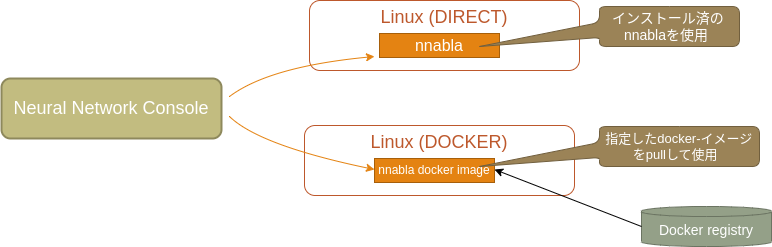
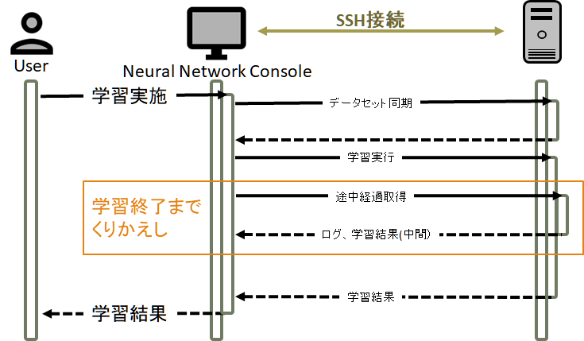
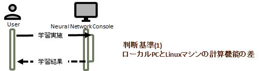
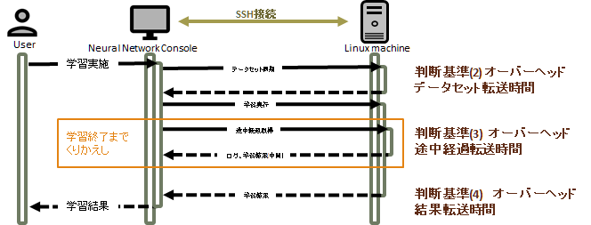
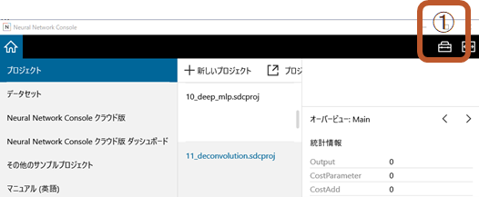
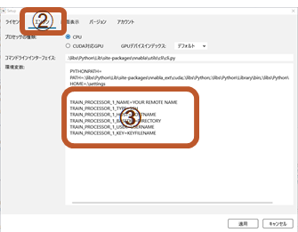
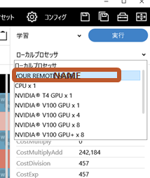

Remote training
================

Remote training
---------------

The Remote Training feature allows you to connect to and train from any Linux environment with a GPU, even if your Windows machine does not have GPU.

The Remote Training feature provides the following connection methods:.

- :ref:`To connect to a host that is already set up for remote training <#REMOTE_DIRECT>`
- :ref:`To connect to a docker-enabled host for remote training <#REMOTE_DOCKER>`

How Remote Training Works
^^^^^^^^^^^^^^^^^^^^^^^^^

Remote training is the practice of training on a Linux machine that
can be SSH into from the Neural Network Console.

Copy the data set from your PC to your Linux machine when you start
training. If you plan to study the same project over and over again,
copy the data set only once.

Then, perform the training and wait for the end while transferring the
progress to the PC at regular intervals.

When the training is completed, the training result is transferred to
the PC and the training is completed.

.. warning::

    During remote training, remote training will also stop if you
    perform a stop training operation, such as exiting the |Console|
    Windows version.

    In addition, if you kill |Console| during remote training, remote
    training continues uninterrupted.  To stop remote training, you
    must log in to the remote machine and manually stop it.

Should I use remote training?
"""""""""""""""""""""""""""""

Remote training allows you to take advantage of the computing power of
networked Linux machines, but it also has its drawbacks. Here are some
tips to help you decide whether to take advantage of remote training.

Performance Differences Between Local PCs and Linux Machines
''''''''''''''''''''''''''''''''''''''''''''''''''''''''''''

If your local PC has a powerful enough GPU, there's not much reason to
use remote training. However, since remote training can be done using
multiple GPUs, it is worth it if your Linux machine has multiple GPUs.

Communication overhead
''''''''''''''''''''''

There are some overhead when implementing remote training, depending
on the line speed.

Since the data set is transferred to Linux during the initial
training, it can take several hours if the data set is large.

Also, it is not uncommon for a large network to have several hundred
megabytes of training result parameters (NNP files). In this case, the
transfer time of the training result is also an element that cannot be
ignored.

In almost all cases, remote training is useful if your remote Linux
machine has a GPU and your local PC doesn't have one, but if your
local PC has a GPU, you can balance it against the performance of the
GPU on your Linux machine.

Using Remote Training
^^^^^^^^^^^^^^^^^^^^^^

|Console| Settings
""""""""""""""""""

Configure the settings as follows:.

Press the setting button on the upper right of the screen.

Click on Engine
Add setting to Environment Variables

This is done by setting the value of the variable starting with `REMOTE_PROCESSOR` .
The string used for setting is composed of `REMOTE_PROCESSOR_N_variable name`.

    `REMOTE_PROCESSOR`
        A preposition that indicates a remote training configuration.
    N
        It's 1 ~ 9. You can save nine types of remote connection settings.
    Variable name
        A string that begins with an uppercase letter and contains
        only uppercase letters, numbers, and underscores. The last
        character can only be uppercase alphanumeric.

The following two settings are common to all:.

- `REMOTE_PROCESSOR_N_NAME`
- `REMOTE_PROCESSOR_N_TYPE`

No error detection is performed for the settings.
Use caution when configuring the settings.

About Remote evaluation execution (Experimental)
""""""""""""""""""""""""""""""""""""""""""""""""

.. warning::

  This feature is experimental.

You can remotely perform evaluation by setting the following environment variables in the setup window.

- FORWARD_PROCESSOR_INDEX

Internally, learning also uses the `TRAIN_PROCESSOR_INDEX` environment variable
You have selected a destination, but the GUI will overwrite this environment variable.
It is meaningless to set in the setting screen.

.. _#SSH_KEY:

About SSH key
"""""""""""""

For `REMOTE_PROCESSOR_N_KEY`, specify the absolute PATH to the SSH
private key file or a string consisting of the contents of the file
concatenated with `\n`.

Currently, the connection between NNC and Linux environments is only
supported for private key authentication without a passphrase.

The private key file specified for REMOTE_PROCESSOR_N_KEY is FILE and
the Linux host is HOSTNAME.

In the PoweShell window or command prompt, click

.. code-block:: bash

    ssh -i FILE HOSTNAME

Verify that you can log in without a password with the command.

.. _#REMOTE_DIRECT:

To connect to a host that is already set up for remote training
^^^^^^^^^^^^^^^^^^^^^^^^^^^^^^^^^^^^^^^^^^^^^^^^^^^^^^^^^^^^^^^

About DIRECT Connections
""""""""""""""""""""""""

Perform remote training using nnabla installed on the remote machine.

- Run "nnabla_cli" under the account used to connect to the remote machine.
- The remote machine must have nnabla, nnabla_ext_cuda and the
  corresponding CUDA, cuDNN installed.
- There is no way to specify the version of nnabla to run locally.
- The expected results may not be obtained if the nnabla shipped with
  the local Neural Network Console is different from the nnabla
  version installed on the remote machine.

.. warning::

    We do not actively recommend using "DIRECT". If you have no
    special reason not to use docker, we recommend using "DOCKER".

Setting up a Linux machine
""""""""""""""""""""""""""

The following settings are required.

- Set up an account that can be connected via SSH and have a private
  key on hand

- Single GPU

    Installing CUDA, cuDNN

    .. code-block:: bash

        sudo apt-key adv --fetch-keys http://developer.download.nvidia.com/compute/cuda/repos/ubuntu1804/x86_64/7fa2af80.pub
        wget http://developer.download.nvidia.com/compute/cuda/repos/ubuntu1804/x86_64/cuda-repo-ubuntu1804_10.2.89-1_amd64.deb
        sudo dpkg -i cuda-repo-ubuntu1804_10.2.89-1_amd64.deb
        rm cuda-repo-ubuntu1804_10.2.89-1_amd64.deb
        sudo apt update
        sudo apt install -y cuda-11-0 cuda-drivers
        echo "deb https://developer.download.nvidia.com/compute/machine-learning/repos/ubuntu1804/x86_64 /" | sudo tee /etc/apt/sources.list.d/nvidia-ml.list
        sudo apt update
        sudo apt install libcudnn8
        sudo reboot

- Multi GPU

    Follow the instructions for a single GPU to install CUDA. In addition to that,

    - Installing NCCL

    .. code-block:: bash

        apt install -y libnccl2

    - Insatalling openmpi

    .. code-block:: bash

        sudo apt install -y --no-install-recommends build-essential curl gfortran libibverbs-dev
        curl https://download.open-mpi.org/release/open-mpi/v3.1/openmpi-3.1.6.tar.bz2 -O
        tar xvf openmpi-3.1.6.tar.bz2
        cd openmpi-3.1.6
        ./configure --enable-orterun-prefix-by-default --with-sge CC=gcc CXX=g++ F77=gfortran FC=gfortran
        make -j8
        sudo make install
        sudo ldconfig

- Installing nnabla

    - Installing python

    .. code-block:: bash

        sudo apt install -y python3.8 python3-pip
        sudo python3.8 -m pip install -U pip

    - Installing nnabla for single GPU machine.

    .. code-block:: bash

        sudo pip install nnabla nnabla-ext-cuda110

    - Installing nnabla for multi gpu machine.

    .. code-block:: bash

        sudo pip install nnabla nnabla-ext-cuda110-nccl2-mpi3.1.6

NNC setttings
"""""""""""""

The settings used by DOCKER are:

    `REMOTE_PROCESSOR_N_NAME`
        Configuration name
    `REMOTE_PROCESSOR_N_TYPE`
        Please specify "DIRECT".
    `REMOTE_PROCESSOR_N_HOST`
        Specifies the host name to connect to.
    `REMOTE_PROCESSOR_N_BASEDIR`
        Specifies the directory to use when training. Please specify a directory with enough free space to copy the data set.
    `REMOTE_PROCESSOR_N_USER`
        User name used for connection
    `REMOTE_PROCESSOR_N_KEY`
        Refer :ref:`About SSH key <#SSH_KEY>`

Caution
"""""""

If your remote host has multiple GPUs, you can use all of them for
training without asking. Consider using DOCKER if you want to specify
exactly which GPU to use.

Congiguration examples
""""""""""""""""""""""

The following is an example configuration:.
Please use it after changing it according to your environment.

.. code-block::

    REMOTE_PROCESSOR_N_NAME=SSH on HOST
    REMOTE_PROCESSOR_N_TYPE=SSH
    REMOTE_PROCESSOR_N_HOST=HOSTNAME(or IP address)
    REMOTE_PROCESSOR_N_BASEDIR=/XXX/XXXX/XXX
    REMOTE_PROCESSOR_N_USER=USERNAME
    REMOTE_PROCESSOR_N_KEY=c:\Users\XXXXXXXX\.ssh\id_rsa

.. _#REMOTE_DOCKER:

To connect to a docker-enabled host for remote training
^^^^^^^^^^^^^^^^^^^^^^^^^^^^^^^^^^^^^^^^^^^^^^^^^^^^^^^
Train in a Docker environment on a remote machine.

- Pull the specified Docker image and run `nnabla_cli`.
- Linux machines need nvidia GPU drivers and nvidia-docker2 installed, but no nnabla, CUDA, cuDNN, etc.

Preparing the Linux Machine
"""""""""""""""""""""""""""

The following settings are required.

- Set up an account that can be connected via SSH and have a private key on hand

The following steps assume Ubuntu 18.04.

- Install CUDA driver

.. code-block:: bash

    sudo apt-key adv --fetch-keys http://developer.download.nvidia.com/compute/cuda/repos/ubuntu1804/x86_64/7fa2af80.pub
    wget http://developer.download.nvidia.com/compute/cuda/repos/ubuntu1804/x86_64/cuda-repo-ubuntu1804_10.2.89-1_amd64.deb
    sudo dpkg -i cuda-repo-ubuntu1804_10.2.89-1_amd64.deb
    rm cuda-repo-ubuntu1804_10.2.89-1_amd64.deb
    sudo apt update
    sudo apt install -y cuda-drivers
    sudo reboot

- Install nvidia-docker2

.. code-block:: bash

    curl https://get.docker.com | sh
    sudo systemctl start docker && sudo systemctl enable docker
    distribution=$(. /etc/os-release;echo $ID$VERSION_ID)
    curl -s -L https://nvidia.github.io/nvidia-docker/gpgkey | sudo apt-key add -
    curl -s -L https://nvidia.github.io/nvidia-docker/$distribution/nvidia-docker.list | sudo tee /etc/apt/sources.list.d/nvidia-docker.list
    sudo apt-get update
    sudo apt-get install -y nvidia-docker2
    sudo systemctl restart docker

- Set users to join the docker group

.. code-block:: bash

    sudo usermod –aG docker $USER

NNC settings
"""""""""""""

The settings used for DOCKER connections are,

    `REMOTE_PROCESSOR_N_NAME`
        Configuration name
    `REMOTE_PROCESSOR_N_TYPE`
        Please specify "DOCKER".
    `REMOTE_PROCESSOR_N_HOST`
        Specifies the host name to connect to.
    `REMOTE_PROCESSOR_N_BASEDIR`
        Specifies the directory to use when training. Please specify a directory with enough free space to copy the data set.
    `REMOTE_PROCESSOR_N_USER`
        User name used for connection
    `REMOTE_PROCESSOR_N_KEY`
        Refer :ref:`About SSH key <#SSH_KEY>`
    `REMOTE_PROCESSOR_N_GPUS_FOR_DOCKER`
        Specifies the GPU to use when training. Specifies the GPUIDs
        displayed by the nvidia-smi command, separated by commas. If
        not specified, all GPUs will be used.
    `REMOTE_PROCESSOR_N_IMAGE`
        Specifies the docker image to use when training. Since
        "nnabla/nnabla-ext-cuda-multi-gpu: latest" is specified by
        default, you will be using the latest release version, and you
        should normally not need to specify it.

Congiguration examples
""""""""""""""""""""""

- Run with GPU id (Single GPU)

    .. code-block:: bash

        REMOTE_PROCESSOR_N_NAME=Docker on HOST(GPU0)
        REMOTE_PROCESSOR_N_TYPE=DOCKER
        REMOTE_PROCESSOR_N_HOST=HOSTNAME(or IP address)
        REMOTE_PROCESSOR_N_BASEDIR=/XXX/XXXX/XXX
        REMOTE_PROCESSOR_N_USER=USERNAME
        REMOTE_PROCESSOR_N_KEY=c:\Users\XXXXXXXX\.ssh\id_rsa
        REMOTE_PROCESSOR_N_GPUS_FOR_DOCKER=0

- Run with GPU id (2 GPUs)

    .. code-block:: bash

        REMOTE_PROCESSOR_N_NAME=Docker on HOST(GPU0)
        REMOTE_PROCESSOR_N_TYPE=DOCKER
        REMOTE_PROCESSOR_N_HOST=HOSTNAME(or IP address)
        REMOTE_PROCESSOR_N_BASEDIR=/XXX/XXXX/XXX
        REMOTE_PROCESSOR_N_USER=USERNAME
        REMOTE_PROCESSOR_N_KEY=c:\Users\XXXXXXXX\.ssh\id_rsa
        REMOTE_PROCESSOR_N_GPUS_FOR_DOCKER=0,1

- don't specify GPU id (use all GPUs on the host machine)

    .. code-block:: bash

        REMOTE_PROCESSOR_N_NAME=Docker on HOST(ALL GPUS)
        REMOTE_PROCESSOR_N_TYPE=DOCKER
        REMOTE_PROCESSOR_N_HOST=HOSTNAME(or IP address)
        REMOTE_PROCESSOR_N_BASEDIR=/XXX/XXXX/XXX
        REMOTE_PROCESSOR_N_USER=USERNAME
        REMOTE_PROCESSOR_N_KEY=c:\Users\XXXXXXXX\.ssh\id_rsa
