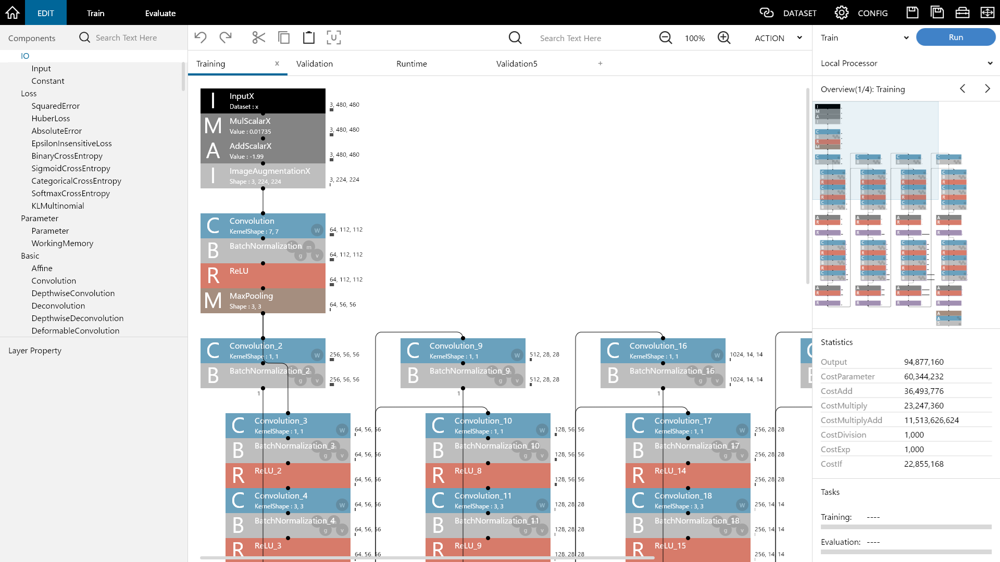

# Neural Network Console

**[English](../../README.md)**

## 概要

Neural Network Consoleは、ニューラルネットワークの設計、学習、評価を行うためのWindows対応GUIアプリケーションです。視覚的なネットワーク設計、構造自動探索による効率的な試行錯誤、包括的なモデル管理を可能にするディープラーニング統合開発環境です。

このツールは特にこれからディープラーニングを理解しようとする方に向けた教育目的や、組み込み用途などの小型のニューラルネットワークの開発に最適です。ネットワーク設計を視覚的に理解できるようにしながら、GPUアクセラレーションによる高速な学習をサポートします。

## 主な機能

### 視覚的ネットワーク設計
- **ドラッグ＆ドロップインターフェース**: レイヤーを接続してニューラルネットワークを視覚的に構築
- **リアルタイムネットワーク可視化**: ネットワーク構造と統計情報をリアルタイムで確認
- **レイヤープロパティ編集**: 直感的なインターフェースでレイヤーパラメータを設定
- **ネットワーク統計**: 計算複雑度とメモリ使用量を監視

### 複数エンジンサポート
- **NNabla**: 効率性に最適化されたSonyのディープラーニングフレームワーク
- **PyTorch**: 豊富なモデルサポートを持つ人気の研究フレームワーク
- **Transformers**: NLPとコンピュータビジョンタスク用の事前訓練済みモデル

### 訓練と評価
- **ローカル学習**: GPUサポートで自分のマシンで学習
- **リアルタイム監視**: 学習曲線とメトリクスで学習の進捗を追跡
- **ハイパーパラメータ管理**: オプティマイザ、学習率スケジュールなどを設定
- **構造探索**: ニューラルネットワークのアーキテクチャ探索機能

### データ管理
- **データセット統合**: CSV、画像、音声データセットをサポート
- **データ前処理**: データ準備と拡張のための組み込みツール
- **フォーマットサポート**: 複数フォーマット（NNP、ONNX、TensorFlow）でのインポート/エクスポート

### プロジェクトテンプレートと例
- **チュートリアルプロジェクト**: 学習用のステップバイステップのExample
- **サンプルデータセット**: MNIST、CIFAR-10を含む事前設定済みデータセット
- **アプリケーションテンプレート**: 一般的なタスク用の即使用可能なプロジェクト：
  - 画像分類と認識
  - 物体検出とセマンティックセグメンテーション
  - 生成モデル（VAE、GAN）
  - 自然言語処理
  - 音声分類
  - 時系列解析

## システム要件

- **オペレーティングシステム**: Windows 10以降（64ビット）
- **メモリ**: 最小8GB RAM、推奨16GB
- **ストレージ**: 10GB以上の空き容量
- **GPU**: NVIDIA GPU with CUDAサポート（オプション、GPUを使用した学習を行う場合）

## インストール

1. [GitHub Releases](https://github.com/sony/neural-network-console/releases)から最新バージョンをダウンロード
2. 7zファイルを解凍し、解凍した`neural_network_console`フォルダをC:\ドライブにコピー
3. GPUサポートには、最新のNVIDIAドライバをインストール

**重要な注意事項:**
- **推奨場所**: `C:\neural_network_console\`（権限問題を回避し、最適なパフォーマンスを確保）
- **避けるべき場所**: Program Files、システムディレクトリ、マルチバイト文字を含むパス（日本語、中国語、韓国語）
- 異なるバージョンには別々のフォルダを使用して競合を避ける

## クイックスタート

包括的なチュートリアルについては、ステップバイステップのビデオガイドのために[YouTubeチャンネル](https://www.youtube.com/c/NeuralNetworkConsole)をご覧ください。

1. **起動**: `neural_network_console.exe`をダブルクリック
2. **プロジェクト作成**: "+New Project (nnabla)"をクリック
3. **ネットワーク設計**: 視覚エディタを使用してニューラルネットワークを構築
4. **データ準備**: データセットを読み込むか、提供されたサンプルを使用
5. **訓練設定**: CONFIGタブで訓練パラメータを設定
6. **訓練**: 訓練ボタンをクリックして進捗を監視
7. **評価**: 検証データで訓練済みモデルをテスト

## ドキュメント

アプリケーション内で**F1**キーを押すことで、組み込まれたヘルプシステムのドキュメントに直接アクセスできます。

また、インストールフォルダで包括的なPDFマニュアルを見つけることができます：
- 英語マニュアル: `manual.pdf`
- 日本語マニュアル: `manual_ja.pdf`

追加のドキュメントもソースリポジトリで利用可能です：
- 英語ドキュメント: `document/en/`
- 日本語ドキュメント: `document/ja/`

## サンプルプロジェクト

インストールには開始に役立つ様々なサンプルプロジェクトが含まれています：

- **基礎**: 基本概念とシンプルなネットワーク
- **画像認識**: 画像分類用のCNNモデル
- **画像生成**: 画像合成用のGANsとVAEs
- **自然言語処理**: テキスト分類とシーケンスモデル
- **物体検出**: YOLOとその他の検出アーキテクチャ
- **セマンティックセグメンテーション**: ピクセルレベル分類モデル
- **音声処理**: 音声分類と処理

## ソースからのビルド

Neural Network Consoleをソースコードからビルドしたい場合は、詳細なビルド手順について[BUILD.md](BUILD.md)を参照してください。

## サポートとリソース

- **ドキュメント**: インストールパッケージに含まれ、F1キーでアクセス可能
- **サンプルプロジェクト**: 様々な用途向けの事前設定済み例
- **コミュニティフォーラム**: 他のユーザーと接続し、知識を共有
  - 英語: [Neural Network Console Users](https://groups.google.com/g/neural_network_console_users)
  - 日本語: [Neural Network Console Users JP](https://groups.google.com/g/neural_network_console_users_jp)

## ライセンス

このプロジェクトはApache License 2.0の下でライセンスされています。詳細については[LICENSE](../../LICENSE)ファイルを参照してください。

---

Neural Network Consoleは、ディープラーニング教育のためのアクセスしやすいプラットフォームを提供し、手動でニューラルネットワークを設計し、その内部で何が起こっているかを直感的に理解することができます。この視覚的アプローチにより、ディープラーニングの基本概念を学び、ニューラルネットワークアーキテクチャ設計の実践的な経験を積むことができます。 