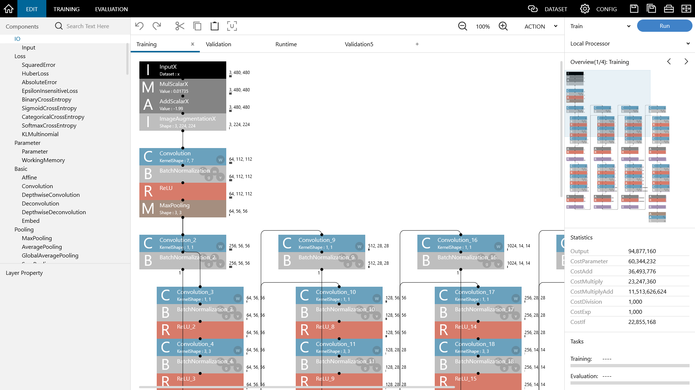

はじめに
========

|Console| とは
--------------------------

|Console| （ニューラルネットワーク コンソール）は、Deep Learningの統合開発環境です。Deep Learningを用いた研究開発におけるネットワークの設計、ネットワーク構造の探索による試行錯誤の大幅な効率化を実現します。ネットワークのデザインについて視覚的に把握することができるため、Deep Learningの学習用途にも最適です。

|Console| はWindows上で動作するアプリケーションです。GPUを用いた学習環境を構築することにより、大規模データを扱う本格的なDeep Learningの研究開発用途にも対応します。

最新の |Console| は以下のWebサイトから取得可能です。

https://github.com/sony/neural-network-console
