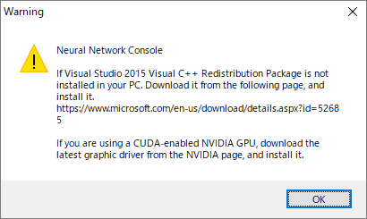
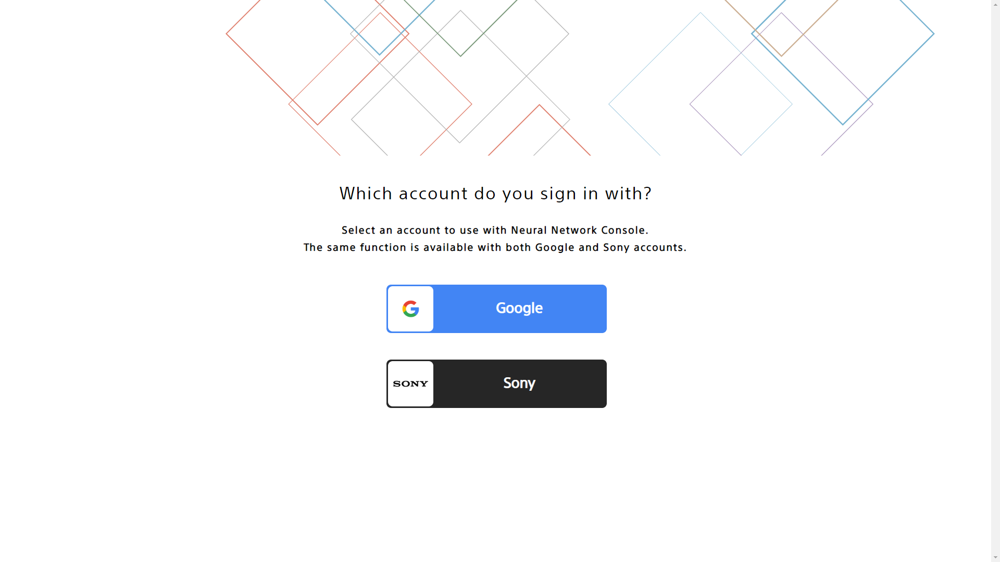
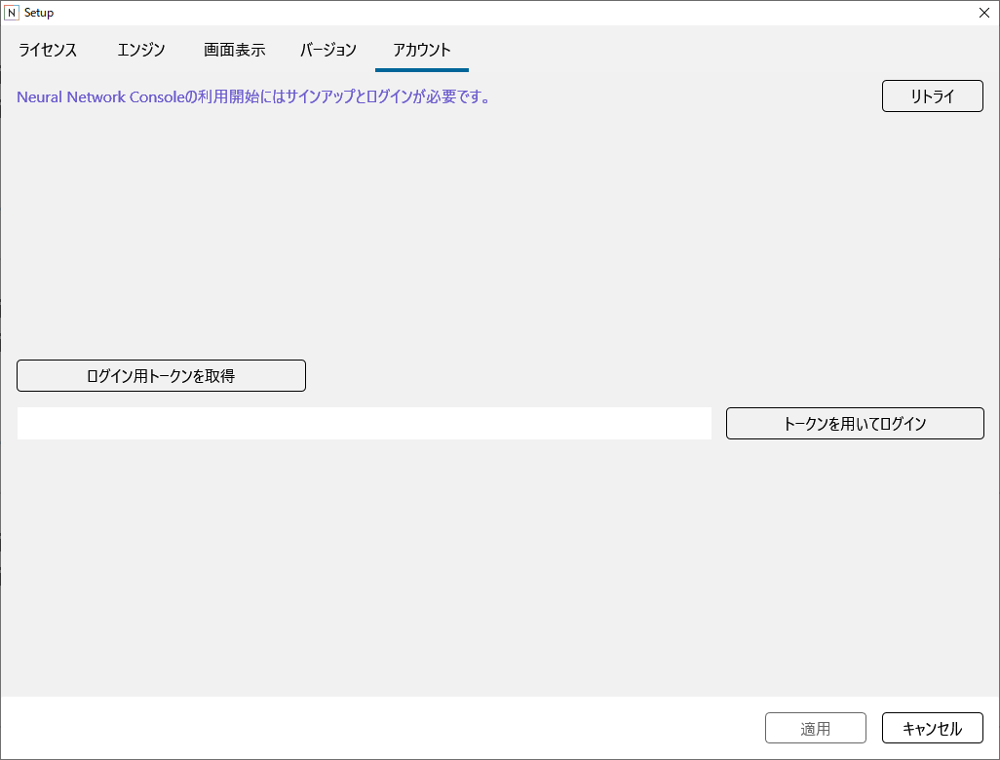
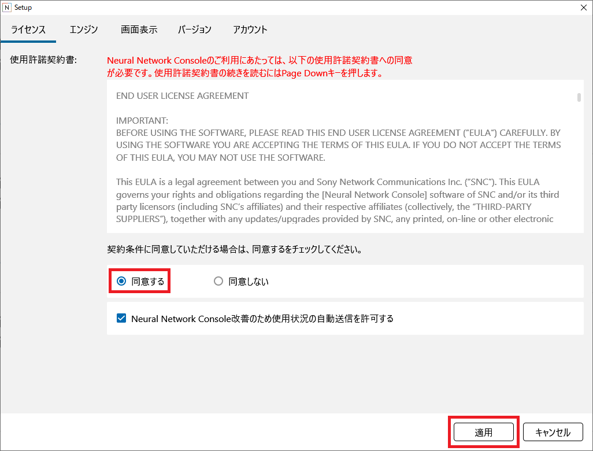
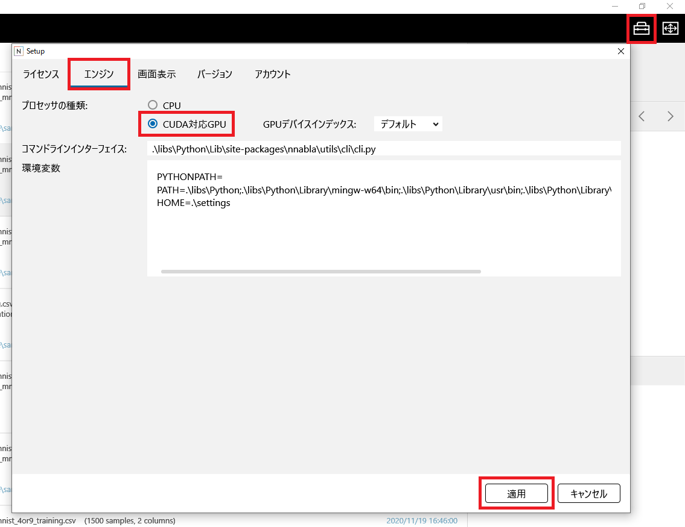

セットアップと事前準備
======================

セットアップ
------------

1. neural_network_console_xxx.7z（xxxはバージョン名）を実行し、インストール先のフォルダを指定してExtractボタンをクリックします。

**ご注意**

Neural Network Consoleはパスに日本語などの2バイト文字が含まれない、またアプリケーションから自由に書き込み可能なフォルダに配置する必要があります。Neural Network Consoleは2バイト文字が含まれているフォルダや、Program Filesのようなアプリケーションから書き込み不可なフォルダでは正しく動作しません。

**ご注意**

新しいバージョンの |Console| をインストール（アップデート）する場合、新しいバージョンの |Console| は既存の |Console| とは別のフォルダに解凍する必要があります。既存の |Console| に上書きした場合正しく動作しないことがあります。

2. Visual Studio 2015 Visual C++の再頒布パッケージがインストールされていない場合は、以下からダウンロードし、インストールを行います。

https://www.microsoft.com/ja-jp/download/details.aspx?id=53587

3. NVIDIA製、Keplerアーキテクチャ以降のCUDA対応GPUをお使いの場合で、GPUを利用される場合は、GPUのドライバを最新のものに更新します。

**ご注意**

GPUを利用する場合、GPUドライバの更新を行う必要があります。GPUドライバが最新のものに更新されていない場合、GPUでの学習実行時にエラーとなります。 |Console| のインストール、アップデート後は必ずGPUドライバを最新のものに更新するようにしてください。

**ご参考**

GPUを利用しない場合のセットアップは以上です。NVIDIA製のCUDA対応GPUをお使いの場合、この後解説する :ref:`GPU環境のセットアップ <#GPU環境のセットアップ>` を行うことで学習速度を劇的に向上することができます。

|Console| の起動とアクティベート
--------------------------------------------

|Console| の起動
~~~~~~~~~~~~~~~~~~~~~~~~~~~~

1. neural_network_console.exeをダブルクリックして起動します。事前セットアップの案内が表示されます。対応済みであることを確認の上、OKボタンをクリックします。

アクティベート
~~~~~~~~~~~~~~

|Console| の初回利用には、 |Console| のアカウントの作成とログインが必要です。これらの作業を行うためにはコンピュータがインターネットに接続されている必要があります。

1. 初回 |Console| 起動時に開くブラウザ画面より、 |Console| のアカウントの作成とログインを行います。ログインには、Sonyアカウント及びGoogleアカウントを利用することができます。アカウントの作成とログインをやり直すには、Setupウインドウ、アカウントタブ右上のリトライボタンをクリックします。

**ご参考**

リトライを行っても正しくログインできない場合は、ログイン用トークンを取得ボタンをクリック、画面の指示に従って取得したトークンをボタン右のテキストボックスに入力し、トークンを用いてログインボタンをクリックします。

2. ライセンスタブに表示されるライセンスを確認し、同意の上、同意をクリックして選択します。

3. 利用状況の収集と送信に同意しない場合は、 |Console| 改善のため使用状況の自動送信を許可するのチェックボックスをクリックして外します。

4. 適用ボタンを押して設定画面を閉じます。

.. _#GPU環境のセットアップ:

GPU環境のセットアップ
---------------------

NVIDIA製、Keplerアーキテクチャ以降のCUDA対応GPUをお使いの場合、この後解説するGPU環境のセットアップを行うことで学習速度を劇的に向上することができます。

**Step 1. 設定画面でGPU使用の設定を行う**

ウインドウ右上の設定（セットアップ）ボタンをクリックして設定画面を開きます。

設定画面のエンジンタブで、プロセッサの種類のCUDA対応GPUをクリックして選択します。設定画面右下の適用ボタンを押して設定画面を閉じると、GPUの使用が有効化されます。

**Step 2. GPUを用いた学習が正しく動作することを確認する**

:ref:`チュートリアル <#チュートリアル>` にある :ref:`サンプルプロジェクトを用いた学習 <#サンプルプロジェクトを用いた学習>` を実行します。学習を実行すると学習結果タブ下のログに表示されるメッセージにエラーが出ないことを確認します。

データセットの準備
------------------

データセットとは、ニューラルネットワークの学習や性能評価に用いるデータの集まりです。

**ご参考**

|Console| に含まれるサンプルプロジェクトを用いることで、ひとまずデータセットを作成することなく学習を試すことができます。サンプルデータセットを用いた学習を行う方法については :ref:`チュートリアル <#チュートリアル>` をご参照ください。本節では自分でデータセットを作成する方法について解説します。

**ご参考**

|Console| は、画像カテゴリ毎にフォルダ分けされた画像を元に、画像分類用データセットを作成する機能を備えています。本機能については「:ref:`画像カテゴリ毎にフォルダ分けされた画像を元に、画像分類用データセットを作成するには <#画像カテゴリ毎にフォルダ分けされた画像を元に画像分類用データセットを作成するには>` 」をご参照ください。

|Console| は、 |Console| の定めるCSV（カンマ区切りのテキスト）フォーマットのデータセット形式に対応しています。本データセット形式は、画像認識機の学習に用いられる画像入力-ベクトル出力形式、画素毎の認識や画像フィルタの学習に用いられる画像入力-画像出力形式、その他の任意のベクトルもしくは行列データを元にした認識機の学習に用いられる行列入力-ベクトル出力形式などに幅広く対応します。

|Console| で学習を行うには、学習用データセット、評価用データセットの2つのデータセットを用意します。学習用データセットはニューラルネットワークの学習に用いられるデータセットです。評価用データセットは学習には用いられず、精度評価のためのみに用いられます。学習用データセット、評価用データセットのファイルフォーマットは共通です。

データセットの基本構成
~~~~~~~~~~~~~~~~~~~~~~

データセットCSVファイルのテキストのエンコーディングはASCII、もしくはUTF-8に対応しています。

データセットのCSVファイルは、ヘッダを表す1行目と、データを表す2行目以降で構成されます。

ヘッダ
^^^^^^

1行目のヘッダの各セルは、CSVファイルの各列のデータの変数名、次元インデックス、コメントを示します。ヘッダの各セルの値は、変数名[__次元インデックス][:コメント]で表します。

変数名は |Console| 内での識別に用いる変数名を表します。変数名には任意の文字列を利用することができますが、通常入力データにはx、出力データにはyを割り当てます。入出力が複数ある場合はそれぞれx1、x2…、y1、y2…のように、x、yの後に数字を付加して区別します。yはxより右側の列に、x、yそれぞれの中では添え字が大きい変数ほど右側の列に配置します。

次元インデックスは、ベクトルの形をした変数である場合に、CSVの各列がベクトルの何次元目であるかを示します。次元インデックスは、変数名に続けて__（ダブルアンダースコア）と数字で表します。インデックスは0から始まり、例えば10次元のベクトルであれば0～9の値を取ります。

コメントは、各変数もしくは変数の各次元の分かりやすい名前を示します。コメントには変数名とは異なり、特に制約なくユーザに理解しやすい任意の文字列を割り当てることができます。

コメントの最後に;で区切った文字列を入力することで、カテゴリのIndexを示す変数について各カテゴリの名称を指定することができます。例えば以下の例では変数yに対ついて、Index 0がDog、Index 1がCatであることを示します。

.. list-table::
   :widths: 10000

   * - y:label;dog;cat

ヘッダの先頭に#を入力することで、該当する列全体をコメント列として扱うことができます。コメント列は |Console| による学習などの処理の実行時には無視されますが、各データの説明等を記述するために役立ちます。

**ご注意**

|Console| はCSVファイル内のスペースを通常の文字として扱います。カンマの後などに余計なスペースを挿入しないようご注意ください。

データ
^^^^^^

2行目以降の各行は、1つのデータを示します。例えば2行目以降に1000行を持つ1001行のCSVファイルは、1000個のデータを含みます。1つのデータはヘッダで指定した複数の変数で構成されます。2行目以降の各セルには、変数の種類に応じてファイル名もしくは数値が入ります。

変数が画像データである場合は、各セルに画像ファイル名を入力します。ファイル名には絶対パス、もしくはデータセットCSVファイルからの相対パスを利用することができます。 |Console| は拡張子が.png、.jpg、.jpeg、.gif、.bmp、.tifであり、Color Channel数が1（グレースケール）もしくは3（RGB）である画像ファイルに対応しています。コアライブラリ内部において画像は各次元の要素数が（Color Channel数,Height,Width）である配列として扱われます。

変数が波形データである場合は、各セルに波形データのファイル名を入力します。ファイル名には絶対パス、もしくはデータセットCSVファイルからの相対パスを利用することができます。現在 |Console| は拡張子が.wavであり、非圧縮（PCM）フォーマット、かつ8bitもしくは16bitの波形ファイルに対応しています。コアライブラリ内部において波形は各次元の要素数が（時間長,チャンネル数）である行列として扱われます。 |Console| において波形の振幅は、8bit波形の場合は1/128倍、16bit波形の場合は1/32768倍し、-1.0～1.0の値として扱われます。

変数が画像、波形以外のベクトルもしくは行列である場合、各セルにはデータCSVファイルのファイル名を入力します。データCSVファイルはデータセットCSVファイルとは別にデータ毎に用意するCSVファイルです。データCSVファイルはヘッダを持たず、数値セルのみで構成されます。 |Console| はCSVファイルを要素数が （行数,列数)である配列として扱います。

**ご注意**

1つのデータセットCSVファイルに含まれる同じ変数は、全て配列の要素数が同一である必要があります。たとえば、同じ変数xの画像としてColor Channel数, Width, Heightが異なるものを混在させることはできません。このような場合は、事前に全ての画像の解像度を統一する前処理（リサイズ等）を行っておく必要があります。

**ご参考**

作成したデータセットが正しいデータセットフォーマットであるかどうかは、 |Console| のデータセットタブでデータセットを読み込んだ後、右クリックメニューのデータセットの整合性をチェックを選択することで確認することができます。詳しくは :ref:`データセットの整合性を確認するには <#データセットの整合性を確認するには>` をご参照ください。

**ご参考**

|Console| では、与えられた学習データセットの先頭から順にデータを読みながら、コンフィグタブのバッチサイズで与えた数のデータ（Mini-Batch）を1つの単位としたミニバッチ勾配降下法によるパラメータの最適化を行います。この際、効率的な最適化のためには1つのMini-Batchに含まれるデータはできるだけバリエーション豊かであることが理想的です。データセットCSVファイルの各行はあらかじめシャッフルしておくことをお勧めします。

**ご参考**

安定したニューラルネットワークの学習のためには、実数値はおおむね-1.0～1.0の間に収まるように事前に加工しておくことをお勧めします。

画像認識用データセットの例
~~~~~~~~~~~~~~~~~~~~~~~~~~

以下のフォルダに作成されるMNIST手書き数字認識のサンプルデータセットを元に、画像認識機の学習に用いるデータセットのフォーマットについて解説します。

samples\sample_dataset\mnist\mnist_training.csv

（※このファイルはMNISTデータセットを用いるいずれかのサンプルプロジェクトの読み込み時に自動生成されます。ファイルが存在しない場合は01_logistic_regresionなどのサンプルプロジェクトを読み込みます。サンプルプロジェクトの読み込みについては :ref:`チュートリアル <#チュートリアル>` をご参照ください）

このデータセットは、数字が書かれた28x28のモノクロ画像と、各画像が「0」～「9」のいずれの数字であるのかを示すラベルデータから構成されています。

.. list-table::
   :widths: 30 70
   :class: longtable
   :header-rows: 1

   * - x:image
     - y:label

   * - ./training/5/0.png
     - 5

   * - ./training/0/1.png
     - 0

   * - ./training/4/2.png
     - 4

   * - ./training/1/3.png
     - 1

   * - ./training/9/4.png
     - 9

   * - ./training/2/5.png
     - 2

   * - ./training/1/6.png
     - 1

   * - ./training/3/7.png
     - 3

   * - ./training/1/8.png
     - 1

   * - …
     -

1行目、1列目のx:imageは、1列目の変数名がxであることを示します。1行目、2列目のy:labelは、2列目のデータの変数名がyであることを示します。

2行目以降の各行は、１行ごとに１つのデータ示します。1列目は入力であるxの画像ファイル名（CSVファイルからの相対パス）を、2列目は正解カテゴリのIndexを示します。MNISTデータセットでは認識対象の数字は0～9の10種類であるため、カテゴリIndexはそれぞれ数字の「0」～「9」に対応する0～9の値をとります。例えば１列目で与えられた画像が数字の「5」である場合、2列目には数字の「5」に対応するカテゴリIndexである5が指定されています。

MNISTデータセットにおいて変数xの示す画像データファイルは28x28のモノクロ画像であるため、 |Console| 上でのxの配列のサイズは(1,28,28)になります。変数yの示すデータは1次元の値であるため、yの配列のサイズは(1)になります。
