.. _#チュートリアル:

チュートリアル
==============

.. _#サンプルプロジェクトを用いた学習:

サンプルプロジェクトを用いた学習
--------------------------------

|Console| を起動する
~~~~~~~~~~~~~~~~~~~~~~~~~~~~~~~~

neural_network_console.exeをダブルクリックして実行します。

サンプルプロジェクトを開く
~~~~~~~~~~~~~~~~~~~~~~~~~~

起動後に表示されるプロジェクト一覧から、01_logistic_regression.sdcprojを選択して開きます。

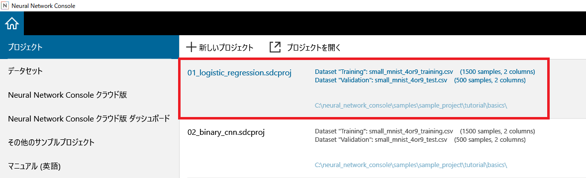

**ご参考**

最初にサンプルプロジェクトを開いたタイミングで、以下のサイトからサンプルプロジェクトで用いるMNISTデータセットのダウンロード、およびデータセットファイルの準備が実行されます。データセットの準備は通常数分で完了します。

http://yann.lecun.com/exdb/mnist/

プロキシを使用している環境でデータセットのダウンロードが正常に完了しない場合は、設定画面のエンジンタブにて、既存の設定項目に加えて環境変数にプロキシの設定を追加します。

HTTP_PROXY=http://（HTTPプロキシサーバのアドレス）:（ポート番号）

HTTPS_PROXY=https:// （HTTPSプロキシサーバのアドレス）:（ポート番号）

開いたサンプルプロジェクトの内容を確認する
~~~~~~~~~~~~~~~~~~~~~~~~~~~~~~~~~~~~~~~~~~

編集タブにて、手書き文字認識データセットMNISTの1x28x28のモノクロ手書き文字画像（4と9の画像）を、9かどうかの2値判別を行うための1層ネットワーク（Logistic Regression）が読み込まれていることを確認します。

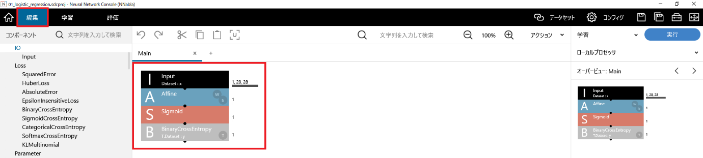

データセットタブにて、MNISTデータセットから一部を抽出して作成したSmall MNISTデータセットの学習用、評価用データセット（4と9の画像、および画像が9であるかどうかを示すラベル、「4」＝カテゴリIndex 0、「9」＝カテゴリIndex 1）が読み込まれていることを確認します。

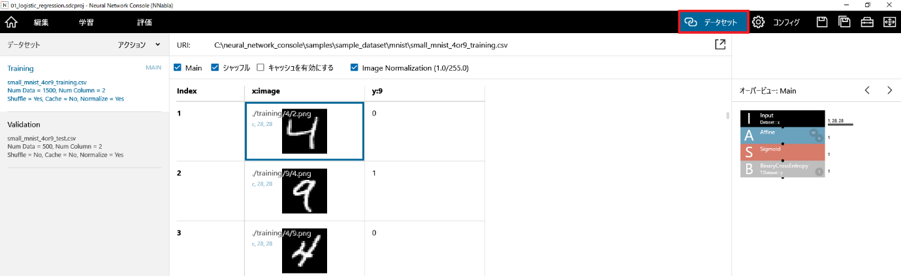

学習を実行する
~~~~~~~~~~~~~~

編集タブにて学習実行ボタンをクリックし（ショートカット：F5）、学習処理を開始します。

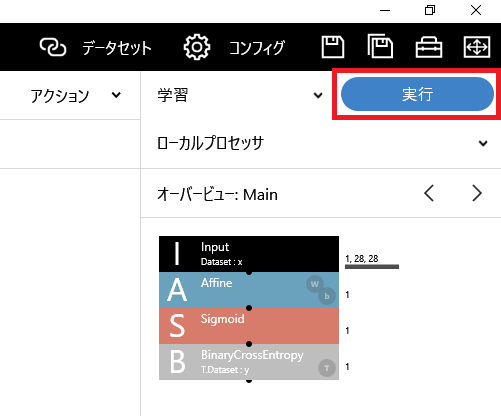

学習タブにて、学習の進捗状況が学習曲線と共に表示されます。

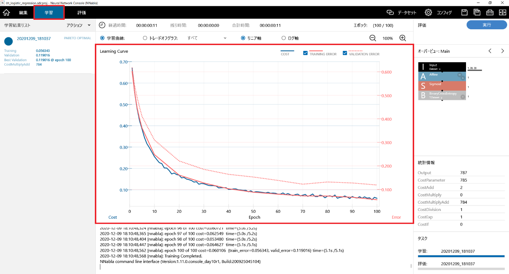

グラフの横軸、Epochは最適化の繰り返し世代数を示します。また、Costは最適化段階でのロス関数の出力値を、ErrorはEpochの終了時点での学習データ、評価データそれぞれにおけるロス関数の出力値を示します。図のように世代数の増加に従いCost、Errorの値が下がっていれば正しく最適化が実行されていると考えられます。

評価を実行する
~~~~~~~~~~~~~~

学習タブにて評価実行ボタンをクリックし（ショートカット：F6）、評価処理を開始します。

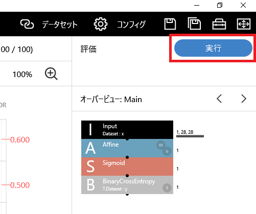

評価タブで評価の進捗状況と評価結果が表示されます。

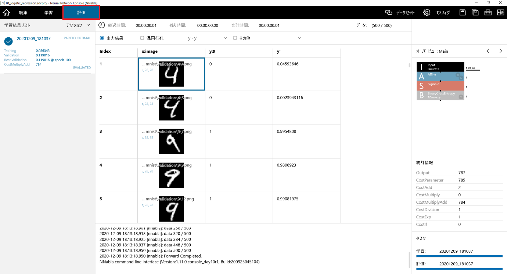

評価結果として、評価用データセットに学習したニューラルネットワークによる推定結果（y’列）が追加された表が表示されます。01_logistic_regression.sdcproj におけるy'はyが1である（入力画像が9である）確率を示します。

混同行列をチェックして、精度評価結果を表示します。

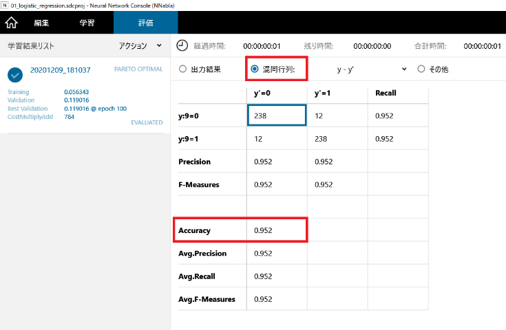

Accuracyが分類精度を示し、この例では評価データセットの「4」と「9」を95.2%の精度で分類できたことが分かります。

2層のニューラルネットワークの設計と学習
---------------------------------------

新しいプロジェクトを作成する
~~~~~~~~~~~~~~~~~~~~~~~~~~~~

|Console| を起動し、+ 新しいプロジェクトをクリックして新しいプロジェクトを作成します。

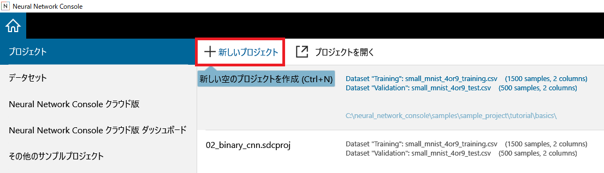

データセットを指定する
~~~~~~~~~~~~~~~~~~~~~~

データセットタブのデータセット指定ボタン（スクリーンショットではデータセットタブボタン直下）をクリックし、Trainingデータセットにsmall_mnist_4or9_training.csvを選択します。

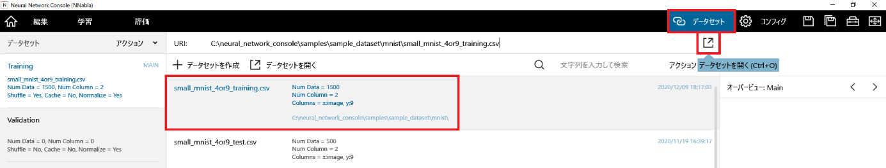

データセットのValidationをクリックしてValidationデータセットを選択します。Trainingデータセットと同様にしてValidationデータセットにsmall_mnist_4or9_test.csvを選択します。

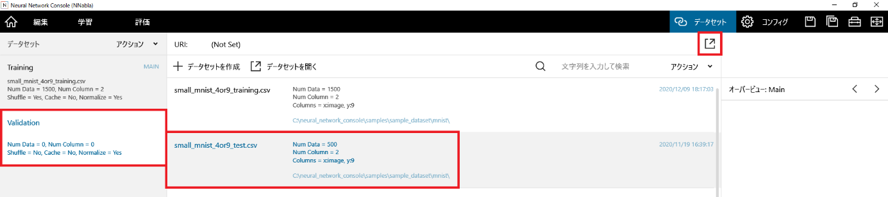

2層のニューラルネットワークを設計する
~~~~~~~~~~~~~~~~~~~~~~~~~~~~~~~~~~~~~

1. 編集タブ左のコンポーネントにて、Input、Affine、Tanh、Affine、Sigmoid、BinaryCrossEntropyを順にダブルクリックしネットワークグラフにレイヤーを追加します。

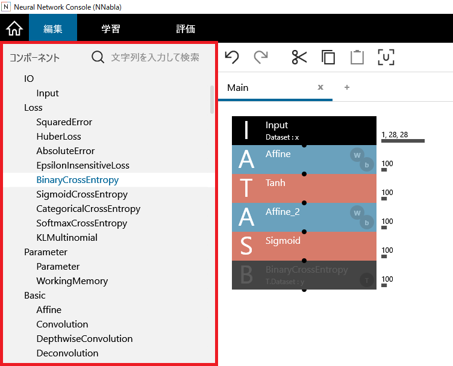

**ご参考**

Affineは上から4番目のBasicカテゴリに、TanhとSigmoidは上から6番目のActivationカテゴリに、BinaryCrossEntropyは上から2番目のLossカテゴリに含まれています。

2. Inputレイヤーをクリックして選択し、レイヤープロパティのSize（クリックして入力）に変数x（入力データ）のサイズである1,28,28を入力します（デフォルトのまま）。

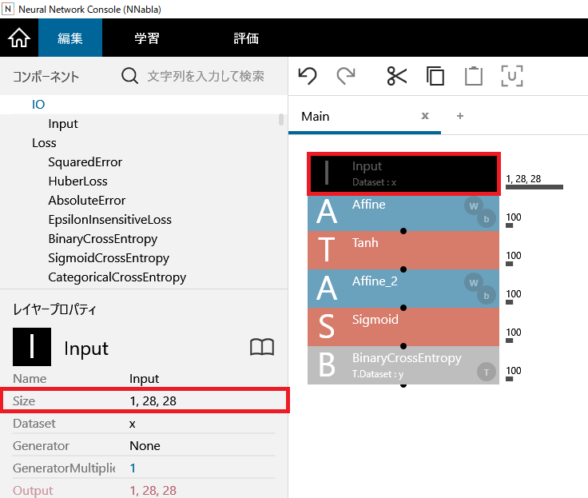

3. 1つめのAffineレイヤーをクリックして選択し、レイヤープロパティのOutShapeに中間層のノード数（例として100）を指定します（デフォルトのまま）。

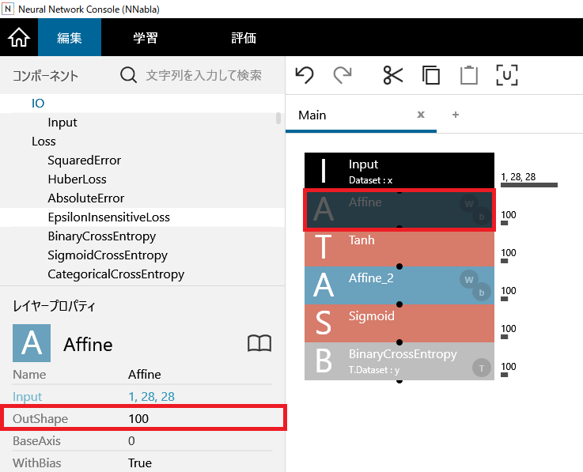

4. 2番目のAffineレイヤーをクリックして選択し、レイヤープロパティのOutShapeに出力層のノード数（今回の場合変数y（出力データ）のサイズである1）を指定します。

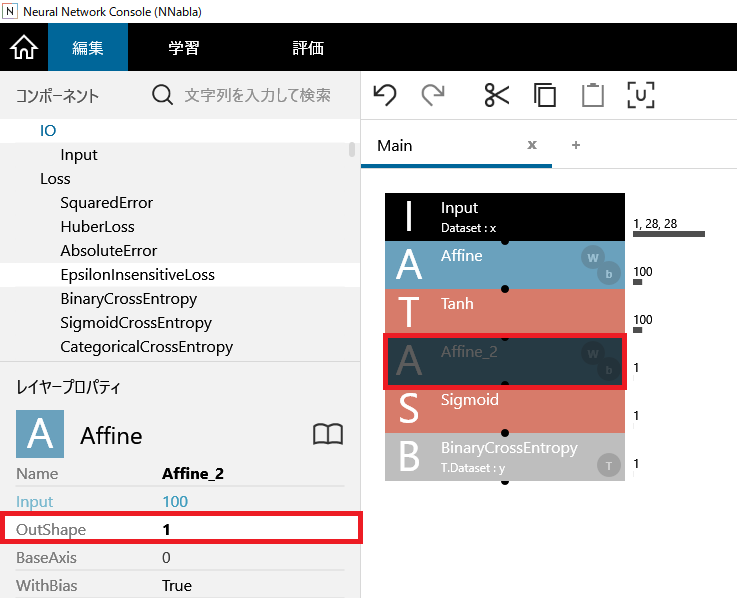

.. _学習を実行する-1:

学習を実行する
~~~~~~~~~~~~~~

学習実行ボタンをクリックします（ショートカット：F5）。プロジェクトが保存されていない場合、プロジェクトの保存を促すメッセージが表示されます。ファイル名を入力してプロジェクトを保存すると学習がスタートします。

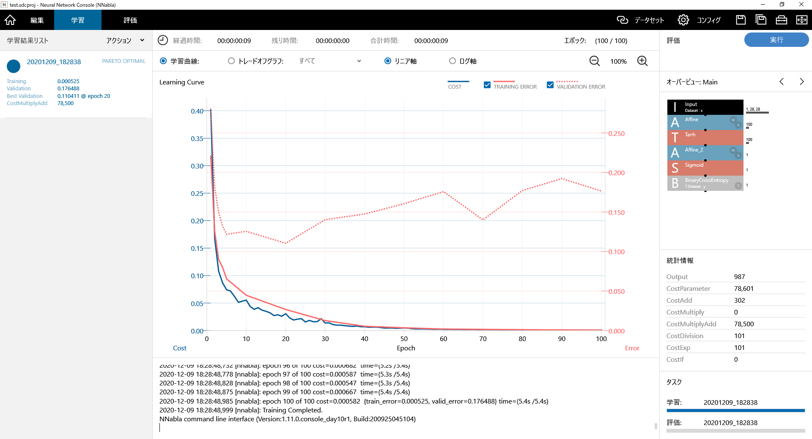

