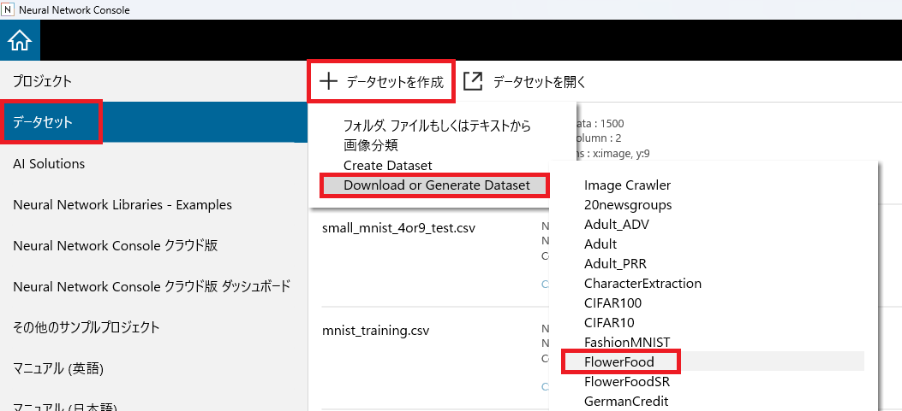
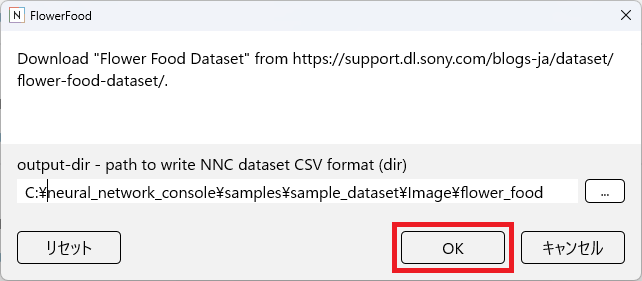
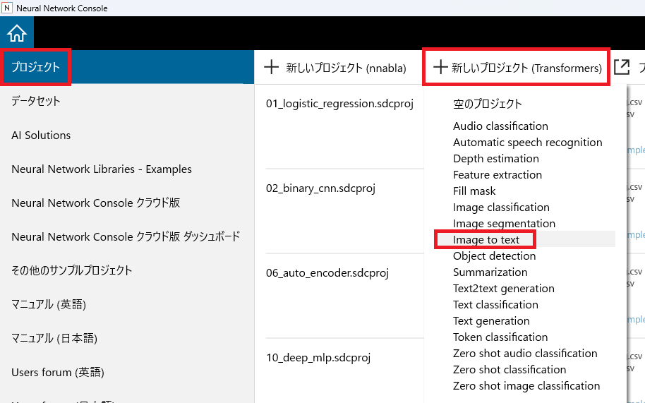
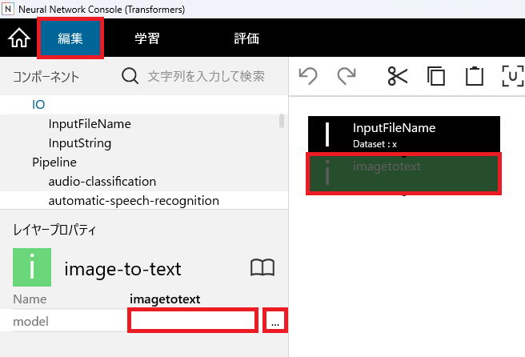
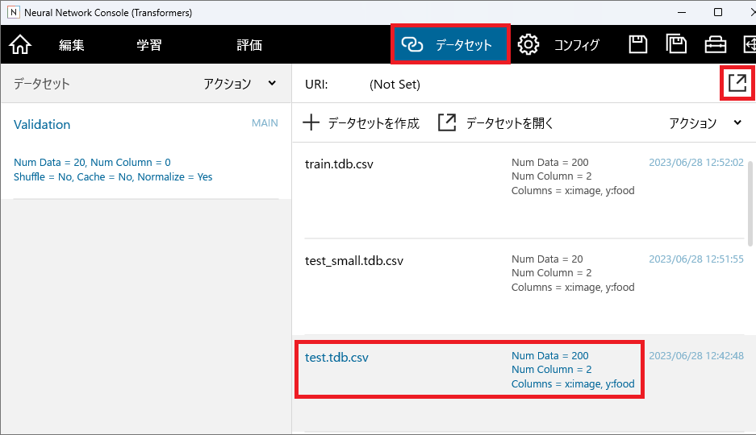
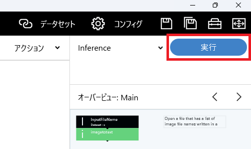

.. _#チュートリアル(Transformers):

チュートリアル(Transformers)
============================

HuggingFaceで公開されている学習済みモデルを用いた推論を実行します。

画像のテキスト変換
------------------

本チュートリアルでは食べ物と花の写真を含んだFlowerFoodデータセットとImage to textモデルを用い、データセットに含まれる画像をテキストに変換する例を示します。

Flower Foodデータセットの取得
~~~~~~~~~~~~~~~~~~~~~~~~~~~~~

Image to textの実行に用いるFlower Foodデータセットを取得します。

データセット管理画面で、+データセットを作成、Download or Generate Dataset、FlowerFoodを選択します。

OKボタンを押してFlower Foodデータセットをダウンロードします。

Transformersプロジェクトの作成
~~~~~~~~~~~~~~~~~~~~~~~~~~~~~~

プロジェクト画面で+新しいプロジェクト(Transformers)をクリックし、Image to textを選択します。

推論に使用するモデルを選択する
~~~~~~~~~~~~~~~~~~~~~~~~~~~~~~

編集タブのimagetotextレイヤーをクリックして選択し、レイヤープロパティーのmodelの右列部分をクリック、さらに...ボタンをクリックします。

ブラウザでHuggingFaceのWebサイトが開き、HuggingFaceにあるimage to textの学習済みモデル一覧が表示されます。
各モデルの性能やライセンスなどの詳細を確認するには、モデル名をクリックしてModel Cardを表示します。

使用するモデルが決まったら、モデルの名前（nlpconnect/vit-gpt2-image-captioningなど）をクリップボードにコピーします。

コピーしたモデル名をimagetotextレイヤーのmodelプロパティーに貼り付けます。

**ご参考**

ひとまず推論の実行を試すだけであれば、modelプロパティーは空欄のままでも推論を実行することができます。この場合、推論には各タスクのデフォルトのモデルが使用されます。

ただしモデルが指定されていない状態では推論結果が不定となるため、実使用においてはmodelプロパティを入力して使用する必要があります。

推論に用いるデータセットを指定する
~~~~~~~~~~~~~~~~~~~~~~~~~~~~~~~~~~

データセットタブにて、データセットを開くボタンをクリックし、一覧からFlower Foodデータセットのtest.tdb.csvをクリックします。

推論を実行する
~~~~~~~~~~~~~~

画面右上、Inference右のRunボタンをクリックして推論を実行します。

プロジェクトの保存を促すメッセージに従い、プロジェクトを適当なファイル名で保存します。

実行後しばらく待つと評価タブに推論結果が表示されます。

**ご参考**

初めて用いるモデル実行時にはモデルのダウンロード処理が行われるため、推論の完了までには長い時間を要します。

使用するGPUのメモリが十分でない場合、追加のライブラリのインストールが必要な場合などは推論に失敗することがあります。

追加のライブラリをインストールするには、学習結果リストの右クリックメニューからその他のツール、コマンドプロンプトを選択してコマンドプロンプトを起動します。

ここで、python -m pip install (インストールするライブラリ名)と入力することで、追加のPythonライブラリをインストールすることができます。

**ご参考**

後処理プラグインのうちほとんどはTransformersに対応していません。
