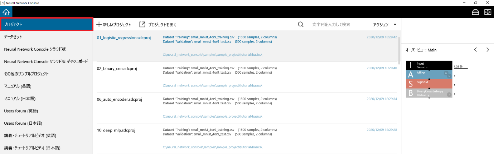

プロジェクト選択画面
====================

|Console| では、Deep Learning開発における学習、評価といった一連の作業をプロジェクトという単位で扱います。1つのプロジェクトには、学習に用いるネットワークの構成、データセット、パラメータ、学習および評価の結果が記録されます。

プロジェクト選択画面では、新しいプロジェクトの作成や、過去に利用したプロジェクトの読み込みを行います。

プロジェクト選択画面の使い方
----------------------------

空の新しいプロジェクトを作成するには
~~~~~~~~~~~~~~~~~~~~~~~~~~~~~~~~~~~~

+新しいプロジェクト(nnabla)をクリックします。

空の新しいプロジェクトが作成され、プロジェクト画面に移ります。プロジェクト画面での操作方法については :ref:`プロジェクト画面の使い方 <#プロジェクト画面の使い方>` をご参照ください。

空の新しいTorchプロジェクトを作成するには
~~~~~~~~~~~~~~~~~~~~~~~~~~~~~~~~~~~~~~~~~

+新しいプロジェクト(torch)をクリックします。

もしくは、キーボードのCtrlキーを押しながらNキーを押します。

空の新しいプロジェクトが作成され、プロジェクト画面に移ります。プロジェクト画面での操作方法については :ref:`プロジェクト画面の使い方 <#プロジェクト画面の使い方>` をご参照ください。

学習済みモデルを用いた推論のための新しいプロジェクトを作成するには
~~~~~~~~~~~~~~~~~~~~~~~~~~~~~~~~~~~~~~~~~~~~~~~~~~~~~~~~~~~~~~~~~~

1. +新しいプロジェクト(Transformers)をクリックします。

2. 表示されるポップアップメニューから、推論プロジェクトの種類を選択します。

.. list-table::
   :widths: 30 70
   :class: longtable

   * - 空のプロジェクト
     - 空の推論用プロジェクトを作成します

   * - Audio classification
     - 音声波形分類プロジェクトを作成します

   * - Automatic speech recognition
     - 音声認識プロジェクトを作成します
        
   * - Depth estimation
     - 画像の深度推定プロジェクトを作成します

   * - Feature extraction
     - 入力データの特徴抽出プロジェクトを作成します

   * - Fill mask
     - 入力テキストのうち<mask>でマスクされた箇所の単語を推定するプロジェクトを作成します

   * - Image classification
     - 画像分類プロジェクトを作成します

   * - Image segmentation
     - 画像のセマンティックセグメンテーションプロジェクトを作成します

   * - Image to text
     - 画像のキャプショニングプロジェクトを作成します

   * - Object detection
     - 画像の物体検出プロジェクトを作成します

   * - Summarization
     - テキスト要約プロジェクトを作成します

   * - Text2text generation
     - 入力テキストを元にテキストを生成するプロジェクトを作成します

   * - Text classification
     - 文章分類プロジェクトを作成します

   * - Text generation
     - 入力テキストに続く文章生成プロジェクトを作成します

   * - Token classification
     - テキストのトークン分類プロジェクトを作成します

   * - Zero shot audio classification
     - テキストで指定するクラスに分類する音声波形分類プロジェクトを作成します

   * - Zero shot classification
     - テキストで指定するクラスに分類する文章分類プロジェクトを作成します

   * - Zero shot image classification
     - テキストで指定するクラスに分類する画像分類プロジェクトを作成します

新しい推論用プロジェクトが作成され、プロジェクト画面に移ります。プロジェクト画面での操作方法については :ref:`プロジェクト画面の使い方 <#プロジェクト画面の使い方>` をご参照ください。

ディスクに保存されているプロジェクトファイルを読み込むには
~~~~~~~~~~~~~~~~~~~~~~~~~~~~~~~~~~~~~~~~~~~~~~~~~~~~~~~~~~

1. プロジェクトを開くをクリックします。

..

   もしくは、キーボードのCtrlキーを押しながらOキーを押します。

2. 読み込むプロジェクトファイル「*.sdcprojファイル」を選択します。

選択したプロジェクトファイルが開かれ、プロジェクト画面に移ります。

過去に利用したプロジェクトファイルを読み込むには
~~~~~~~~~~~~~~~~~~~~~~~~~~~~~~~~~~~~~~~~~~~~~~~~

プロジェクト選択画面に表示されている過去に利用したプロジェクトファイルをクリックします。

もしくは、プロジェクトファイルにカーソルを合わせてキーボードのEnterキーを押します。

選択したプロジェクトファイルが開かれ、プロジェクト画面に移ります。

過去に利用したプロジェクトファイルを絞り込んで表示するには
~~~~~~~~~~~~~~~~~~~~~~~~~~~~~~~~~~~~~~~~~~~~~~~~~~~~~~~~~~

プロジェクト選択画面右上、虫眼鏡アイコンの右隣にあるテキストボックスに検索文字列を入力します。

ファイル名その他の記述に指定文字列を含んでいるプロジェクトのみ表示されます。

**ご参考**

検索文字列は半角スペースで区切って複数指定することができます。半角スペースを含んだ検索文字列はダブルクオーテーションで囲います。

過去に利用したプロジェクトファイルのあるフォルダを開くには
~~~~~~~~~~~~~~~~~~~~~~~~~~~~~~~~~~~~~~~~~~~~~~~~~~~~~~~~~~

過去に利用したプロジェクトファイルを右クリックして表示されるポップアップメニューから、ファイルの場所を開くを選択します。

過去に利用したプロジェクトファイルをプロジェクト選択画面から除外するには
~~~~~~~~~~~~~~~~~~~~~~~~~~~~~~~~~~~~~~~~~~~~~~~~~~~~~~~~~~~~~~~~~~~~~~~~

過去に利用したプロジェクトファイルを右クリックして表示されるポップアップメニューから、リストから除くを選択します。

**ご参考**

除外したプロジェクトファイルは、プロジェクト選択画面から除外されるのみでディスクからは削除されません。

**ご参考**

一度除外したプロジェクトファイルも、プロジェクトを開くから読み込むことで再びプロジェクト選択画面に表示されるようになります。

過去に利用したプロジェクトファイルのうち、ディスク上には存在しないファイルをまとめてプロジェクト選択画面から除外するには
~~~~~~~~~~~~~~~~~~~~~~~~~~~~~~~~~~~~~~~~~~~~~~~~~~~~~~~~~~~~~~~~~~~~~~~~~~~~~~~~~~~~~~~~~~~~~~~~~~~~~~~~~~~~~~~~~~~~~~~~

1. プロジェクトファイルを右クリックして表示されるポップアップメニューから、全ての存在しないファイルをリストから除くを選択します。

2. 除外するプロジェクトファイル数を確認するダイアログボックスで、「はい」を選択します。

