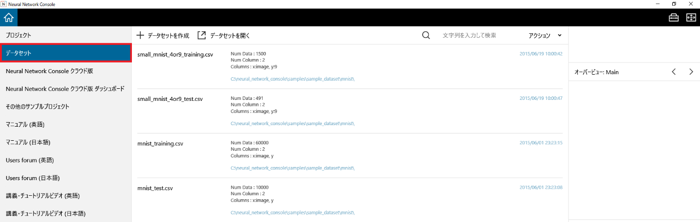
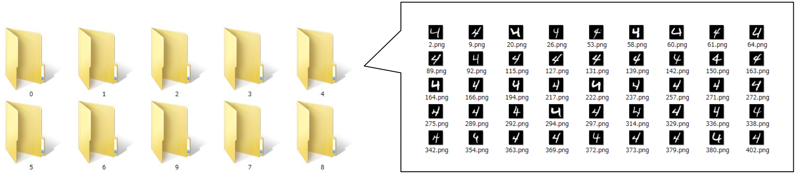
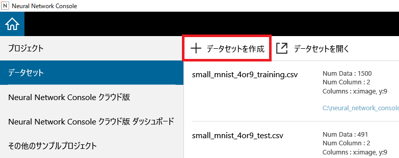
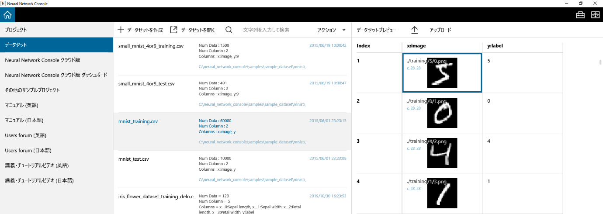

データセット管理画面
====================

データセット管理画面では、データセットの作成や追加、過去に利用したデータセットのプレビューを行います。

データセット管理画面の使い方
----------------------------

.. _#画像カテゴリ毎にフォルダ分けされた画像を元に画像分類用データセットを作成するには:

画像カテゴリ毎にフォルダ分けされた画像を元に、画像分類用データセットを作成するには
~~~~~~~~~~~~~~~~~~~~~~~~~~~~~~~~~~~~~~~~~~~~~~~~~~~~~~~~~~~~~~~~~~~~~~~~~~~~~~~~~~

1. フォルダ毎に分類された画像ファイルを用意します。

2. 起動後の画面でデータセットを選択し、データセット管理画面を表示します。

3. データセットを作成ボタンをクリックします。

..

   もしくは、キーボードのCtrlキーを押しながらNキーを押します。

4. 表示されるポップアップメニューから画像分類を開きます。

画像分類データセット作成ダイアログが開きます。

   .. image:: figures/image28.png
      :align: center

5. データセットの作成に関する設定を行います。

.. list-table::
   :widths: 30 70
   :class: longtable
   :header-rows: 1

   * - ソースディレクトリ
     - 画像毎に分類されたフォルダが設置されたフォルダを指定します

   * - 出力ディレクトリ
     - 作成したデータセットを出力するフォルダを指定します

   * - 変形方法
     -
        各フォルダに含まれる画像のアスペクト比が指定サイズの示すアスペクト比と異なる場合、アスペクト比を合わせる方法を指定します

        トリミング：画像の端を切り取ることでアスペクト比を合わせます

        パディング：画像の端に0を挿入することでアスペクト比を合わせます

        リサイズ：アスペクト比を無視し、画像を指定サイズにリサイズします

   * - 出力カラーチャンネル
     - 出力画像のカラーチャンネル数を1（モノクロ）もしくは3（RGBカラー）で指定します

   * - 出力幅
     - 出力画像の横幅をピクセル単位で指定します

   * - 出力高さ
     - 出力画像の縦幅をピクセル単位で指定します

   * - データ順をシャッフル
     - データの順序をシャッフルします（デフォルトでON）

   * - ファイル名
     - 作成するデータセットCSVのファイル名を指定します

   * - 割合 (%)
     -
        作成するデータセットCSVに用いるデータの割合を指定します

        出力ファイル1、出力ファイル2の割合の合計は100 (%)である必要があります

6. 適用ボタンを押してデータセットの作成を開始します。

前処理プラグインを用いてその他のデータセットを作成するには
~~~~~~~~~~~~~~~~~~~~~~~~~~~~~~~~~~~~~~~~~~~~~~~~~~~~~~~~~~

1. 起動後の画面でデータセットを選択し、データセット管理画面を表示します。

2. データセットを作成ボタンをクリックします。

..

   もしくは、キーボードのCtrlキーを押しながらNキーを押します。

3. 表示されるポップアップメニューのCreate DatasetもしくはDownload or Generate Datasetから、前処理に使用するプラグイン名を選択します。プラグインの実行画面が開きます。

4. プラグインの実行に関するパラメータを入力します。

5. OKボタンを押してプラグインを実行します。プラグインの実行結果が表示されます。

**ご参考**

各プラグインの詳細についてはプラグインリファレンスをご参照ください。

x列1列のみのデータセットを直接作成するには
~~~~~~~~~~~~~~~~~~~~~~~~~~~~~~~~~~~~~~~~~~

テキストボックスに入力した各行のテキストをそのまま変数xの値とするデータセットCSVファイルを作成します。

1. 起動後の画面でデータセットを選択し、データセット管理画面を表示します。

2. データセットを作成ボタンをクリックします。

..

   もしくは、キーボードのCtrlキーを押しながらNキーを押します。

3. 表示されるポップアップメニューから、フォルダ、ファイルもしくはテキストからを選択します。New Datasetウインドウが開きます。

4. テキストボックスに直接データセットの各行に用いるデータを入力します。

..

   テキストボックスにフォルダに含まれるファイルのファイル名を追加するには、フォルダから...をクリックし、ファイルの含まれる最上位のフォルダを指定して開くを選択します。

   テキストボックスに1つもしくは複数ファイルのファイル名を追加するには、ファイルから...をクリックし、追加するファイルを選択して（複数選択可）開くを選択します。

5. ウインドウ右下の名前を付けて保存...をクリックし、テキストボックスの内容をデータセットCSVファイルとして保存します。

ディスクに保存されているデータセットを読み込むには
~~~~~~~~~~~~~~~~~~~~~~~~~~~~~~~~~~~~~~~~~~~~~~~~~~

1. データセットを開くをクリックします。

..

   もしくは、キーボードのCtrlキーを押しながらOキーを押します。

2. 読み込むデータセットファイル（*.CSVファイル）を選択します。

過去に利用したデータセットをプレビューするには
~~~~~~~~~~~~~~~~~~~~~~~~~~~~~~~~~~~~~~~~~~~~~~

データセット管理画面に表示されている過去に利用したデータセットをクリックします。

もしくは、データセットをカーソルキーの上下で選択します。

画面右に選択したデータセットのプレビューが表示されます。

過去に利用したデータセットを絞り込んで表示するには
~~~~~~~~~~~~~~~~~~~~~~~~~~~~~~~~~~~~~~~~~~~~~~~~~~

データセット管理画面右上、虫眼鏡アイコンの右隣にあるテキストボックスに検索文字列を入力します。

ファイル名や記述に指定文字列を含んでいるデータセットのみ表示されます。

**ご参考**

検索文字列は半角スペースで区切って複数指定することができます。半角スペースを含んだ検索文字列はダブルクオーテーションで囲って指定します。

過去に利用したデータセットのあるフォルダを開くには
~~~~~~~~~~~~~~~~~~~~~~~~~~~~~~~~~~~~~~~~~~~~~~~~~~

過去に利用したデータセットを右クリックして表示されるポップアップメニューから、ファイルの場所を開くを選択します。

過去に利用したデータセットをデータセット管理画面から除外するには
~~~~~~~~~~~~~~~~~~~~~~~~~~~~~~~~~~~~~~~~~~~~~~~~~~~~~~~~~~~~~~~~

過去に利用したデータセットを右クリックして表示されるポップアップメニューから、リストから除くを選択します。

**ご参考**

除外したデータセットは、データセット管理画面から除外されるのみでディスクからは削除されません。

**ご参考**

一度除外したデータセットも、データセットを開くで読み込むことで再びデータセット管理画面に表示されるようになります。

