プロジェクト画面
================

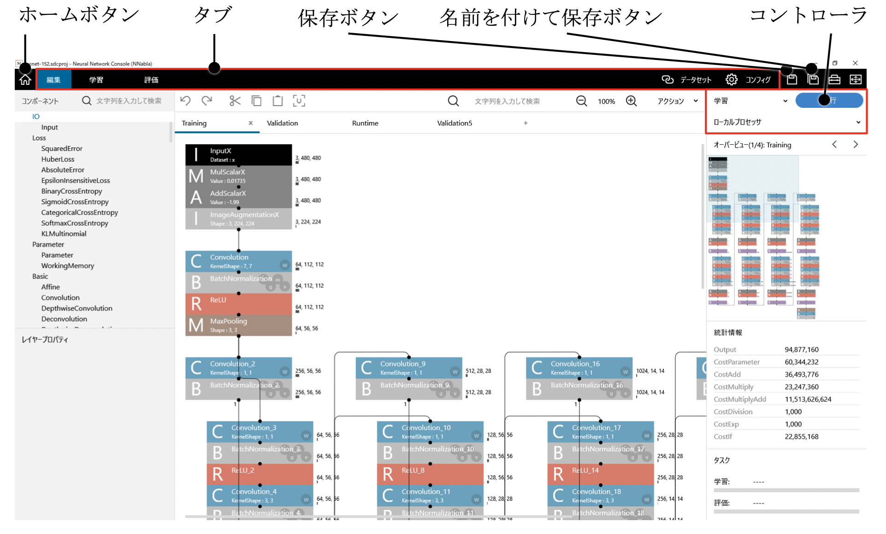

プロジェクト画面では、プロジェクトの編集、学習、評価まで、Deep Learningの一連の開発作業を行います。

.. _#プロジェクト画面の使い方:

プロジェクト画面の使い方
------------------------

プロジェクト選択画面に戻るには
~~~~~~~~~~~~~~~~~~~~~~~~~~~~~~

ホームボタンをクリックします。

もしくは、キーボードのCtrlキーを押しながらWキーを押します。

**ご注意**

プロジェクトが編集されている場合は、保存するかどうかを問い合わせるメッセージボックスが表示されます。

**ご注意**

学習が実行中の場合は、学習を停止するかどうかを問い合わせるメッセージボックスが表示されます。

編集中のプロジェクトを上書き保存するには
~~~~~~~~~~~~~~~~~~~~~~~~~~~~~~~~~~~~~~~~

保存ボタンをクリックします。

もしくは、キーボードのCtrlキーを押しながらSキーを押します。

**ご注意**

プロジェクトを初めて保存する場合、保存ボタンの動作は名前を付けて保存ボタンの動作になります。

編集中のプロジェクトを新しいプロジェクトファイルに保存するには
~~~~~~~~~~~~~~~~~~~~~~~~~~~~~~~~~~~~~~~~~~~~~~~~~~~~~~~~~~~~~~

1. 名前を付けて保存ボタンをクリックします。

2. 保存先のプロジェクトファイル「*.sdcprojファイル」を選択します。

学習に用いるニューラルネットワークのネットワーク構成を編集するには
~~~~~~~~~~~~~~~~~~~~~~~~~~~~~~~~~~~~~~~~~~~~~~~~~~~~~~~~~~~~~~~~~~

編集と書かれたタブをクリックして選択します。

編集タブが表示されます。編集タブでの操作方法については :ref:`編集タブの使い方 <#編集タブの使い方>` をご参照ください。

学習に用いるデータセットを指定、確認するには
~~~~~~~~~~~~~~~~~~~~~~~~~~~~~~~~~~~~~~~~~~~~

データセットと書かれたタブをクリックして選択します。

データセットタブが表示されます。データセットタブでの操作方法については :ref: `データセットタブの使い方 <#データセットタブの使い方>` をご参照ください。

学習パラメータの設定を変更するには
~~~~~~~~~~~~~~~~~~~~~~~~~~~~~~~~~~

コンフィグと書かれたタブをクリックして選択します。

コンフィグタブが表示されます。コンフィグタブでの操作方法については :ref:`コンフィグタブ（Global Config）の使い方 <#コンフィグタブの使い方>`: をご参照ください。

ニューラルネットワークの学習を実行するには
~~~~~~~~~~~~~~~~~~~~~~~~~~~~~~~~~~~~~~~~~~

編集タブにて、コントローラの実行ボタンをクリックします。もしくは、キーボードのF5キーを押します。

ニューラルネットワークの学習が開始し、学習の進捗を確認するための学習タブが表示されます。学習タブでの操作方法については :ref:`学習タブ <#学習タブの使い方>` の使い方をご参照ください。

**ご注意**

編集中のネットワーク構成に不備がある、データセットが正しく指定されていないなど、正しく学習を開始できない場合はエラーメッセージが表示されます。エラーメッセージの行をダブルクリックすることで、エラーのある箇所に移動することができます。

ニューラルネットワークの学習実行中に、他の設定での学習を予約するには
~~~~~~~~~~~~~~~~~~~~~~~~~~~~~~~~~~~~~~~~~~~~~~~~~~~~~~~~~~~~~~~~~~~~

編集タブにて、コントローラのスケジュールボタンをクリックします。

もしくは、キーボードのF5キーを押します。

学習タブにて現在の設定での学習が予約されます。予約した学習は現在実行中の学習が完了次第順次実行されます。

学習の進捗状況や過去の学習結果を確認するには
~~~~~~~~~~~~~~~~~~~~~~~~~~~~~~~~~~~~~~~~~~~~

学習と書かれたタブをクリックして選択します。

学習タブが表示されます。学習タブについては :ref:`学習タブの使い方 <#学習タブの使い方>` をご参照ください。

過去に学習したニューラルネットワークを用いた精度評価を行うには
~~~~~~~~~~~~~~~~~~~~~~~~~~~~~~~~~~~~~~~~~~~~~~~~~~~~~~~~~~~~~~

評価と書かれたタブをクリックして選択します。

評価タブが表示されます。評価タブについては :ref:`評価タブの使い方 <#評価タブの使い方>` をご参照ください。

.. _#編集タブの使い方:

編集タブの使い方
----------------

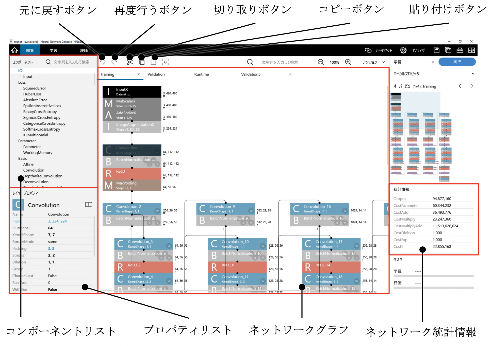

編集タブでは、学習に用いるニューラルネットワークのネットワーク構成を編集します。

|Console| では、ニューラルネットワークの構成を、あらかじめ用意されたレイヤーと呼ばれる部品（関数）の組み合わせで表現します。

ネットワークグラフに新しいレイヤーを追加するには
~~~~~~~~~~~~~~~~~~~~~~~~~~~~~~~~~~~~~~~~~~~~~~~~

ネットワークグラフに追加するレイヤーを、編集タブ左端のコンポーネントからネットワークグラフにドラッグ&ドロップします。

もしくは、コンポーネントでネットワークグラフに追加するレイヤーをダブルクリックします。

もしくは、コンポーネントで、ネットワークグラフに追加するレイヤーをクリックするかカーソルキーの上下で選択し、キーボードのEnterキーを押します。

もしくは、コンポーネントで、ネットワークグラフに追加するレイヤーをクリックするかカーソルキーの上下で選択し、ネットワークグラフ上でダブルクリックします。

**ご参考**

ネットワークグラフでレイヤーが選択されている状態でコンポーネントのダブルクリック、もしくはEnterキーでレイヤーを追加すると、新しいレイヤーは選択されていたレイヤーに自動的に接続します。

レイヤーを1つ選択するには
~~~~~~~~~~~~~~~~~~~~~~~~~

ネットワークグラフ上のレイヤーをクリックします。

もしくは、ネットワークグラフ上をクリックした後、キーボードのカーソルキーで目的のレイヤーまで移動します。

レイヤーを複数選択するには
~~~~~~~~~~~~~~~~~~~~~~~~~~

キーボードのCtrlキーを押しながらネットワークグラフ上のレイヤーをクリックします。

もしくは、最初のレイヤーを選択した後、キーボードのCtrlキーを押しながら、カーソルキーでレイヤーを移動します。

もしくは、ネットワークグラフ上のレイヤーやリンクのない箇所からドラッグし、レイヤーを範囲選択します。

すべてのレイヤーを選択するには
~~~~~~~~~~~~~~~~~~~~~~~~~~~~~~

ネットワークグラフ上を右クリックして表示されるポップアップメニューからすべて選択を選択します。

もしくは、キーボードのCtrlキーを押しながらAキーを押します。

レイヤーの選択を反転するには
~~~~~~~~~~~~~~~~~~~~~~~~~~~~

ネットワークグラフ上を右クリックして表示されるポップアップメニューからレイヤーの選択を反転を選択します。

レイヤーの選択を解除するには
~~~~~~~~~~~~~~~~~~~~~~~~~~~~

ネットワークグラフ上の、レイヤーやリンクのない箇所をクリックします。

もしくは、ネットワークグラフ上を右クリックして表示されるポップアップメニューから選択解除を選択します。

もしくは、キーボードのEscキーを押します。

レイヤーの座標を移動するには
~~~~~~~~~~~~~~~~~~~~~~~~~~~~

1. 移動対象のレイヤーを選択します。

2. レイヤーをドラッグして移動します。

レイヤーを削除するには
~~~~~~~~~~~~~~~~~~~~~~

1. 削除対象のレイヤーを選択します。

2. ネットワークグラフ上を右クリックして表示されるポップアップメニューから削除を選択します。

..

   もしくは、キーボードのDeleteキーを押します。

**ご注意**

レイヤーを削除すると、レイヤーに接続されていたリンクも合わせて削除されます。

既存のレイヤーの位置に新しいレイヤーを挿入するには
~~~~~~~~~~~~~~~~~~~~~~~~~~~~~~~~~~~~~~~~~~~~~~~~~~

1. コンポーネントリストで、ネットワークグラフに追加するレイヤーをクリックするかカーソルキーの上下で選択します。

2. ネットワークグラフで、選択したレイヤーの挿入先のレイヤーを選択します。

3. キーボードのInsertキーを押します。

リンク構造を保ったままレイヤーを削除するには
~~~~~~~~~~~~~~~~~~~~~~~~~~~~~~~~~~~~~~~~~~~~

1. 削除対象のレイヤーを選択します。

2. キーボードのBack spaceキーを押します。

2つのレイヤーを接続（リンク）するには
~~~~~~~~~~~~~~~~~~~~~~~~~~~~~~~~~~~~~

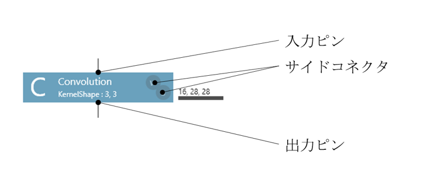

ネットワークグラフ上で、接続先レイヤーを、接続元レイヤーのすぐ下までドラッグして移動します。

もしくは、接続元レイヤーの出力ピンから接続先レイヤーの入力ピンあるいはサイドコネクタまでマウスでドラッグします。

もしくは、接続元レイヤーが選択されている状態で、キーボードのShiftキーを押しながら接続先のレイヤーをクリックします。

リンクの接続先を変更するには
~~~~~~~~~~~~~~~~~~~~~~~~~~~~

ネットワークグラフ上で、接続変更対象のリンクをドラッグします。

**ご参考**

出力ピンに近い方をドラッグすると接続元のレイヤーを、入力ピンに近い方の終端をドラッグすると接続先のレイヤーを変更することができます。

リンクを選択するには
~~~~~~~~~~~~~~~~~~~~

ネットワークグラフ上でリンクをクリックします。

リンクを削除するには
~~~~~~~~~~~~~~~~~~~~

1. 削除対象のリンクを選択します。

2. ネットワークグラフ上を右クリックして表示されるポップアップメニューから削除を選択します。

..

   もしくは、キーボードのDeleteキーを押します。

過去に行った編集を元に戻すには
~~~~~~~~~~~~~~~~~~~~~~~~~~~~~~

画面上部の元に戻すボタンをクリックします。

もしくは、ネットワークグラフ上を右クリックして表示されるポップアップメニューから元に戻すを選択します。

もしくは、キーボードのCtrlキーを押しながらZキーを押します。

**ご参考**

|Console| では過去の編集を100回までさかのぼって元に戻すことができます。

元に戻した編集を再度行うには
~~~~~~~~~~~~~~~~~~~~~~~~~~~~

画面上部の再度行うボタンをクリックします。

もしくは、ネットワークグラフ上を右クリックして表示されるポップアップメニューからやり直しを選択します。

もしくは、キーボードのCtrlキーを押しながらYキーを押します。

もしくは、キーボードのCtrlキーとShiftキーを押しながらZキーを押します。

**ご注意**

一度でもUndo以外の編集操作を行うと、過去に行った編集を再度行うことはできなくなります。

レイヤーをクリップボードに切り取りするには
~~~~~~~~~~~~~~~~~~~~~~~~~~~~~~~~~~~~~~~~~~

1. 切り取り対象のレイヤーを選択します。

2. 画面上部の切り取りボタンをクリックします。

..

   もしくは、ネットワークグラフ上を右クリックして表示されるポップアップメニューから切り取りを選択します。

   もしくは、キーボードのCtrlキーを押しながらXキーを押します。

レイヤーをクリップボードにコピーするには
~~~~~~~~~~~~~~~~~~~~~~~~~~~~~~~~~~~~~~~~

1. コピー対象のレイヤーを選択します。

2. 画面上部のコピーボタンをクリックします。

..

   もしくは、ネットワークグラフ上を右クリックして表示されるポップアップメニューからコピーを選択します。

   もしくは、キーボードのCtrlキーを押しながらCキーを押します。

クリップボードのレイヤーを貼り付けするには
~~~~~~~~~~~~~~~~~~~~~~~~~~~~~~~~~~~~~~~~~~

画面上部の貼り付けボタンをクリックします。

もしくは、ネットワークグラフ上を右クリックして表示されるポップアップメニューから貼り付けを選択します。

もしくは、キーボードのCtrlキーを押しながらVキーを押します。

選択中のレイヤーの複製を作成するには
~~~~~~~~~~~~~~~~~~~~~~~~~~~~~~~~~~~~

キーボードのCtrlキーを押しながらDキーを押します。

もしくは、キーボードのAltキーを押しながら選択中のレイヤーをドラッグします。

特定の文字列を含むレイヤーを検索するには
~~~~~~~~~~~~~~~~~~~~~~~~~~~~~~~~~~~~~~~~

ネットワークグラフの上の検索窓にレイヤーの名前を入力します。

入力した文字列をコンポーネント名、もしくはレイヤー名に含むレイヤーが選択されます。

特定の文字列を含む次のレイヤーを検索するには
~~~~~~~~~~~~~~~~~~~~~~~~~~~~~~~~~~~~~~~~~~~~

ネットワークグラフの上の検索窓にカーソルがある状態で、キーボードのEnterキーを押します。

もしくはキーボードのF3キーを押します。

特定の文字列を含む前のレイヤーを検索するには
~~~~~~~~~~~~~~~~~~~~~~~~~~~~~~~~~~~~~~~~~~~~

キーボードのShiftキーを押しながらF3キーを押します。

レイヤーを他のレイヤーに置換するには
~~~~~~~~~~~~~~~~~~~~~~~~~~~~~~~~~~~~

1. ネットワークグラフ上を右クリックして表示されるポップアップメニューから置換を選択します。

2. 置換元で置換元のレイヤー、置換先で置換先のレイヤーを選択します。

3. プロジェクトに含まれるすべてのネットワークで置換を行う場合は対象ネットワークとしてすべてを、現在表示中のネットワーク内でのみ置換を行う場合は現在を選択します。

4. 対象ネットワークで指定したネットワークに含まれるすべてのレイヤーの置換を行う場合は対象レイヤーとしてすべてを、現在選択中のレイヤーのみ置換対象とする場合は選択範囲を選択します。

5. 置換ボタンをクリックして置換処理を実行します。

レイヤーの配置を自動整理するには
~~~~~~~~~~~~~~~~~~~~~~~~~~~~~~~~

ネットワークグラフ上を右クリックして表示されるポップアップメニューからレイヤーの整列

を選択します。

ネットワークに含まれるすべてのパラメータファイルをクリアするには
~~~~~~~~~~~~~~~~~~~~~~~~~~~~~~~~~~~~~~~~~~~~~~~~~~~~~~~~~~~~~~~~

ネットワークグラフ上を右クリックして表示されるポップアップメニューから全てのパラメータファイルをクリアを選択します。Affine、ConvolutionのW.File、b.Fileプロパティなど、レイヤーに設定されたパラメータファイルを指定するプロパティが一括クリアされます。

ネットワークグラフの表示範囲を移動するには
~~~~~~~~~~~~~~~~~~~~~~~~~~~~~~~~~~~~~~~~~~

ネットワークグラフ右および下に表示されるスクロールバーをドラッグします。

もしくは、マウスホイールを操作します（マウスホイールのみの操作で縦スクロール、Shiftキーを押しながらの操作で横スクロール）。

ネットワークグラフ表示を拡大縮小するには
~~~~~~~~~~~~~~~~~~~~~~~~~~~~~~~~~~~~~~~~

1. ネットワークグラフをクリックして選択します。

2. キーボードのCtrlキーを押しながらマウスホイールを操作します。

..

   もしくは、キーボードのCtrlキーを押しながら「+」（プラス）キーもしくは「-」（マイナス）キーを押します。

もしくは、ネットワークグラフ上を右クリックして表示されるポップアップメニューから拡大縮小を選択し、さらに拡大もしくは縮小を選択します。

ネットワークグラフ表示の拡大率を元に戻すには
~~~~~~~~~~~~~~~~~~~~~~~~~~~~~~~~~~~~~~~~~~~~

1. ネットワークグラフをクリックして選択します。

2. キーボードのCtrlキーを押しながら「0」（ゼロ）キーを押します。

もしくは、ネットワークグラフ上を右クリックして表示されるポップアップメニューから拡大縮小を選択し、さらにデフォルトを選択します。

レイヤーのプロパティを編集するには
~~~~~~~~~~~~~~~~~~~~~~~~~~~~~~~~~~

1. プロパティ編集対象のレイヤーを1つもしくは複数選択します。

2. プロパティリストに表示されたプロパティのうち、編集するプロパティの値をクリックします。

..

   もしくは、プロパティリスト上をクリックした後、キーボードのカーソルキーで目的のプロパティまで移動しEnterキーを押します。

3. 文字列を入力するプロパティの場合、キーボードで値を入力します。選択肢から選択するプロパティの場合、マウスで値を選択するか、キーボードのカーソルキー上下で値を選択します。

4. 他の編集に作業に移るか、キーボードのEnterキー、ESCキーを押すと編集は終了します。

プロパティの値としては、通常の数値や文字列の他、以下の値を指定することができます。

.. list-table::
   :class: longtable
   :header-rows: 1

   * - プロパティの値
     - 解説
     - 使用例

   * - \*（アスタリスク）+他のプロパティ名
     - 同じレイヤーの他のプロパティの値をコピーして使用します
     - -  AffineレイヤーのOutShapeプロパティを「*Input」とすることで、出力サイズを入力サイズとする

   * - \*（アスタリスク）+Argumentレイヤーの名前
     - 現在のネットワーク内にある、指定した名前のArgumentレイヤーの持つ、Valueプロパティの値をコピーして使用します
     - -  名前をConvKernelとしたArgumentレイヤーを用意し、複数のConvolutionレイヤーのKernel Shapeを「*ConvKernel」とすることで、ArgumentレイヤーのValueプロパティを編集して複数のConvolutionのKernelShapeをまとめて指定可能にする

   * - \*Default
     - プロパティのデフォルト値を使用します
     - -  Unitレイヤーのプロパティーの値として、Unit内のArgumentレイヤー、Valueプロパティで指定されている値を使用する

   * - 数式、カンマ区切りの数式
     -
        四則演算とカッコで構成される四則演算を用いることができます

        数式中の変数として、同じレイヤーの他のプロパティや、Argumentレイヤーを用いることができます

        用いる変数が配列の場合、[ ]演算子を用いて配列の要素のIndexを指定することができます。
     -
        -  ConvolutionレイヤーのOutMapsを「Input[0]*2」とすることで、OutMapsが入力Map数の倍になるようにする

        -  ConvolutionレイヤーのPaddingを「KernelShape[0]/2,KernelShape[1]/2」とすることで、PaddingをKernelShapeの半分にする

**ご参考**

デフォルト値から変更されたプロパティは太字で、通常の数値や文字列以外の値が指定されているプロパティは青字で表示されます。

**ご注意**

編集結果は、値を入力すると即座に反映されます（Enterキーを押す前に確定されています）。誤って入力した値を元に戻したい場合は、元に戻す機能を利用します。

**ご注意**

編集可能なプロパティは濃い黒字で表示されます。その他のプロパティの値は、レイヤーの接続状況やほかのプロパティの値から自動計算されます。

**ご注意**

不正な値が入力されているか、他のレイヤーとの接続の結果不整合が生じているプロパティには、プロパティリスト右に警告マークが表示されます。また、ネットワークグラフ上で不整合が生じているプロパティを持つレイヤーの右上にも警告マークが表示されます。この場合、レイヤーの接続を見直すか、プロパティの値を修正してください。

複数のレイヤーのプロパティをまとめて編集するには
~~~~~~~~~~~~~~~~~~~~~~~~~~~~~~~~~~~~~~~~~~~~~~~~

複数のレイヤーを選択した状態でプロパティを編集します。

選択中のレイヤーのプロパティのうち、値を入力したプロパティと同名のプロパティがすべて入力した値で上書きされます。

プロパティリストの列幅を変更するには
~~~~~~~~~~~~~~~~~~~~~~~~~~~~~~~~~~~~

プロパティリストの列の境界を左右にドラッグし、列の幅を調整します

レイヤーをユニット化するには
~~~~~~~~~~~~~~~~~~~~~~~~~~~~

1. ユニット化対象のレイヤーを1つもしくは複数選択します。

2. ユニット作成ボタンを押します。Create Unitダイアログが開きます。

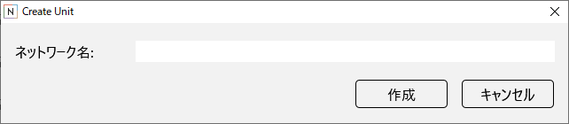

3. ネットワーク名にユニットネットワークのネットワーク名を入力し、作成ボタンを押します。

各レイヤーの必要とするメモリ量や計算量を確認するには
~~~~~~~~~~~~~~~~~~~~~~~~~~~~~~~~~~~~~~~~~~~~~~~~~~~~

1. メモリ量や計算量の確認対象のレイヤーを1つ選択します。

2. プロパティリストで以下の値を参照します。

.. list-table::
   :widths: 30 70
   :class: longtable
   :header-rows: 1

   * - 項目
     - 内容

   * - CostParameter
     - レイヤーの持つパラメータの総数

   * - CostAdd
     - レイヤーの計算に必要な加算回数

   * - CostMultiply
     - レイヤーの計算に必要な乗算回数

   * - CostMultiplyAdd
     - レイヤーの計算に必要な乗加算回数

   * - CostDivision
     - レイヤーの計算に必要な除算回数

   * - CostExp
     - レイヤーの計算に必要な指数計算回数

   * - CostIf
     - レイヤーの計算に必要な条件分岐判断回数

**ご参考**

必要なメモリ量や計算量が常にゼロである項目はプロパティリストに表示されません。

Webでレイヤーの説明を参照するには
~~~~~~~~~~~~~~~~~~~~~~~~~~~~~~~~~

1. 説明を参照するレイヤーを選択します。

2. プロパティリスト右上の説明アイコン（本の形のアイコン）をクリックします。

..

   もしくは、キーボードのCtrlキーを押しながらF1キーを押します。

ブラウザが起動し、選択中のレイヤーについての解説ページが開きます。

ネットワーク全体の統計情報を確認するには
~~~~~~~~~~~~~~~~~~~~~~~~~~~~~~~~~~~~~~~~

編集タブ右のネットワーク統計情報を参照します。

ネットワーク統計情報には以下の統計情報が表示されます。

.. list-table::
   :widths: 30 70
   :class: longtable
   :header-rows: 1

   * - 項目
     - 内容

   * - Output
     - 計算過程で保持する必要がある途中計算値（バッファ）の数

   * - CostParameter
     - ニューラルネットワーク全体の持つパラメータの総数

   * - CostAdd
     - 1回のニューラルネットワークの計算で必要な加算回数

   * - CostMultiply
     - 1回のニューラルネットワークの計算で必要な乗算回数

   * - CostMultiplyAdd
     - 1回のニューラルネットワークの計算で必要な乗加算回数

   * - CostDivision
     - 1回のニューラルネットワークの計算で必要な除算回数

   * - CostExp
     - 1回のニューラルネットワークの計算で必要な指数計算回数

   * - CostIf
     - 1回のニューラルネットワークの計算で必要な条件分岐判断回数

ネットワーク全体の統計情報をクリップボードにコピーするには
~~~~~~~~~~~~~~~~~~~~~~~~~~~~~~~~~~~~~~~~~~~~~~~~~~~~~~~~~~

ネットワーク統計情報を右クリックして表示されるポップアップメニューからCopyを選択します。

特定の統計情報を詳しく確認するには
~~~~~~~~~~~~~~~~~~~~~~~~~~~~~~~~~~

ネットワーク統計情報で、詳しく確認したい統計情報をクリックして選択します。

もしくは、ネットワーク統計情報をクリックした後、キーボードのカーソルキー上下で統計情報の種類を選択します。

もしくは、プロパティリストで統計情報のプロパティを選択します。

ネットワークグラフ上の各レイヤーの右に、選択した統計情報の各レイヤーに占める割合が表示されます。

**ご参考**

統計情報を何も選択していない場合、レイヤーの右にはデフォルトでOutputの内容が表示されます。

編集中のネットワークを画像としてファイルに保存するには
~~~~~~~~~~~~~~~~~~~~~~~~~~~~~~~~~~~~~~~~~~~~~~~~~~~~~~

1. ネットワークグラフ上を右クリックして表示されるポップアップメニューからネットワークの画像を保存を選択します。

2. 保存先の画像ファイル名を指定します。

nntxt、nnp、ONNXファイルを読み込むには
~~~~~~~~~~~~~~~~~~~~~~~~~~~~~~~~~~~~~~

1. ネットワークグラフ上を右クリックして表示されるポップアップメニューからインポート、nntxt, nnp, ONNXを選択します。

2. 読み込むnntxt, nnp, ONNXファイルを指定します。

**ご参考**

nntxtファイルは、 |Console| が学習時に生成する、ニューラルネットワークの構造や学習の設定が記述されたファイルです。nntxtファイルのインポート操作により、編集タブ、コンフィグタブの設定が指定したnntxtファイルより読み込まれます。

nnpファイルは、Neural Network Librariesが扱う、ニューラルネットワークの構造、学習の設定、学習済みパラメータなどが記述されたファイルです。nnpファイルのインポート操作により、編集タブ、コンフィグタブの設定が指定したnnpファイルより読み込まれます。nnpファイルが学習済みパラメータを含んでいる場合は、Convolution、AffineなどのWeight（W.File）、Bias（b.File）に学習済みパラメータファイルが読み込まれます。

ONNX(Open Neural Network Exchange Format)は、Deep Learningのモデルを異なるソフトウェア間で共有可能にするオープンなファイルフォーマットです。

https://onnx.ai/

ONNXファイルのインポート操作により、Convolution、AffineなどのWeight（W.File）、Bias（b.File）に学習済みパラメータファイルが設定された状態で、編集タブにネットワーク構造が読み込まれます。

nntxt、nnp、ONNXファイルをユニットとして読み込むには
~~~~~~~~~~~~~~~~~~~~~~~~~~~~~~~~~~~~~~~~~~~~~~~~~~~~

3. ネットワークグラフ上を右クリックして表示されるポップアップメニューからインポート、nntxt, nnp, ONNX as Unitを選択します。

4. 読み込むnntxt, nnp, ONNXファイルを指定します。

Caffeのprototxtからネットワークを読み込むには（beta）
~~~~~~~~~~~~~~~~~~~~~~~~~~~~~~~~~~~~~~~~~~~~~~~~~~~~~

1. ネットワークグラフ上を右クリックして表示されるポップアップメニューからインポート、prototxt (Caffe) betaを選択します。

2. 読み込むprototxtファイルを指定します。

**ご注意**

|Console| はprototxtに書かれている情報のうち、 |Console| と互換性のある情報のみを読み込み、その他の情報は破棄します。 |Console| でサポートされていないレイヤーはUnsupportedレイヤーとして読み込まれます。Unsupportedレイヤーはその内容を確認するために設けられたダミーのレイヤーであり、学習を実行する前に削除する必要があります。

Caffeのprototxtフォーマットでネットワークを出力するには（beta）
~~~~~~~~~~~~~~~~~~~~~~~~~~~~~~~~~~~~~~~~~~~~~~~~~~~~~~~~~~~~~~~

1. ネットワークグラフ上を右クリックして表示されるポップアップメニューからエクスポート、prototxt (Caffe) betaを選択します。

2. 保存先のprototxtファイルを指定します。

**ご注意**

|Console| はネットワーク情報のうち、prototxtと互換性のある情報のみを出力し、その他の情報は破棄します。出力したprototxtを元にCaffeで学習を行うためには、Caffeでの学習に必要な追加の情報を追記する必要があります。

Neural Network Librariesで利用可能なネットワーク定義のPythonコードを出力するには
~~~~~~~~~~~~~~~~~~~~~~~~~~~~~~~~~~~~~~~~~~~~~~~~~~~~~~~~~~~~~~~~~~~~~~~~~~~~~~~~

ネットワークグラフ上を右クリックして表示されるポップアップメニューからエクスポート、Pythonコード(NNabla)を選択します。

ネットワーク定義のPythonコードがクリップボードにコピーされます。

ネットワークをpptx形式で出力するには
~~~~~~~~~~~~~~~~~~~~~~~~~~~~~~~~~~~~

ネットワークグラフ上を右クリックして表示されるポップアップメニューからエクスポート、pptx betaを選択します。

出力されたpptxファイルが関連付けられたアプリで開きます。

学習結果のレポートをhtml形式で出力するには
~~~~~~~~~~~~~~~~~~~~~~~~~~~~~~~~~~~~~~~~~~

ネットワークグラフ上を右クリックして表示されるポップアップメニューからエクスポート、html betaを選択します。

出力されたhtmlファイルが関連付けられたアプリで開きます。

プロジェクトに2つ目以降のネットワーク構造を追加するには
~~~~~~~~~~~~~~~~~~~~~~~~~~~~~~~~~~~~~~~~~~~~~~~~~~~~~~~

ネットワークグラフ上方の「+」ボタンをクリックします。

編集対象のネットワーク構造を切り替えるには
~~~~~~~~~~~~~~~~~~~~~~~~~~~~~~~~~~~~~~~~~~

ネットワークグラフ上方のタブをクリックして選択します。

もしくは、ユニットレイヤーをダブルクリックして、編集対象のネットワーク構造を、ユニットレイヤーの使用しているネットワーク構造に切り替えます。

**ご注意**

プロジェクト内のすべてのネットワーク構造において同名のレイヤーは一部を除き全て同じプロパティである必要があります。学習、評価の際、同名のレイヤーやパラメータは全てのネットワーク構造の間で共有されます。

ネットワーク構造の名前を変更するには
~~~~~~~~~~~~~~~~~~~~~~~~~~~~~~~~~~~~

1. ネットワークグラフ上方のタブをクリックして選択します。

2. クリックしたタブの名前部分を再度クリックします。

3. ネットワーク構造の名前を入力し、Enterキーを押します。

**ご注意**

通常ネットワーク構造の名前には「Main」を用います。ネットワーク構造の名前として「Main」を指定した場合、設計した学習用のニューラルネットワークを元に評価用のネットワーク構造「MainValidation」、実行時用のネットワーク構造「MainRuntime」がそれぞれ自動生成されます。「Main」以外の名前を指定した場合、学習用（Training）、評価用（Validation）、実行時用（Runtime）のネットワーク構造をそれぞれ個別に設定する必要があります。

ネットワーク構造をプロジェクトから削除するには
~~~~~~~~~~~~~~~~~~~~~~~~~~~~~~~~~~~~~~~~~~~~~~

1. ネットワークグラフ上方のタブをクリックして削除対象のネットワーク構造を選択します。

2. ネットワーク構造右端の「x」ボタンをクリックします。

ネットワーク構造を並び替えるには
~~~~~~~~~~~~~~~~~~~~~~~~~~~~~~~~

ネットワークグラフ上方のタブを左右にドラッグして移動します。

.. _#データセットタブの使い方:

データセットタブの使い方
------------------------

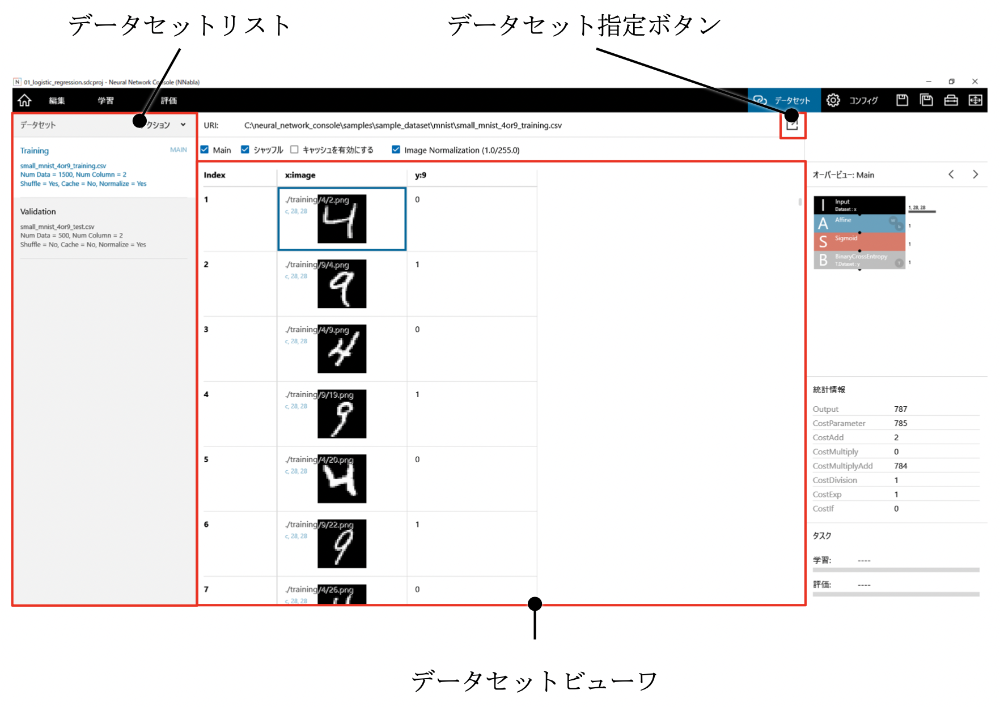

データセットタブでは、ニューラルネットワークの学習に用いるデータセットの指定と、確認を行います。

学習、評価に用いるデータセットのCSVファイルを指定するには
~~~~~~~~~~~~~~~~~~~~~~~~~~~~~~~~~~~~~~~~~~~~~~~~~~~~~~~~~

1. データセットリストで、CSVファイルを指定するデータセットを選択します。デフォルトで用意されているTrainingは学習に用いるデータセット、Validationは評価に用いるデータセットを示します。

2. データセット指定ボタンをクリックします。

3. 表示されるデータセット一覧からデータセットを選択します。

..

   もしくは、データセット一覧上のデータセットを作成ボタンをクリックし、新しいデータセットを作成します。

   もしくは、データセット一覧上のデータセットを開くボタンをクリックし、コンピュータ内のデータセットCSVファイルを開きます。

データセットの内容を確認するには
~~~~~~~~~~~~~~~~~~~~~~~~~~~~~~~~

1. データセットリストで、内容を確認するデータセットを選択します。

2. データセットビューワ部で、データセットの内容を確認します。データセットビューワ部には、指定されたデータセットの内容が表の形式で表示されます。

**ご参考**

画像ファイル名が指定されたセルには画像のプレビューが、データCSVファイル、もしくはWavファイルのファイル名が指定されたセルにはデータのグラフがそれぞれ表示されます。

1 epochの長さの決定に用いるデータセットを指定するには
~~~~~~~~~~~~~~~~~~~~~~~~~~~~~~~~~~~~~~~~~~~~~~~~~~~~~

1. データセットリストで、1 epochの長さの決定に用いるデータセットを選択します。

2. Mainをクリックしてチェックします。

**ご参考**

1 epochで学習に用いられるデータ数はMainに指定したデータセットを元に決定されます。例えばデータ数10000のデータセットAと30000のデータセットBが学習に用いられ、BをMainデータセットに指定した場合、30000のデータを学習した時点で1 epochと数えます。この設定においてデータセットAは1 epochの学習中に3回繰り返し使用されます。

データセットを実行時にシャッフルするには
~~~~~~~~~~~~~~~~~~~~~~~~~~~~~~~~~~~~~~~~

1. データセットリストで、シャッフルするデータセットを選択します。

2. シャッフルをクリックしてチェックします。

**ご注意**

シャッフルは、新しいEpochの学習が始まる度に100データ毎に作成されるキャッシュファイル単位、および1つのキャッシュファイル内の100データの間でそれぞれ行われます。

評価に用いるデータセットはシャッフルの指定をしないようにしてください。評価時は、CSVファイルのデータ順とキャッシュファイルのデータ順が同一に保たれている必要があります。

既に作られたデータセットのキャッシュを再利用し、学習開始までの時間を短縮するには
~~~~~~~~~~~~~~~~~~~~~~~~~~~~~~~~~~~~~~~~~~~~~~~~~~~~~~~~~~~~~~~~~~~~~~~~~~~~~~~~

1. データセットリストで、キャッシュを再利用するデータセットを選択します。

2. キャッシュを有効にするをクリックしてチェックします。

**ご注意**

キャッシュを有効にするがチェックされており、かつデータセットのキャッシュが存在する状態では、常にキャッシュを利用します。従ってデータセットの内容が更新されていたとしても、キャッシュを更新することなく既存のキャッシュを利用します。データセットの内容を更新した際キャッシュの内容を更新するには、一旦キャッシュを有効にするをオフにして学習を実行します。

データセットに含まれる画像データについて、ニューラルネットワーク入力前に輝度値を1/255倍して入力値を0.0～1.0に正規化するには
~~~~~~~~~~~~~~~~~~~~~~~~~~~~~~~~~~~~~~~~~~~~~~~~~~~~~~~~~~~~~~~~~~~~~~~~~~~~~~~~~~~~~~~~~~~~~~~~~~~~~~~~~~~~~~~~~~~~~~~~~~~

1. データセットリストで、画像の輝度値を正規化するデータセットを選択します。

2. Image Normalization(1.0/255.0)をクリックしてチェックします。

**ご参考**

Image NormalizationはCPUで処理されます。大きいサイズの画像データを扱う場合、Image NormalizationはOFFにし、代わりにGPU処理可能なMulScalarレイヤーを用いて1/255倍処理を行うようにすることで（Valueプロパティに1/255=0.0039215686…を設定）学習のパフォーマンスを改善できることがあります。

データセットに含まれるCSV、もしくはwavファイルの表示方法を切り替えるには
~~~~~~~~~~~~~~~~~~~~~~~~~~~~~~~~~~~~~~~~~~~~~~~~~~~~~~~~~~~~~~~~~~~~~~~~

グラフの様式を以下の4種類から選択します。

.. list-table::
   :widths: 30 70
   :class: longtable
   :header-rows: 1

   * - 線グラフ (サマリ)
     - データの先頭から248行、10列を、列ごとに色分けされた折れ線グラフで表示します。データCSVファイルに含まれる数値が-1.0～1.0の範囲を超えている場合はOverloadのメッセージが表示されます

   * - 線グラフ (全て)
     - データ全体を、列ごとの折れ線グラフで表示します

   * - 2次元
     - データ全体を、縦方向を行、横方向を列としたヒートマップの形で表示します

   * - 2次元(転置)
     - データ全体を、縦方向を列、横方向を行としたヒートマップの形で表示します

新しいデータセットを追加するには
~~~~~~~~~~~~~~~~~~~~~~~~~~~~~~~~

メニューボタン、もしくはデータセットリストを右クリックして表示されるポップアップメニューからAddを選択します。

データセットの名前を変更するには
~~~~~~~~~~~~~~~~~~~~~~~~~~~~~~~~

1. メニューボタン、もしくはデータセットリストを右クリックして表示されるポップアップメニューから名前の変更を選択します。

..

   もしくはデータセットリストから、名前を変更するデータセットを2度クリックします。

2. 新しい名前を入力してキーボードのEnterキーを押します。

データセットを削除するには
~~~~~~~~~~~~~~~~~~~~~~~~~~

1. データセットリストで、削除するデータセットを選択します。

2. メニューボタン、もしくはデータセットリストを右クリックして表示されるポップアップメニューから削除を選択します。

..

   もしくは、キーボードのDeleteキーを押します。

データセットを並び替えるには
~~~~~~~~~~~~~~~~~~~~~~~~~~~~

1. データセットリストで、並び替えるデータセットを選択します。

2. メニューボタン、もしくはデータセットリストを右クリックして表示されるポップアップメニューから上に移動もしくは下に移動を選択します。

データセットビューワの特定のセルを選択するには
~~~~~~~~~~~~~~~~~~~~~~~~~~~~~~~~~~~~~~~~~~~~~~

選択対象のセルをクリックします。

もしくは、キーボードのカーソルキー、PgUpキー、PgDnキー、Homeキー、Endキー、マウスホイール（マウスホイールのみの操作で縦方向、Shiftキーを押しながらの操作で横方向）を用いてデータセットビューワのカーソルを移動します。

データセットビューワの表示範囲を移動するには
~~~~~~~~~~~~~~~~~~~~~~~~~~~~~~~~~~~~~~~~~~~~

データセットビューワ右、データセットビューワ下のスクロールバーをドラッグします。

もしくは、キーボードのカーソルキー、PgUpキー、PgDnキー、Homeキー、Endキー、マウスホイール（マウスホイールのみの操作で縦方向、Shiftキーを押しながらの操作で横方向）を用いてデータセットビューワのカーソルを画面外まで移動します。

**ご参考**

データセットの縦、横がそれぞれ1画面に収まる場合、それぞれ縦、横スクロールバーは表示されません。

データセット内の画像など特定のファイルを外部アプリで開くには
~~~~~~~~~~~~~~~~~~~~~~~~~~~~~~~~~~~~~~~~~~~~~~~~~~~~~~~~~~~~

ファイル名の書かれたセルをダブルクリックします。

もしくは、ファイル名の書かれたセルを右クリックして表示されるポップアップメニューから開くを選択します。

もしくは、ファイル名の書かれたセルを選択し、キーボードのEnterキーを押します。

データセットCSVファイルを外部アプリで開くには
~~~~~~~~~~~~~~~~~~~~~~~~~~~~~~~~~~~~~~~~~~~~~

データセットビューワを右クリックして表示されるポップアップメニューから表を開くを選択します。

もしくは、データセットのURIをダブルクリックします。

データセットのCSVファイルを別名で保存するには
~~~~~~~~~~~~~~~~~~~~~~~~~~~~~~~~~~~~~~~~~~~~~

データセットビューワを右クリックして表示されるポップアップメニューからCSVファイル形式で保存…を選択します。

.. _#データセットの整合性を確認するには:

データセットの整合性を確認するには
~~~~~~~~~~~~~~~~~~~~~~~~~~~~~~~~~~

データセットビューワを右クリックして表示されるポップアップメニューからデータセットの整合性をチェックを選択します。

学習、評価、それぞれのデータセットで、ファイル名、変数の数、各変数のサイズなどが正しく設定されているかについてのチェックが行われます。不整合がある場合はエラー箇所と共に不整合の内容が表示されます。

.. _#コンフィグタブの使い方:

コンフィグタブ（Global Config）の使い方
---------------------------------------

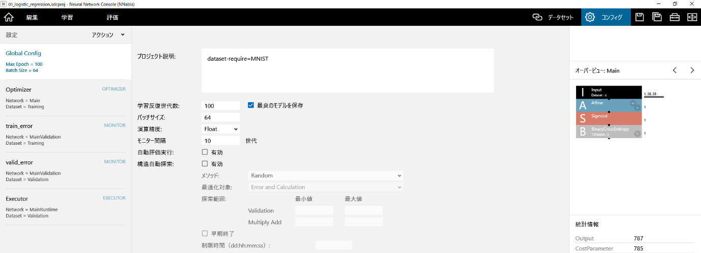

コンフィグタブ（Global Config）では、ニューラルネットワークの学習に関する設定と、確認を行います。

プロジェクトのコメントを編集するには
~~~~~~~~~~~~~~~~~~~~~~~~~~~~~~~~~~~~

プロジェクト説明に任意のコメントをテキストで入力します。

学習完了までの最適化の世代数（Epoch）を指定するには
~~~~~~~~~~~~~~~~~~~~~~~~~~~~~~~~~~~~~~~~~~~~~~~~~~~

学習反復世代数に世代数を入力します。

パラメータを持つ全てのレイヤーについてパラメータのプロパティ（Weight、Biasなど）が指定されている状態で、学習を行わず設計したネットワークをそのまま学習結果として出力するには、学習反復世代数に0を指定します。

学習結果のニューラルネットワークを保存する条件を指定するには
~~~~~~~~~~~~~~~~~~~~~~~~~~~~~~~~~~~~~~~~~~~~~~~~~~~~~~~~~~~~

最終世代のニューラルネットワークを保存するには最良のモデルを保存のチェックを外します。Validation データセットにおいてもっとも誤差が小さかったepochのニューラルネットワークを保存するには最良のモデルを保存をチェックします。

Mini-batchを用いた最適化の際のバッチサイズを指定するには
~~~~~~~~~~~~~~~~~~~~~~~~~~~~~~~~~~~~~~~~~~~~~~~~~~~~~~~~

バッチサイズに1回のパラメータ更新に用いるデータの数を入力します。

**ご注意**

バッチサイズの値には、学習に用いる各データセットに含まれるデータ数より小さい値を指定する必要があります。

学習、評価に用いる演算精度を指定するには
~~~~~~~~~~~~~~~~~~~~~~~~~~~~~~~~~~~~~~~~

演算精度を以下の2つから選択します。

.. list-table::
   :widths: 30 70
   :class: longtable
   :header-rows: 1

   * - 項目
     - 解説

   * - Float
     - 32bit浮動小数点数による演算を行います

   * - Half
     -
        基本を16bit浮動小数点数とし、一部32bit浮動小数点数（Mixed Precision）による演算を行います

        Halfを選択することで、使用メモリ量が削減されより大きいネットワークが学習可能になるメリットが、またNVIDIA製、VOLTA世代以降のGPU利用時には演算速度が高速化するメリットがあります。

**ご注意**

Halfは、NVIDIA製で、かつPascal世代以降のGPU利用時のみ指定することができます。

また、Half指定時はネットワーク構造によって正しく学習が進まないことがあります。そのような場合は、Loss Scalingを行うことでFloatでの学習時と同等の性能が得られる可能性があります。

|Console| でLoss Scalingを行うには、ロス関数の後ろにMulScalarレイヤーを用いてロスの値をスケール倍します。また、Sgd、Momentum、Nesterov等、学習率の自動調整を行わない最適化アルゴリズムを用いている場合はLearning Rateをスケール分の1にします。

精度評価を行う頻度を指定するには
~~~~~~~~~~~~~~~~~~~~~~~~~~~~~~~~

モニター間隔に精度評価を行う間隔をepoch単位で指定します。デフォルトの10が指定されている状態では、10 epochごとに精度評価が行われます。毎epoch精度評価を行うには、1を指定します。

**ご参考**

1～5 epochの間は、モニター間隔の設定値に関わらず毎epoch精度評価が行われます。

自動評価実行のON/OFFを指定するには
~~~~~~~~~~~~~~~~~~~~~~~~~~~~~~~~~~

自動評価実行をクリックして、自動評価実行のON/OFFを切り替えます。

自動評価実行をONにした状態で学習を実行すると、学習処理の完了次第、自動的に評価処理が実行されます。

ネットワーク構造の自動最適化のON/OFFを指定するには
~~~~~~~~~~~~~~~~~~~~~~~~~~~~~~~~~~~~~~~~~~~~~~~~~~

構造自動探索の有効をクリックしてネットワーク構造の自動最適化のON/OFFを切り替えます。

構造自動探索を有効にした状態で学習を実行すると、自動的にネットワーク構造を様々に変化させながら、より精度が高く演算量の少ないネットワーク構造を探す最適化が行われます。

**ご注意**

構造自動探索を有効にした状態で学習を実行すると、ユーザが明示的に学習停止ボタンを押すなどしない限り永久に学習が継続されます。

ネットワーク構造の自動最適化のアルゴリズムを選択するには
~~~~~~~~~~~~~~~~~~~~~~~~~~~~~~~~~~~~~~~~~~~~~~~~~~~~~~~~

構造自動探索のメソッドを以下の2つから選択します。

.. list-table::
   :widths: 30 70
   :class: longtable
   :header-rows: 1

   * - 項目
     - 解説

   * - Random
     - 進化的計算を用いたネットワーク構造の自動探索を行います。様々なネットワーク構造を試行する代わりに、最適化には時間はかかります。

   * - Network Feature + Gaussian Process
     - ネットワーク特徴量とGaussian Processを使ったBayesian Optimizationを用いたネットワーク構造の自動探索を行います。Randomと比較して素早くより良いネットワークを発見できます。

ネットワーク構造の自動最適化における最適化対象を選択するには
~~~~~~~~~~~~~~~~~~~~~~~~~~~~~~~~~~~~~~~~~~~~~~~~~~~~~~~~~~~~

構造自動探索の最適化対象を以下の2つから選択します。

.. list-table::
   :widths: 30 70
   :class: longtable
   :header-rows: 1

   * - 項目
     - 解説

   * - Error
     - より誤差の少ないネットワークを探索します。演算量を考慮せず、とにかく高い性能のネットワークを探索したい場合に指定します。

   * - Error and Calculation
     - より誤差が少なく、かつ演算量の少ないネットワークを探索します。

**ご注意**

最適化対象にErrorを選択した場合、以下で説明する方法で乗加算回数の探索範囲を限定する（上限を設ける）ことをお勧めします。上限を指定しない場合演算量が非常に大きいネットワークが探索され、最適化に時間を要する可能性があります。

ネットワーク構造の自動最適化時、評価データセットでの精度や乗加算回数で探索範囲を限定するには
~~~~~~~~~~~~~~~~~~~~~~~~~~~~~~~~~~~~~~~~~~~~~~~~~~~~~~~~~~~~~~~~~~~~~~~~~~~~~~~~~~~~~~~~~~~~

探索範囲のValidation（評価データセットの誤差）、Multiply Add（乗加算回数）で、最小値（下限）、最大値（上限）をそれぞれ指定します。上限や下限を指定しない場合は値を削除して空欄にします。

例えばValidationの最大値に0.05を、Multiply Addの最大値に2000000を指定すると、評価データセットの誤差が0.05を上回らず、Multiply Addの範囲が2,000,000を上回らない範囲で構造自動探索が行われます（評価データの誤差に関しては結果的に指定した範囲を超えることがありますが、範囲を超えた学習結果は探索のために用いられません）。

ネットワーク構造の自動最適化時、性能向上が期待できない探索の早期打ち切りを行うには
~~~~~~~~~~~~~~~~~~~~~~~~~~~~~~~~~~~~~~~~~~~~~~~~~~~~~~~~~~~~~~~~~~~~~~~~~~~~~~~~~~

早期終了をクリックしてチェックします。また、制限時間に1度のネットワークの評価を行う最大の時間をdays:hours:minutes:seconds（それぞれ2ケタの数値）のフォーマットで指定します。制限時間を指定しない場合は制限時間の値を削除し空欄にします。

早期終了がチェックされている場合、探索中のネットワーク構造より乗加算回数が少ないネットワーク構造で過去に行った学習結果と学習曲線比較し、同じ世代で倍以上のエラーとなった場合はその時点で学習を打ち切り、次のネットワーク構造の評価に移ります。

制限時間が設定されている場合、1つのネットワークの評価が指定した時間を超えるとその時点で学習を打ち切り、次のネットワーク構造の評価に移ります。

アウトオブコア学習を用いてGPUメモリに乗り切らない大型のモデルの学習を行うには
~~~~~~~~~~~~~~~~~~~~~~~~~~~~~~~~~~~~~~~~~~~~~~~~~~~~~~~~~~~~~~~~~~~~~~~~~~~~~

アウトオブコア学習の有効をクリックして、アウトオブコア学習のON/OFFを切り替えます。

アウトオブコア学習を有効にすることで、GPUメモリに乗り切らない途中演算結果をCPUのメインメモリに退避しながら、GPUメモリサイズの限界を超えたモデルの学習が可能になります。

**ご注意**

CPU側に十分なメモリ容量が無い場合、CPU側のメモリ容量を圧迫しメモリ不足が発生することがあります。

アウトオブコア学習で利用するGPUメモリサイズとウインドウ長を指定するには
~~~~~~~~~~~~~~~~~~~~~~~~~~~~~~~~~~~~~~~~~~~~~~~~~~~~~~~~~~~~~~~~~~~~~~~

アウトオブコア学習のGPUメモリ、ウインドウサイズにそれぞれのサイズをバイト単位で指定します。

.. list-table::
   :widths: 30 70
   :class: longtable
   :header-rows: 1

   * - GPUメモリサイズ
     -
        GPUメモリからCPUメモリへの退避をスケジュールする際に上限として設定するGPUメモリサイズをbyte単位で指定します

        このGPUメモリサイズ以内に収まるようにCPUメモリへの退避スケジュールが探索されます

        0を指定してデフォルトの推奨値を用います

   * -
     -

        GPUメモリサイズの1.5倍程度の値が目安です

        0を指定してデフォルトの推奨値を用います

**ご注意**

GPUメモリサイズで指定するサイズは目安であり、実際のGPUメモリ使用量はここで指定した値を上回ることがあります。マニュアルでGPUメモリサイズを指定する際はGPUがメモリ不足に陥らない範囲でこの値を調整する必要があります。

コンフィグタブ（Optimizer）の使い方
-----------------------------------

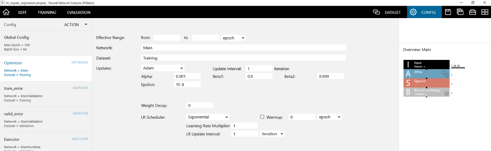

Optimizerを有効にする範囲を指定するには
~~~~~~~~~~~~~~~~~~~~~~~~~~~~~~~~~~~~~~~

有効範囲のfrom、toにそれぞれ有効にする範囲iterationもしくは世代（epoch）単位で指定します。

例えば、Optimizerを50 epoch～100 epochまで有効にするには、fromに50、toに100を入力します。1 epoch～Max Epochまで全ての範囲でOptimizerを有効にするには、from、toいずれも空欄にします。

最適化に用いるネットワークの名前を指定するには
~~~~~~~~~~~~~~~~~~~~~~~~~~~~~~~~~~~~~~~~~~~~~~

ネットワークに編集タブで作成したネットワーク名を指定します。

最適化に用いるデータセットの名前を指定するには
~~~~~~~~~~~~~~~~~~~~~~~~~~~~~~~~~~~~~~~~~~~~~~

データセットにデータセットタブで読み込んだデータセット名を指定します。Optimizerで複数のデータセットを同時に用いる場合は、複数のデータセットの名前をカンマ区切りで指定します。

パラメータのアップデート手法を指定するには
~~~~~~~~~~~~~~~~~~~~~~~~~~~~~~~~~~~~~~~~~~

1. コンフィグリストからOptimizerを選択します。

2. 最適化アルゴリズムを以下から選択します（デフォルトはAdam）。

.. list-table::
   :widths: 30 70
   :class: longtable
   :header-rows: 1

   * - Updater
     - 更新式

   * - AdaBelief
     -
        .. math:: m_{t} = \beta_{1}m_{t - 1} + \left( 1 - \beta_{1} \right)g_{t}

        .. math:: v_{t} = \beta_{2}v_{t - 1} + \left( 1 - \beta_{2} \right){(g_{t} - m_{t})}^{2}

        .. math:: {\widehat{m}}_{t} = \frac{m_{t}}{1 - \beta_{1}^{t}}

        .. math:: {\widehat{v}}_{t} = \frac{v_{t}}{1 - \beta_{2}^{t}}

        .. math:: \theta_{t + 1} = \theta_{t} - \alpha\frac{{\widehat{m}}_{t}}{\sqrt{{\widehat{v}}_{t} + \varepsilon} + \varepsilon}

        - AMSGrad プロパティに 1 を指定した場合、さらに以下の式による処理が加わります。

        .. math:: {\widehat{v}}_{t} = \max\left( {\widehat{v}}_{t - 1},\ v_{t} \right)

        - WD Decoupleプロパティに1を指定した場合、AdamWで行われるようなDecoupleされたWeight Decayを行います
        - Fixed Decayプロパティに1を指定した場合、WD Decoupleが1になっている条件で、Weight Decayの値を固定します
        - Rectifyプロパティに1を指定した場合、さらにRAdamで行われるようなRectify処理が加わります

        - AdaBelief Optimizer: Adapting Stepsizes by the Belief in Observed Gradients

          - Juntang Zhuang, Tommy Tang, Yifan Ding, Sekhar Tatikonda, Nicha Dvornek, Xenophon Papademetris, James S. Duncan
          - https://arxiv.org/abs/2010.07468

   * - Adadelta
     -
        .. math:: \mathrm{\Delta}\theta_{t} = - \frac{{\text{RMS}\lbrack\mathrm{\Delta}\theta\rbrack}_{t - 1}}{{\text{RMS}\lbrack g\rbrack}_{t}}g_{t}

        .. math:: \theta_{t + 1} = \theta_{t} + \eta{\mathrm{\Delta}\theta}_{t}

        - ADADELTA: An Adaptive Learning Rate Method

          - Matthew D. Zeiler
          - https://arxiv.org/abs/1212.5701

   * - Adagrad
     -
        .. math:: r_{t} = r_{t - 1} + g_{t}^{2}

        .. math:: \theta_{t + 1} = \theta_{t} - \frac{\eta}{\sqrt{r} + \varepsilon}g_{t}

        - Adaptive Subgradient Methods for Online Learning and Stochastic Optimization

          - John Duchi, Elad Hazan and Yoram Singer
          - http://www.jmlr.org/papers/volume12/duchi11a/duchi11a.pdf

   * - Adam
     -
        .. math:: m_{t} = \beta_{1}m_{t - 1} + \left( 1 - \beta_{1} \right)g_{t}

        .. math:: v_{t} = \beta_{2}v_{t - 1} + \left( 1 - \beta_{2} \right)g_{t}^{2}

        .. math:: {\widehat{m}}_{t} = \frac{m_{t}}{1 - \beta_{1}^{t}}

        .. math:: {\widehat{v}}_{t} = \frac{v_{t}}{1 - \beta_{2}^{t}}

        .. math:: \theta_{t + 1} = \theta_{t} - \alpha\frac{{\widehat{m}}_{t}}{\sqrt{{\widehat{v}}_{t}} + \varepsilon}

        - Adam: A Method for Stochastic Optimization.

          - Kingma and Ba
          - https://arxiv.org/abs/1412.6980

   * - AdamW
     -
        .. math:: m_{t} = \beta_{1}m_{t - 1} + \left( 1 - \beta_{1} \right)g_{t}

        .. math:: v_{t} = \beta_{2}v_{t - 1} + \left( 1 - \beta_{2} \right)g_{t}^{2}

        .. math:: {\widehat{m}}_{t} = \frac{m_{t}}{1 - \beta_{1}^{t}}

        .. math:: {\widehat{v}}_{t} = \frac{v_{t}}{1 - \beta_{2}^{t}}

        .. math:: \theta_{t + 1} = \theta_{t} - \alpha\frac{{\widehat{m}}_{t}}{\sqrt{{\widehat{v}}_{t}} + \varepsilon} - \ \eta_{t}\lambda\theta_{t}

        - Decoupled Weight Decay Regularization

          - Ilya Loshchilov, Frank Hutter
          - https://arxiv.org/abs/1711.05101

   * - Adamax
     -
        .. math:: m_{t} = \beta_{1}m_{t - 1} + \left( 1 - \beta_{1} \right)g_{t}

        .. math:: u_{t} = max(\beta_{2}u_{t - 1}, |g_{t}|)

        .. math:: {\widehat{m}}_{t} = \frac{m_{t}}{1 - \beta_{1}^{t}}

        .. math:: \theta_{t + 1} = \theta_{t} - \alpha\frac{{\widehat{m}}_{t}}{u_{t} + \varepsilon}

        Adam: A Method for Stochastic Optimization.

        Kingma and Ba

        https://arxiv.org/abs/1412.6980

   * - AdaBound
     -
        .. math:: w_{t+1} \leftarrow w_t - \eta_t \circledcirc m_t

        .. math:: \eta t = \text{clip}\left( \alpha\frac{\sqrt{1 - \beta_{2}^{t}}}{\left( 1 - \beta_{1}^{t} \right)\left( \sqrt{v_{t}} + \varepsilon \right)},\eta l(t),\eta u(t) \right)

        .. math:: \eta_l(t)=(1-\frac{1}{(1-\beta)t+1})\alpha

        .. math:: \eta_u(t)=(1+\frac{1}{(1-\beta)t})\alpha

        - Adaptive Gradient Methods with Dynamic Bound of Learning Rate.

          - L. Luo, Y. Xiong, Y. Liu and X. Sun.
          - https://arxiv.org/abs/1902.09843

   * - AMSGRAD
     -
        .. math:: m_{t} = \beta_{1}m_{t - 1} + \left( 1 - \beta_{1} \right)g_{t}

        .. math:: v_{t} = \beta_{2}v_{t - 1} + \left( 1 - \beta_{2} \right){g_{t}}^{2}

        .. math:: {\widehat{v}}_{t} = \max\left( {\widehat{v}}_{t - 1},\ v_{t} \right)

        .. math:: \theta_{t + 1} = \theta_{t} - \alpha\frac{m_{t}}{\sqrt{{\widehat{v}}_{t}} + \varepsilon}

        - On the convergence of ADAM and beyond.

          - Reddi et al.
          - https://openreview.net/pdf?id=ryQu7f-RZ

   * - AMSBound
     -
        .. math:: w_{t+1} \leftarrow w_t - \eta_t \circledcirc m_t

        .. math:: \eta t = \text{clip}\left( \alpha\frac{\sqrt{1 - \beta_{2}^{t}}}{\left( 1 - \beta_{1}^{t} \right)\left( \sqrt{{\widehat{v}}_{t}} + \varepsilon \right)},\eta l(t),\eta u(t) \right)

        .. math:: {\widehat{v}}_{t} = \max\left( {\widehat{v}}_{t - 1},\ v_{t} \right)

        .. math:: \eta_l(t)=(1-\frac{1}{(1-\beta)t+1})\alpha

        .. math:: \eta_u(t)=(1+\frac{1}{(1-\beta)t})\alpha

        - Adaptive Gradient Methods with Dynamic Bound of Learning Rate.

          - L. Luo, Y. Xiong, Y. Liu and X. Sun.
          - https://arxiv.org/abs/1902.09843

   * - Momentum
     -
        .. math:: v_{t} = \gamma v_{t - 1} + \eta g_{t}

        .. math:: \theta_{t + 1} = \theta_{t} - v_{t}

        - On the momentum term in gradient descent learning algorithms

          - Ning Qian
          - http://www.columbia.edu/~nq6/publications/momentum.pdf

   * - Nag
     -
        .. math:: v_{t} = \gamma v_{t - 1} - \eta g_{t}

        .. math:: \theta_{t + 1} = \theta_{t} - \gamma v_{t - 1} + (1 + \gamma)v_{t}

        - A method for unconstrained convex minimization problem with the rate of convergence o(1/k2)

          - Yurii Nesterov

   * - RMSprop
     -
        .. math:: r_{t} = \gamma r_{t - 1} + (1 - \gamma)g_{t}^{2}

        .. math:: \theta_{t + 1} = \theta_{t} - \frac{\eta}{\sqrt{r} + \varepsilon}g_{t}

        - Lecture 6a : Overview of mini-batch gradient descent

          - Geoff Hinton
          - http://www.cs.toronto.edu/~tijmen/csc321/slides/lecture_slides_lec6.pdf

   * - Sgd
     - .. math:: \theta_{t + 1} = \theta_{t} - \eta g_{t}

   * - SgdW
     -
        .. math:: v_{t} = \gamma v_{t - 1} + \eta g_{t} - \frac{\eta}{\eta_{0}}\lambda v_{t - 1}

        .. math:: \theta_{t + 1} = \theta_{t} - v_{t}

        - Decoupled Weight Decay Regularization

          - Ilya Loshchilov, Frank Hutter
          - https://arxiv.org/abs/1711.05101

:math:`\theta`
      更新対象のパラメータ
:math:`g`
      勾配
:math:`\eta, \alpha`
      Learning Rate、Alpha（学習係数）
:math:`\gamma, \beta_1, \beta_2`
      MomentamもしくはDecay、Beta1、Beta2（Decayパラメータ）
:math:`\epsilon`
      Epsilon（ゼロ除算を防ぐために用いる小さな値）
:math:`\lambda`
      Weight Decay

Weight Decay（L2正則化）の強度を設定するには
~~~~~~~~~~~~~~~~~~~~~~~~~~~~~~~~~~~~~~~~~~~~

Weight DecayにWeight Decayの係数を指定します。

学習係数の減衰方法を指定するには
~~~~~~~~~~~~~~~~~~~~~~~~~~~~~~~~

1. コンフィグリストからOptimizerを選択します。

2. 最適化アルゴリズムのLR Scheduler (Learning Rate Scheduler)を以下から選択します（デフォルトはExponential）。

3. Linear Warmupを行う場合、Warmupをチェックし、Warmupの長さをiterationもしくはepochで指定します。

.. list-table::
   :widths: 30 70
   :class: longtable
   :header-rows: 1

   * - LR Scheduler
     - 解説

   * - Cosine
     -
        以下の式に従い学習係数を減衰します。

        .. math:: \eta_{t} = \frac{\eta_{0}}{2}\left( 1 + cos\left( \frac{t}{T}\pi \right) \right)

        :math:`t`
              現在までのパラメータ更新回数
        :math:`\eta_t`
              パラメータ更新に用いる学習係数
        :math:`\eta_0`
              Updaterで指定する学習係数
        :math:`T`
              学習終了までのパラメータ更新回数

   * - Exponential
     -
        学習係数を指数関数で減衰します。

        - Learning Rate Multiplierに学習係数を減衰させる係数を、LR Update Intervalに学習係数を減衰させる間隔を指定します。
        - 例えば学習係数をMini-batch毎に0.9999倍に減衰させるには、Learning Rate Multiplierを0.9999、LR Update Intervalを1 iterationとします。学習係数を20 epoch毎に0.1倍に減衰させるには、Learning Rate Multiplierを0.1、LR Update Intervalを1 epochとします。

   * - Polynomial
     -
        学習係数を以下の多項式で減衰します。

        .. math:: \eta_{t} = \eta_{0}\left( 1 - \left( \frac{t}{T} \right)^{p} \right)

        Powerにpに用いる係数を指定します。

        :math:`t`
              現在までのパラメータ更新回数
        :math:`\eta_t`
              パラメータ更新に用いる学習係数
        :math:`\eta_0`
              Updaterで指定する学習係数
        :math:`T`
              学習終了までのパラメータ更新回数

   * - Step
     -
        学習係数を指定するiterationもしくはepoch毎に指定倍に減衰します。

        - Learning Rate Multiplierに学習係数を減衰させる係数を、LR Update Stepsに学習係数を減衰させるタイミングをカンマ区切りの数値で指定します。
        - 例えば学習係数を20万、30万、40万iterationで0.1倍に減衰させるには、Learning Rate Multiplierを0.1、LR Update Stepsに「200000,300000,400000」 iterationとします。
        - 例えば学習係数を30、60、80 epochで0.1倍に減衰させるには、Learning Rate Multiplierを0.1、LR Update Stepsに「30,60,80」epochとします。

パラメータの更新を複数回のMini-batchに1回行うには
~~~~~~~~~~~~~~~~~~~~~~~~~~~~~~~~~~~~~~~~~~~~~~~~~

更新間隔にパラメータの更新を行う間隔を指定します。例えば64個のデータを含んだMini-batchを用いて4回勾配を計算し、4回のMini-batchごとにまとめてこれらの勾配を用いたパラメータの更新を行うには、バッチサイズを64、更新間隔を4とします。

**ご注意**

複数の学習用ネットワークを用いた最適化を行う場合、更新間隔には常に1を指定する必要があります。

新しいOptimizerを追加するには
~~~~~~~~~~~~~~~~~~~~~~~~~~~~~

メニューボタン、もしくはコンフィグリストを右クリックして表示されるポップアップメニューからOptimizerを追加を選択します。

Optimizerの名前を変更するには
~~~~~~~~~~~~~~~~~~~~~~~~~~~~~

1. メニューボタン、もしくはコンフィグリストを右クリックして表示されるポップアップメニューから名前の変更を選択します。

..

   もしくはコンフィグリストから、名前を変更するOptimizerを2度クリックします。

2. 新しい名前を入力してキーボードのEnterキーを押します。

Optimizerを削除するには
~~~~~~~~~~~~~~~~~~~~~~~

1. コンフィグリストで、削除するOptimizerを選択します。

2. メニューボタン、もしくはコンフィグリストを右クリックして表示されるポップアップメニューからDeleteを選択します。

..

   もしくは、キーボードのDeleteキーを押します。

Optimizerを並び替えるには
~~~~~~~~~~~~~~~~~~~~~~~~~

1. コンフィグリストで、並び替えるOptimizerを選択します。

2. メニューボタン、もしくはコンフィグストを右クリックして表示されるポップアップメニューから上に移動もしくは下に移動を選択します。

コンフィグタブ（Monitor）の使い方
---------------------------------

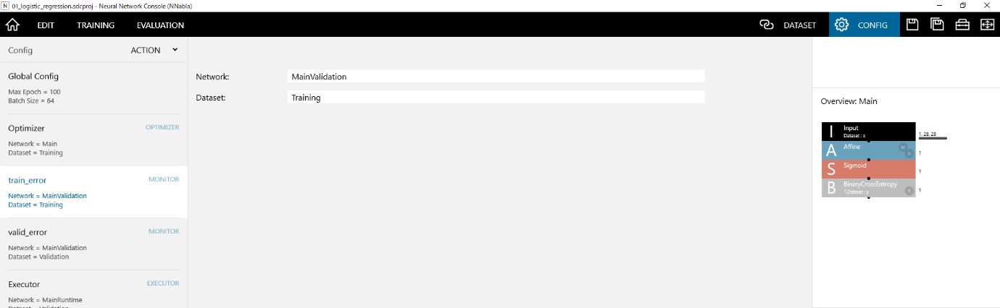

学習中の評価に用いるネットワークの名前を指定するには
~~~~~~~~~~~~~~~~~~~~~~~~~~~~~~~~~~~~~~~~~~~~~~~~~~~~

ネットワークに編集タブで作成したネットワーク名を指定します。

**ご参考**

学習曲線におけるtrain_error、valid_errorはコンフィグタブのMonitor設定に従いプロットされます。ネットワーク名として編集タブで作成したMainネットワークから自動生成されるMainValidationネットワークがデフォルトで指定されています。

学習中の評価に用いるデータセットの名前を指定するには
~~~~~~~~~~~~~~~~~~~~~~~~~~~~~~~~~~~~~~~~~~~~~~~~~~~~

データセットにデータセットタブで読み込んだデータセット名を指定します。Monitorで複数のデータセットを同時に用いる場合は、複数のデータセットの名前をカンマ区切りで指定します。

コンフィグタブ（Executor）の使い方
----------------------------------

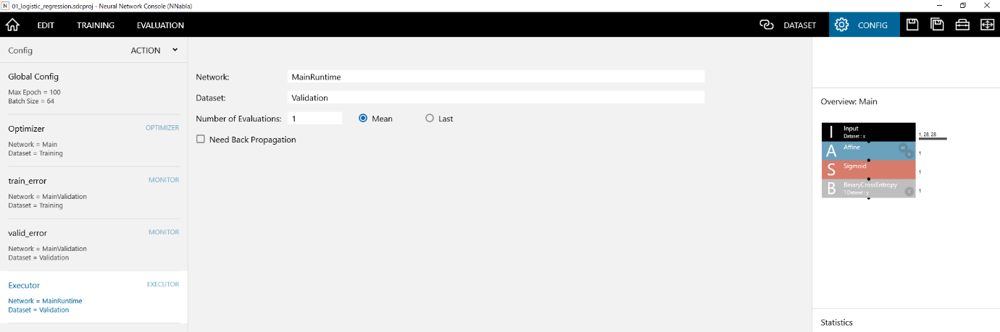

評価実行ボタンを用いた評価に用いるネットワークの名前を指定するには
~~~~~~~~~~~~~~~~~~~~~~~~~~~~~~~~~~~~~~~~~~~~~~~~~~~~~~~~~~~~~~~~~~

ネットワークに編集タブで作成したネットワーク名を指定します。

**ご参考**

ネットワーク名として編集タブで作成したMainネットワークから自動生成されるMainRuntimeネットワークがデフォルトで指定されています。

評価実行ボタンを用いた評価に用いるデータセットの名前を指定するには
~~~~~~~~~~~~~~~~~~~~~~~~~~~~~~~~~~~~~~~~~~~~~~~~~~~~~~~~~~~~~~~~~~

データセットにデータセットタブで読み込んだデータセット名を指定します。

評価実行時に、1つのデータあたり複数回の評価を実行するには
~~~~~~~~~~~~~~~~~~~~~~~~~~~~~~~~~~~~~~~~~~~~~~~~~~~~~~~~~

評価回数に評価を実行する回数を指定します。例えば同じデータに対して16回認識処理を実行し、その平均もしくは最後の結果を認識結果とするには、評価回数を16とします。

**ご参考**

評価用のネットワークがDropout、ImageAugmentationなどの乱数処理を含んだレイヤーを含む場合、同じデータに対して複数回の評価を実行し、その結果の平均を評価結果とすることにより精度が向上する効果があります。

**ご注意**

評価回数を指定した場合、評価の実行には指定した回数倍の時間がかかります。

複数回の評価を実行する際、最終的な評価結果として複数回の評価結果の平均値を採用するには
~~~~~~~~~~~~~~~~~~~~~~~~~~~~~~~~~~~~~~~~~~~~~~~~~~~~~~~~~~~~~~~~~~~~~~~~~~~~~~~~~~~~~~

Meanをクリックしてチェックします。

複数回の評価を実行する際、最終的な評価結果として複数回の評価結果の標準偏差を採用するには
~~~~~~~~~~~~~~~~~~~~~~~~~~~~~~~~~~~~~~~~~~~~~~~~~~~~~~~~~~~~~~~~~~~~~~~~~~~~~~~~~~~~~~~~

Stdをクリックしてチェックします。

複数回の評価を実行する際、最終的な評価結果として複数回の評価結果のうち最後の評価結果を採用するには
~~~~~~~~~~~~~~~~~~~~~~~~~~~~~~~~~~~~~~~~~~~~~~~~~~~~~~~~~~~~~~~~~~~~~~~~~~~~~~~~~~~~~~~~~~~~~~~~~~

Lastをクリックしてチェックします。

評価計算の実行中にもバックプロパゲーションを行うには
~~~~~~~~~~~~~~~~~~~~~~~~~~~~~~~~~~~~~~~~~~~~~~~~~~~~

バックプロパゲーションを行うをクリックしてチェックします。

新しいExecutorを追加するには
~~~~~~~~~~~~~~~~~~~~~~~~~~~~

メニューボタン、もしくはコンフィグリストを右クリックして表示されるポップアップメニューからExecutorを追加を選択します。

Executorの名前を変更するには
~~~~~~~~~~~~~~~~~~~~~~~~~~~~

1. メニューボタン、もしくはコンフィグリストを右クリックして表示されるポップアップメニューから名前の変更を選択します。

..

   もしくはコンフィグリストから、名前を変更するExecutorを2度クリックします。

2. 新しい名前を入力してキーボードのEnterキーを押します。

Executorを削除するには
~~~~~~~~~~~~~~~~~~~~~~

1. コンフィグリストで、削除するExecutorを選択します。

2. メニューボタン、もしくはコンフィグセットリストを右クリックして表示されるポップアップメニューから削除を選択します。

..

   もしくは、キーボードのDeleteキーを押します。

Executorを並び替えるには
~~~~~~~~~~~~~~~~~~~~~~~~

1. コンフィグリストで、並び替えるExecutorを選択します。

2. メニューボタン、もしくはコンフィグストを右クリックして表示されるポップアップメニューから上に移動もしくは下に移動を選択します。

.. _#学習タブの使い方:

学習タブの使い方
----------------

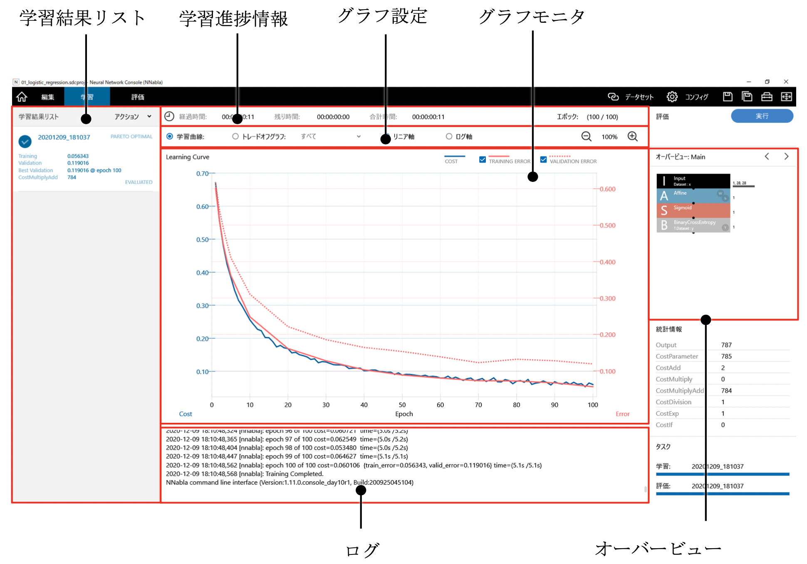

学習タブでは、現在の学習進捗状況の確認や複数の学習結果の比較を行います。

学習の進捗状況を確認するには
~~~~~~~~~~~~~~~~~~~~~~~~~~~~

学習進捗情報、グラフモニタ、ログを参照します。

学習進捗情報のエポックは、コンフィグタブで指定した学習完了までの最適化の世代数（学習反復世代数）のうち、現時点で何世代目まで完了しているかを示します。

学習進捗情報の経過時間、残り時間、合計時間はそれぞれ、学習開始時点から現時点までに経過した時間、現時点から学習終了予測時間までの時間、学習開始時点から学習終了予測時間までの時間を示します。

グラフモニタの学習曲線の横軸は学習世代数、左縦軸は学習データにおけるコスト関数の値、右縦軸は学習データおよび評価データにおける誤差関数の値を示します。

ログは、Neural Network Librariesの出力したログを示します。

**ご参考**

学習エンジンの設定不備、ネットワークの不整合、データセットの不整合、学習パラメータの異常その他の原因により学習中に何らかのエラーが生じた場合は、ログを参照することで原因を特定できる場合があります。詳しくは :ref:`FAQ <#学習実行時>` をご参照ください。

実行中の学習を停止するには
~~~~~~~~~~~~~~~~~~~~~~~~~~

コントローラの停止ボタンをクリックします。

もしくは、キーボードのShiftキーを押しながらF5キーを押します。

過去の学習結果すべての誤差、コストのトレードオフ関係を表示するには
~~~~~~~~~~~~~~~~~~~~~~~~~~~~~~~~~~~~~~~~~~~~~~~~~~~~~~~~~~~~~~~~~~

グラフ設定のトレードオフグラフをクリックして選択します。

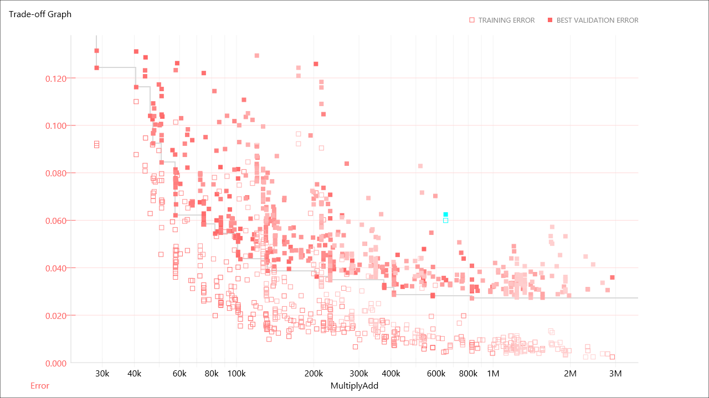

グラフモニタに縦軸を誤差、横軸をデフォルトでは乗加算回数とし、各点が1つの学習結果を表すトレードオフ関係のグラフが表示されます。

**ご参考**

グラフ設定のトレードオフグラフ右のドロップダウンリストボックスからパレート最適解のみを選択することで、表示するデータ点を過去のすべての学習結果の中から誤差、乗加算回数いずれかの指標で他の学習結果を上回っている結果だけに限定することができます。

**ご参考**

グラフ設定のトレードオフグラフ右のドロップダウンリストボックスから以前の結果のみを選択することで、表示するデータ点を現在選択している学習結果より以前の結果だけに限定することができます。

トレードオフグラフの横軸を変更するには
~~~~~~~~~~~~~~~~~~~~~~~~~~~~~~~~~~~~~~

トレードオフグラフ横軸のラベル（デフォルトではCostMultiplyAdd）をクリックして表示されるドロップダウンリストボックスから横軸を選択します。

過去の学習結果のうち特定の学習結果を確認するには
~~~~~~~~~~~~~~~~~~~~~~~~~~~~~~~~~~~~~~~~~~~~~~~~

学習結果リストに表示される過去の学習結果一覧から、確認対象の学習結果をクリックして選択します。

もしくは、グラフモニタに表示したトレードオフグラフ上のデータ点をクリックします。

選択した学習結果について、学習進捗状況、グラフモニタ、オーバービュー、ログの内容が更新されます。

学習結果ファイルの格納されたフォルダを開くには
~~~~~~~~~~~~~~~~~~~~~~~~~~~~~~~~~~~~~~~~~~~~~~

1. 学習結果リストで、フォルダを開く学習結果をクリックして選択します。

2. 学習結果リストを右クリックして表示されるポップアップメニューから学習結果のフォルダを開くを選択します。

もしくは、フォルダを開く学習結果をダブルクリックします。

**ご参考**

学習結果ファイルは、プロジェクトファイル名の拡張子を除いたものに、”.files”を付加した名前のフォルダの下、さらに学習を実行した日付・時刻の名前のフォルダの下に保存されています。

学習結果の名前を変更するには
~~~~~~~~~~~~~~~~~~~~~~~~~~~~

1. 学習結果リストに表示される過去の学習結果一覧から、名前を変更する学習結果を2度クリックします。

..

   もしくは、学習結果リストを右クリックして表示されるポップアップメニューから名前の変更を選択します。

2. 新しい名前を入力してキーボードのEnterキーを押します。

学習結果のコメントを編集するには
~~~~~~~~~~~~~~~~~~~~~~~~~~~~~~~~

1. 学習結果リストに表示される過去の学習結果一覧から、コメントを編集する学習結果を選択します。

2. 学習結果リストを右クリックして表示されるポップアップメニューからコメントを編集を選択します。

3. コメントのテキストを入力してキーボードのEnterキーを押します。

学習結果の一覧を最新の情報に更新するには
~~~~~~~~~~~~~~~~~~~~~~~~~~~~~~~~~~~~~~~~

学習結果リストを右クリックして表示されるポップアップメニューから最新の情報に更新を選択します。

2つの学習結果の間の学習曲線の比較を行うには
~~~~~~~~~~~~~~~~~~~~~~~~~~~~~~~~~~~~~~~~~~~

1. 学習結果リストで、比較元に用いる学習結果をクリックして選択します。

2. 学習結果リストを右クリックして表示されるポップアップメニューから学習曲線を比較用に開くを選択します。

3. 学習結果リストで、比較先に用いる学習結果をクリックして選択します。

グラフモニタの学習曲線において、比較元の学習曲線が薄い線で、比較先の学習結果が通常の線で表示されます。

2つの学習結果の間の学習曲線の比較を終了するには
~~~~~~~~~~~~~~~~~~~~~~~~~~~~~~~~~~~~~~~~~~~~~~~

学習結果リストを右クリックして表示されるポップアップメニューから比較用に開いた学習曲線をクリアを選択します。

グラフモニタに表示する項目を変更するには
~~~~~~~~~~~~~~~~~~~~~~~~~~~~~~~~~~~~~~~~

グラフモニタを右クリックして表示されるポップアップメニューからViewを選択し、さらに表示する項目を以下の3つから選択します。

.. list-table::
   :widths: 30 70
   :class: longtable
   :header-rows: 1

   * - 項目
     - 解説

   * - Training & Validation（デフォルト）
     - 学習データおよび評価データ両方の誤差関数の値を表示します。

   * - Training
     - 学習データでの誤差関数の値のみ表示します。

   * - Validation
     - 評価データでの誤差関数の値のみ表示します。

グラフモニタの縦軸を対数軸に切り替えるには
~~~~~~~~~~~~~~~~~~~~~~~~~~~~~~~~~~~~~~~~~~

グラフ設定のログ軸をクリックして選択します。

対数軸から線形軸に戻すには、リニア軸をクリックします。

グラフモニタの縦軸を拡大縮小するには
~~~~~~~~~~~~~~~~~~~~~~~~~~~~~~~~~~~~

1. グラフモニタをクリックして選択します。

2. キーボードのCtrlキーを押しながらマウスホイールを操作します。

..

   もしくは、キーボードのCtrlキーを押しながら「+」（プラス）キーもしくは「-」（マイナス）キーを押します。

もしくは、グラフモニタ上を右クリックして表示されるポップアップメニューから拡大縮小を選択し、さらに拡大もしくは縮小を選択します。

グラフモニタの縦軸の拡大率を元に戻すには
~~~~~~~~~~~~~~~~~~~~~~~~~~~~~~~~~~~~~~~~

1. グラフモニタをクリックして選択します。

2. キーボードのCtrlキーを押しながら「0」（ゼロ）キーを押します。

もしくは、ネットワークグラフ上を右クリックして表示されるポップアップメニューから拡大縮小を選択し、さらにデフォルトを選択します。

グラフモニタで表示中のグラフの値をCSVファイル形式で保存するには
~~~~~~~~~~~~~~~~~~~~~~~~~~~~~~~~~~~~~~~~~~~~~~~~~~~~~~~~~~~~~~~

1. グラフモニタを右クリックして表示されるポップアップメニューからCSVファイル形式で保存...を選択します。

2. 保存先のCSVファイル名を指定します。

グラフモニタで表示中のグラフを画像として保存するには
~~~~~~~~~~~~~~~~~~~~~~~~~~~~~~~~~~~~~~~~~~~~~~~~~~~~

1. グラフモニタを右クリックして表示されるポップアップメニューからグラフの画像を保存...を選択します。

2. 保存先の画像ファイル名を指定します。

**ご参考**

保存される画像の解像度は1280×720pixelになります（固定）。

学習済みモデルをnnp (Neural Network Libraries file format)形式で出力するには
~~~~~~~~~~~~~~~~~~~~~~~~~~~~~~~~~~~~~~~~~~~~~~~~~~~~~~~~~~~~~~~~~~~~~~~~~~~~

1. 学習結果リストで、nnp形式で出力する学習結果をクリックして選択します。

2. 学習結果リストを右クリックして表示されるポップアップメニューからエクスポート、NNP (Neural Network Libraries file format)を選択します。

nnpファイルは、学習結果ファイルの格納されたフォルダに”model.nnp”のファイル名で生成されます。

**ご参考**

nnpファイルは、Neural Network Librariesの扱うニューラルネットワークの構造、学習の設定、学習済みパラメータなどが含まれたファイルです。

nnp形式で出力したモデルは、Neural Network LibrariesのPython API、コマンドラインインターフェイス、C++コマンドラインインターフェイスを通じて利用することができます。

学習済みモデルをnnb (NNabla C Runtime file format)形式で出力するには
~~~~~~~~~~~~~~~~~~~~~~~~~~~~~~~~~~~~~~~~~~~~~~~~~~~~~~~~~~~~~~~~~~~~

1. 学習結果リストで、nnb形式で出力する学習結果をクリックして選択します。

2. 学習結果リストを右クリックして表示されるポップアップメニューからエクスポート、NNB (NNabla C Runtime file format)を選択します。

nnbファイルは、学習結果ファイルの格納されたフォルダに”model.nnb”のファイル名で生成されます。

**ご参考**

nnbファイルは、Neural Network LibrariesのNNabla C Runtimeが扱う、ニューラルネットワークの構造と学習済みパラメータが含まれたファイルです。

nnb形式で出力したモデルは、Neural Network LibrariesのNNabla C Runtimeを通じて利用することができます。

学習済みモデルをONNX形式で出力するには
~~~~~~~~~~~~~~~~~~~~~~~~~~~~~~~~~~~~~~

1. 学習結果リストで、ONNX形式で出力する学習結果をクリックして選択します。

2. 学習結果リストを右クリックして表示されるポップアップメニューからエクスポート、ONNXを選択します。

ONNXファイルは、学習結果ファイルの格納されたフォルダに”model.onnx”のファイル名で生成されます。

**ご参考**

ONNX(Open Neural Network Exchange Format)は、Deep Learningのモデルを異なるソフトウェア間で共有可能にするオープンなファイルフォーマットです。

https://onnx.ai/

ONNX形式で出力したモデルは、ONNXフォーマットに対応した各種ソフトウェアを通じて利用することができます。

学習済みモデルをsaved_model形式で出力するには（beta）
~~~~~~~~~~~~~~~~~~~~~~~~~~~~~~~~~~~~~~~~~~~~~~~~~~~~~

1. 学習結果リストで、saved_model (TensorFlow)形式で出力する学習結果をクリックして選択します。

2. 学習結果リストを右クリックして表示されるポップアップメニューからエクスポート、saved_model (TensorFlow)を選択します。

指定したモデルは学習結果ファイルの格納されたフォルダに”saved_model”のフォルダ名でエクスポートされます。

学習済みモデルをtflite形式で出力するには（beta）
~~~~~~~~~~~~~~~~~~~~~~~~~~~~~~~~~~~~~~~~~~~~~~~~

1. 学習結果リストで、tflite (TensorFlow lite)形式で出力する学習結果をクリックして選択します。

2. 学習結果リストを右クリックして表示されるポップアップメニューからエクスポート、tflite (TensorFlow lite)を選択します。

tfliteファイルは、学習結果ファイルの格納されたフォルダに”model.tflite”のファイル名で生成されます。

学習結果のレポートをpptx形式で出力するには（beta）
~~~~~~~~~~~~~~~~~~~~~~~~~~~~~~~~~~~~~~~~~~~~~~~~~~

1. 学習結果リストで、pptx形式で出力する学習結果をクリックして選択します。

2. 学習結果リストを右クリックして表示されるポップアップメニューからエクスポート、pptx betaを選択します。

出力されたpptxファイルが関連付けられたアプリで開きます。

学習結果のレポートをhtml形式で出力するには（beta）
~~~~~~~~~~~~~~~~~~~~~~~~~~~~~~~~~~~~~~~~~~~~~~~~~~

1. 学習結果リストで、html形式で出力する学習結果をクリックして選択します。

2. 学習結果リストを右クリックして表示されるポップアップメニューからエクスポート、html betaを選択します。

出力されたhtmlファイルが関連付けられたアプリで開きます。

学習未完了のネットワークを学習完了状態にするには
~~~~~~~~~~~~~~~~~~~~~~~~~~~~~~~~~~~~~~~~~~~~~~~~

1. 学習結果リストで、学習未完了（Incomplete）の学習結果をクリックして選択します。

2. 学習結果リストを右クリックして表示されるポップアップメニューから学習完了状態にするを選択します。

3. 確認を行うダイアログボックスでOKを選択します。

**ご参考**

本機能は、学習を完了前に中断したネットワークにおいて評価の実行を可能にするためなどに利用します。

中断した学習を再開するには
~~~~~~~~~~~~~~~~~~~~~~~~~~

1. 学習結果リストで、学習未完了（Incomplete）の学習結果をクリックして選択します。

2. 学習結果リストを右クリックして表示されるポップアップメニューから中断した学習を再開するを選択します。

**ご注意**

最適化アルゴリズムの状態、乱数の状態は、学習の再開を行った場合も学習中断時の状態を復元できません。このため、中断、再開を経た学習結果は学習を中断せずに最後まで学習を継続した場合と全く同じにはなりません。

過去の学習結果に含まれるネットワーク構造で再度学習を実行するには
~~~~~~~~~~~~~~~~~~~~~~~~~~~~~~~~~~~~~~~~~~~~~~~~~~~~~~~~~~~~~~~~

1. 学習結果リストで、再度学習を行う学習結果をクリックして選択します。

2. 学習結果リストを右クリックして表示されるポップアップメニューから再度学習する (上書き)（選択中の学習結果フォルダを上書きする場合）、もしくは再度学習する (新規)（新しい学習結果フォルダを作成し、そこに学習結果を保存する場合）を選択します。

3. 上書きを選択した場合、学習実行の確認を行うダイアログボックスでOKを選択します。

過去の全ての学習結果に含まれるネットワーク構造で再度学習を実行するには
~~~~~~~~~~~~~~~~~~~~~~~~~~~~~~~~~~~~~~~~~~~~~~~~~~~~~~~~~~~~~~~~~~~~~~

1. 学習結果リストを右クリックして表示されるポップアップメニューから全て再学習する (上書きを選択します。

2. 学習実行の確認を行うダイアログボックスでOKを選択します。

**ご注意**

既存の全ての学習結果は新しい学習結果で上書きされます。

予約された学習をキャンセルするには
~~~~~~~~~~~~~~~~~~~~~~~~~~~~~~~~~~

1. 学習結果リストで、予約された学習をキャンセルするアイテムをクリックして選択します。

2. 学習結果リストを右クリックして表示されるポップアップメニューから処理のスケジュールをキャンセルを選択します。

全ての予約された学習をキャンセルするには
~~~~~~~~~~~~~~~~~~~~~~~~~~~~~~~~~~~~~~~~

学習結果リストを右クリックして表示されるポップアップメニューからスケジュールされた全ての処理をキャンセルを選択します。

学習停止状態で予約された学習の実行を再開するには
~~~~~~~~~~~~~~~~~~~~~~~~~~~~~~~~~~~~~~~~~~~~~~~~

学習結果リストを右クリックして表示されるポップアップメニューからスケジュールされた処理を再開を選択します。

過去の学習結果をディスクから削除するには
~~~~~~~~~~~~~~~~~~~~~~~~~~~~~~~~~~~~~~~~

1. 学習結果リストで、ディスクから削除する学習結果をクリックして選択します。

2. 学習結果リストを右クリックして表示されるポップアップメニューからディスクから削除を選択します。

3. 削除の確認を行うダイアログボックスでOKを選択します。

**ご注意**

この操作を行うと、学習結果はごみ箱を介さず直接ディスクから削除されます。

学習が完了していないすべての学習結果をディスクから削除するには
~~~~~~~~~~~~~~~~~~~~~~~~~~~~~~~~~~~~~~~~~~~~~~~~~~~~~~~~~~~~~~

1. 学習結果リストを右クリックして表示されるポップアップメニューから全ての未完了の処理をディスクから削除を選択します。

2. 削除の確認を行うダイアログボックスでOKを選択します。

**ご注意**

この操作を行うと、学習結果はごみ箱を介さず直接ディスクから削除されます。

オーバービューで複数のネットワークの表示、および学習設定の表示を切り替えるには
~~~~~~~~~~~~~~~~~~~~~~~~~~~~~~~~~~~~~~~~~~~~~~~~~~~~~~~~~~~~~~~~~~~~~~~~~~~~~~

オーバービュー右上のネットワーク切り替えボタンをクリックします。

学習済みパラメータをプロットして確認するには
~~~~~~~~~~~~~~~~~~~~~~~~~~~~~~~~~~~~~~~~~~~~

1. 学習結果リストで、パラメータを確認するネットワークを含んだ学習結果をクリックして選択します。

2. オーバービューで、パラメータを確認するレイヤーをダブルクリックします。

..

   もしくは、パラメータを確認するレイヤーをクリックして選択後、右クリックして表示されるポップアップメニューからPlot Weightを選択します。

グラフモニタにVisualizeされたパラメータと、パラメータの主成分分析結果から求めたパラメータの寄与率が表示されます。寄与率のグラフの横軸はパラメータの次元数、縦軸は累積寄与率を示します。

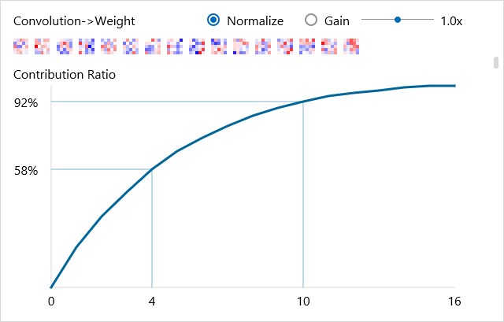

学習済みパラメータのプロットをスクロールするには
~~~~~~~~~~~~~~~~~~~~~~~~~~~~~~~~~~~~~~~~~~~~~~~~

グラフモニタ右に表示されるスクロールバーをドラッグします。

もしくは、マウスホイールを操作します。

学習済みパラメータのプロットを拡大縮小するには
~~~~~~~~~~~~~~~~~~~~~~~~~~~~~~~~~~~~~~~~~~~~~~

1. グラフモニタをクリックして選択します。

2. キーボードのCtrlキーを押しながらマウスホイールを操作します。

..

   もしくは、キーボードのCtrlキーを押しながら「+」（プラス）キーもしくは「-」（マイナス）キーを押します。

もしくは、グラフモニタ上を右クリックして表示されるポップアップメニューから拡大縮小を選択し、さらに拡大もしくは縮小を選択します。

学習済みパラメータのプロットの拡大率を元に戻すには
~~~~~~~~~~~~~~~~~~~~~~~~~~~~~~~~~~~~~~~~~~~~~~~~~~

1. グラフモニタをクリックして選択します。

2. キーボードのCtrlキーを押しながら「0」（ゼロ）キーを押します。

もしくは、グラフモニタ上を右クリックして表示されるポップアップメニューから拡大縮小を選択し、さらにデフォルトを選択します。

学習済みパラメータのプロットを正規化表示するには
~~~~~~~~~~~~~~~~~~~~~~~~~~~~~~~~~~~~~~~~~~~~~~~~

ノーマライズをチェックします。

学習済みパラメータのプロットのゲインを変更するには
~~~~~~~~~~~~~~~~~~~~~~~~~~~~~~~~~~~~~~~~~~~~~~~~~~

ゲインを左右にドラッグします。

過去の学習結果に含まれるネットワーク構造を編集タブに読み込むには
~~~~~~~~~~~~~~~~~~~~~~~~~~~~~~~~~~~~~~~~~~~~~~~~~~~~~~~~~~~~~~~~

1. 学習結果リストで、読み込むネットワーク構造を含んだ学習結果をクリックして選択します。

2. 学習結果リスト、もしくはネットワーク表示中のオーバービューを右クリックして表示されるポップアップメニューから編集タブで開くを選択します。編集タブにオーバービューで表示中のネットワーク構造が読み込まれます。

過去の学習結果に含まれるネットワーク構造をパラメータ付きで編集タブに読み込むには
~~~~~~~~~~~~~~~~~~~~~~~~~~~~~~~~~~~~~~~~~~~~~~~~~~~~~~~~~~~~~~~~~~~~~~~~~~~~~~~~

1. 学習結果リストで、読み込むネットワーク構造を含んだ学習結果をクリックして選択します。

2. 学習結果リスト、もしくはネットワーク表示中のオーバービューを右クリックして表示されるポップアップメニューから編集タブで重み付きで開くを選択します。編集タブにオーバービューで表示中のネットワーク構造がConvolution、AffineなどのWeight（W.File）、Bias（b.File）に学習済みネットワークのパラメータファイルが入力された状態で読み込まれます。

Neural Network Librariesが使用可能なコマンドプロンプトを起動するには
~~~~~~~~~~~~~~~~~~~~~~~~~~~~~~~~~~~~~~~~~~~~~~~~~~~~~~~~~~~~~~~~~~~~

1. 学習結果リストで、コマンドプロンプトを起動するフォルダの学習結果をクリックして選択します。

2. 学習結果リストを右クリックして表示されるポップアップメニューからその他のツール、コマンドプロンプトを選択します。

学習中のCPU・GPU使用率の履歴を確認するには
~~~~~~~~~~~~~~~~~~~~~~~~~~~~~~~~~~~~~~~~~~

ログのCPU使用率またはGPU使用率をクリックして選択します。

**ご注意**

学習にそれほど時間を要していない場合など、学習結果によってはCPU・GPU使用率が表示できないことがあります。

.. _#評価タブの使い方:

評価タブの使い方
----------------

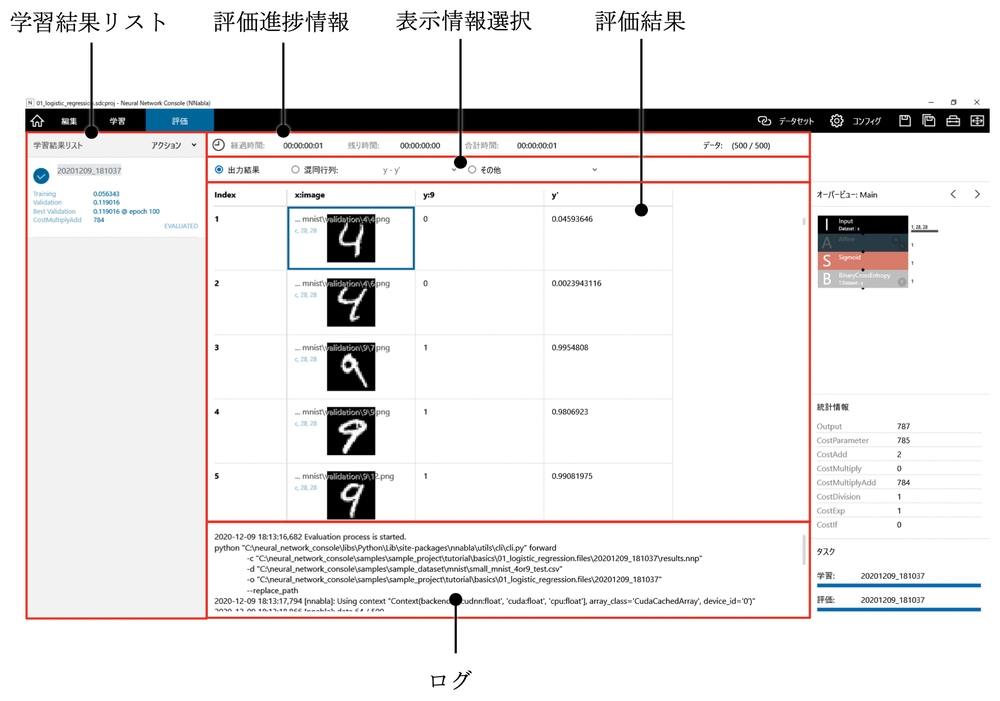

評価タブでは、評価データセットに対して学習済みのニューラルネットワークを用いた演算を行い、その結果の評価を行います。

学習済みのニューラルネットワークの評価を実行するには
~~~~~~~~~~~~~~~~~~~~~~~~~~~~~~~~~~~~~~~~~~~~~~~~~~~~

1. 学習結果リストで、評価する学習結果をクリックして選択します。

2. 評価実行ボタンをクリックします。

..

   もしくは、キーボードのF6キーを押します。

評価の進捗状況を確認するには
~~~~~~~~~~~~~~~~~~~~~~~~~~~~

評価進捗情報、ログを参照します。

評価進捗情報のデータは、評価データセットの全データのうち、現時点で評価が完了しているデータの個数を示します。

評価進捗情報の経過時間、残り時間、合計時間はそれぞれ、評価開始時点から現時点までに経過した時間、現時点から評価終了予測時間までの時間、評価開始時点から評価終了予測時間までの時間を示します。

ログは、評価エンジンの出力したログを示します。

実行中の評価を停止するには
~~~~~~~~~~~~~~~~~~~~~~~~~~

コントローラの停止ボタンをクリックします。

もしくは、キーボードのShiftキーを押しながらF6キーを押します。

ニューラルネットワークによる演算結果を確認するには
~~~~~~~~~~~~~~~~~~~~~~~~~~~~~~~~~~~~~~~~~~~~~~~~~~

表示情報選択部の、出力結果をクリックします。

評価結果部に、評価データセットに対するニューラルネットワークの演算結果が表示されます。

**ご参考**

評価結果部には、評価データセットそのものに、ニューラルネットワークの演算結果を新たな列として追加する形で演算結果が表示されます。評価データセットが画面に収まらない複数の列を持っている場合は、評価結果を右にスクロールして画面外にある演算結果を表示します。

**ご参考**

評価結果部に表示される表は、学習結果ファイルの格納されたフォルダのoutput_result.csvに保存されています。このファイルを直接開くことで外部のアプリケーションによる評価を行うことができます。

クラス分類問題時、混同行列で性能を確認するには
~~~~~~~~~~~~~~~~~~~~~~~~~~~~~~~~~~~~~~~~~~~~~~

1. 表示情報選択部の、混同行列をクリックします。

2. 表示情報選択部、混同行列右のポップアップボックスで、混同行列を表示する変数を選択します。

クラス分類問題時、分類を誤ったデータを確認するには
~~~~~~~~~~~~~~~~~~~~~~~~~~~~~~~~~~~~~~~~~~~~~~~~~~

混同行列でデータを一覧したいセルを選択し、右クリックメニューからリストを選択します。

もしくは、混同行列でデータを一覧したいセルをダブルクリックします。

2値分類の際の閾値を変更して混同行列を再作成するには
~~~~~~~~~~~~~~~~~~~~~~~~~~~~~~~~~~~~~~~~~~~~~~~~~~~

1. 混同行列の右クリックメニューから再度作成を選択します。

2. 2値分類に用いる閾値を入力し、OKをクリックします。

出力結果を特定の列でソートするには
~~~~~~~~~~~~~~~~~~~~~~~~~~~~~~~~~~

出力結果でソートしたい列のセルを選択し、右クリックメニューから並び替えを選択します。

もしくは、出力結果でソートしたい列のセルをダブルクリックします。

評価結果の表をCSVファイル形式で保存するには
~~~~~~~~~~~~~~~~~~~~~~~~~~~~~~~~~~~~~~~~~~~

1. 評価を右クリックして表示されるポップアップメニューからCSVファイル形式で保存...を選択します。

2. 保存先のCSVファイル名を指定します。

プロジェクト画面で利用可能なその他の機能
----------------------------------------

学習を行わず、編集中のプロジェクトに対応する学習結果ファイルを作成するには
~~~~~~~~~~~~~~~~~~~~~~~~~~~~~~~~~~~~~~~~~~~~~~~~~~~~~~~~~~~~~~~~~~~~~~~~~~

編集タブにて、コントローラの学習をクリックし、学習結果の作成を選択した状態でコントローラの実行ボタンをクリックします。

**ご参考**

本機能は、パラメータを持たない計算グラフを学習結果として出力する、編集タブで重み付きで開く機能で読み込んだネットワークを再編集し新しい学習結果ファイルとして出力する、学習前のニューラルネットワークの初期値を確認するためなどに利用できます。本機能の動作は、学習反復世代数を0として学習を実行した場合と同じです。

設計中のニューラルネットワークの実行速度を詳細に測定するには
~~~~~~~~~~~~~~~~~~~~~~~~~~~~~~~~~~~~~~~~~~~~~~~~~~~~~~~~~~~~

編集タブにて、コントローラの学習をクリックし、プロファイルを選択した状態でコントローラの実行ボタンをクリックします。

学習結果フォルダのprofile.csvに詳細な測定結果が出力されます。

.. _neural-network-librariesが使用可能なコマンドプロンプトを起動するには-1:

Neural Network Librariesが使用可能なコマンドプロンプトを起動するには
~~~~~~~~~~~~~~~~~~~~~~~~~~~~~~~~~~~~~~~~~~~~~~~~~~~~~~~~~~~~~~~~~~~~

1. 学習結果リストもしくは評価結果で、コマンドプロンプトを起動するフォルダの学習結果、もしくはデータをクリックして選択します。

2. 学習結果リストを右クリックして表示されるポップアップメニューからその他のツール、コマンドプロンプトを選択します。

出力結果に対してプラグインを用いた処理を行うには
~~~~~~~~~~~~~~~~~~~~~~~~~~~~~~~~~~~~~~~~~~~~~~~~

1. 学習結果リストもしくは評価結果で、プラグインにより処理を行う学習結果、もしくはデータをクリックして選択します。

2. 評価結果を右クリックして表示されるポップアップメニューから、プラグイン、使用するプラグイン名を選択します。プラグインの実行画面が開きます。

3. プラグインの実行に関するパラメータを入力します。

4. OKボタンを押してプラグインを実行します。プラグインの実行結果が表示されます。

**ご参考**

各プラグインの詳細についてはプラグインリファレンスをご参照ください。

**ご参考**

プラグイン実行画面を開いた際、最後にプラグイン実行した際に入力していたパラメータの値が自動的に読み込まれます。

プラグイン実行画面で入力中のパラメータの値を初期値に戻すには
~~~~~~~~~~~~~~~~~~~~~~~~~~~~~~~~~~~~~~~~~~~~~~~~~~~~~~~~~~~~

プラグイン実行画面左下のリセットボタンをクリックします。

プラグイン、プロファイルなどその他の処理結果を確認するには
~~~~~~~~~~~~~~~~~~~~~~~~~~~~~~~~~~~~~~~~~~~~~~~~~~~~~~~~~~

1. 評価タブで、表示情報選択部のその他をクリックします。

2. 表示情報選択部、その他右のポップアップボックスで、表示するファイルを選択します。

**ご注意**

学習結果ファイルの格納されたフォルダ以外にプラグインの処理結果を出力した場合、その他から選択、確認することはできません。このような場合にプラグインの処理結果を確認するには、出力ファイルをエクスプローラーなどで直接参照します。

既存のプロジェクトファイルをカスタムユニットとして登録するには
~~~~~~~~~~~~~~~~~~~~~~~~~~~~~~~~~~~~~~~~~~~~~~~~~~~~~~~~~~~~~~

1. 編集タブ、コンポーネントリストを右クリックして表示されるポップアップメニューから、カスタムユニットを登録を選択します。

2. カスタムユニットとして登録するプロジェクトファイルを選択して開くボタンをクリックします。

選択したプロジェクトファイルが、コンポーネントリスト最後のCustom Unitカテゴリに登録されます。

登録したカスタムユニットをネットワークグラフに追加するには
~~~~~~~~~~~~~~~~~~~~~~~~~~~~~~~~~~~~~~~~~~~~~~~~~~~~~~~~~~

編集タブ、コンポーネントリスト内のカスタムユニットをネットワークグラフにドラッグします。

もしくは、ダブルクリックします。

**ご参考**

この操作を行うと、登録したプロジェクトファイルに含まれる最初のネットワークを呼び出すユニットがネットワークグラフに追加されます。同時に、登録したプロジェクトファイルに含まれるその他のネットワークがプロジェクトに追加されます。

**ご注意**

登録したプロジェクトファイルに含まれるネットワークと同名のネットワークが既にプロジェクトに含まれている場合、そのネットワークは読み込まれません。

登録済みのカスタムユニットを削除するには
~~~~~~~~~~~~~~~~~~~~~~~~~~~~~~~~~~~~~~~~

1. 編集タブ、コンポーネントリストで削除対象のカスタムユニットを選択します。

2. コンポーネントリストを右クリックして表示されるポップアップメニューから、カスタムユニットを削除を選択します。

カスタムユニットを最新の情報に更新するには
~~~~~~~~~~~~~~~~~~~~~~~~~~~~~~~~~~~~~~~~~~

編集タブ、コンポーネントリストを右クリックして表示されるポップアップメニューから、最新の情報更新を登録を選択します。

