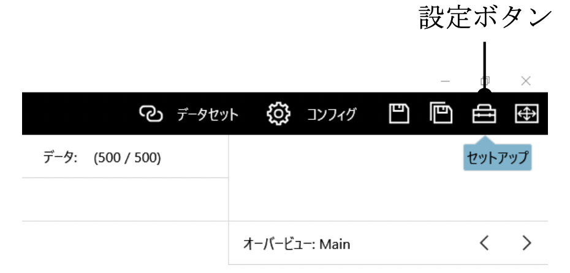
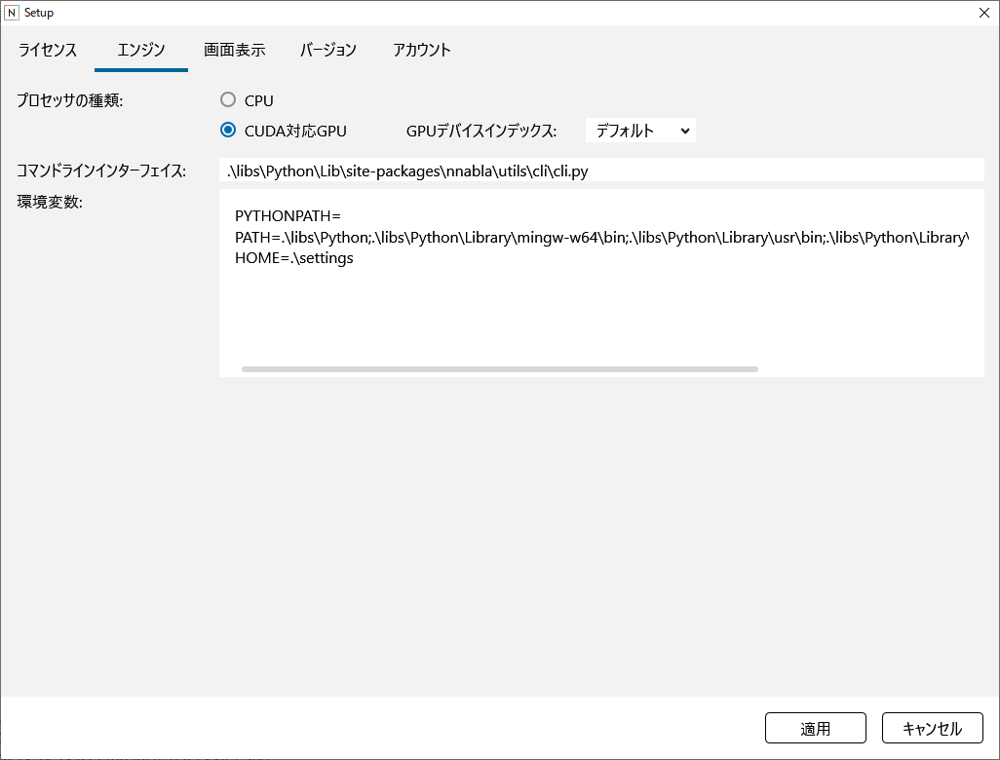

設定画面
========

設定画面を開くには、ウインドウ右上の設定ボタンをクリックします。

エンジン設定画面の使い方
------------------------

CPU実行、GPU実行を切り替えるには
~~~~~~~~~~~~~~~~~~~~~~~~~~~~~~~~

プロセッサの種類のCPUもしくはCUDA対応GPUをクリックして選択します。

複数GPU搭載環境で、使用するGPUを選択するには
~~~~~~~~~~~~~~~~~~~~~~~~~~~~~~~~~~~~~~~~~~~~

GPUデバイスインデックスで使用するGPUのインデックス（0～7）を指定します。

|Console| が利用する関連ライブラリの場所を変更するには
~~~~~~~~~~~~~~~~~~~~~~~~~~~~~~~~~~~~~~~~~~~~~~~~~~~~~~~~~~~~~~~~~~

コマンドラインインターフェイスで、NNablaのcli.pyのパスを指定します。

環境変数で、Neural Network Libraries実行時に用いる環境変数を指定します。

**ご注意**

通常ユーザがこれらの設定を変更する必要はありません。

表示設定画面の使い方
--------------------

表示言語を変更するには
~~~~~~~~~~~~~~~~~~~~~~

表示言語をクリックして表示言語を選択します。

GUIの表示サイズを拡大、縮小するには
~~~~~~~~~~~~~~~~~~~~~~~~~~~~~~~~~~~

表示拡大率をマウスでドラッグして拡大、縮小率を指定します。

**ご参考**

GUIの表示サイズは、設定画面を開いていない状態でキーボードのCtrlキーとShiftキーを押しながら「+」（プラス）キーもしくは「-」（マイナス）キーを押すことで、もしくはマウスホイールを操作することで拡大縮小できます。

GUIのアニメーション（トランジション）のON/OFFを指定するには
~~~~~~~~~~~~~~~~~~~~~~~~~~~~~~~~~~~~~~~~~~~~~~~~~~~~~~~~~~~

アニメーションをクリックしてアニメーションのON/OFFを切り替えます。

CSVデータ、Wavファイルのグラフ表示のデフォルトの表示様式を変更するには
~~~~~~~~~~~~~~~~~~~~~~~~~~~~~~~~~~~~~~~~~~~~~~~~~~~~~~~~~~~~~~~~~~~~~~

グラフの様式をクリックして、デフォルトの表示様式を選択します。

音声波形のプレビュー再生のON/OFFを指定するには
~~~~~~~~~~~~~~~~~~~~~~~~~~~~~~~~~~~~~~~~~~~~~~

オーディオファイル選択時に音声を再生をクリックしてプレビュー再生のON/OFFを繰り替えます。

オーディオファイル選択時に音声を再生がチェックされている場合、データセットタブなどで音声波形のファイルのセルを選択すると同時に音声が再生されます。

バージョン情報画面の使い方
--------------------------

|Console| のバージョンや関連情報を確認するには
~~~~~~~~~~~~~~~~~~~~~~~~~~~~~~~~~~~~~~~~~~~~~~~~~~~~~~~~~~

バージョンタブをクリックして表示します。

