レイヤーリファレンス
====================

|Console| のnnablaプロジェクトで利用可能なレイヤーとそのプロパティについて解説します。

レイヤー共通プロパティ
----------------------

レイヤーの名前、およびレイヤー間の接続状況やレイヤー固有のプロパティを元に自動計算されるプロパティです。

.. list-table::
   :widths: 30 70
   :class: longtable

   * - Name
     -
        レイヤー名を示します
        
        レイヤー名はグラフの中でユニークである必要があります

   * - Input
     - レイヤーの入力サイズを示します

   * - Output
     - レイヤーの出力サイズを示します

   * - CostParameter
     - レイヤーに含まれるパラメータの数を示します

   * - CostAdd
     - レイヤーの前向き計算に要する乗算と同時に行うことができない加算回数を示します

   * - CostMultiply
     - レイヤーの前向き計算に要する加算と同時に行うことができない乗算回数を示します

   * - CostMultiplyAdd
     - レイヤーの前向き計算に要する乗加算回数（加算と乗算を同時に行うことができる乗算と加算それぞれの回数）を示します

   * - CostDivision
     - レイヤーの前向き計算に要する除算回数を示します

   * - CostExp
     - レイヤーの前向き計算に要するExpの回数を示します

   * - CostIf
     - レイヤーの前向き計算に要する条件判断の回数を示します

入出力レイヤー
--------------

Input
~~~~~

ニューラルネットワークの入力層です。

.. list-table::
   :widths: 30 70
   :class: longtable

   * - Size
     -
        入力のサイズを指定します
        
        画像データの場合「色数,高さ,幅」のフォーマットで指定します。例えばRGBカラー画像でWidthが32、Heightが24の場合「3,24,32」とします。モノクロ画像でWidthが64、Heightが48の場合「1,48,64」とします
        
        CSVデータの場合「行数,列数」のフォーマットで指定します。例えば行のみで16行1列の場合「16,1」とします。12行3列の行列の場合「12,3」とします

   * - Dataset
     - データセットに含まれる変数のうち、このInputレイヤーに入力する変数の変数名を指定します

   * - Generator
     -
        このInputレイヤーに使用するGeneratorを指定します。GeneratorプロパティがNone以外の場合、最適化時Datasetで指定した変数の代わりにGeneratorにより生成するデータを用います。
        
        None
            データ生成を行いません
        
        Uniform
            -1.0～1.0の一様乱数を生成します
        
        Normal
            平均0.0、分散1.0であるガウス乱数を生成します
        
        Constant
            全ての要素が一定値（1.0）であるデータを生成します

   * - GeneratorMultiplier
     - Generatorにより生成した値に対して掛ける係数を指定します

   * - Order
     -
        ネットワークが複数のInputレイヤーを持つ場合の順序を0から始まる整数（0, 1, 2, …）で指定します
        
        -1を指定すると自動（レイヤーの作成順序）で順序が決定されます
        
        Unitとして用いるネットワークが複数の入力を持ち、かつGeneratorを用いない場合は、必ずOrderプロパティの値として0以上の値を指定する必要があります

ロスレイヤー
------------

SquaredError
~~~~~~~~~~~~

データセットの変数との二乗誤差を最小化するニューラルネットワークの出力層です。ニューラルネットワークにより回帰問題を解く際（連続値を出力するニューラルネットワークを最適化する際）に使用します。

.. list-table::
   :widths: 30 70
   :class: longtable

   * - T.Dataset
     - データセットに含まれる変数のうち、このSquaredErrorレイヤーの出力として期待する変数の変数名を指定します

   * - T.Generator
     -
        データセットの代わりに用いるGeneratorを指定します。GeneratorプロパティがNone以外の場合、最適化時T.Datasetで指定した変数の代わりにGeneratorにより生成するデータを用います
        
        None
            データ生成を行いません
        
        Uniform
            -1.0～1.0の一様乱数を生成します
        
        Normal
            平均0.0、分散1.0であるガウス乱数を生成します
        
        Constant
            全ての要素が一定値（1.0）であるデータを生成します

   * - T.GeneratorMultiplier
     - Generatorにより生成した値に対して掛ける係数を指定します

HuberLoss
~~~~~~~~~

データセットの変数とのHuber Lossを最小化するニューラルネットワークの出力層です。Squared Error同様ニューラルネットワークにより回帰問題を解く際に使用します。Squared Errorの代わりに使用することにより学習を安定させる効果があります。

.. math::
   L = \left\{\begin{matrix}
   i^2 &  for \left| i \right| \leqq \delta,  \\
   \delta(2|i| - \delta) & otherwise. \\
   \end{matrix}\right.

（iはデータセットと入力値との差分を示す）

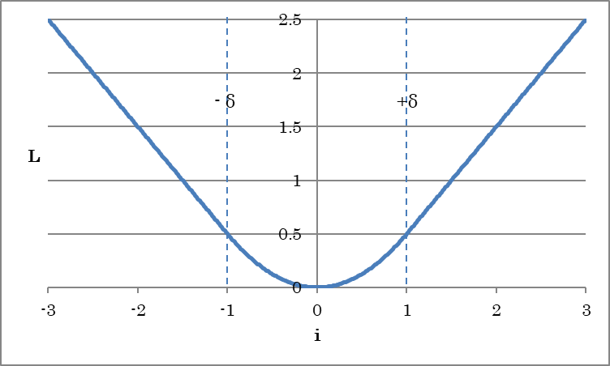

.. list-table::
   :widths: 30 70

   * - Delta
     - ロスを線形に増加させる閾値となるδを指定します

その他のプロパティはSquaredErrorと共通です。

AbsoluteError
~~~~~~~~~~~~~

データセットの変数との絶対誤差を最小化するニューラルネットワークの出力層です。ニューラルネットワークにより回帰問題を解く際（連続値を出力するニューラルネットワークを最適化する際）に使用します。プロパティはSquaredErrorと共通です。

EpsilonInsensitiveLoss
~~~~~~~~~~~~~~~~~~~~~~

Epsilonで指定する範囲を超えたデータセットの変数との絶対誤差を最小化するニューラルネットワークの出力層です。ニューラルネットワークにより回帰問題を解く際（連続値を出力するニューラルネットワークを最適化する際）に使用します。

.. math::

   L = \left\{\begin{matrix}
   0 &  if \left| i \right| < \epsilon,  \\
   |i| - \epsilon & otherwise. \\
   \end{matrix}\right.

（iはデータセットと入力値との差分を示す）

.. list-table::
   :widths: 30 70

   * - Epsilon
     - εの値を指定します

その他のプロパティはSquaredErrorと共通です。

BinaryCrossEntropy
~~~~~~~~~~~~~~~~~~

データセットの変数との交差エントロピーを最小化するニューラルネットワークの出力層です。2値分類問題（0 or 1）を解く際に使用します。BinaryCrossEntropyの入力値は0.0～1.0（確率値）、データセットの変数は0もしくは1である必要があります。プロパティはSquaredErrorと共通です。

SigmoidCrossEntropy
~~~~~~~~~~~~~~~~~~~

データセットの変数との交差エントロピーを最小化するニューラルネットワークの出力層です。学習時、SigmoidCrossEntropyはSigmoid+BinaryCrossEntropyと等価ですが、まとめて演算することにより演算誤差を抑える効果があります。プロパティはSquaredErrorと共通です。

**ご参考**

Sigmoid+BinaryCrossEntropyの代わりにSigmoidCrossEntropyを用いた場合、評価実行結果としてはSigmoid処理が行われていない連続値がそのまま出力されることになります。

CategoricalCrossEntropy
~~~~~~~~~~~~~~~~~~~~~~~

カテゴリIndexで与えられるデータセットの変数との交差エントロピーを最小化するニューラルネットワークの出力層です。プロパティはSquaredErrorと共通です。

SoftmaxCrossEntropy
~~~~~~~~~~~~~~~~~~~

カテゴリIndexで与えられるデータセットの変数との交差エントロピーを最小化するニューラルネットワークの出力層です。学習時、SoftmaxCrossEntropyはSoftmax+CategoricalCrossEntropyと等価ですが、まとめて演算することにより演算誤差を抑える効果があります。プロパティはSquaredErrorと共通です。

**ご参考**

Softmax+CategoricalCrossEntropyの代わりにSoftmaxCrossEntropyを用いた場合、評価実行結果としてはSoftmax処理が行われていない連続値がそのまま出力されることになります。

KLMultinomial
~~~~~~~~~~~~~

多項分布である入力の確率分布（p）と、データセットの変数（q）とのKullback Leibler距離を最小化するニューラルネットワークの出力層です。プロパティはSquaredErrorと共通です。

パラメータレイヤー
------------------

Parameter
~~~~~~~~~

ニューラルネットワークのパラメータです。

.. list-table::
   :widths: 30 70
   :class: longtable

   * - Size
     - パラメータのサイズを指定します

   * - File
     -
        プリトレーニングされたパラメータを用いる場合に、パラメータの書かれたファイルを絶対パスで指定します
        
        Fileが指定されておりパラメータをファイルから読み込む場合、Initializerによる初期化は無効になります

   * - Initializer
     -
        パラメータの初期化方法を指定します
        
        Uniform
            -1.0～1.0の一様乱数で初期化します
        
        UniformAffineGlorot
            一様乱数にXavier Glorot提案の 係数をかけて初期化します
        
        UniformConvolutionGlorot
            一様乱数にXavier Glorot提案の 係数をかけて初期化します
        
        Normal
            平均0.0、分散1.0であるガウス乱数で初期化します（デフォルト）
        
        NormalAffineHeForward
            ガウス乱数にKaiming He提案の係数をかけて初期化します（Forward Case）
        
        NormalAffineHeBackward
            ガウス乱数にKaiming He提案の係数をかけて初期化します（Backward Case）
        
        NormalAffineGlorot
            ガウス乱数にXavier Glorot提案の 係数をかけて初期化します
        
        NormalConvolutionHeForward
            ガウス乱数にKaiming He提案の係数をかけて初期化します（Forward Case）
        
        NormalConvolutionHeBackward
            ガウス乱数にKaiming He提案の係数をかけて初期化します（Backward Case）
        
        NormalConvolutionGlorot
            ガウス乱数にXavier Glorot提案の 係数をかけて初期化します
        
        Constant
            全ての要素を一定値（1.0）で初期化します

        |
        
        ChannelLastプロパティがTrueであるConvolutionに対する初期化を行うには、CLConvの含まれる初期化方法を選択します

   * - InitializerMultiplier
     - Initializerにより生成した値に対して掛ける係数を指定します

   * - LRateMultiplier
     - コンフィグタブで指定したLearning Rateに対し、パラメータの更新に用いるLearning Rateの倍率を指定します

**ご参考**

Parameterレイヤーで定義したパラメータは、AffineやConvolutionのW、bサイドコネクタに接続するなどして利用することができます。

WorkingMemory
~~~~~~~~~~~~~

演算結果を一次的に格納することができるバッファです。WorkingMemoryに入力されたデータは、WorkingMemoryに格納されます。WorkingMemoryに格納されたデータは、別のネットワークに設置した同名のWorkingMemoryの出力から取り出すことができます。

.. list-table::
   :widths: 30 70
   :class: longtable

   * - Size
     - バッファのサイズを指定します

   * - File
     -
        予めバッファの内容を指定する場合に、データの書かれたファイルを絶対パスで指定します
        
        Fileが指定されておりデータをファイルから読み込む場合、Initializerによる初期化は無効になります

   * - Initializer
     -
        パラメータの初期化方法を指定します
        
        Uniform
            -1.0～1.0の一様乱数で初期化します
        
        Normal
            平均0.0、分散1.0であるガウス乱数で初期化します（デフォルト）
        
        Constant
            全ての要素を一定値（1.0）で初期化します

   * - InitializerMultiplier
     - Initializerにより生成した値に対して掛ける係数を指定します

基本（Basic）レイヤー
---------------------

Affine
~~~~~~

全ての入力値から、OutShapeプロパティで指定する全ての出力ニューロンへの結合を持つ全結合層です。

.. math:: o = W_i + b

（iは入力、oは出力、Wは重み、bはバイアス項を示す）

.. list-table::
   :widths: 30 70
   :class: longtable

   * - OutShape
     - Affineレイヤーの出力ニューロン数を指定します

   * - WithBias
     - バイアス項(b)の有無を指定します

   * - ParameterScope
     -
        このレイヤーで用いるパラメータの名前を指定します
        
        同じParameterScopeの指定されたレイヤーの間ではパラメータが共有されます

   * - W.File
     -
        プリトレーニングされた重みWを用いる場合に、Wの書かれたファイルを絶対パスで指定します
        
        Fileが指定されており重みWをファイルから読み込む場合、Initializerによる初期化は無効になります

   * - W.Initializer
     -
        重みWの初期化方法を指定します
        
        Uniform
            -1.0～1.0の一様乱数で初期化します
        UniformAffineGlorot
            一様乱数にXavier Glorot提案の 係数をかけて初期化します
        Normal
            平均0.0、分散1.0であるガウス乱数で初期化します
        NormalAffineHeForward
            ガウス乱数にKaiming He提案の係数をかけて初期化します（Forward Case）
        NormalAffineHeBackward
            ガウス乱数にKaiming He提案の係数をかけて初期化します（Backward Case）
        NormalAffineGlorot
            ガウス乱数にXavier Glorot提案の 係数をかけて初期化します（デフォルト）
        Constant
            全ての要素を一定値（1.0）で初期化します

   * - W.InitializerMultiplier
     - Initializerにより生成した値に対して掛ける係数を指定します

   * - W.LRateMultiplier
     -
        コンフィグタブで指定したLearning Rateに対し、重みWの更新に用いるLearning Rateの倍率を指定します
        
        例えばW.LRateMultiplierを0とすることによって、重みWの更新が行われないようにすることができます

   * - b.\*
     - バイアスbに関する設定を行います。プロパティは重みWと共通です

Convolution
~~~~~~~~~~~

入力値に対して畳み込み演算を行うレイヤーです。

1次元Convolutionの場合

    .. math:: O_{x,m} = \sum _{i,n} {W_{i, n,m}I_{x+i,n}} + b_{m}

2次元Convolutionの場合

    .. math:: O_{i,j,n} = \sum_{i,j,n}{W_{i,j,n,m}I{x+i,y+j,n}} + b_m

（Oは出力、Iは入力、i,jはカーネルサイズ、x,y,nは入力のIndex、mは出力マップ（OutMapsプロパティ）、Wはカーネルの重み、bは各カーネルのバイアス項を示す）

.. list-table::
   :widths: 30 70
   :class: longtable

   * - KernelShape
     -
        畳み込むカーネルのサイズを指定します
        
        例えば画像に3(Height)x5(Width)の2次元のカーネルを畳み込む場合「3,5」とします
        
        例えば1次元の時系列信号に7 tapのフィルタを畳み込む場合は「7」とします

   * - WithBias
     - バイアス項(b)の有無を指定します

   * - OutMaps
     -
        畳み込むカーネルの数（=出力データ数）を指定します
        
        例えば入力に対して16種類のフィルタを畳み込む場合は「16」とします

   * - BorderMode
     -
        畳み込みを行う範囲を指定します
        
        valid
            各軸の入力データサイズに対して、Kernel Shape分の畳み込みが可能な範囲で畳み込みを行います
            この場合出力するデータの各軸のサイズは入力サイズ-Kernel Shape+1になります
        
        full
            各軸の入力データに対して、1サンプルでも畳み込みが可能な範囲で畳み込みを行います
            足りない範囲のデータ（上下左右それぞれKernel Shape - 1）には0がPaddingされます
            この場合出力するデータの各軸のサイズは入力サイズ+Kernel Shape-1になります
        
        same
            入力データと出力データのサイズが同じになるような範囲で畳み込みを行います
            足りない範囲のデータ（上下左右それぞれKernel Shape/2 - 1）には0がPaddingされます

   * - Padding
     -
        畳み込み処理前に配列の端にゼロを追加するサイズを指定します。例えば画像の上下方向に3ピクセル、左右に2ピクセルを挿入するには「3,2」とします。
        
        \*ConvolutionPaddingSize
            PaddingにBorderModeから算出される値を用います

   * - Strides
     -
        カーネルの畳み込みを何サンプル毎に行うかを指定します
        
        1以外のStrideを指定した軸の出力サイズは、指定した値でダウンサンプリングされます
        
        例えば画像のX軸方向には2毎サンプル毎、Y軸方向には3サンプル毎に畳み込みを行う場合は「3,2」とします

   * - Dilation
     - カーネルを広げる倍率をカーネルに対するStrideの値で指定します。例えば3(Height)x5(Width)の2次元のカーネルをHeight3倍、Width2倍に広げ、7x9の範囲に対してConvolutionを行う場合は「3,2」とします

   * - Group
     - OutMapsをグルーピングする単位を指定します。

   * - ChannelLast
     - 入力の最後の次元を入力マップとして扱います。

   * - ParameterScope
     -
        このレイヤーで用いるパラメータの名前を指定します
        
        同じParameterScopeの指定されたレイヤーの間ではパラメータが共有されます

   * - W.File
     -
        プリトレーニングされた重みWを用いる場合に、Wの書かれたファイルを絶対パスで指定します
        
        Fileが指定されており重みWをファイルから読み込む場合、Initializerによる初期化は無効になります

   * - W.Initializer
     -
        重みWの初期化方法を指定します
        
        Uniform
            -1.0～1.0の一様乱数で初期化します
        UniformConvolutionGlorot
            一様乱数にXavier Glorot提案の 係数をかけて初期化します
        
        Normal
            平均0.0、分散1.0であるガウス乱数で初期化します
        
        NormalConvolutionHeForward
            ガウス乱数にKaiming He提案の係数をかけて初期化します（Forward Case）
        
        NormalConvolutionHeBackward
            ガウス乱数にKaiming He提案の係数をかけて初期化します（Backward Case）
        
        NormalConvolutionGlorot
            ガウス乱数にXavier Glorot提案の 係数をかけて初期化します（デフォルト）
        
        Constant
            全ての要素を一定値（1.0）で初期化します

        |
        
        ChannelLastプロパティがTrueであるConvolutionに対する初期化を行うには、CLConvの含まれる初期化方法を選択します

   * - W.InitializerMultiplier
     - Initializerにより生成した値に対して掛ける係数を指定します

   * - W.LRateMultiplier
     -
        コンフィグタブで指定したLearning Rateに対し、重みWの更新に用いるLearning Rateの倍率を指定します
        
        例えばW.LRateMultiplierを0とすることによって、重みWの更新が行われないようにすることができます

   * - b.\*
     - バイアスbに関する設定を行います。プロパティは重みWと共通です

DepthwiseConvolution
~~~~~~~~~~~~~~~~~~~~

入力値に対して、Map毎に畳み込み演算を行うレイヤーです。DepthwiseConvolutionの動作は、Groupの値が入力Map数およびOutMapsの値と同一であるConvolutionの動作と等価です。

.. math:: O_{x,y,n} = \sum_{i,j}{W_{i,j}I{x+i,y+j,n}} + b_n

（Oは出力、Iは入力、i,jはカーネルサイズ、x,y,nは入力のIndex、、Wはカーネルの重み、bは各カーネルのバイアス項を示す）

.. list-table::
   :widths: 30 70
   :class: longtable

   * - KernelShape
     -
        畳み込むカーネルのサイズを指定します
        
        例えば画像に3(Height)x5(Width)の2次元のカーネルを畳み込む場合「3,5」とします
        
        例えば1次元の時系列信号に7 tapのフィルタを畳み込む場合は「7」とします

   * - WithBias
     - バイアス項(b)の有無を指定します

   * - BorderMode
     -
        畳み込みを行う範囲を指定します
        
        valid
            各軸の入力データサイズに対して、Kernel Shape分の畳み込みが可能な範囲で畳み込みを行います
            この場合出力するデータの各軸のサイズは入力サイズ-Kernel Shape+1になります
        
        full
            各軸の入力データに対して、1サンプルでも畳み込みが可能な範囲で畳み込みを行います
            足りない範囲のデータ（上下左右それぞれKernel Shape - 1）には0がPaddingされます
            この場合出力するデータの各軸のサイズは入力サイズ+Kernel Shape-1になります
        
        same
            入力データと出力データのサイズが同じになるような範囲で畳み込みを行います
            足りない範囲のデータ（上下左右それぞれKernel Shape/2 - 1）には0がPaddingされます

   * - Padding
     -
        畳み込み処理前に配列の端にゼロを追加するサイズを指定します。例えば画像の上下方向に3ピクセル、左右に2ピクセルを挿入するには「3,2」とします。
        
        \*ConvolutionPaddingSize
            PaddingにBorderModeから算出される値を用います

   * - Strides
     -
        カーネルの畳み込みを何サンプル毎に行うかを指定します
        
        1以外のStrideを指定した軸の出力サイズは、指定した値でダウンサンプリングされます
        
        例えば画像のX軸方向には2毎サンプル毎、Y軸方向には3サンプル毎に畳み込みを行う場合は「3,2」とします

   * - Dilation
     - カーネルを広げる倍率をカーネルに対するStrideの値で指定します。例えば3(Height)x5(Width)の2次元のカーネルをHeight3倍、Width2倍に広げ、7x9の範囲に対してConvolutionを行う場合は「3,2」とします

   * - Multiplier
     - 入力画像数に対する出力画像の枚数の倍率を指定します

   * - ParameterScope
     -
        このレイヤーで用いるパラメータの名前を指定します
        
        同じParameterScopeの指定されたレイヤーの間ではパラメータが共有されます

   * - W.File
     -
        プリトレーニングされた重みWを用いる場合に、Wの書かれたファイルを絶対パスで指定します
        
        Fileが指定されており重みWをファイルから読み込む場合、Initializerによる初期化は無効になります

   * - W.Initializer
     -
        重みWの初期化方法を指定します
        
        Uniform
            -1.0～1.0の一様乱数で初期化します
        
        UniformConvolutionGlorot
            一様乱数にXavier Glorot提案の 係数をかけて初期化します
        
        Normal
            平均0.0、分散1.0であるガウス乱数で初期化します
        
        NormalConvolutionHeForward
            ガウス乱数にKaiming He提案の係数をかけて初期化します（Forward Case）
        
        NormalConvolutionHeBackward
            ガウス乱数にKaiming He提案の係数をかけて初期化します（Backward Case）
        
        NormalConvolutionGlorot
            ガウス乱数にXavier Glorot提案の 係数をかけて初期化します（デフォルト）
        
        Constant
            全ての要素を一定値（1.0）で初期化します

   * - W.InitializerMultiplier
     - Initializerにより生成した値に対して掛ける係数を指定します

   * - W.LRateMultiplier
     -
        コンフィグタブで指定したLearning Rateに対し、重みWの更新に用いるLearning Rateの倍率を指定します
        
        例えばW.LRateMultiplierを0とすることによって、重みWの更新が行われないようにすることができます

   * - b.\*
     - バイアスbに関する設定を行います。プロパティは重みWと共通です

Deconvolution
~~~~~~~~~~~~~

入力値に対して逆畳み込み演算を行うレイヤーです。DeconvolutionのプロパティはConvolutionと共通です。

DepthwiseDeconvolution
~~~~~~~~~~~~~~~~~~~~~~

入力値に対して、Map毎に逆畳み込み演算を行うレイヤーです。DepthwiseDeconvolutionの動作は、Groupの値が入力Map数およびOutMapsの値と同一であるDeconvolutionの動作と等価です。

DeformableConvolution
~~~~~~~~~~~~~~~~~~~~~

入力値に対して2次元のDeformable Convolutionを行うレイヤーです。別途O(offset)サイドコネクタには適切なConvoltuionレイヤーの出力を接続する必要があります。M(mask)サイドコネクタに入力する値は0もしくは1である必要があります。

Deformable Convolutional Networks

Jifeng Dai, Haozhi Qi, Yuwen Xiong, Yi Li, Guodong Zhang, Han Hu, Yichen Wei

https://arxiv.org/abs/1703.06211

Deformable ConvNets v2: More Deformable, Better Results

Xizhou Zhu, Han Hu, Stephen Lin, Jifeng Dai

https://arxiv.org/abs/1811.11168

Oコネクタには、OutMapsの値をDeformableConvolutionのKernelShapeのサイズx2としたConvolutionの出力を接続します。例えばDeformableConvolutionのKernelShapeが3,3の場合、Oコネクタに接続するConvolutionのOutMapsは3x3x2の18とします。これはカーネルのピクセルごとのx方向、y方向のオフセットを示します。

Mコネクタには、OutMapsの値をDeformableConvolutionのKernelShapeのサイズとしたConvolutionの出力を接続します。例えばDeformableConvolutionのKernelShapeが3,3の場合、Mコネクタに接続するConvolutionのOutMapsは3x3の9とします。これはカーネルのピクセルごとのマスクを示します。

AdaptiveSeparableConvolution
~~~~~~~~~~~~~~~~~~~~~~~~~~~~

V、Hそれぞれのサイドコネクタにより入力する垂直方向および水平方向のカーネルに従うSeparable Depthwise Convolutionを行うレイヤーです。

Video Frame Interpolation via Adaptive Separable Convolution

Simon Niklaus, Long Mai, Feng Liu

https://arxiv.org/abs/1708.01692

Implementing Adaptive Separable Convolution for Video Frame Interpolation

Mart Kartašev, Carlo Rapisarda, Dominik Fay

https://arxiv.org/abs/1809.07759

V、Hコネクタにはそれぞれ、OutMapsの値をカーネルサイズとしたConvolutionの出力を接続します。例えばAdaptiveSeparableConvolutionのKernelShapeが3,5の場合、Vコネクタに接続するConvolutionのOutMapsは3、Hコネクタに接続するConvolutionのOutMapsは5とします。

Embed
~~~~~

入力値を0～N-1（Nはクラス数）の整数値で表される離散シンボルであると仮定し、各シンボルに指定サイズの配列を割り当てます。例えば入力値が単語Indexであり、ネットワークの冒頭で各単語をベクトル化する場合などに使用します。出力サイズは入力サイズ×配列サイズになります。

.. list-table::
   :widths: 30 70
   :class: longtable

   * - NumClass
     - クラス数Nを指定します

   * - Shape
     - 1つのシンボルに割り当てる配列のサイズを指定します

   * - ParameterScope
     -
        このレイヤーで用いるパラメータの名前を指定します
        
        同じParameterScopeの指定されたレイヤーの間ではパラメータが共有されます

   * - W.File
     -
        プリトレーニングされた重みWを用いる場合に、Wの書かれたファイルを絶対パスで指定します
        
        Fileが指定されており重みWをファイルから読み込む場合、Initializerによる初期化は無効になります

   * - W.Initializer
     -
        重みWの初期化方法を指定します
        
        Uniform
            -1.0～1.0の一様乱数で初期化します
        
        Normal
            平均0.0、分散1.0であるガウス乱数で初期化します
        
        Constant
            全ての要素を一定値（1.0）で初期化します

   * - W.InitializerMultiplier
     - Initializerにより生成した値に対して掛ける係数を指定します

   * - W.LRateMultiplier
     -
        コンフィグタブで指定したLearning Rateに対し、重みWの更新に用いるLearning Rateの倍率を指定します
        
        例えばW.LRateMultiplierを0とすることによって、重みWの更新が行われないようにすることができます

Poolingレイヤー
---------------

MaxPooling
~~~~~~~~~~

近傍の入力値の最大値を出力します。

.. list-table::
   :widths: 30 70
   :class: longtable

   * - KernelShape
     -
        最大値を取る近傍のサイズを指定します
        
        例えば3(Height)x5(Width)の範囲の最大値を出力する場合は「3,5」とします

   * - Strides
     -
        最大値を何サンプル毎に求めるかを指定します
        
        各軸の出力サイズは、指定した値でダウンサンプリングされます
        
        例えば画像のX軸方向には2毎サンプル毎、Y軸方向には3サンプル毎に最大値を取る場合は「3,2」とします
        
        \*KernelShape
            StridesにKernelShapeと同じ値を用います

   * - IgnoreBorder
     -
        境界の処理方法を指定します
        
        True
            KernelShapeで指定した最大値を取る範囲のサンプルが確保できる範囲で処理を行い、KernelShape分のサンプルが確保できない境界付近のサンプルは無視します
        
        False
            境界付近のサンプルを捨てず、1サンプルでも入力がある範囲で処理を行います

   * - Padding
     -
        Pooling処理前に配列の端にゼロを追加するサイズを指定します
        
        例えば画像の上下各2ピクセル、左右各1ピクセル分のゼロを追加する場合は「2,1」とします

   * - ChannelLast
     - 入力の最後の次元を無視します

SumPooling
~~~~~~~~~~

近傍の入力値の加算値を出力します。プロパティはMaxPoolingと共通です。

AveragePooling
~~~~~~~~~~~~~~

近傍の入力値の平均値を出力します。プロパティはMaxPoolingと共通です。

GlobalAveragePooling
~~~~~~~~~~~~~~~~~~~~

配列の最後の2次元全体の平均値を出力します。GlobalAveragePoolingは、PoolShapeおよびStridesに入力配列の最後の2次元のサンプル数を指定したAveragePoolingと等価です。

Unpooling
~~~~~~~~~

1つの入力値を複数にコピーして、入力データよりサイズの大きいデータを生成します。

.. list-table::
   :widths: 30 70
   :class: longtable

   * - KernelShape
     -
        データをコピーするサイズを指定します
        
        例えば1つのデータを縦方向に2回ずつ、横方向に3回ずつコピーする（縦方向2倍、横方向に3倍の大きさのデータを出力する）場合は、「2,3」とします

Activationレイヤー
------------------

Tanh
~~~~

入力値のTanhによる処理結果を出力します。

.. math:: y = tanh(x)

（yは出力、xは入力を示す）

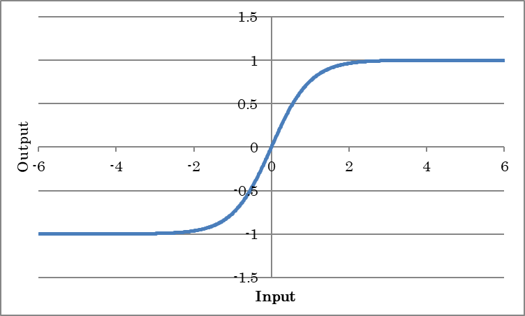

HardTanh
~~~~~~~~

-1以下の入力に対し-1を、+1より大きい入力に対し+1を、-1から+1までの入力に対し入力値を出力します。Tanhをより軽量な演算で近似した活性化関数です。

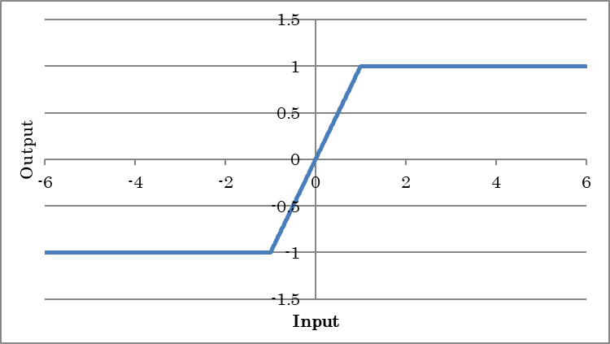

TanhShrink
~~~~~~~~~~

入力値のTanhShrinkによる処理結果を出力します。

.. math:: y = x - tanh(x)

（yは出力、xは入力を示す）

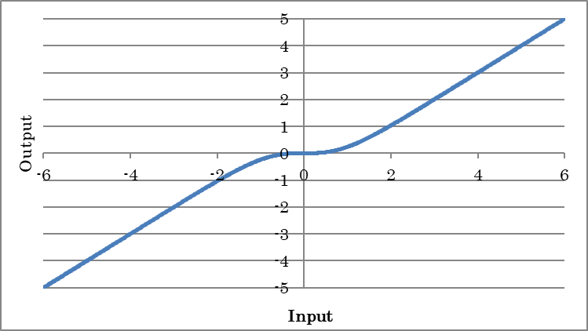

Sigmoid
~~~~~~~

入力値のSigmoidによる処理結果を出力します。確率など0.0～1.0の出力値を得たい場合に使用します。

.. math:: y = sigmoid(x)

（yは出力、xは入力を示す）

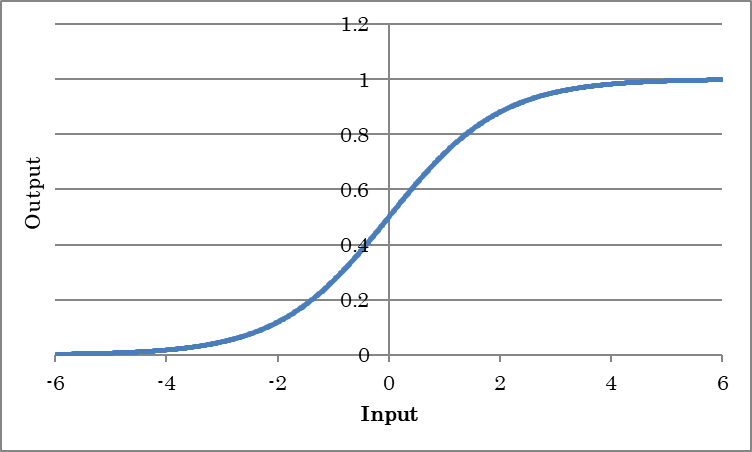

HardSigmoid
~~~~~~~~~~~

-2.5以下の入力に対し-0を、+2.5より大きい入力に対し+1を、-2.5から+2.5までの入力に対し入力値×0.2+0.5を出力します。Sigmoidをより軽量な演算で近似した活性化関数です。

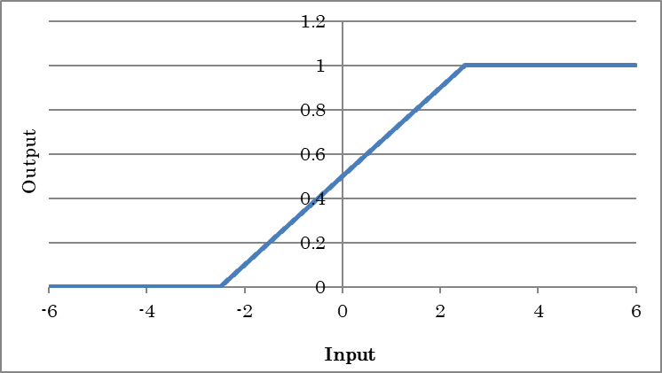

LogSigmoid
~~~~~~~~~~

入力値のLogSigmoidによる処理結果を出力します。

.. math:: y = \log(\frac{1}{1+\exp(-x)})

（yは出力、xは入力を示す）

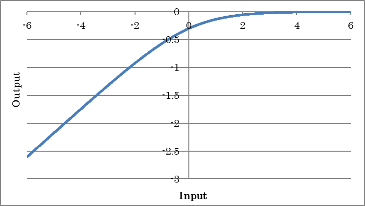

ReLU
~~~~

入力値のReLU（Rectified Linear Unit）による処理結果を出力します。

.. math:: y = \max(0,x)

（yは出力、xは入力を示す）

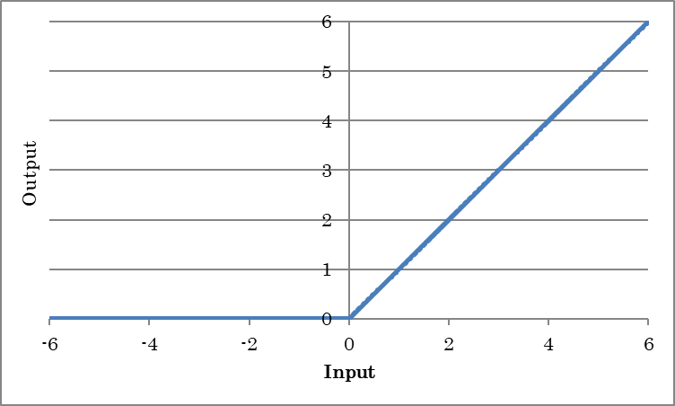

.. list-table::
   :widths: 30 70
   :class: longtable

   * - InPlace
     -
        Trueの場合、入力バッファと出力バッファを共有することにより学習に要するメモリを節約します
        
        InPlace可能な場合に自動でInPlaceするには、*AutoInPlaceOnce*を指定します

CReLU
~~~~~

入力信号と、入力信号の符号を反転したものに対してそれぞれRelu処理を行い、それぞれの結果をAxisプロパティの示す軸で結合して出力します（Concatenated ReLU）。

LeakyReLU
~~~~~~~~~

ReLUが0以下の入力に対して常に0を出力するのに対し、0以下の入力に対しても一定値をかけて出力するようにしたものです。

.. math:: y = \max(0, x) + a\min(0, x)

（yは出力、xは入力を示す）

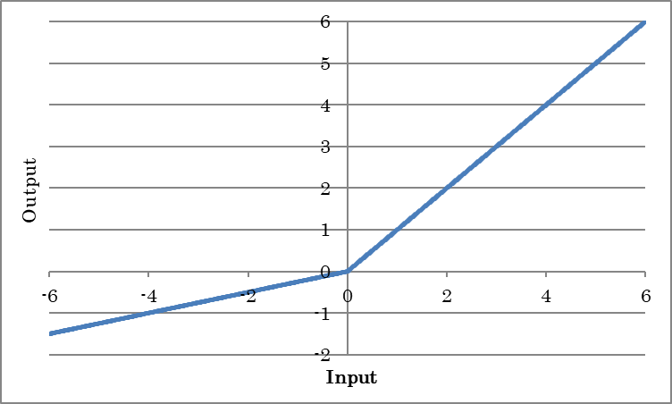

.. list-table::
   :widths: 30 70
   :class: longtable

   * - Alpha
     - 負の勾配aの値を指定します

   * - InPlace
     -
        Trueの場合、入力バッファと出力バッファを共有することにより学習に要するメモリを節約します
        
        InPlace可能な場合に自動でInPlaceするには、*AutoInPlaceOnceを指定します

PReLU
~~~~~

ReLUが0以下の入力に対して常に0を出力するのに対し、0以下の入力に対しても一定値をかけて出力するようにしたものです（Parametric ReLU）。0以下の勾配であるaの値は学習により獲得されます。

.. math:: y = \max(0, x) + a\min(0, x)

（yは出力、xは入力を示す）

.. list-table::
   :widths: 30 70
   :class: longtable

   * - BaseAxis
     - Inputのうち、個別のaを学習する軸のIndex（0から開始）を指定します。例えばInputが4,3,5である入力に対し、最初の次元(要素4)に対しそれぞれ個別のaを学習するには、BaseAxisを0とします

   * - ParameterScope
     -
        このレイヤーで用いるパラメータの名前を指定します
        
        同じParameterScopeの指定されたレイヤーの間ではパラメータが共有されます

   * - slope.File
     -
        プリトレーニングされた勾配 aを用いる場合に、aの書かれたファイルを絶対パスで指定します
        
        Fileが指定されており重みslopeをファイルから読み込む場合、Initializerによる初期化は無効になります

   * - slope.Initializer
     -
        勾配 aの初期化方法を指定します
        
        Uniform
            -1.0～1.0の一様乱数で初期化します
        
        Normal
            平均0.0、分散1.0であるガウス乱数で初期化します
        
        Constant
            全ての要素を一定値（1.0）で初期化します

   * - slope.InitializerMultiplier
     - Initializerにより生成した値に対して掛ける係数を指定します

   * - slope.LRateMultiplier
     -
        コンフィグタブで指定したLearning Rateに対し、勾配 aの更新に用いるLearning Rateの倍率を指定します
        
        例えばslope.LRateMultiplierを0とすることで、勾配 aの更新が行われないようにすることができます

ReLU6
~~~~~

出力の最大値を6としたReLUによる処理結果を出力します。

.. math:: y = \min(\max(0,x),6)

（yは出力、xは入力を示す）

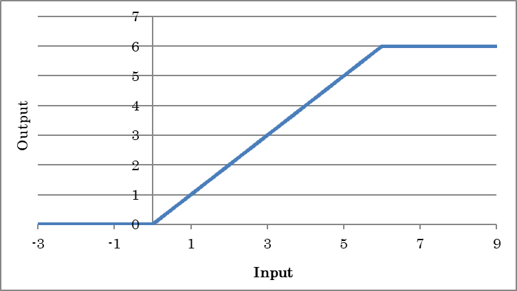

ELU
~~~

入力値のELU（Exponential Linear Unit）による処理結果を出力します。

.. math:: y = \max(0, x) + alpha(\exp(\min(0, x)) – 1)

（yは出力、xは入力を示す）

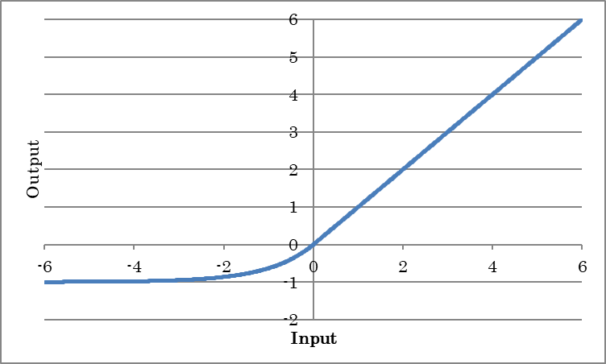

.. list-table::
   :widths: 30 70
   :class: longtable

   * - Alpha
     - 負の出力の係数alphaを指定します

CELU
~~~~

入力信号と、入力信号の符号を反転したものに対してそれぞれELU処理を行い、それぞれの結果をAxisプロパティの示す軸で結合して出力します（Concatenated ELU）。

SELU
~~~~

入力値のSELU（Scaled Exponential Linear Unit）による処理結果を出力します。

.. math:: y = lambda {max(0, x) + alpha(exp(min(0, x)) – 1)}

（yは出力、xは入力を示す）

.. list-table::
   :widths: 30 70
   :class: longtable

   * - Scale
     - 全体のスケールlambdaを指定します

   * - Alpha
     - 負の出力の係数alphaを指定します

GELU
~~~~

入力値のGELU（Gaussian Error Unit）による処理結果を出力します。

.. math:: y = xP(X \leq x) = x\Phi(x)

.. math:: y = 0.5x(1+tanh(\frac{\sqrt{2}}{\pi}(x+0.044715 x^3)))

（yは出力、xは入力を示す）

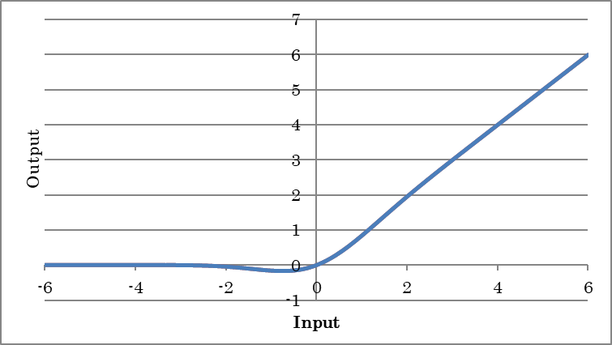

SoftPlus
~~~~~~~~

入力値のSoftPlusによる処理結果を出力します。

.. math:: y = log(1+exp(x))

（yは出力、xは入力を示す）

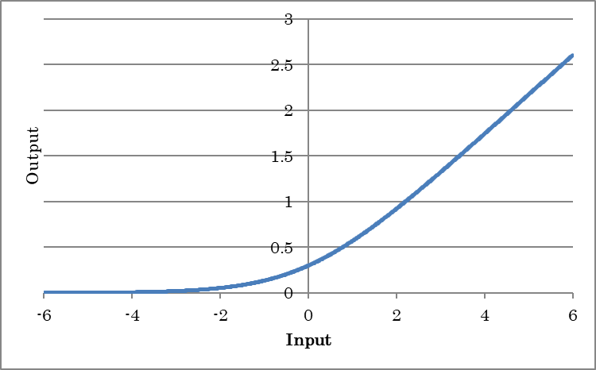

Sinc
~~~~

入力値のSincによる処理結果を出力します。

.. math:: y = \frac{sin(x)}{x} \qquad (x != 0)

.. math:: y = 1 \qquad (x == 0)

（yは出力、xは入力を示す）

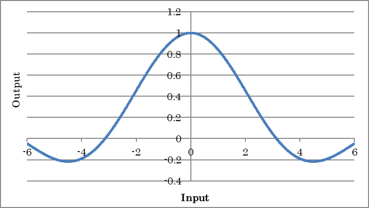

SoftSign
~~~~~~~~

入力値のSoftSignによる処理結果を出力します。

.. math:: y = \frac{x}{1+|x|}

（yは出力、xは入力を示す）

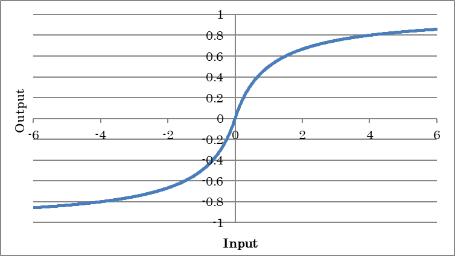

Swish
~~~~~

入力値のSwishによる処理結果を出力します。

.. math:: y = \frac{x}{1+\exp(-x)}

（yは出力、xは入力を示す）

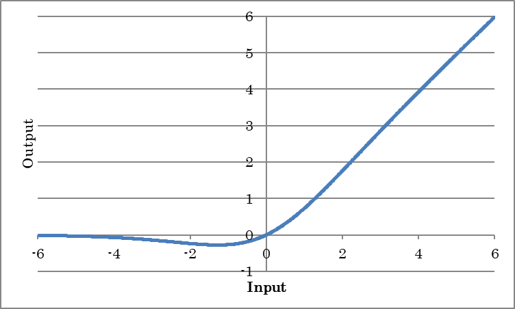

Mish
~~~~

入力値のMishによる処理結果を出力します。

.. math:: y = x tanh(log(1+exp(x))

（yは出力、xは入力を示す）

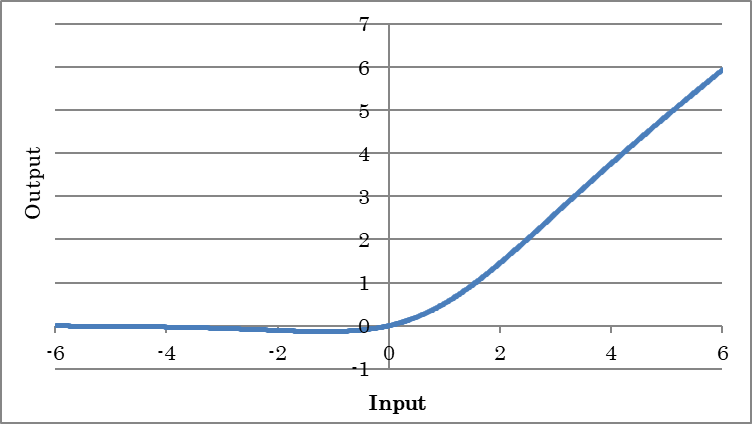

Abs
~~~

入力値の絶対値を出力します。

.. math:: y = abs(x)

（yは出力、xは入力を示す）

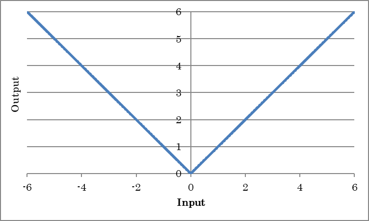

Softmax
~~~~~~~

入力値のSoftmax値を出力します。カテゴリ分類問題における確率など、0.0～1.0かつ合計が1.0となる出力値を得たい場合に使用します。

.. math:: y_i = \frac{\exp(x_i)}{\sum_{j}{\exp(x_j)}}

（yは出力、xは入力、iはデータのIndexを示す）

LogSoftmax
~~~~~~~~~~

入力値のSoftmax値のlogを出力します。

.. math:: y_i = \log(\frac{\exp(x_i)}{\sum_{j}{\exp(x_j)}})

（yは出力、xは入力、iはデータのIndexを示す）

Loop Controlレイヤー
--------------------

Residual Networks、Recurrent Neural Networksなどループ構造を持つネットワークを構成するためのレイヤーです。

RepeatStart
~~~~~~~~~~~

繰り返しの開始位置を示すレイヤーです。RepeatStart、RepeatEndの間に配置されたレイヤーは、RepeatStartのTimesプロパティの示す回数繰り返し作成されます。

**ご注意**

Repeat StartとRepeatEndの配列サイズは同一である必要があります。繰り返しの度に配列のサイズが異なるような構造は記述できません。

RepeatEnd
~~~~~~~~~

繰り返し終了位置を示すレイヤーです。

RecurrentInput
~~~~~~~~~~~~~~

Recurrent Neural Networkの時間ループ開始位置を示すレイヤーです。Axisプロパティで指定する軸が時間軸として扱われます。時間ループの長さは入力データのAxisプロパティで指定する軸の要素数です。

RecurrentOutput
~~~~~~~~~~~~~~~

Recurrent Neural Networkの時間ループ終了位置を示すレイヤーです。

Delay
~~~~~

RecurrentNeuralNetworkにおける時間遅れ信号を示すレイヤーです。

.. list-table::
   :widths: 30 70
   :class: longtable

   * - Size
     - 時間遅れ信号のサイズを指定します

   * - Initial.Dataset
     - データセットに含まれる変数のうち、時間遅れ信号の初期値として使用する値の変数名を指定します

   * - Initial.Generator
     -
        データセットの代わりに用いるGeneratorを指定します。GeneratorプロパティがNone以外の場合、最適化時T.Datasetで指定した変数の代わりにGeneratorにより生成するデータを用います。
        
        None
            データ生成を行いません
        
        Uniform
            -1.0～1.0の一様乱数を生成します
        
        Normal
            平均0.0、分散1.0であるガウス乱数を生成します
        
        Constant
            全ての要素が一定値（1.0）であるデータを生成します

   * - Initial.GeneratorMultiplier
     - Generatorにより生成した値に対して掛ける係数を指定します

量子化レイヤー
--------------

重み係数やデータの量子化を行うレイヤーです。

FixedPointQuantize
~~~~~~~~~~~~~~~~~~

線形量子化を行います。

.. list-table::
   :widths: 30 70
   :class: longtable

   * - Sign
     -
        符号の有無を指定します
        
        Falseの場合、量子化後の値は全て正になります

   * - N
     - 量子化ビット数を指定します

   * - Delta
     - 量子化のステップサイズを指定します

   * - STEFineGrained
     -
        Backward時の勾配の計算方法を指定します
        
        True
            勾配は常に1
        
        False
            量子化で表現可能な最大値、最小値の範囲のみ勾配1、その他は0

MinMaxQuantize
~~~~~~~~~~~~~~

最小値と最大値に従った量子化を行います。

Quantization and Training of Neural Networks for Efficient Integer-Arithmetic-Only Inference
Benoit Jacob, Skirmantas Kligys, Bo Chen, Menglong Zhu, Matthew Tang, Andrew Howard, Hartwig Adam, and Dmitry Kalenichenko
https://arxiv.org/abs/1712.05877

.. list-table::
   :widths: 30 70
   :class: longtable

   * - Decay
     - 量子化範囲の最小値、および最大値を示すr、Rを更新する際の指数移動平均の減衰率を指定します

   * - XMinMax
     - 量子化範囲の最小値、および最大値を示すr、Rを入力の最小値と最大値から決定するかどうかを指定します

   * - EMA
     - 量子化範囲の最小値、および最大値を示すr、Rの計算に指数移動平均を用いるかどうかを指定します

   * - STEFineGrained
     -
        Backward時の勾配の計算方法を指定します
        
        True
            min-maxから計算された{0, 1}-maskを勾配の計算に用いる
        
        False
            勾配は常に1

   * - Epsilon
     - ゼロ除算を防ぐために分母に加算する値を指定します

   * - r.*、R.*
     - 
       量子化範囲の最小値、および最大値です

       XMinMaxがTrue、EMAがTrueの場合、Forward計算時に入力値の最大値、最小値の指数移動平均により更新されます

       XMinMaxがTrue、EMAがFalseの場合、Forward計算時に入力値の最大値、最小値により上書きされます

       XMinMaxがFalse、EMAがTrueの場合、r、Rの値を用いた量子化を行いますが、r、Rの値は更新されません

       XMinMaxがFalse、EMAがFalseの場合、Backward計算時にr、Rの勾配が計算されます

   * - l.*、L.*
     - 最小量子化レベル、および最大量子化です（通常は0と255）

Pow2Quantize
~~~~~~~~~~~~

2べきの量子化を行います。

.. list-table::
   :widths: 30 70
   :class: longtable

   * - Sign
     -
        符号の有無を指定します
        
        Falseの場合、量子化後の値は全て正になります

   * - WithZero
     -
        ゼロの有無を指定します
        
        Falseの場合、量子化後の値はゼロを含みません

   * - N
     - 量子化ビット数を指定します

   * - M
     - 量子化後の最大値を2^Mで指定します

   * - STEFineGrained
     -
        Backward時の勾配の計算方法を指定します
        
        True
            勾配は常に1
        
        False
            量子化で表現可能な最大値、最小値の範囲のみ勾配1、その他は0

BinaryConnectAffine
~~~~~~~~~~~~~~~~~~~

-1、+1にバイナリ化されたWを用いるAffineレイヤーです。

.. math:: o = sign(W)i+b

（iは入力、oは出力、Wは重み、bはバイアス項を示す）

.. list-table::
   :widths: 30 70
   :class: longtable

   * - Wb.\*
     - バイナリ化後の重みWbに関する設定を行います。プロパティはAffineレイヤーの重みWと共通です

その他のプロパティについてはAffineレイヤーをご参照ください。

BinaryConnectConvolution
~~~~~~~~~~~~~~~~~~~~~~~~

-1、+1にバイナリ化されたWを用いるConvolutionレイヤーです。

2次元Convolutionの場合

    .. math:: O_{x,y,m} = \sum_{i,j,n}{sign(W_{i,j,n,m})I{x+i,y+j,n}} + b_m

（Oは出力、Iは入力、i,jはカーネルサイズ、x,y,nは入力のIndex、mは出力マップ（OutMapsプロパティ）、Wはカーネルの重み、bは各カーネルのバイアス項を示す）

.. list-table::
   :widths: 30 70
   :class: longtable

   * - Wb.\*
     - バイナリ化後の重みWbに関する設定を行います。プロパティはConvolutionレイヤーの重みWと共通です

その他のプロパティについてはConvolutionレイヤーをご参照ください。

BinaryWeightAffine
~~~~~~~~~~~~~~~~~~

-1、+1にバイナリ化されたWを用いた上でScalingを行うことで通常のAffineレイヤーの出力に近づけたAffineレイヤーです。

.. math:: o = a sign(W)i +b

（iは入力、oは出力、Wは重み、aはスケール、bはバイアス項を示す）

BinaryWeightConvolution
~~~~~~~~~~~~~~~~~~~~~~~

-1、+1にバイナリ化されたWを用いた上でScalingを行うことで通常のConvolutionレイヤーの出力に近づけたConvolutionレイヤーです。

2次元Convolutionの場合

    .. math:: O_{x,y,m} = \sum_{i,j,n}{sign(W_{i,j,n,m})I_{x+i,y+j,n}} * a + b_m

（Oは出力、Iは入力、i,jはカーネルサイズ、x,y,nは入力のIndex、mは出力マップ（OutMapsプロパティ）、Wはカーネルの重み、aはスケール、bは各カーネルのバイアス項を示す）

BinaryTanh
~~~~~~~~~~

0以下の入力に対し-1を、0より大きい入力に対し+1を出力します。

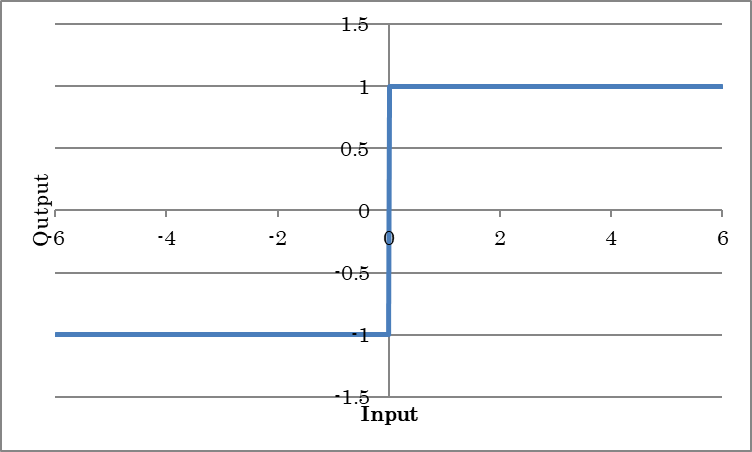

BinarySigmoid
~~~~~~~~~~~~~

0以下の入力に対し0を、0より大きい入力に対し+1を出力します。

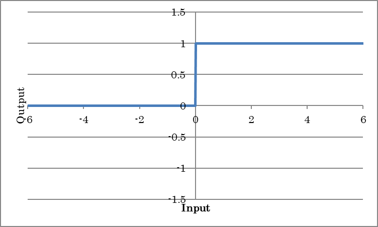

Unitレイヤー
------------

ネットワークの途中に、他のネットワークを挿入する機能を提供するレイヤーです。Unitレイヤーを用いることで、ネットワークとして定義したレイヤーの集合を、別のネットワークの途中に挿入することができます。

Unitレイヤーを用いて他のネットワークを挿入するネットワークを「呼び出し元ネットワーク」、Unitレイヤーを用いて他のネットワークに挿入されるネットワークを「ユニットネットワーク」と呼びます。

Unit
~~~~

現在の呼び出し元ネットワークにユニットネットワークを挿入します。

.. list-table::
   :widths: 30 70
   :class: longtable

   * - Network
     - 挿入するユニットネットワークのネットワーク名を指定します

   * - ParameterScope
     -
        このユニットで用いるパラメータの名前を指定します
        
        同じParameterScopeの指定されたユニットの間ではパラメータが共有されます

   * - （その他のプロパティ）
     - 挿入するユニットネットワークのプロパティを指定します

Networkプロパティで指定するネットワークが複数のInputレイヤーを備えており、それぞれにOrderプロパティが指定されている場合、Unitレイヤーの入力にはOrder 0の入力が、UnitレイヤーのサイドコネクタにはOrder 1以降の入力が割り当てられます。

Argument
~~~~~~~~

ユニットネットワークにおいて、呼び出し元ネットワークからUnitのプロパティとして編集可能にする引数を設定します。Argumentレイヤーの値は、ユニットネットワーク内の他のレイヤーのプロパティにArgumentレイヤーの名前を指定することで、ユニットネットワーク内の他のレイヤーから利用可能です。設置したArgumentレイヤーの値は、呼び出し元ネットワークに設置されたUnitのプロパティで指定可能になります。

.. list-table::
   :widths: 30 70
   :class: longtable

   * - Value
     - 引数のデフォルト値を指定します

   * - Type
     -
        引数の型を指定します
        
        Boolean
            True or False
        
        Int
            整数
        
        IntArray
            整数の配列
        
        PInt
            1以上の整数
        
        PIntArray
            1以上の整数の配列
        
        PIntArrays
            1以上の整数の配列の配列
        
        UInt
            符号なし整数
        
        UIntArray
            符号なし整数の配列
        
        Float
            浮動小数点数
        
        FloatArray
            浮動小数点数の配列
        
        FloatArrays
            浮動小数点数の配列の配列
        
        Text
            文字列
        
        File
            ファイル名

   * - Search
     - 呼び出し元ネットワークにおいて、引数が構造自動探索の対象にするかどうかを指定します

スペクトルレイヤー
------------------

FFT
~~~

複素数入力、複素数出力のフーリエ変換を行います。入力配列の最後の次元は要素2（実部と虚部）の複素数である必要があります。

.. list-table::
   :widths: 30 70
   :class: longtable

   * - SignalNDim
     -
        フーリエ変換を行う信号の次元数を指定します
        
        例えば1次元フーリエ変換の場合は1を、2次元フーリエ変換を行う場合は2を指定します

   * - Normalized
     -
        フーリエ変換結果を以下の式で示す定数倍して出力します
        
        :math:`\sqrt{\frac{1}{\prod_{i = 1}^{d}N_{i}}}`

IFFT
~~~~

複素数入力、複素数出力の逆フーリエ変換を行います。

.. list-table::
   :widths: 30 70
   :class: longtable

   * - SignalNDim
     -
        逆フーリエ変換を行う信号の次元数を指定します
        
        例えば1次元逆フーリエ変換の場合は1を、2次元逆フーリエ変換を行う場合は2を指定します

   * - Normalized
     -
        逆フーリエ変換結果に乗算する定数を指定します
        
        True
            :math:`\sqrt{\frac{1}{\prod_{i = 1}^{d}N_{i}}}`
        
        False
            :math:`\frac{1}{\prod_{i = 1}^{d}N_{i}}`

数値演算レイヤー
----------------

Sum
~~~

指定次元の値の合計を求めます。

.. list-table::
   :widths: 30 70
   :class: longtable

   * - Axis
     - 値を合計する軸のIndex（0から開始）を指定します

   * - KeepDims
     - 値を合計した軸を保持するかどうかを指定します

CumSum
~~~~~~

指定次元方向に累計を求めます。

.. list-table::
   :widths: 30 70
   :class: longtable

   * - Axis
     - 累計を計算する軸のIndex（0から開始）を指定します

   * - Exclusive
     - 累計から自分自身の値を除くかどうかを指定します。

   * - Reverse
     - 累計を逆方向に計算するかどうかを指定します

Mean
~~~~

指定次元の値の平均を求めます。

.. list-table::
   :widths: 30 70
   :class: longtable

   * - Axis
     - 値を平均する軸のIndex（0から開始）を指定します

   * - KeepDims
     - 値を平均した軸を保持するかどうかを指定します

Prod
~~~~

指定次元の値の積を求めます。

.. list-table::
   :widths: 30 70
   :class: longtable

   * - Axis
     - 値を掛け合わせる軸のIndex（0から開始）を指定します

   * - KeepDims
     - 値を掛け合わせた軸を保持するかどうかを指定します

CumProd
~~~~~~~

指定次元方向に累積積を求めます。

.. list-table::
   :widths: 30 70
   :class: longtable

   * - Axis
     - 累積積を計算する軸のIndex（0から開始）を指定します

   * - Exclusive
     - 累積積から自分自身の値を除くかどうかを指定します。

   * - Reverse
     - 累積積を逆方向に計算するかどうかを指定します

Max
~~~

指定次元の値の最大値を求めます。

.. list-table::
   :widths: 30 70
   :class: longtable

   * - Axis
     - 最大値を求める軸のIndex（0から開始）を指定します

   * - KeepDims
     - 最大値を求めた軸を保持するかどうかを指定します

   * - OnlyIndex
     -
        Maxの出力の種類を指定します
        
        True
            最大値を持つIndexを出力します
        
        False
            最大値を出力します

Min
~~~

指定次元の値の最小値を求めます。

.. list-table::
   :widths: 30 70
   :class: longtable

   * - Axis
     - 最小値を求める軸のIndex（0から開始）を指定します

   * - KeepDims
     - 最小値を求めた軸を保持するかどうかを指定します

   * - OnlyIndex
     -
        Minの出力の種類を指定します
        
        True
            最小値を持つIndexを出力します
        
        False
            最小値を出力します

Norm
~~~~

入力値のノルムを求めます。

.. list-table::
   :widths: 30 70
   :class: longtable

   * - P
     - ノルムのオーダーpを指定します

   * - Axes
     -
        Inputのうち、ノルムの計算に用いる軸のIndex（-1および0以上の整数）を指定します
        
        例えばInputが4,3,5である入力に対し、最初の次元(要素4)に対しノルムを求めるには、Axesを0とします。2番目と3番目の次元（要素3,5）のノルムを求めるには、Axesを1,2とします
        
        ミニバッチもノルムを求める対象として加えるには、Axesに-1を加えます

   * - KeepDims
     - ノルムを求めた軸を保持するかどうかを指定します

Log
~~~

eを底とする自然対数を計算します。

Exp
~~~

eを底とする指数関数を計算します。

Sign
~~~~

負の入力に対し-1を、正の入力に対し+1,、0に対しalphaを出力します。

.. list-table::
   :widths: 30 70
   :class: longtable

   * - Alpha
     - 入力値0に対応する出力値を指定します

**ご参考**

BinaryTanhと比較するとForward演算時の動作はほぼ（入力値が0の場合の挙動を除き）同じですが、Backward計算時の動作が異なります。BinaryTanhは入力データの絶対値が1以上の場合微分を0とするのに対し、Back propagationされた微分をそのまま自身の微分としてスルーします。

BatchMatmul
~~~~~~~~~~~

入力(A)と、コネクタRの入力(B)の最後の2次元で表される行列の行列積を計算します。Aの行列がL×N、Bの行列がN×Mである場合、出力行列はL×Mになります。

BatchInv
~~~~~~~~

入力の最後の2次元の逆行列を出力します。

BatchDet
~~~~~~~~

入力の最後の2次元の行列の行列式を出力します。

BatchLogdet
~~~~~~~~~~~

入力の最後の2次元の行列の行列式の絶対値のログを出力します。

Round
~~~~~

入力値を四捨五入します。

Ceil
~~~~

入力値の小数点以下を切り上げます。

Floor
~~~~~

入力値の小数点以下を切り捨てます。

三角関数レイヤー（Trigonometric）
---------------------------------

要素毎に三角関数を計算します。

.. list-table::
   :widths: 30 70
   :class: longtable
   :header-rows: 1

   * - レイヤー名
     - 数式

   * - Sin
     - :math:`y = sin(x)`

   * - Cos
     - :math:`y = cos(x)`

   * - Tan
     - :math:`y = tan(x)`

   * - Sinh
     - :math:`y = sinh(x)`

   * - Cosh
     - :math:`y = cosh(x)`

   * - ASin
     - :math:`y = arcsin(x)`

   * - ACos
     - :math:`y = arccos(x)`

   * - ATan
     - :math:`y = arctan(x)`

   * - ATan2
     - :math:`y = arctan2(x_1, x_2)`

   * - ASinh
     - :math:`y = asinh(x)`

   * - ACosh
     - :math:`y = asinh(x)`

   * - ATanh
     - :math:`y = atanh(x)`

（x、x\ :sub:`1`\ 、x\ :sub:`2`\ は入力、yは出力を示す）

スカラ算術演算レイヤー（Arithmetic（Scalar））
----------------------------------------------

Valueプロパティで指定する実数値を用いた要素毎の各種算術演算を行います。

.. list-table::
   :widths: 30 70
   :class: longtable
   :header-rows: 1

   * - レイヤー名
     - 数式

   * - AddScalar
     - :math:`y = x+value`

   * - MulScalar
     - :math:`y = x*value`

   * - RSubScalar
     - :math:`y = value-x`

   * - RDivScalar
     - :math:`y = value/x`

   * - PowScalar
     - :math:`y = x ^ {value}`

   * - RPowScalar
     - :math:`y = value ^ {x}`

   * - MaximumScalar
     - :math:`y = max(x, value)`

   * - MinimumScalar
     - :math:`y = min(x, value)`

（xは入力、yは出力、valueは実数値を示す）

2入力算術演算レイヤー（Arithmetic（2 Inputs））
-----------------------------------------------

2つの入力を用いた要素毎の各種算術演算を行います。

入力ピンに :math:`x_1` を、サイドコネクタに :math:`x_2` を接続します。

.. list-table::
   :widths: 30 70
   :class: longtable
   :header-rows: 1

   * - レイヤー
     - 数式

   * - Add2
     - :math:`y = x_1 + x_2`

   * - Sub2
     - :math:`y = x_1 - x_2`

   * - Mul2
     - :math:`y = x_1 * x_2`

   * - Div2
     -
        :math:`y = x_1 / x_2`
        
        右辺x\ :sub:`2`\ に用いる入力はコネクタRに接続します

   * - Pow2
     -
        :math:`y = x_1^{X_2}`
        
        右辺x\ :sub:`2`\ に用いる入力はコネクタRに接続します

   * - Maxmum2
     - :math:`y = max(x_1, x_2)`

   * - Minimum2
     - :math:`y = min(x_1, x_2)`

（x\ :sub:`1`\ 、x\ :sub:`2`\ は入力、yは出力を示す）

N入力算術演算レイヤー（Arithmetic（N Inputs））
-----------------------------------------------

2つ以上の入力を用いた要素毎の各種算術演算を行います。

.. list-table::
   :widths: 30 70
   :class: longtable
   :header-rows: 1

   * - レイヤー
     - 数式

   * - AddN
     - :math:`y = \sum{x_i}`

   * - MulN
     - :math:`y = \prod {x_i}`

（x\ :sub:`i`\ は入力、yは出力を示す）

論理演算レイヤー
----------------

2つの入力もしくは1つの入力とValueプロパティで指定する値を用いた要素毎の論理演算を行います。論理演算の出力は0もしくは1となります。

入力ピンに :math:`x_1` を、サイドコネクタに :math:`x_2` を接続します。

.. list-table::
   :widths: 30 70
   :class: longtable
   :header-rows: 1

   * - レイヤー名
     - 処理

   * - LogicalAnd
     - :math:`y =  x_1 and x_2`

   * - LogicalOr
     - :math:`y =  x_1 or x_2`

   * - LogicalXor
     - :math:`y =  x_1 xor x_2`

   * - Equal
     - :math:`y =  x_1 == x_2`

   * - NotEqual
     - :math:`y =  x_1 != x_2`

   * - GreaterEqual
     - :math:`y =  x_1 >= x_2`

   * - Greater
     - :math:`y =  x_1 > x_2`

   * - LessEqual
     - :math:`y =  x_1 <= x_2`

   * - Less
     - :math:`y =  x_1 < x_2`

   * - LogicalAndScalar
     - :math:`y =  x and value`

   * - LogicalOrScalar
     - :math:`y =  x or value`

   * - LogicalXorScalar
     - :math:`y =  x xor value`

   * - EqualScalar
     - :math:`y =  x == value`

   * - NotEqualScalar
     - :math:`y =  x != value`

   * - GreaterEqualScalar
     - :math:`y =  x >= value`

   * - GreaterScalar
     - :math:`y =  x > value`

   * - LessEqualScalar
     - :math:`y =  x <= value`

   * - LessScalar
     - :math:`y =  x < value`

   * - LogicalNot
     - :math:`y =  !x`

   * - IsNaN
     - :math:`y =  x == NaN`

   * - IsInf
     - :math:`y =  x == inf or x== -inf`

（x、x\ :sub:`1`\ 、x\ :sub:`2`\ は入力、yは出力を示す）

**ご注意**

論理演算レイヤーはBack-propagation演算に対応していません。

評価用レイヤー
--------------

BinaryError
~~~~~~~~~~~

入力データと、正解を示すデータセットの変数Tそれぞれについて、0.5以上であるかどうかを基準に0または1へのバイナリ化を行い、バイナリの不一致をデータ毎に評価します。入力データと正解のバイナリが一致している場合は0を、一致していない場合は1を出力します。

.. list-table::
   :widths: 30 70
   :class: longtable

   * - T.Dataset
     - データセットに含まれる変数のうち、このレイヤーの出力として期待する変数の変数名を指定します

   * - T.Generator
     -
        データセットの代わりに用いるGeneratorを指定します。GeneratorプロパティがNone以外の場合、最適化時T.Datasetで指定した変数の代わりにGeneratorにより生成するデータを用います
        
        None
            データ生成を行いません
        
        Uniform
            -1.0～1.0の一様乱数を生成します
        
        Normal
            平均0.0、分散1.0であるガウス乱数を生成します
        
        Constant
            全ての要素が一定値（1.0）であるデータを生成します

   * - T.GeneratorMultiplier
     - Generatorにより生成した値に対して掛ける係数を指定します

TopNError
~~~~~~~~~

各カテゴリの確率もしくはスコアを示す入力データと、正解カテゴリのIndexを示すデータセットの変数Tを元に、正解カテゴリの確率もしくはスコアが全カテゴリ中でTop N位以内に入っているかどうかをデータ毎に評価します。正解カテゴリの確率もしくはスコアがTop N位以内に入っている場合は0を、Top N位以内に入っていない場合は1を出力します。

.. list-table::
   :widths: 30 70
   :class: longtable

   * - Axis
     - カテゴリを示す軸のIndexを指定します

   * - N
     -
        正解として許容する順位Nを指定します。
        
        例えば正解カテゴリの確率もしくはスコアが最大であるもののみ正解とする場合は「1」とします。正解カテゴリの確率もしくはスコアが上位5位以内に入っているものを正解とする場合は「5」とします

   * - T.Dataset
     - データセットに含まれる変数のうち、このレイヤーの出力として期待する変数の変数名を指定します

   * - T.Generator
     -
        データセットの代わりに用いるGeneratorを指定します。GeneratorプロパティがNone以外の場合、最適化時T.Datasetで指定した変数の代わりにGeneratorにより生成するデータを用います
        
        None
            データ生成を行いません
        
        Uniform
            -1.0～1.0の一様乱数を生成します
        
        Normal
            平均0.0、分散1.0であるガウス乱数を生成します
        
        Constant
            全ての要素が一定値（1.0）であるデータを生成します

   * - T.GeneratorMultiplier
     - Generatorにより生成した値に対して掛ける係数を指定します

正規化レイヤー
--------------

BatchNormalization
~~~~~~~~~~~~~~~~~~

入力値をバッチ内で平均0分散1に標準化します。ConvolutionやAffineの後に挿入することで精度向上、および収束を早める効果があります。

.. math:: y_i = (x_i-mean(x)) * \frac{\gamma_i}{\sum{x}} + \beta_i

（yは出力、xは入力、iはデータのIndexを示す）

Batch Normalization: Accelerating Deep Network Training by Reducing Internal Covariate Shift

Sergey Ioffe, Christian Szegedy

https://arxiv.org/abs/1502.03167

.. list-table::
   :widths: 30 70
   :class: longtable

   * - Axes
     - Inputのうち、個別の標準化を行う軸のIndex（0から開始）を指定します。例えばInputが4,3,5である入力に対し、最初の次元(要素4)に対しそれぞれ個別の標準化を行うには、Axisを0とします。2番目と3番目の次元（要素3,5）に対しそれぞれ個別の標準化を行うには、Axesを1,2とします

   * - DecayRate
     - 学習時に入力データの平均と標準偏差を更新する際の減衰率を指定します（0.0～1.0）。値が1.0に近いほど過去のデータから求めた平均と標準偏差を維持します

   * - Epsilon
     - 標準化計算時のゼロ除算を防ぐため、入力データの分散に加算する値を指定します

   * - BatchStat
     -
        Batch NormalizationにMini-batch毎に算出した平均分散を用いるかどうかを指定します
        
        True：Mini Batch毎に算出した平均分散を用います
        
        False：BatchStat=Trueの際に計算された移動平均と移動分散を用います

   * - ParameterScope
     -
        このレイヤーで用いるパラメータの名前を指定します
        
        同じParameterScopeの指定されたレイヤーの間ではパラメータが共有されます

   * - beta.File
     -
        プリトレーニングされたbetaを用いる場合に、betaの書かれたファイルを絶対パスで指定します
        
        betaが指定されておりファイルから読み込む場合、Initializerによる初期化は無効になります

   * - beta.Initializer
     -
        betaの初期化方法を指定します
        
        Uniform：-1.0～1.0の一様乱数で初期化します
        
        Normal：平均0.0、分散1.0であるガウス乱数で初期化します
        
        Constant：全ての要素を一定値（1.0）で初期化します

   * - beta.InitializerMultiplier
     - Initializerにより生成した値に対して掛ける係数を指定します

   * - beta.LRateMultiplier
     -
        コンフィグタブで指定したLearning Rateに対し、重みWの更新に用いるLearning Rateの倍率を指定します
        
        例えばコンフィグタブで指定したLearning Rateが0.01の状態でbeta.LRateMultiplierを0とした場合、betaの更新は行われません

   * - gamma.\*
     - 標準化後の標準偏差を指定します

   * - mean.\*
     - 入力データの平均値を指定します

   * - var.\*
     - 入力データの標準偏差を指定します

FusedBatchNormalization
~~~~~~~~~~~~~~~~~~~~~~~

BatchNormalizationと活性化関数の処理を1つの関数で行います。BatchNormalization、活性化関数をそれぞれ用いる場合と比較して少し計算速度を向上する効果があります。Nonlinearity以外のプロパティはBatchNormalizationと共通です。

.. list-table::
   :widths: 30 70
   :class: longtable

   * - Nonlinearity
     - 活性化関数の種類を指定します。現在reluのみが指定可能です。

NormNormalization
~~~~~~~~~~~~~~~~~

入力値をノルムが1となるように正規化します。

.. math:: y_i =\frac{x_i}{||x||_p}

（yは出力、xは入力、iはデータのIndexを示す）

.. list-table::
   :widths: 30 70
   :class: longtable

   * - P
     - ノルムのオーダーpを指定します

   * - Axes
     -
        Inputのうち、ノルムの計算に用いる軸のIndex（-1および0以上の整数）を指定します
        
        例えばInputが4,3,5である入力に対し、最初の次元(要素4)に対しノルムを求め正規化を行うには、Axesを0とします。2番目と3番目の次元（要素3,5）のノルムを求め正規化を行うには、Axesを1,2とします
        
        ミニバッチもノルムを求める対象として加えるには、Axesに-1を加えます

   * - Epsilon
     - 正規化計算時のゼロ除算を防ぐため、分母に加算する値を指定します

WeightStandardization
~~~~~~~~~~~~~~~~~~~~~

主にParameterレイヤーの出力であるパラメータに対し、以下の式で定義されるWeight Standardizationを適用します。

.. math:: \mu w_{i} = \frac{1}{I}\sum_{j = 1}^{I}W_{\text{ij}}

.. math:: \sigma w_{i} = \sqrt{\frac{1}{I}\sum_{j = 1}^{I}{{(W_{\text{ij}} - \ \mu w_{i})}^{2} + \varepsilon}}

.. math:: \widehat{W}_{ij} = \frac{W_{ij} - \mu w_i}{\sigma w_i}

.. math:: y = \widehat{W}*\text{\ x}

Micro-Batch Training with Batch-Channel Normalization and Weight Standardization

Siyuan Qiao, Huiyu Wang, Chenxi Liu, Wei Shen, Alan Yuille

https://arxiv.org/abs/1502.03167

.. list-table::
   :widths: 30 70
   :class: longtable

   * - ChannelAxis
     -
        Inputのうち、個別の標準化を行う軸のIndex（0から開始、通常出力チャンネル軸）を指定します
        
        例えばサイズが256,128,3,3である入力パラメータに対し、最初の次元(要素256)それぞれについて平均と分散を求め標準化を行うには、ChannelAxisを0とします

   * - Epsilon
     - 標準化時のゼロ除算を防ぐため、分散に加算する値εを指定します

WeightNormalization
~~~~~~~~~~~~~~~~~~~

主にParameterレイヤーの出力であるパラメータに対し、以下の式で定義されるWeight Normalizationを適用します。

.. math:: w_{WN} = \ g\frac{w}{\|w\|}

Micro-Batch Training with Batch-Channel Normalization and Weight Standardization

Siyuan Qiao, Huiyu Wang, Chenxi Liu, Wei Shen, Alan Yuille

https://arxiv.org/abs/1903.10520

.. list-table::
   :widths: 30 70
   :class: longtable

   * - Dim
     -
        Inputのうち、個別の正規化を行う軸のIndex（0から開始、通常出力チャンネル軸）を指定します
        
        例えばサイズが256,128,3,3である入力パラメータに対し、最初の次元(要素256)それぞれについて平均と分散を求め正規化を行うには、Dimを0とします

   * - Epsilon
     - 正規化時のゼロ除算を防ぐため、ノルムに加算する値εを指定します

   * - g.\*
     - 正規化後のスケールを指定します

SpectralNorm
~~~~~~~~~~~~

主にParameterレイヤーの出力であるパラメータに対し、以下の式で定義されるSpectral Normalizationを適用します。

.. math:: w_{SN} = \frac{w}{\sigma(w)}

:math:`\sigma(w)` はWのSpectral Normを示します。Spectral Normはべき乗法により近似計算されます。

Takeru Miyato, Toshiki Kataoka, Masanori Koyama, Yuichi Yoshida, "Spectral Normalization for Generative Adversarial Networks", International Conference on Learning Representations. 2018.

.. list-table::
   :widths: 30 70
   :class: longtable

   * - Dim
     -
        Inputのうち、個別の標準化を行う軸のIndex（0から開始、通常出力チャンネル軸）を指定します
        
        例えばサイズが256,128,3,3である入力パラメータに対し、最初の次元(要素256)それぞれについて平均と分散を求め正規化を行うには、Dimを0とします

   * - Epsilon
     - 正規化時のゼロ除算を防ぐため、分母に加算する値εを指定します

   * - Itr
     - べき乗法の繰り返し回数を指定します

   * - Test
     - Trueの場合、uはアップデートされません

   * - u.\*
     - Forward計算時に求められた特異値ベクトルの格納先を指定します。uはTestがFalseの場合のみ更新されます

LayerNormalization
~~~~~~~~~~~~~~~~~~

入力値を以下の式で定義されるLayer Normalizationによりデータ内で標準化します。

.. math:: \mu^{l} = \frac{1}{H}\sum_{i = 1}^{H}x_{i}^{l}

.. math:: \sigma^{l} = \sqrt{\frac{1}{H}\sum_{i = 1}^{H}{{(x_{i}^{l} - \ \mu^{l})}^{2} + \varepsilon}}

.. math:: y = \frac{x - \mu^{l}}{\sigma^{l}}\gamma + \beta

xとyは入力変数と出力変数、μ\ :sup:`l`\ とσ\ :sup:`l`\ はデータごとに個別に計算される平均および標準偏差です。また、βとγは適用バイアスとゲインです。

Layer Normalization

Jimmy Lei Ba, Jamie Ryan Kiros, Geoffrey E. Hinton

https://arxiv.org/abs/1607.06450

.. list-table::
   :widths: 30 70
   :class: longtable

   * - BatchAxis
     - Inputのうち、ミニバッチを示す個別の標準化を行う軸のIndex（通常-1）を指定します

   * - Epsilon
     - 標準化計算時のゼロ除算を防ぐため、入力データの分散に加算する値を指定します

   * - ParameterScope
     -
        このレイヤーで用いるパラメータの名前を指定します
        
        同じParameterScopeの指定されたレイヤーの間ではパラメータが共有されます

   * - beta.File
     - プリトレーニングされた適用バイアスβを用いる場合に、βの書かれたファイルを絶対パスで指定します

   * - 
     -
        
        Uniform
            -1.0～1.0の一様乱数で初期化します
        
        Normal
            平均0.0、分散1.0であるガウス乱数で初期化します
        
        Constant
            全ての要素を一定値（1.0）で初期化します

   * - beta.InitializerMultiplier
     - Initializerにより生成した値に対して掛ける係数を指定します

   * - beta.LRateMultiplier
     -
        コンフィグタブで指定したLearning Rateに対し、重みWの更新に用いるLearning Rateの倍率を指定します
        
        例えばコンフィグタブで指定したLearning Rateが0.01の状態でbeta.LRateMultiplierを0とした場合、betaの更新は行われません

   * - gamma.\*
     - 標準化後の標準偏差を指定します

InstanceNormalization
~~~~~~~~~~~~~~~~~~~~~

入力値を以下の式で定義されるInstance Normalizationによりデータ内で標準化します。

.. math:: \mu^{i} = \frac{1}{H}\sum_{j = 1}^{H}x_{j}^{i}

.. math:: \sigma^{i} = \sqrt{\frac{1}{H}\sum_{j = 1}^{H}{{(x_{j}^{i} - \ \mu^{i})}^{2} + \varepsilon}}

.. math:: y = \frac{x - \mu^{i}}{\sigma^{i}}\gamma + \beta

xとyは入力変数と出力変数、μ\ :sup:`i`\ とσ\ :sup:`i`\ はインスタンス（データ、チャンネル）ごとに個別に計算される平均および標準偏差です。また、βとγは適用バイアスとゲインです。

Instance Normalization: The Missing Ingredient for Fast Stylization

Dmitry Ulyanov, Andrea Vedaldi, Victor Lempitsky

https://arxiv.org/abs/1607.08022

.. list-table::
   :widths: 30 70
   :class: longtable

   * - ChannelAxis
     - Inputのうち、チャンネルを示す個別の標準化を行う軸のIndexを指定します

   * - BatchAxis
     - Inputのうち、ミニバッチを示す個別の標準化を行う軸のIndex（通常-1）を指定します

   * - Epsilon
     - 標準化計算時のゼロ除算を防ぐため、入力データの分散に加算する値を指定します

   * - ParameterScope
     -
        このレイヤーで用いるパラメータの名前を指定します
        
        同じParameterScopeの指定されたレイヤーの間ではパラメータが共有されます

   * - beta.File
     - プリトレーニングされた適用バイアスβを用いる場合に、βの書かれたファイルを絶対パスで指定します

   * - beta.Initializer
     -
        βの初期化方法を指定します
        
        beta.Fileが指定されておりファイルから読み込む場合、Initializerによる初期化は無効になります
        
        Uniform
            -1.0～1.0の一様乱数で初期化します
        
        Normal
            平均0.0、分散1.0であるガウス乱数で初期化します
        
        Constant
            全ての要素を一定値（1.0）で初期化します

   * - beta.InitializerMultiplier
     - Initializerにより生成した値に対して掛ける係数を指定します

   * - beta.LRateMultiplier
     -
        コンフィグタブで指定したLearning Rateに対し、重みWの更新に用いるLearning Rateの倍率を指定します
        
        例えばコンフィグタブで指定したLearning Rateが0.01の状態でbeta.LRateMultiplierを0とした場合、betaの更新は行われません

   * - gamma.\*
     - 標準化後の標準偏差を指定します

GroupNormalization
~~~~~~~~~~~~~~~~~~

入力値を以下の式で定義されるGroup Normalizationによりデータ内で標準化します。

.. math:: \mu^{g} = \frac{1}{H}\sum_{i = 1}^{H}x_{i}^{g}

.. math:: \sigma^{g} = \sqrt{\frac{1}{H}\sum_{i = 1}^{H}{{(x_{i}^{g} - \ \mu^{g})}^{2} + \varepsilon}}

.. math:: y = \frac{x - \mu^{g}}{\sigma^{g}}\gamma + \beta

xとyは入力変数と出力変数、μ\ :sup:`g`\ とσ\ :sup:`g`\ はグループ（各データ、チャンネルのグループ）ごとに個別に計算される平均および標準偏差です。また、βとγは適用バイアスとゲインです。

Group Normalization

Yuxin Wu, Kaiming He

https://arxiv.org/abs/1803.08494

.. list-table::
   :widths: 30 70
   :class: longtable

   * - ChannelAxis
     - Inputのうち、チャンネルを示す個別の標準化を行う軸のIndexを指定します

   * - BatchAxis
     - Inputのうち、ミニバッチを示す個別の標準化を行う軸のIndex（通常-1）を指定します

   * - NumGroups
     - チャンネルをグルーピングする際のグループ数を指定します

   * - Epsilon
     - 標準化計算時のゼロ除算を防ぐため、入力データの分散に加算する値を指定します

   * - ParameterScope
     -
        このレイヤーで用いるパラメータの名前を指定します
        
        同じParameterScopeの指定されたレイヤーの間ではパラメータが共有されます

   * - beta.File
     - プリトレーニングされた適用バイアスβを用いる場合に、βの書かれたファイルを絶対パスで指定します

   * - beta.Initializer
     -
        βの初期化方法を指定します
        
        beta.Fileが指定されておりファイルから読み込む場合、Initializerによる初期化は無効になります
        
        Uniform
            -1.0～1.0の一様乱数で初期化します
        
        Normal
            平均0.0、分散1.0であるガウス乱数で初期化します
        
        Constant
            全ての要素を一定値（1.0）で初期化します

   * - beta.InitializerMultiplier
     - Initializerにより生成した値に対して掛ける係数を指定します

   * - beta.LRateMultiplier
     -
        コンフィグタブで指定したLearning Rateに対し、重みWの更新に用いるLearning Rateの倍率を指定します
        
        例えばコンフィグタブで指定したLearning Rateが0.01の状態でbeta.LRateMultiplierを0とした場合、betaの更新は行われません

   * - gamma.\*
     - 標準化後の標準偏差を指定します

その他のレイヤー
----------------

Dropout
~~~~~~~

入力の要素を指定した確率で0にします。

.. list-table::
   :widths: 30 70
   :class: longtable

   * - P
     - 要素を0にする確率を0.0～1.0の範囲で指定します

Concatenate
~~~~~~~~~~~

二つ以上の配列を既存の軸で結合します。

.. list-table::
   :widths: 30 70
   :class: longtable

   * - Axis
     -
        配列を結合する軸を指定します
        
        軸のIndexは左から0,1,2...の値を取ります
        
        例えば「3,28,28」と「5,28,28」の2つの入力を、最初（一番左）の軸で結合する場合は「0」とします。この場合出力サイズは「8,28,28」になります

Reshape
~~~~~~~

配列の形を指定した形に変換します。

.. list-table::
   :widths: 30 70
   :class: longtable

   * - OutShape
     -
        変更後の配列の形を指定します
        
        例えば入力が「2,5,5」である配列を「10,5」として出力する場合は「10,5」とします
        
        入力と出力の配列の要素数は同一である必要があります

Broadcast
~~~~~~~~~

データをコピーすることで、要素数が1である配列の次元を指定したサイズに変換します。

.. list-table::
   :widths: 30 70
   :class: longtable

   * - OutShape
     -
        変更後の配列の形を指定します
        
        例えば入力が「3,1,2」である配列の2番目の次元の要素数を10にする場合は「3,10,2」とします

Tile
~~~~

データを指定回数繰り返しコピーします。

.. list-table::
   :widths: 30 70
   :class: longtable

   * - Reps
     -
        データをコピーする回数を指定します
        
        例えば入力データを縦方向に2回ずつ、横方向に3回ずつ並べてコピーする（縦方向2倍、横方向に3倍の大きさのデータを出力する）場合は、「2,3」とします

Pad
~~~

配列の各次元に指定サイズの要素を追加します。

.. list-table::
   :widths: 30 70
   :class: longtable

   * - PadWidth
     -
        追加する要素数を指定します
        
        例えば、「10,12」である配列の、最初の次元の先頭に1要素、最後に2要素、2番目の次元の先頭に3要素、最後に4要素を追加する場合は、「1,2,3,4」とします
        
        要素の追加は入力配列の最後からlen(PadWidth)/2の軸に対して行われます。従って、PadWidthの長さは2の倍数、かつ入力配列の次元数×2以下である必要があります

   * - Mode
     -
        要素の追加方法を指定します
        
        constant
            ConstantValueで指定する定数を追加します
        
        replicate
            各軸の最初の値と最後の値を追加します
        
        reflect
            各軸の最初と最後で反転させた値を追加します

   * - ConstantValue
     - Modeにconstantを選択した場合に、追加する定数の値を指定します

**ご注意**

現在PadのModeはconstantのみに対応しています。

Flip
~~~~

配列のうち、指定した次元の要素の順序を反転します。

.. list-table::
   :widths: 30 70
   :class: longtable

   * - Axes
     -
        要素の順序を反転する次元のIndexを指定します
        
        軸のIndexは左から0,1,2...の値を取ります
        
        例えば32(W)x24(H)のRGB画像「3,24,32」を上下左右反転する場合は「1,2」とします

Shift
~~~~~

配列の要素を指定分シフトします。

.. list-table::
   :widths: 30 70
   :class: longtable

   * - Shift
     -
        要素をシフトする量を指定します
        
        例えば画像データを右に2pixel、上に3ピクセルシフトするには「-3,2」とします

   * - BorderMode
     -
        シフト処理によって値が未定となる配列の端の処理方法を指定します
        
        nearest:元の配列の端のデータをコピーして使用します
        
        reflect:元の配列の端を起点に元のデータを反転させたものを使用します

Transpose
~~~~~~~~~

データの次元の入れ替えを行います。

.. list-table::
   :widths: 30 70
   :class: longtable

   * - Axes
     -
        入力データの各次元について、出力データ上での軸のIndexを指定します
        
        軸のIndexは左から0,1,2...の値を取ります
        
        例えばサイズが「3,20,10」の入力データの2番目の次元と3番目の次元を入れ替えて出力するには「0,2,1」を指定します（この場合の出力データサイズは「3,10,20」）

Slice
~~~~~

配列の一部を抽出します。

.. list-table::
   :widths: 30 70
   :class: longtable

   * - Start
     - 抽出の始点を指定します

   * - Stop
     - 抽出の終点を指定します

   * - Step
     -
        抽出の間隔を指定します
        
        例えば、サイズが「3,48,64」の画像データの中心24x32ピクセルを2ピクセル毎に抽出するには、Startに「0,12,16」を、Stopに「3,36,48」を、Stepに「1,2,2」を指定します

Stack
~~~~~

二つ以上の配列を新しい軸で結合します。結合する全ての配列のサイズは同一である必要があります。Concatenateが既存の軸で結合を行うのに対し、Stackは新しい軸で結合します。

.. list-table::
   :widths: 30 70
   :class: longtable

   * - Axis
     -
        配列を結合する軸を指定します
        
        軸のIndexは左から0,1,2...の値を取ります
        
        例えば4つの「3,28,28」入力を、2番目の軸で結合する場合は「1」とします。この場合出力サイズは「3,4,28,28」になります

MatrixDiag
~~~~~~~~~~

配列の最後の1次元を対角行列化します。

MatrixDiagPart
~~~~~~~~~~~~~~

配列の最後の2次元の対角成分を抽出します。

ClipGradByValue
~~~~~~~~~~~~~~~

勾配の値を指定した範囲内に収めます。

.. list-table::
   :widths: 30 70
   :class: longtable

   * - min.Dataset
     - データセットに含まれる変数のうち、最小値として使用するデータセットの変数名を指定します。

   * - min.Generator
     -
        最小値に使用するGeneratorを指定します。GeneratorプロパティがNone以外の場合、最適化時Datasetで指定した変数の代わりにGeneratorにより生成するデータを用います。
        
        None
            データ生成を行いません
        
        Uniform
            -1.0～1.0の一様乱数を生成します
        
        Normal
            平均0.0、分散1.0であるガウス乱数を生成します
        
        Constant
            全ての要素が一定値（1.0）であるデータを生成します

   * - min.GeneratorMultiplier
     - 最小値のGeneratorにより生成した値に対して掛ける係数を指定します

   * - max.Dataset
     - データセットに含まれる変数のうち、最大値として使用するデータセットの変数名を指定します。

   * - max.Generator
     -
        最大値に使用するGeneratorを指定します。GeneratorプロパティがNone以外の場合、最適化時Datasetで指定した変数の代わりにGeneratorにより生成するデータを用います。
        
        None
            データ生成を行いません
        
        Uniform
            -1.0～1.0の一様乱数を生成します
        
        Normal
            平均0.0、分散1.0であるガウス乱数を生成します
        
        Constant
            全ての要素が一定値（1.0）であるデータを生成します

   * - max.GeneratorMultiplier
     - 最大値のGeneratorにより生成した値に対して掛ける係数を指定します

**ご参考**

最小値と最大値を定数で指定するには、min.Generatorとmax.GeneratorにそれぞれConstantを指定し、min.GeneratorMultiplierで最小値、max.GeneratorMultiplierで最大値を指定します。

ClipGradByNorm
~~~~~~~~~~~~~~

勾配の値を指定したノルムの範囲に収めます。

.. list-table::
   :widths: 30 70
   :class: longtable

   * - ClipNorm
     - ノルムの値を指定します

   * - Axes
     -
        ノルムを計算する軸を指定します
        
        軸のIndexは左から0,1,2...の値を取ります

TopKData
~~~~~~~~

入力に含まれる大きい値から順にK個のみを残しその他の値を0にします。もしくは、入力に含まれる大きい値から順にK個のみを出力します。

.. list-table::
   :widths: 30 70
   :class: longtable

   * - K
     - 大きい値を残す数を指定します

   * - Abs
     -
        絶対値の大きい値を残すかどうかを指定します
        
        True
            絶対値の大きい方からK個の値を残します
        
        False
            値の大きい方からK個の値を残します

   * - Reduce
     -
        大きい値からK個のみを出力するかどうかを指定します
        
        True
            大きい値からK個のみを出力します。出力配列は、BaseAxisで指定した手前までのサイズに、要素Kの次元を加えたサイズになります。
        
        False
            入力の配列サイズはそのままに、K個に含まれなかった値は0にして出力します

   * - BaseAxis
     - 最大値を取る最初の軸のIndexを指定します

**ご参考**

入力配列のサイズが「4,5,6」、K=3、Reduce=False、BaseAxis=1の場合、出力配列のサイズは「4,5,6」になります。

入力配列のサイズが「4,5,6」、K=3、Reduce=True、BaseAxis=1の場合、出力配列のサイズは「4,3」になります。

入力配列のサイズが「4,5,6」、K=3、Reduce=True、BaseAxis=2の場合、出力配列のサイズは「4,5,3」になります。

TopKGrad
~~~~~~~~

大きい勾配から順にK個のみを残しその他の値を0にします。

.. list-table::
   :widths: 30 70
   :class: longtable

   * - K
     - 大きい勾配を残す数を指定します

   * - Abs
     -
        絶対値の大きい勾配を残すかどうかを指定します
        
        True
            絶対値の大きい方からK個の勾配を残します
        
        False
            値の大きい方からK個の勾配を残します

   * - BaseAxis
     - 最大値を取る最初の軸のIndexを指定します

Sort
~~~~

値の大小に応じてデータを並び替えます。

.. list-table::
   :widths: 30 70
   :class: longtable

   * - Axis
     - 並び替えを行う軸のIndexを指定します

   * - Reverse
     -
        並び替え順を指定します
        
        True
            降順
        
        False
            昇順

   * - OnlyIndex
     -
        Sortの出力の種類を指定します
        
        True
            並び替え後のデータの並び替え前のIndex
        
        False
            並び替え後のデータ

Prune
~~~~~

絶対値の小さい値から順に0にします。

.. list-table::
   :widths: 30 70

   * - Rate
     -
        値を0にする割合を指定します
        
        例えば絶対値の小さい順から95%の値を0にするには0.95とします

Interpolate
~~~~~~~~~~~

データを補完しながら拡大もしくは縮小します。

.. list-table::
   :widths: 30 70
   :class: longtable

   * - OutputSize
     - 出力サイズを指定します

   * - Mode
     -
        補間方法を指定します
        
        linear
            線形補間

   * - AlignCorners
     - Trueに設定した場合、入力と出力の角の位置がそれぞれ合うようにアラインされます。結果的に、出力のコーナーのピクセルの値は入力のコーナーのピクセルと同じ値になります。

ResetNaN
~~~~~~~~

入力に含まれるNaNの要素を0にします。

ResetInf
~~~~~~~~

入力に含まれるInf/-Infの要素を0にします。

VATNoise
~~~~~~~~

Virtual Adversarial Trainingとして知られる手法を実現するために用意されたレイヤーです。

このレイヤーは、Forward計算時は入力ノイズ信号をNormalizeして出力します。Backward計算時は出力から伝播してきた誤差をBufに格納します。

Unlink
~~~~~~

Forward計算時は入力をそのまま出力し、Backward計算時は常にゼロを出力します。Unlinkレイヤーより手前に誤差を伝播させたくない場合に使用します。

Identity
~~~~~~~~

入力をそのまま出力します。通常用いる必要はありませんが、ネットワークの特定の箇所に識別用の名前を付けるためなどに挿入します。

Comment
~~~~~~~

ネットワークグラフにコメントを挿入します。Commentレイヤーは学習や評価などの処理には影響しません。

.. list-table::
   :widths: 30 70

   * - Comment
     -
        コメントを入力します
        
        入力したコメントのテキストはCommentレイヤー上に表示されます

その他のレイヤー（前処理）
--------------------------

OneHot
~~~~~~

入力インデックスを元にOneHot配列（特定の要素のみが1の配列）を作成します。

.. list-table::
   :widths: 30 70

   * - Shape
     -
        作成する配列のサイズを指定します
        
        配列の次元数は、入力データの最後の次元数と同一である必要があります

RandomCrop
~~~~~~~~~~

配列の一部をランダムに切り出します。

.. list-table::
   :widths: 30 70

   * - Shape
     -
        切り出すデータのサイズを指定します
        
        例えば3,64,64の画像から画像の一部である3,48,48をランダムに切り出すには、「3,48,48」とします

RandomFlip
~~~~~~~~~~

配列のうち、指定した次元の要素の順序を50%の確率で反転します。

.. list-table::
   :widths: 30 70
   :class: longtable

   * - Axes
     -
        要素の順序を反転する軸のIndexを指定します
        
        軸のIndexは左から0,1,2...の値を取ります
        
        例えば32(W)x24(H)のRGB画像「3,24,32」について上下左右をランダムに反転する場合は「1,2」とします

   * - SkipAtTest
     -
        推論時に処理をスキップするかどうかを指定します
        
        学習時にのみRandomFlip処理を実行するにはSkipAtTestをTrueとします（デフォルト）

RandomShift
~~~~~~~~~~~

配列の要素を指定した範囲内でランダムにシフトします。

.. list-table::
   :widths: 30 70
   :class: longtable

   * - Shift
     -
        要素をシフトする量を指定します
        
        例えば画像データを左右±2 pixel、上下±3 pixelシフトするには「3,2」とします

   * - BorderMode
     -
        シフト処理によって値が未定となる配列の端の処理方法を指定します
        
        nearest:元の配列の端のデータをコピーして使用します
        
        reflect:元の配列の端を起点に元のデータを反転させたものを使用します

   * - SkipAtTest
     -
        推論時に処理をスキップするかどうかを指定します
        
        学習時にのみRandomFlip処理を実行するにはSkipAtTestをTrueとします（デフォルト）

RandomErase
~~~~~~~~~~~

入力のパッチをランダムに消去し、ランダムな値で置き換えます。

shareがTrueの場合、指定された確率、ランダムに選択された面積比およびアスペクト比で各サンプルおよび各Nに対して消去を行います。それ以外の場合(Share = False)は、さらに各特徴マップに対して消去を行います。

ランダムパッチは以下のようにランダム座標によって選択されます。

.. math::
   S_e &&= Uniform(s_l, s_h) \times S

   r_e &&= Uniform(r_l, r_h)

   H_e &&= \sqrt{S_e \times r_e}

   W_e &&= \sqrt{S_e / r_e}

   y_e &&= Uniform(0, H - H_e)

   x_e &&= Uniform(0, W - W_e)

ここでは、Sは面積、SlおよびShは面積比の範囲の低値および高値、rlおよびrhはアスペクト比の範囲の低値および高値、HeおよびWeはパッチの高さおよび幅、yeおよびxeはパッチの開始座標です。入力のピクセルがこのパッチに該当する場合は、そのピクセル値はReplacements範囲のランダムな値に置き換えられます。

STEFineGrainedがFalseの場合、Backwardは勾配をそのまま前方のレイヤーに伝えます。Trueの場合は、Backwardは消去されていない領域のみで実行されます。

.. list-table::
   :widths: 30 70
   :class: longtable

   * - Prob
     -
        消去する確率を指定します

   * - AreaRatios
     -
        消去する面積の範囲を最小値と最大値で指定します

        例えば入力画像の0.02～0.4倍の面積を消去するには、0.02,0.4を指定します（デフォルト）

   * - AspectRatios
     -
        消去する範囲のアスペクト比を最小値と最大値で指定します

        例えば入力画像の0.3～3.3333の範囲のアスペクト比を用いるには0.3,3.3333を指定します（デフォルト）

   * - Replacements
     -
        消去後の値の範囲を最小値と最大値で指定します
		
		例えば消去後の値を0.0~1.0の範囲の乱数にするには、0.0,1.0を指定します（デフォルト）

   * - N
     -
        消去するパッチの数を指定します

   * - Share
     -
        特徴次元に対して、ランダムに決定された同じ矩形を用いるかどうかを指定します。

        True
          指定された確率、ランダムに選択された面積比およびアスペクト比で各サンプルおよび各Nに対して消去を行います

        False
          さらに各特徴マップに対して消去を行います

   * - InPlace
     -
        このオプションは互換性のために残されているオプションであり、設定値は無視されます。

   * - BaseAxis
     -
        BaseAxisで示すIndexまでの軸はサンプル次元として扱われます。

   * - Seed
     -
        乱数Seedを指定します。-1を指定した場合、Seedは乱数により設定されます。

   * - ChannelLast
     -
        最後の次元をチャンネル次元として扱うかどうかを指定します。

   * - STEFineGrained
     -
        Backward時の勾配の計算方法を指定します
        
        True
            消去されていない領域のみ勾配を前方のレイヤーに伝えます
        
        False
            勾配を常に前方のレイヤーに伝えます

   * - SkipAtTest
     -
        推論時に処理をスキップするかどうかを指定します
        
        学習時にのみRandomErase処理を実行するにはSkipAtTestをTrueとします（デフォルト）

MeanSubtraction
~~~~~~~~~~~~~~~

入力値を平均0に正規化します。画像認識などにおいて前処理として使用することで精度を向上する効果があります。

y\ :sub:`i`\ =x\ :sub:`i`-mean

（yは出力、xは入力、iはデータのIndexを示す）

.. list-table::
   :widths: 30 70
   :class: longtable

   * - BaseAxis
     - 平均を取る最初の軸のIndexを指定します

   * - UpdateRunningMean
     - 入力データに従って平均を計算するかどうかを指定します

   * - ParameterScope
     -
        このレイヤーで用いるパラメータの名前を指定します
        
        同じParameterScopeの指定されたレイヤーの間ではパラメータが共有されます

   * - mean.\*
     - 入力データの平均値を指定します

   * - t.\*
     - 入力データの平均値算出に用いられたMini-batch数を指定します

ImageAugmentation
~~~~~~~~~~~~~~~~~

入力画像にランダムな変化を加えます。

.. list-table::
   :widths: 30 70
   :class: longtable

   * - Shape
     - 出力画像データのサイズを指定します

   * - MinScale
     -
        画像をランダムに拡大縮小する際の最小の拡大率を指定します
        
        例えば元の画像の0.8倍まで縮小を行う場合「0.8」とします
        
        ランダムな拡大縮小を行わない場合はMinScale、MaxScale共に「1.0」とします

   * - MaxScale
     -
        画像をランダムに拡大縮小する際の最大の拡大率を指定します
        
        例えば元の画像の2倍まで拡大を行う場合「2.0」とします

   * - Angle
     -
        画像をランダムに回転する際の回転角度の範囲をradian単位で指定します
        
        画像は-Angle～+Angleの範囲でランダムに回転されます
        
        例えば画像を±15度の範囲で回転させるには、「0.26」とします（15度/360度 × 2π）
        
        ランダムな回転を行わない場合は「0.0」とします

   * - AspectRatio
     -
        画像のアスペクト比をランダムに変更する際のアスペクト比変更範囲指定します
        
        例えば元の画像を1:1としたとき、1:1.3～1.3:1の範囲でアスペクト比を変更する場合「1.3」とします

   * - Distortion
     - 画像をランダムに歪ませる際の強度の範囲を指定します。

   * - FlipLR
     - ランダムな左右反転を行うかどうかを指定します

   * - FlipUD
     - ランダムな上下反転を行うかどうかを指定します

   * - Brightness
     -
        輝度値にランダムに加算する値の範囲を指定します
        
        輝度値には-Brightness～+Brightnessの範囲のランダムな値が加算されます
        
        例えば輝度を-0.05～+0.05の範囲で変化させるには「0.05」とします
        
        輝度のランダムな加算を行わない場合は「0.0」とします

   * - BrightnessEach
     -
        Brightnessで指定する輝度値のランダムな加算をカラーチャンネル毎に行うかどうかを指定します
        
        True
            各チャンネルで異なる乱数値を元に輝度を加算します
        
        False
            各チャンネルで共通の乱数値を元に輝度を加算します

   * - Contrast
     -
        画像のコントラストをランダムに変更する範囲を指定します
        
        コントラストは1/Contrast倍～Contrast倍のランダムな範囲で変更されます
        
        出力の輝度値は(input – 0.5) \* contrast + 0.5です
        
        例えばコントラストを0.91倍～1.1倍の範囲で変化させるには「1.1」とします
        
        コントラストのランダムな変更を行わない場合は「1.0」とします

   * - ContrastEach
     -
        Contrastで指定するコントラストのランダムな変更をカラーチャンネル毎に行うかどうかを指定します
        
        True
            各チャンネルで異なる乱数値を元にコントラストを変更します
        
        False
            各チャンネルで共通の乱数値を元にコントラストを変更します

**ご参考**

ImageAugmentationの効果の手軽な確認方法として、画像Input→ImageAugmentation→SquaredErrorだけのネットワークを用いた上でMax Epoch 0として学習し、評価実行ボタンにより加工結果をモニターするという方法があります。

設定レイヤー
------------

ネットワークの設定を行うレイヤーです。

Import
~~~~~~

本レイヤーの設置されたネットワークに他のネットワークを取り込み再利用します。
例えばArgumentレイヤーを配置したネットワークを複数のネットワークから利用するために用いることができます。

.. list-table::
   :widths: 30 70

   * - Network
     - 
        再利用するネットワークのネットワーク名を指定します
        
        指定したネットワークの全体が、Importレイヤーを設置したネットワークに取り込まれます

TestNetwork
~~~~~~~~~~~

本レイヤーの設置されたネットワークをテスト用ネットワークに自動編集します。

.. list-table::
   :widths: 30 70

   * - ModifyforTesting
     -
        このネットワークをテスト用ネットワークに自動編集するかどうかを指定します
        
        Trueに指定した場合、学習実行時SkipAtTestプロパティがTrueであるレイヤーがネットワークから削除されます。また、BatchNormalizationレイヤーのBatchStatをFalseに設定するなど、一部のレイヤーのプロパティとしてテストネットワーク用の値が用いられます。

        Falseに指定した場合このレイヤーはネットワークに影響を及ぼしません
        
        TestNetworkレイヤーが設置されていない場合のデフォルト値はFalseです

StructureSearch
~~~~~~~~~~~~~~~

構造自動探索に関する設定を行います。

.. list-table::
   :widths: 30 70

   * - Search
     -
        このネットワークを構造自動探索の対象にするかどうかを指定します
        
        Falseに指定したネットワークは構造自動探索時も変化しません
        
        StructureSearchレイヤーが設置されていない場合のデフォルト値はTrueです
