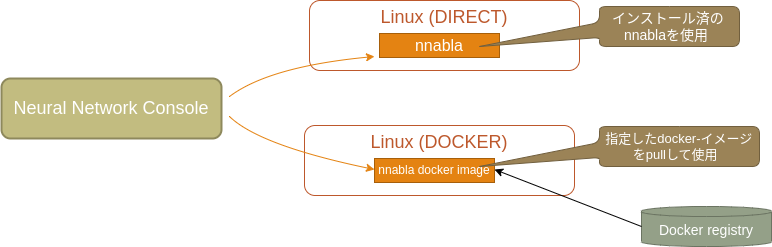
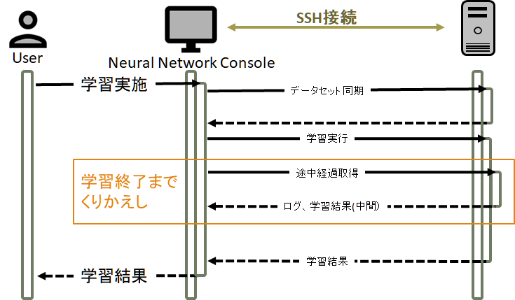
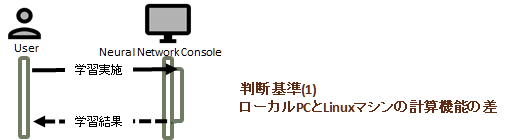
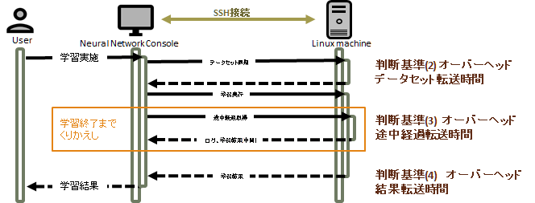
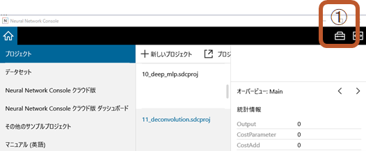
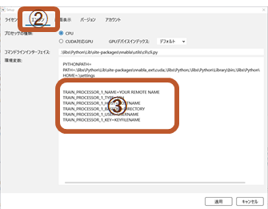
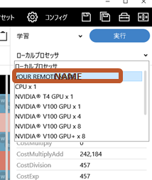

リモート学習機能
======================

リモート学習機能
----------------

「リモート学習」機能を利用することで、お手元のWindowsマシンにGPUが搭載されていなくても、GPUが搭載されているLinux環境があればそこに接続して学習を実行することが可能です。

「リモート学習」機能では、以下の接続方法を提供しています。

- :ref:`nnablaセットアップ済みのホストに接続してリモート学習を行うには <#REMOTE_DIRECT>`
- :ref:`dockerが使えるホストに接続してリモート学習を行うには <#REMOTE_DOCKER>`

リモート学習のしくみ
^^^^^^^^^^^^^^^^^^^^

リモート学習とは、Neural Network ConsoleからSSHで接続可能なLinuxマシン上で学習を実施する仕組みです。

学習開始時にPCにあるデータセットをLinuxマシンにコピーします。何度もおなじプロジェクトで学習を実施する場合には、データセットのコピーは一回だけ実施します。

その後、学習を実行して、途中経過を一定時間ごとにPCに転送しながら終了を待ちます。

学習が終了したら学習結果をPCに転送して終了となります。

.. warning::

    リモート学習中に |Console|  Windows版を終了するなどの学習停止操作を行うと、リモート学習も停止します。

    また、リモート学習中に |Console| を強制終了するなどすると、リモート学習は停止されることなく継続します。
    リモート学習を停止するには、リモートマシンにログインして手動で停止する必要があります。

リモート学習を利用するべきかどうか
""""""""""""""""""""""""""""""""""

リモート学習を用いると、ネットワークでつながっているLinuxマシンの計算能力を利用することができますが、デメリットもあります。 ここではリモート学習を利用するべきかどうか、判断するためのポイントについて説明します。

ローカルPCとLinuxマシンの性能差
'''''''''''''''''''''''''''''''

ローカルPCに十分高性能なGPUが搭載されている場合にはリモート学習を利用する理由はあまりありません。ただし、リモート学習では複数のGPUを使った学習を実施できますので、Linuxマシンに複数のGPUが搭載されているのであればリモート学習を実施する価値があります。

通信のオーバーヘッド
''''''''''''''''''''

リモート学習を実施する際には回線速度にもよりますが、いくつかのオーバヘッドがあります。

最初に学習を実施する際にデータセットをLinuxに転送しますので、データセットのサイズが巨大であれば数時間を要することがあります。

また、大きなネットワークであれば学習結果のパラメータ（NNPファイル）が数百MBになることも珍しくありません。その場合には学習結果の転送時間も無視できない要素となります。

リモートのLinuxマシンにGPUが搭載されており、ローカルPCにGPUが載っていないのであればほとんどすべての場合においてリモート学習は有効ですが、ローカルPCにGPUが搭載されている場合には、Linuxマシンに搭載されているGPUの性能とのバランスで判断するのがよいでしょう。

リモート学習の使用方法
^^^^^^^^^^^^^^^^^^^^^^

|Console| の設定
""""""""""""""""

以下のような形で設定を行います。

画面右上の設定ボタンを押下

「エンジン」をクリック
「環境変数」に設定を追加

設定内容は、「 `REMOTE_PROCESSOR` 」で始まる変数に値を設定することで行います。
設定に利用する文字列は、「 `REMOTE_PROCESSOR_N_変数名` 」という構成になっています。

    `REMOTE_PROCESSOR`
        リモート学習の設定であることを示す前置詞です。
    N
        半角数字の1~9です。9種類のリモート接続設定を保存することができます。
    変数名
        アルファベット大文字で始まり、大文字英数字とアンダーバーのみを含んだ文字列です。最後の文字は大文字英数字のみが許されます。

全てに共通な設定は以下の2つとなります。

- `REMOTE_PROCESSOR_N_NAME`
- `REMOTE_PROCESSOR_N_TYPE`

設定内容のエラー検出などは行っていません
十分に注意して設定を実施してください。

ここまでの設定に問題がなければ、学習実行時に以下のプロセッサ選択画面で利用するプロセッサを選択することができます。

評価のリモート実行について(実験段階)
""""""""""""""""""""""""""""""""""""

.. warning::

  この機能は実験段階です。

以下の環境変数を設定画面で設定しておくことで、評価をリモートで実行できます。

- `FORWARD_PROCESSOR_INDEX`

内部的には、学習およびプロファイル実行時にも `TRAIN_PROCESSOR_INDEX` と
いう環境変数を用いて学習先を選択していますが、この環境変数はGUIによっ
て上書きされますので、設定画面で設定しても意味はありません。

.. _#SSH_KEY:

SSH鍵について
"""""""""""""
`REMOTE_PROCESSOR_N_KEY` には、SSHの秘密鍵ファイルへの絶対PATH、もしくはファイルの内容を `\n` で連結した文字列を指定して下さい。

現在のところ、NNCとLinux環境の接続については、 パスフレーズ無しの秘密鍵認証 にのみ対応しております。

REMOTE_PROCESSOR_N_KEY に指定する秘密鍵ファイルを FILE 、Linuxホストを HOSTNAME とすると、

PoweShellウインドウもしくはコマンドプロンプトにて、

.. code-block:: bash

    ssh -i FILE HOSTNAME

というコマンドでパスワードなしでログインできることを確認してください。

.. _#REMOTE_DIRECT:

nnablaセットアップ済みのホストに接続してリモート学習を行うには
^^^^^^^^^^^^^^^^^^^^^^^^^^^^^^^^^^^^^^^^^^^^^^^^^^^^^^^^^^^^^^

DIRECT接続について
""""""""""""""""""

リモートマシンにインストール済みのnnablaを利用してリモート学習を実施します。

- リモートマシンに接続する際に用いるアカウントで「nnabla_cli」を実行します。
- リモートマシンにはあらかじめnnabla、nnabla_ext_cudaと対応するCUDA, cuDNNをインストールしておく必要があります。
- ローカルから実行するnnablaのバージョンを指定する方法はありません。
- ローカルのNeural Network Consoleに同梱されているnnablaと、リモートマシンにインストールしているnnablaのバージョンが異なる場合には期待した結果が得られない可能性があります。

.. warning::

  「DIRECT」の使用は積極的には推奨していません。dockerを利用できない特段の事情がなければ「DOCKER」の利用をお勧めします。

Linuxマシンの設定
"""""""""""""""""
以下の設定を行っておく必要があります。

- SSHで接続可能なアカウントを設定し、秘密鍵を手元に準備しておく

- GPUが一枚のみ搭載されている場合

    CUDA, cuDNNのインストール

    .. code-block:: bash

        sudo apt-key adv --fetch-keys http://developer.download.nvidia.com/compute/cuda/repos/ubuntu1804/x86_64/7fa2af80.pub
        wget http://developer.download.nvidia.com/compute/cuda/repos/ubuntu1804/x86_64/cuda-repo-ubuntu1804_10.2.89-1_amd64.deb
        sudo dpkg -i cuda-repo-ubuntu1804_10.2.89-1_amd64.deb
        rm cuda-repo-ubuntu1804_10.2.89-1_amd64.deb
        sudo apt update
        sudo apt install -y cuda-11-0 cuda-drivers
        echo "deb https://developer.download.nvidia.com/compute/machine-learning/repos/ubuntu1804/x86_64 /" | sudo tee /etc/apt/sources.list.d/nvidia-ml.list
        sudo apt update
        sudo apt install libcudnn8
        sudo reboot

- 複数のGPUが搭載されている場合

    シングルGPUのインストラクションに従ってCUDAのインストールを実施します。 それに加えて

    - NCCLのインストール

    .. code-block:: bash

        apt install -y libnccl2

    - openmpiのインストール

    .. code-block:: bash

        sudo apt install -y --no-install-recommends build-essential curl gfortran libibverbs-dev
        curl https://download.open-mpi.org/release/open-mpi/v3.1/openmpi-3.1.6.tar.bz2 -O
        tar xvf openmpi-3.1.6.tar.bz2
        cd openmpi-3.1.6
        ./configure --enable-orterun-prefix-by-default --with-sge CC=gcc CXX=g++ F77=gfortran FC=gfortran
        make -j8
        sudo make install
        sudo ldconfig

- nnablaのインストール

    - Pythonのインストール

    .. code-block:: bash

        sudo apt install -y python3.8 python3-pip
        sudo python3.8 -m pip install -U pip

    - nnablaのインストール(GPU1台の場合)

    .. code-block:: bash

        sudo pip install nnabla nnabla-ext-cuda110

    - nnablaのインストール(GPU複数の場合)

    .. code-block:: bash

        sudo pip install nnabla nnabla-ext-cuda110-nccl2-mpi3.1.6

NNCの設定内容
"""""""""""""

DOCKERで使用する設定項目は

    `REMOTE_PROCESSOR_N_NAME`
        設定名
    `REMOTE_PROCESSOR_N_TYPE`
        「DIRECT」を指定してください。
    `REMOTE_PROCESSOR_N_HOST`
        接続するホスト名を指定します。
    `REMOTE_PROCESSOR_N_BASEDIR`
        学習時に利用するディレクトリを指定します。データセットをコピーしますので十分に空き容量があるディレクトリを指定してください。
    `REMOTE_PROCESSOR_N_USER`
        接続に利用するユーザー名です
    `REMOTE_PROCESSOR_N_KEY`
        :ref:`SSH鍵について <#SSH_KEY>` を参照してください

となります。

注意事項
""""""""

リモートホストに複数のGPUが搭載されている場合には問答無用ですべてのGPUを利用して学習を実行します。利用するGPUを細かく指定したい場合にはDOCKERの使用を検討してください。

設定例
""""""

以下に設定例を示します。
適宜御自分の環境に合わせて変更の上ご利用下さい。

.. code-block::

    REMOTE_PROCESSOR_N_NAME=SSH on HOST
    REMOTE_PROCESSOR_N_TYPE=SSH
    REMOTE_PROCESSOR_N_HOST=HOSTNAME(or IP address)
    REMOTE_PROCESSOR_N_BASEDIR=/XXX/XXXX/XXX
    REMOTE_PROCESSOR_N_USER=USERNAME
    REMOTE_PROCESSOR_N_KEY=c:\Users\XXXXXXXX\.ssh\id_rsa

.. _#REMOTE_DOCKER:

dockerが使えるホストに接続してリモート学習を行うには
^^^^^^^^^^^^^^^^^^^^^^^^^^^^^^^^^^^^^^^^^^^^^^^^^^^^

リモートマシンのDocker環境で学習を実施します。

- 指定したDockerイメージをpullしてnnabla_cliを実行します。
- LinuxマシンにはnvidiaのGPUドライバとnvidia-docker2がインストールされている必要がありますが、nnablaやCUDA, cuDNN等は必要ありません。

Linuxマシンの準備
"""""""""""""""""

以下の設定を行っておく必要があります。

- SSHで接続可能なアカウントを設定し、秘密鍵を手元に準備しておく

以下の手順はUbuntu18.04を前提としています

- CUDAドライバのインストール

.. code-block:: bash

    sudo apt-key adv --fetch-keys http://developer.download.nvidia.com/compute/cuda/repos/ubuntu1804/x86_64/7fa2af80.pub
    wget http://developer.download.nvidia.com/compute/cuda/repos/ubuntu1804/x86_64/cuda-repo-ubuntu1804_10.2.89-1_amd64.deb
    sudo dpkg -i cuda-repo-ubuntu1804_10.2.89-1_amd64.deb
    rm cuda-repo-ubuntu1804_10.2.89-1_amd64.deb
    sudo apt update
    sudo apt install -y cuda-drivers
    sudo reboot

- nvidia-docker2のインストール

.. code-block:: bash

    curl https://get.docker.com | sh
    sudo systemctl start docker && sudo systemctl enable docker
    distribution=$(. /etc/os-release;echo $ID$VERSION_ID)
    curl -s -L https://nvidia.github.io/nvidia-docker/gpgkey | sudo apt-key add -
    curl -s -L https://nvidia.github.io/nvidia-docker/$distribution/nvidia-docker.list | sudo tee /etc/apt/sources.list.d/nvidia-docker.list
    sudo apt-get update
    sudo apt-get install -y nvidia-docker2
    sudo systemctl restart docker

- 利用するユーザーをdockerグループに参加させておく

.. code-block:: bash

    sudo usermod –aG docker $USER

NNCの設定内容
"""""""""""""

DOCKER接続で使用する設定項目は

    `REMOTE_PROCESSOR_N_NAME`
        設定名
    `REMOTE_PROCESSOR_N_TYPE`
        「DOCKER」を指定してください。
    `REMOTE_PROCESSOR_N_HOST`
        接続するホスト名を指定します。
    `REMOTE_PROCESSOR_N_BASEDIR`
        学習時に利用するディレクトリを指定します。データセットをコピーしますので十分に空き容量があるディレクトリを指定してください。
    `REMOTE_PROCESSOR_N_USER`
        接続に利用するユーザー名です
    `REMOTE_PROCESSOR_N_KEY`
        :ref:`SSH鍵について <#SSH_KEY>` を参照してください
    `REMOTE_PROCESSOR_N_GPUS_FOR_DOCKER`
        学習時に利用するGPUを指定します。nvidia-smiコマンドで表示されるGPUIDをカンマ区切りで指定します。指定しない場合には全GPUを利用します。
    `REMOTE_PROCESSOR_N_IMAGE`
        学習時に利用するdockerイメージを指定します。デフォルトで「nnabla/nnabla-ext-cuda-multi-gpu:latest」を指定していますので、最新のリリース版を利用する形となり、通常は指定しなくても問題ないはずです

となります。

設定例
""""""

- GPU id を指定して実行する(Single GPU)

    .. code-block:: bash

        REMOTE_PROCESSOR_N_NAME=Docker on HOST(GPU0)
        REMOTE_PROCESSOR_N_TYPE=DOCKER
        REMOTE_PROCESSOR_N_HOST=HOSTNAME(or IP address)
        REMOTE_PROCESSOR_N_BASEDIR=/XXX/XXXX/XXX
        REMOTE_PROCESSOR_N_USER=USERNAME
        REMOTE_PROCESSOR_N_KEY=c:\Users\XXXXXXXX\.ssh\id_rsa
        REMOTE_PROCESSOR_N_GPUS_FOR_DOCKER=0

- GPU id を指定して実行する(GPUを2つ利用する)

    .. code-block:: bash

        REMOTE_PROCESSOR_N_NAME=Docker on HOST(GPU0)
        REMOTE_PROCESSOR_N_TYPE=DOCKER
        REMOTE_PROCESSOR_N_HOST=HOSTNAME(or IP address)
        REMOTE_PROCESSOR_N_BASEDIR=/XXX/XXXX/XXX
        REMOTE_PROCESSOR_N_USER=USERNAME
        REMOTE_PROCESSOR_N_KEY=c:\Users\XXXXXXXX\.ssh\id_rsa
        REMOTE_PROCESSOR_N_GPUS_FOR_DOCKER=0,1

- GPU id を指定しない(ホストマシンにある全てのGPUを利用する)

    .. code-block:: bash

        REMOTE_PROCESSOR_N_NAME=Docker on HOST(ALL GPUS)
        REMOTE_PROCESSOR_N_TYPE=DOCKER
        REMOTE_PROCESSOR_N_HOST=HOSTNAME(or IP address)
        REMOTE_PROCESSOR_N_BASEDIR=/XXX/XXXX/XXX
        REMOTE_PROCESSOR_N_USER=USERNAME
        REMOTE_PROCESSOR_N_KEY=c:\Users\XXXXXXXX\.ssh\id_rsa
